# DSX01 S01 alias aware polynomial tracklet study

## Motivation

The first DSX01 scan contains clear GLRT carrier frequency offset curves across
eight channels and two receivers. An association method should recover those
curves with a small number of polynomial pieces, respect the CFO alias period,
and retain unresolved measurements in its accounting. The immediate objective
is broad, auditable curve association; tracklets here are receiver/channel
segments, not unique spacecraft.

## Problem

Several discovery algorithms can agree closely and still miss the same visible
curves. Discovery seeds, support floors and complexity penalties can exclude a
valid sparse quadratic before a degree-four fitter ever sees it. Conversely,
high association counts and small fitted residuals can result from short
fragments, selection effects or excessive flexibility. Counts therefore need
to be reported alongside polynomial complexity, residual structure, support,
negative controls and runtime.

## Solution

Four discovery approaches were implemented: wrapped mixture EM, graph paths,
wrapped Hough voting, and a Kalman beam approximation to multiple hypothesis
tracking. A polynomial RANSAC method supplies a fifth, reference result.
All use the same frozen observations and common polynomial output checks.

After 49 tuning configurations and an append-only residual recovery study,
Kalman/MHT associates **4,513 of 4,797 observations, or 94.08%, in 160
tracklets**. Its mean track contains **28.21 points** over **24.22 seconds**.
These final counts include the explicitly labeled sparse-support trial and
provisional short tracks. EM retains the largest supported, structure-free
point set in this study, **3,522 points**. Graph was the fastest measured
primary fitter on one desktop CPU core, with a median **1.17 seconds** for
all 16 lanes; the corresponding embedded CPU ranking remains an inference.

The final reader table and plots are collected in the
[latest plot gallery](../2026_10_17_dsx01_residual_review/track-plots/review.html).
For GitHub readers, the PNG links below work directly; HTML galleries can also
be opened from a local checkout. Every saved figure, PDF variant and exported
table is indexed in [ASSETS.md](ASSETS.md).

## Method

This is an exploratory, descriptive study published on 17 October 2026. The
analysis used only existing local observation exports. No new RF collection,
QNAP mutation, localization fit or RF-dependent calibration coefficient was
used. The numerical modules are research components; this publication does
not wire them into the production recording or analysis pipeline.

The sequence was: compare independent discovery implementations; inspect
prediction sensitivity; fit all observations and tune against common residual
diagnostics; compare selected assignments and grouping; benchmark the selected
primary fitters; inspect visible leftovers; add bounded residual recovery;
then independently recompute RMS and summary statistics for every final
tracklet. The stages below retain their own configurations and figures.

## Frozen input and units

| Property | Value |
| --- | --- |
| Dataset and selected source | DSX01, first scan, source `S01` |
| Recording | `fast8-auto-20261016-161535-99008d35-1-lower` |
| First-sample time estimate | 2026-10-16 16:15:42.609910 UTC, or 09:15:42.609910 PDT |
| Scan extent | Approximately 300 seconds |
| Observations in every headline denominator | 4,797 winning GLRT observations |
| Lanes | RX1 and RX2, each with CH1 through CH8; 16 lanes |
| Time coordinate | Seconds since the first-sample estimate |
| Frequency coordinate | Exported measured GLRT CFO in Hz; plots usually display kHz |
| Alias period | `1 / 4.4e-6 = 227272.72727272726 Hz` |
| Noise scale used in fitting and gates | Fixed `150 Hz` |
| Final association gate | Absolute circular residual below `450 Hz` |

The input loader verifies the byte counts and SHA256 bindings in the
[frozen input manifest](../2026_10_16_dsx01_fast_association_losses/manifest.json),
selects all S01 rows, and strips the original association labels before fitting.
It checks unique observation IDs, finite time/CFO values, all 16 lanes and the
4,797-row count. The source bundle also contains other scans for historical
context; they do not enter this study's denominators.

| Frozen file | SHA256 without prefix |
| --- | --- |
| `manifest.json` | `a7a81958f1aef17e3d958ee308965759829ea9b43f65d0ba54cc0c98d43d099a` |
| `context-observations.jsonl` | `ddf587ed93815f911ddaf7cc0984a6df5b70ea8f8906944dae67a919418e781b` |
| `sources.json` | `44f40dcc8cb7e918ec60b50e501b8f4d44b030596adc14ec4fab96d7900c293b` |

The [publication manifest](evidence-manifest.json) binds the included evidence
files and numerical module sources. Original experiment provenance remains
inside each JSON result. Original full-data memberships are never used to
score the historical full-discovery holdout experiment.

## Statistical model and polynomial constraints

For observation `i`, the lifted measurement is `y_i + k_i A`, where `A` is
the alias period and `k_i` is an integer. A polynomial predicts that lifted
frequency. Membership is decided using the circular residual
`wrap(y_i - p(t_i), A)`; the exported residual is the equivalent lifted
measurement minus prediction. A track's absolute alias gauge is arbitrary.

Polynomials use a scaled time coordinate and a Legendre basis for numerical
conditioning. Degrees zero through four compete on the same candidate support.
For an individual piece the polynomial comparison contains

```text
sum((residual_hz / 150)^2) + (degree + 1) * log(number_of_points).
```

Track creation adds a positive track penalty. Piecewise fits additionally pay
a positive breakpoint penalty and account for the reduced free coefficient
count under equality constraints. Unassigned measurements retain a fixed
clutter cost of `3^2 = 9` in the shared polynomial selection objective. EM's
mixture likelihood is a separate discovery objective; the common final gate
and output constraints still apply to its tracks.

The original support policy requires
`n >= max(8, 4 * (degree + 1))`, a span of at least six seconds and a largest
within-piece gap of at most ten seconds. The sparse-support recovery trial
changes only the coefficient ratio to two while retaining the eight-point
floor and the other bounds. Degree four therefore still requires ten points
under that trial. Degree and positive complexity costs remain active.

Piecewise repairs are bounded to at most two pieces and enforce exact shared
value and first derivative at an accepted join, namely C1 continuity. Slopes
are checked at every derivative extremum over observed support, including
interior extrema of quartic fits. Separate tracklets may have distinct
frequencies; continuity does not force a real frequency step into one curve.
Maximum observed gaps are constrained, while a plotted curve across a gap is
an interpolation of the model, not an observation of intervening RF activity.

Every emitted result is independently audited for exclusive observation
ownership, original-index mapping, integer alias lifts, degree, support,
span, gaps, the final residual gate, analytic slope bounds, RMS consistency
and C1 joins.

## Discovery approaches and literature

The literature motivates algorithm families; the implementations below are
bounded adaptations for this observation geometry, rather than claims to
reproduce an exact global optimum from those papers.

| Approach | Implemented discovery | Bounds and distinctions |
| --- | --- | --- |
| Wrapped EM | Local randomized hypotheses initialize Gaussian polynomial components plus uniform clutter. The E step evaluates neighboring alias branches; weighted polynomial regressions form the M step. Birth, deletion and merge proposals compete under a penalized objective. | Fixed noise and component/clutter amplitudes; up to eight iterations per EM phase. Finite hypotheses and local search can fragment curves. |
| Graph paths | Observations form a time-ordered directed acyclic graph; edge states carry alias-resolved velocities. A second-order recurrence favors consistent consecutive velocities. | At most 48 candidate predecessors per observation. Dynamic programming searches paths under the current additive costs; repeated exclusive packing and later polynomial compression are greedy. This is not a global min-cost-flow solver. |
| Wrapped Hough | Circular frequency/slope voting in overlapping 12, 24 and 48 second windows proposes ridges, followed by polynomial growth and competition. | Finite slope grids, peak suppression and an uncovered-point voting pass. A linear voting seed can miss a sparse curved fragment. |
| Kalman/MHT | Bidirectional pair seeds grow Kalman frequency, slope and curvature states, branching over aliases, measurements and missed observations. | Beam width three, at most 128 seeds per direction and a 120 second growth horizon. This is a bounded beam approximation, not full global MHT inference. |
| RANSAC reference | Local wrapped line hypotheses seed polynomial growth, penalized selection, ownership competition and optional C1 joining. | Finite seed and proposal budgets. Allowing degree four after seeding does not guarantee that a curved candidate is discovered. |

EM follows the latent-assignment estimation principle introduced by
[Dempster, Laird and Rubin, 1977](https://doi.org/10.1111/j.2517-6161.1977.tb01600.x).
The reference search draws on robust consensus fitting in
[Fischler and Bolles, 1981](https://doi.org/10.1145/358669.358692), while
frequency/slope voting follows the parameter-space accumulation idea in
[Duda and Hart, 1972](https://doi.org/10.1145/361237.361242).

The branching interpretation of ambiguous observations is motivated by
[Reid, 1979](https://doi.org/10.1109/TAC.1979.1102177). The polynomial dimension
penalty is BIC-like, with the dimension-versus-fit motivation in
[Schwarz, 1978](https://doi.org/10.1214/aos/1176344136); finite search and
membership selection mean this experiment is not an application of a
large-sample consistency theorem.

For a future extension with more polynomial pieces,
[Killick, Fearnhead and Eckley, 2012](https://arxiv.org/abs/1101.1438)
provides a useful reference for penalized changepoint optimization. Its
additive segment-cost setting does not directly solve the present mixture
assignment and alias problem with shared derivative constraints. That
extension was not implemented or benchmarked here.

## Residual criteria and support categories

All observations participate in the primary full-data fits. Hyperparameter
ranking uses the same full-data residual diagnostics for every method:

| Check | Flag condition |
| --- | --- |
| Mean | `abs(mean) * sqrt(n) / 150 > 3.5` |
| Local means | Largest absolute equal-count-bin standardized mean exceeds `3.5` |
| Cumulative residual bridge | Maximum centered cumulative residual divided by `150 * sqrt(n)` exceeds `1.6` |
| Adjacent residual correlation | Absolute correlation exceeds `max(0.35, 2.5 / sqrt(n))` |
| Residual sign runs | Absolute standardized runs statistic exceeds `3.5` |
| Residual mean step | Largest standardized difference of means across eligible splits exceeds `4` |

At most five bins are used. Split tests leave at least five observations or
ten percent of the piece on each side, whichever is larger. The diagnostics
also record within-bin spreads, but do not hard-reject varying noise variance.
Correlation is in adjacent observation order; sample spacing is irregular.
These thresholds are descriptive effect-size checks, not calibrated joint
significance tests after model search.

A track is **structure flagged** if any piece has a flag. With no flag it is
**insufficient support** if any piece has fewer than 20 points; otherwise it
is **no structure detected**. This last category is called "supported" in the
tables. Neither mean-zero residuals nor a small RMS proves white noise:
least-squares fitting itself removes low-order moments, memberships are
selected by residual size, and short tracks offer weak diagnostic power.

The tuning rank first maximizes supported points with no detected structure,
then total associated points, then minimizes flagged points, track count and
pooled RMS. It does not maximize raw coverage alone. Legacy discovery/repair
code also retains a conditional blocked coefficient-prediction diagnostic.
That internal check holds discovered membership fixed; it is not independent
validation of discovery. No observations are permanently excluded from the
reported full-data fits.

## Initial comparison and 49 configuration search

The initial comparison held the major constraints fixed, including the
8,000 Hz/s slope bound and track/breakpoint penalties of 18/10.

<!-- table:initial-comparison -->

| Method | Tracks | Pieces | Associated | Associated % | Unassociated |
| --- | --- | --- | --- | --- | --- |
| RANSAC reference | 147 | 147 | 4344 | 90.56 | 453 |
| EM | 196 | 196 | 4354 | 90.77 | 443 |
| Graph | 155 | 155 | 4304 | 89.72 | 493 |
| Hough | 154 | 154 | 4414 | 92.02 | 383 |
| Kalman/MHT | 149 | 150 | 4411 | 91.95 | 386 |

<!-- /table:initial-comparison -->

Source: [initial summary JSON](../2026_10_17_dsx01_four_methods/summary.json).
Historical quality labels in that bundle use the earlier conditional
diagnostic policy; they must not be directly compared with the later
full-data-only category counts as if the definitions were unchanged.

The subsequent search evaluated 12 EM, 12 Graph, eight Hough, nine MHT and
eight reference configurations. Noise remained 150 Hz and the final gate
450 Hz. Tested changes included slope limits, positive complexity penalties,
degree three versus four, maximum gap, and seed. This is a bounded
development search on an inspected scan, not a proof of globally optimal
hyperparameters. The complete 49-row table is available as
[CSV](tables/all-tuning-trials.csv) and [Markdown](tables/all-tuning-trials.md).

<!-- table:tuned-selection -->

| Method | Trials | Slope bound Hz/s | Track penalty | Knot penalty | Seed | Tracks | Associated | Supported no structure |
| --- | --- | --- | --- | --- | --- | --- | --- | --- |
| EM | 12 | 8000 | 64 | 10.0 | 1701 | 154 | 4430 | 3522 |
| Graph | 12 | 8000 | 18.0 | 10.0 | 1701 | 155 | 4304 | 3291 |
| Hough | 8 | 12000.0 | 10.0 | 5.0 | 1701 | 155 | 4418 | 3352 |
| Kalman/MHT | 9 | 12000 | 18.0 | 10.0 | 1701 | 152 | 4440 | 3393 |
| RANSAC reference | 8 | 8000.0 | 18.0 | 10.0 | 1702 | 147 | 4345 | 3351 |

<!-- /table:tuned-selection -->

Sources: each method's `search.json` and `selected.json` in the
[full-data tuning bundle](../2026_10_17_dsx01_full_data_tuning/).
The common configuration retains maximum degree four, minimum eight points,
four points per coefficient, six-second minimum span and ten-second maximum
gap. The reference's selected seed is 1702; other selected seeds are 1701.

EM's track penalty increased from 18 to 64. This reduced competing fragments
and raised its supported coverage to 3,522 points. Penalty 48 achieved the
largest raw EM association count, **4,469**, but only **3,471** supported
points, so the declared ranking selects penalty 64 and 4,430 total points.
Hough selected track/knot penalties 10/5 and a 12,000 Hz/s slope bound. MHT
also selected 12,000 Hz/s, adding short-track points without improving its
supported coverage. Graph retained its original selected settings.

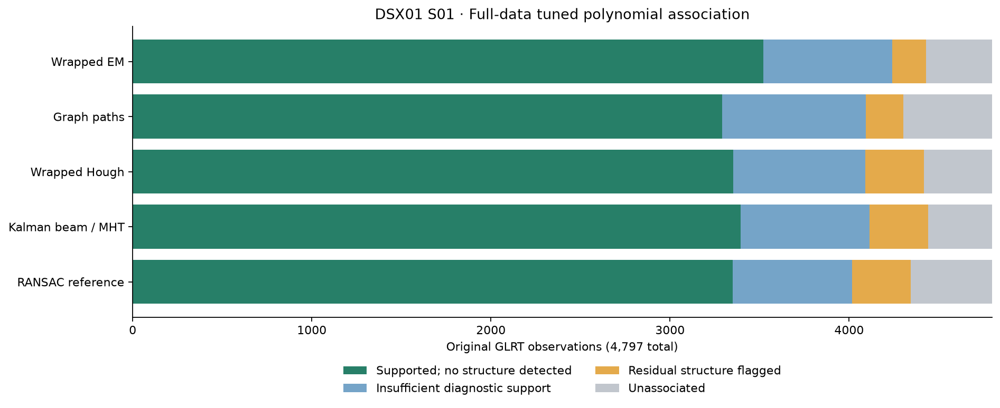

*DSX01 S01, all 4,797 observations for each method. Bars count fitted points
by full-data residual/support category and retain unresolved points. This
figure precedes residual recovery and does not measure satellite identity.*

## Pairwise agreement before residual recovery

Comparison aligns original observation IDs and treats track numbers as local
labels. Associated-point overlap is intersection divided by union. Grouping
agreement is the F1 score of unordered pairs placed in the same track,
restricted to observations associated by both methods. Receiver/channel is
part of every track label, and unresolved points never form a common cluster.
This avoids label-permutation errors and high agreement from counting the
many pairs in different tracks.

<!-- table:pairwise-comparison -->

| Method A | Method B | Both associated | Only A | Only B | Point overlap % | Grouping F1 % | Supported overlap % | Curve difference RMS Hz |
| --- | --- | --- | --- | --- | --- | --- | --- | --- |
| EM | Graph | 4271 | 159 | 33 | 95.70 | 95.81 | 90.04 | 37.96 |
| EM | Hough | 4388 | 42 | 30 | 98.39 | 95.38 | 95.17 | 27.95 |
| EM | Kalman/MHT | 4398 | 32 | 42 | 98.35 | 96.82 | 95.84 | 25.56 |
| EM | RANSAC reference | 4316 | 114 | 29 | 96.79 | 95.26 | 95.14 | 28.04 |
| Graph | Hough | 4255 | 49 | 163 | 95.25 | 96.41 | 91.50 | 39.91 |
| Graph | Kalman/MHT | 4267 | 37 | 173 | 95.31 | 96.36 | 91.30 | 40.62 |
| Graph | RANSAC reference | 4200 | 104 | 145 | 94.40 | 97.01 | 91.47 | 41.71 |
| Hough | Kalman/MHT | 4381 | 37 | 59 | 97.86 | 97.20 | 98.73 | 23.71 |
| Hough | RANSAC reference | 4337 | 81 | 8 | 97.99 | 98.18 | 99.97 | 16.31 |
| Kalman/MHT | RANSAC reference | 4335 | 105 | 10 | 97.42 | 98.29 | 98.76 | 19.20 |

<!-- /table:pairwise-comparison -->

Sources: [complete pairwise JSON](../2026_10_17_dsx01_full_data_tuning/pairwise/comparison.json),
[per-lane CSV](../2026_10_17_dsx01_full_data_tuning/pairwise/per-lane.csv) and
[point consensus CSV](../2026_10_17_dsx01_full_data_tuning/pairwise/point-consensus.csv).
Curve differences compare predictions on common observations modulo the
alias period, not polynomial coefficients in different gauges.

Across the four new methods, 4,217 points are associated by all, 311 are
unassociated by all and 269 have disputed association status. Including the
reference, the associated intersection is 4,173 and the union 4,486. The
five-method supported intersection is 3,173 and supported union 3,593.
EM's supported set contains all supported Hough and reference points and
3,384 of MHT's 3,393 supported points. No relative-alias inconsistencies were
found within the overlapping track-pair cells used in this comparison.

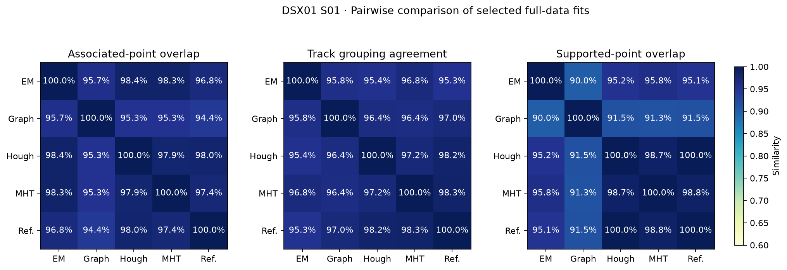

*DSX01 S01 selected full-data fits before recovery. Matrices show associated
set overlap, common-observation grouping F1 and supported set overlap. Values
are fractions displayed as percentages. Shared polynomial finalization and
support policies mean this agreement is not independent confirmation.*

Global agreement hides local segmentation differences. For RX1 CH3,
Graph–MHT grouping F1 is **73.49%**, EM–MHT is **80.47%**, while Hough–MHT is
**98.92%**. The subsequent visual review found coherent curves missed by
multiple methods. Agreement therefore supports a common core of curves but
does not establish completeness of discovery.

## Review of unassociated curves

Visual inspection identified sparse curved sequences that were excluded by
the common support policy. Allowing a fourth-order fit after a linear seed
does not recover a candidate that never has enough linear inliers to enter
the fitter. Separately, eight or ten observations cannot satisfy the original
12-observation requirement for a quadratic, regardless of fit quality.

<!-- table:reviewed-fragments -->

| Lane | Points | Span s | Quadratic RMS Hz | Maximum residual Hz | Required by old floor |
| --- | --- | --- | --- | --- | --- |
| RX1 CH7 | 8 | 15.61 | 81.94 | 181.53 | 12 |
| RX2 CH4 | 10 | 25.54 | 107.82 | 287.37 | 12 |
| RX2 CH7 | 11 | 25.20 | 60.82 | 120.85 | 12 |

<!-- /table:reviewed-fragments -->

The first two sequences were entirely unassociated by all five selected
methods. The RX2 CH7 sequence was entirely missed by EM and Graph; the other
methods associated eight of its eleven points. These are visually selected
diagnostic examples, not blind test cases. The
[fragment export](../2026_10_17_dsx01_residual_review/reviewed-fragments.json)
contains the time/CFO values, observation IDs, coefficients and diagnostics.

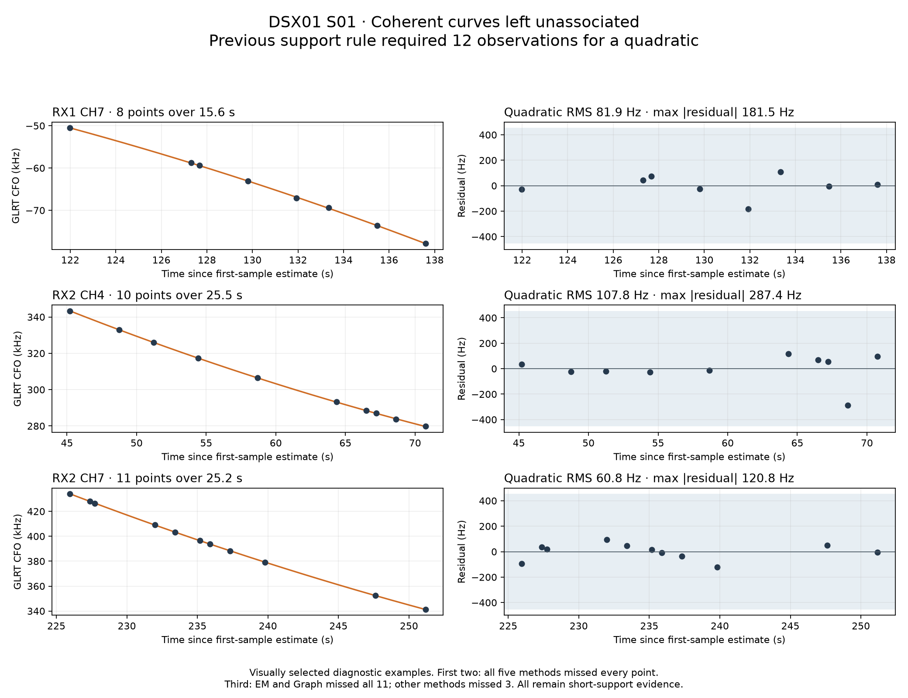

*DSX01 S01, three reviewed sequences. Left: measured CFO in kHz and fitted
quadratic. Right: fitted residual in Hz with the ±450 Hz gate shaded.
The short support prevents a strong whiteness claim even though these curves
are coherent and their residuals fit inside the existing gate.*

The fixed EM penalty also matters. For the eight-point RX1 CH7 quadratic,
the shared polynomial association gain is approximately 69.61, versus a
penalty of `64 + 3*log(8) = 70.24`. Thus changing the support ratio alone
does not make this candidate pass the selected EM complexity threshold.
The recovery study retained each method's penalty rather than silently
lowering it to collect a visually selected example.

## Append only residual recovery

The bounded recovery pipeline freezes every existing track's membership,
coefficients, alias lifts and residuals, then:

1. Runs the same selected method on its unassociated observations.
2. Runs direct quadratic-triple seeding on the remaining observations with
   the original support policy.
3. In a separate sparse-support trial, runs that quadratic discovery again
   with two points per coefficient, still requiring at least eight points.

Quadratic seeds are sampled deterministically in overlapping 12, 24 and
48 second windows, with a budget of 1,024 triples per window. Allowed alias
branches and seed slopes are bounded before residual voting. Refitting still
selects polynomial degree with the existing penalty. Original noise scale,
450 Hz gate, span, gaps, slope bounds, positive penalties and output audits
remain active. New tracks with detected full-data residual structure are
rejected; short unflagged additions remain provisional.

<!-- table:residual-recovery -->

| Method | Before recovery | Original support | Sparse support | Added strict | Added sparse total |
| --- | --- | --- | --- | --- | --- |
| EM | 4430 | 4447 | 4487 | 17 | 57 |
| Graph | 4304 | 4452 | 4487 | 148 | 183 |
| Hough | 4418 | 4464 | 4499 | 46 | 81 |
| Kalman/MHT | 4440 | 4478 | 4513 | 38 | 73 |
| RANSAC reference | 4345 | 4461 | 4496 | 116 | 151 |

<!-- /table:residual-recovery -->

Sources: [recovery comparison CSV](../2026_10_17_dsx01_residual_review/comparison.csv)
and [recovery summary JSON](../2026_10_17_dsx01_residual_review/summary.json).
"Original support" includes stages one and two. "Sparse support" includes
all three stages and is the source of the final figures and reader table.
The recovery is a common postprocessor, so the final methods are hybrids
with that postprocessor rather than newly independent discovery algorithms.

The same-method residual-only rerun itself recovered 120 Graph points,
78 reference points, eight Hough points, 29 MHT points and zero EM points.
This directly demonstrates search incompleteness with unchanged settings.
Most additional quadratic-seed recoveries are short fragments. Graph alone
adds 61 points to the adequately supported category; the other supported
point counts are unchanged by this recovery stage.

## Final association and track length table

<!-- table:latest-results -->

| Method | Associated | Associated % | Tracks | Mean points/track | Mean duration s | Unassociated |
| --- | --- | --- | --- | --- | --- | --- |
| EM | 4487 | 93.54 | 160 | 28.04 | 25.02 | 310 |
| Graph | 4487 | 93.54 | 170 | 26.39 | 23.84 | 310 |
| Hough | 4499 | 93.79 | 163 | 27.60 | 23.98 | 298 |
| Kalman/MHT | 4513 | 94.08 | 160 | 28.21 | 24.22 | 284 |
| RANSAC reference | 4496 | 93.73 | 162 | 27.75 | 23.78 | 301 |

<!-- /table:latest-results -->

Sources: [machine-readable summary](../2026_10_17_dsx01_residual_review/track-plots/method-summary.csv)
and [all 815 per-track records](../2026_10_17_dsx01_residual_review/track-plots/all-track-rms.csv).
Association percentage uses all 4,797 original observations. Mean points per
track is associated points divided by track count. Mean duration is the
unweighted mean of last observation time minus first observation time within
each track. Durations can include allowed gaps, overlap across tracks, and
overlap across receivers/channels. Counts include flagged and provisional
tracks as shown separately below.

<!-- table:latest-quality -->

| Method | Supported tracks | Supported points | Flagged tracks | Flagged points | Short tracks | Short points |
| --- | --- | --- | --- | --- | --- | --- |
| EM | 101 | 3522 | 5 | 190 | 54 | 775 |
| Graph | 98 | 3352 | 6 | 210 | 66 | 925 |
| Hough | 97 | 3352 | 7 | 327 | 59 | 820 |
| Kalman/MHT | 96 | 3393 | 7 | 327 | 57 | 793 |
| RANSAC reference | 96 | 3351 | 7 | 327 | 59 | 818 |

<!-- /table:latest-quality -->

Low RMS and high coverage must be interpreted alongside these categories.
The largest final raw coverage belongs to Kalman/MHT, while EM has the
largest supported point set. The latest figures reuse the same track IDs
and colors between GLRT and RMS panels within each method and lane.

| Method | GLRT colored by track | Unassociated GLRT | RMS of every track | Per-track table |
| --- | --- | --- | --- | --- |
| EM | [PNG](../2026_10_17_dsx01_residual_review/track-plots/em/associations.png) | [PNG](../2026_10_17_dsx01_residual_review/track-plots/em/unassociated.png) | [PNG](../2026_10_17_dsx01_residual_review/track-plots/em/track-rms.png) | [CSV](../2026_10_17_dsx01_residual_review/track-plots/em/track-rms.csv) |
| Graph | [PNG](../2026_10_17_dsx01_residual_review/track-plots/graph/associations.png) | [PNG](../2026_10_17_dsx01_residual_review/track-plots/graph/unassociated.png) | [PNG](../2026_10_17_dsx01_residual_review/track-plots/graph/track-rms.png) | [CSV](../2026_10_17_dsx01_residual_review/track-plots/graph/track-rms.csv) |
| Hough | [PNG](../2026_10_17_dsx01_residual_review/track-plots/hough/associations.png) | [PNG](../2026_10_17_dsx01_residual_review/track-plots/hough/unassociated.png) | [PNG](../2026_10_17_dsx01_residual_review/track-plots/hough/track-rms.png) | [CSV](../2026_10_17_dsx01_residual_review/track-plots/hough/track-rms.csv) |
| Kalman/MHT | [PNG](../2026_10_17_dsx01_residual_review/track-plots/mht/associations.png) | [PNG](../2026_10_17_dsx01_residual_review/track-plots/mht/unassociated.png) | [PNG](../2026_10_17_dsx01_residual_review/track-plots/mht/track-rms.png) | [CSV](../2026_10_17_dsx01_residual_review/track-plots/mht/track-rms.csv) |
| RANSAC reference | [PNG](../2026_10_17_dsx01_residual_review/track-plots/baseline/associations.png) | [PNG](../2026_10_17_dsx01_residual_review/track-plots/baseline/unassociated.png) | [PNG](../2026_10_17_dsx01_residual_review/track-plots/baseline/track-rms.png) | [CSV](../2026_10_17_dsx01_residual_review/track-plots/baseline/track-rms.csv) |

### EM final figures

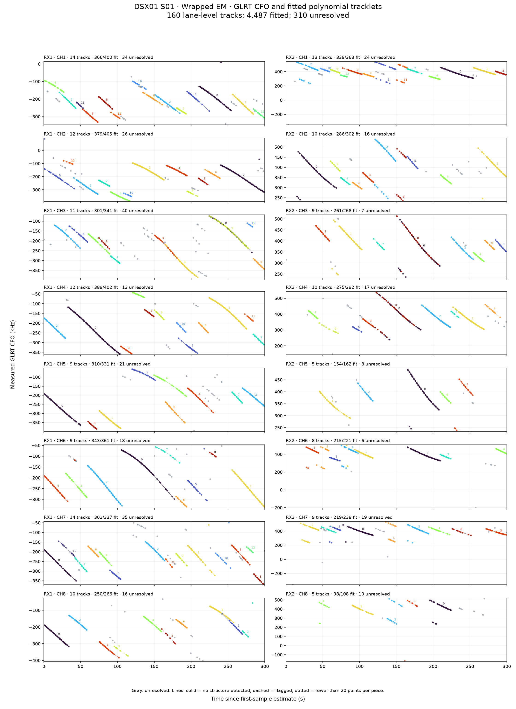

*S01, 4,487/4,797 points associated in 160 lane-level tracks after recovery.
GLRT CFO is in kHz versus time in seconds. Gray marks the 310 unresolved
points; line style distinguishes supported, flagged and short fits.*

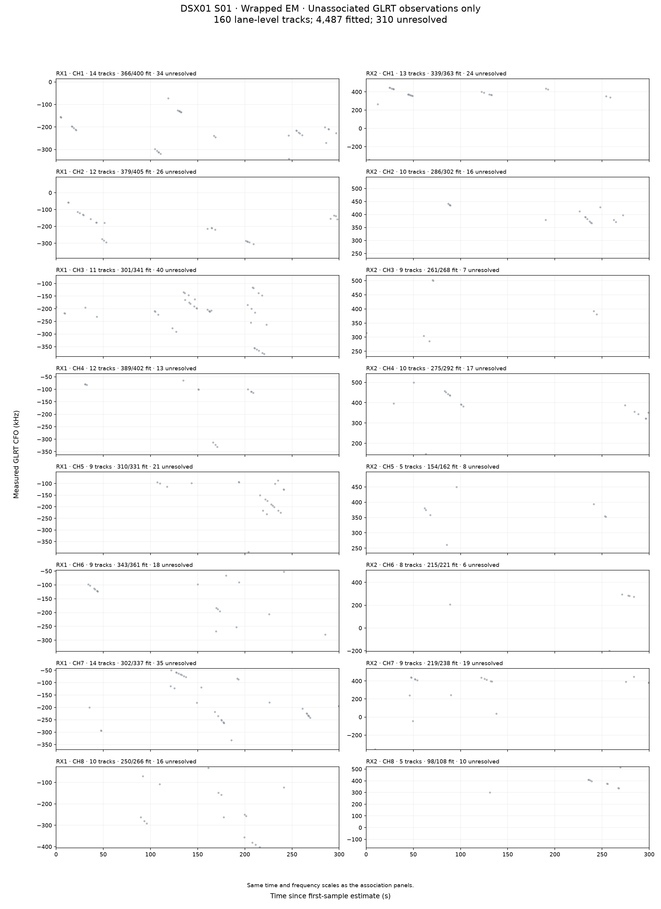

*S01, the 310 EM points still unassociated, using the full lane frequency/time
scales. Visible remaining fragments are not automatically classified as noise.*

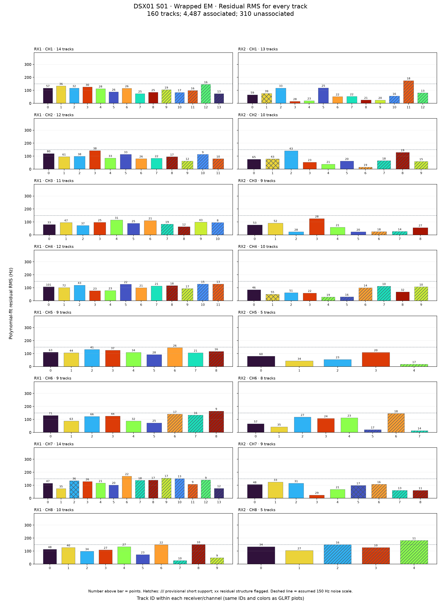

*S01, in-sample residual RMS in Hz for all 160 EM tracks. Bar colors and IDs
match the GLRT panels. Numbers show point counts; hatches distinguish short
support and residual flags. The dashed 150 Hz line is an assumed noise scale.*

### Graph final figures

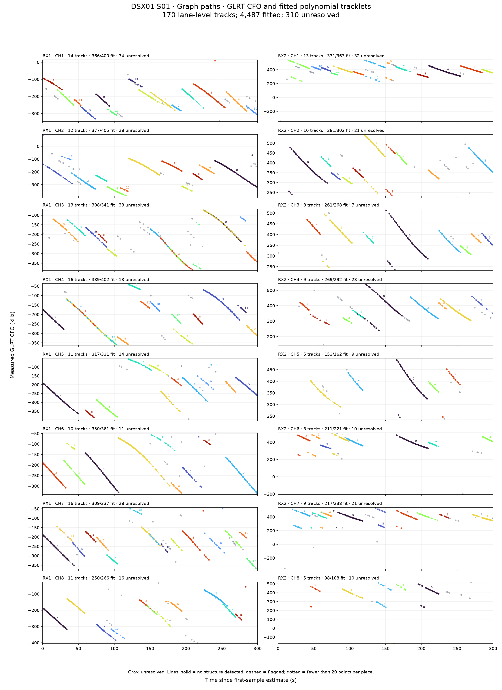

*S01, 4,487/4,797 points associated in 170 lane-level tracks after recovery.
Measured CFO is in kHz versus seconds, with gray unresolved observations and
polynomial overlays; colors are local to this method and lane.*

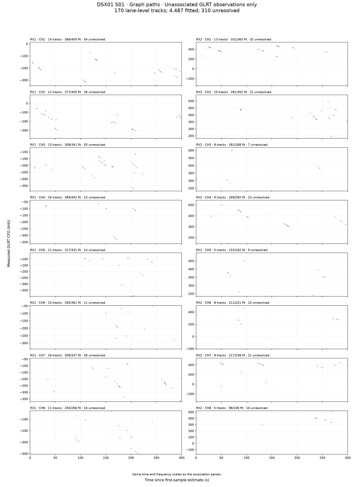

*S01, 310 Graph leftovers on the same raw-CFO/time scales. Exclusion can reflect
support, complexity or finite discovery budgets, not only measurement noise.*

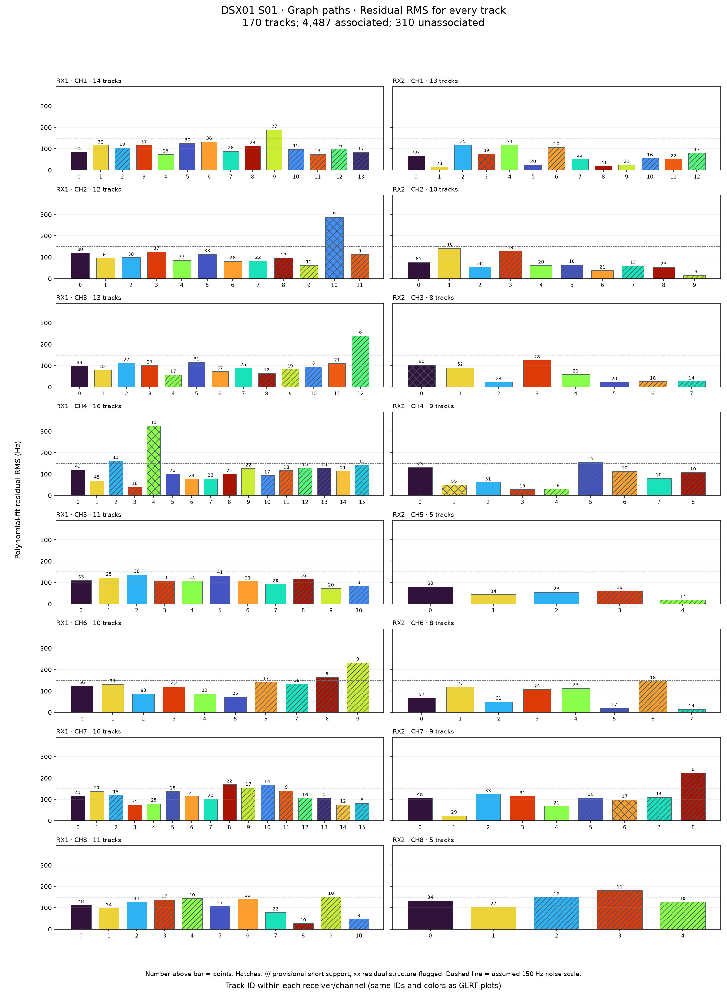

*S01, residual RMS in Hz for all 170 Graph tracks, with per-track point counts
and quality hatches. RMS values are independently recomputed from exported
memberships and do not establish correct emitter identity.*

### Hough final figures

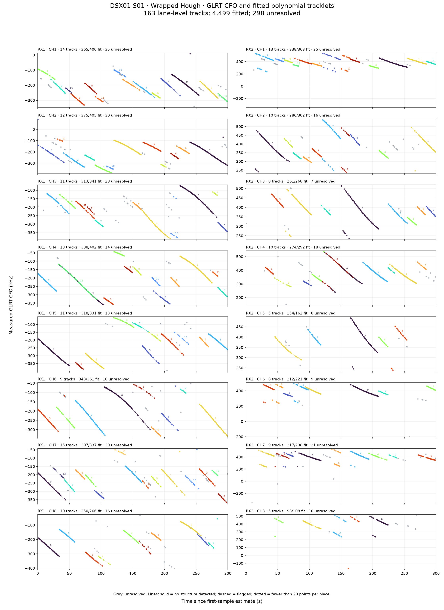

*S01, 4,499/4,797 points associated in 163 lane-level tracks after recovery.
GLRT CFO in kHz versus seconds; gray points remain outside the association
set. The postprocessor includes the explicitly labeled support relaxation.*


*S01, 298 Hough leftovers on the full lane frequency/time scales. Short
sequences remain candidates rather than proven clutter.*

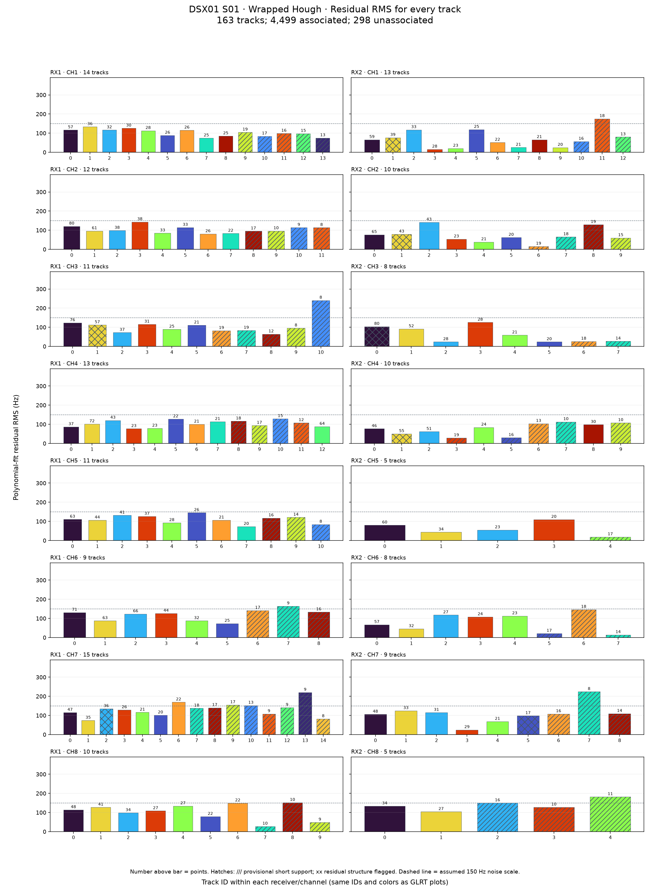

*S01, residual RMS in Hz for all 163 Hough tracks. Track IDs and colors match
the GLRT panels; counts and hatches retain support/quality distinctions.*

### Kalman and MHT final figures

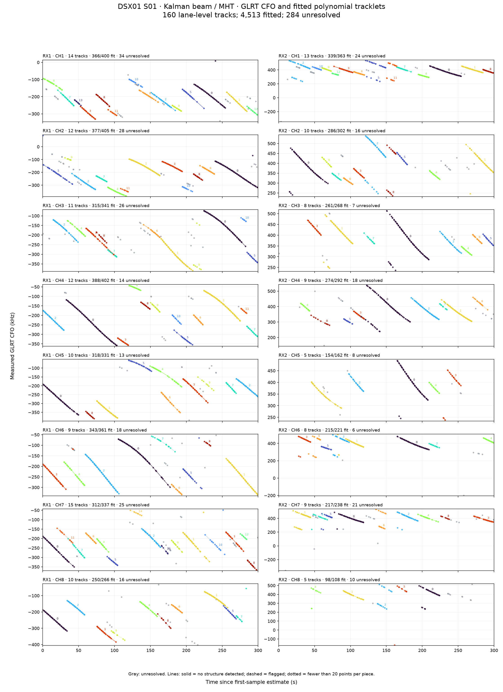

*S01, 4,513/4,797 points associated in 160 lane-level tracks after recovery.
Measured CFO in kHz versus seconds, with fitted curves and 284 gray leftovers.
This is the highest raw final coverage, including provisional tracks.*

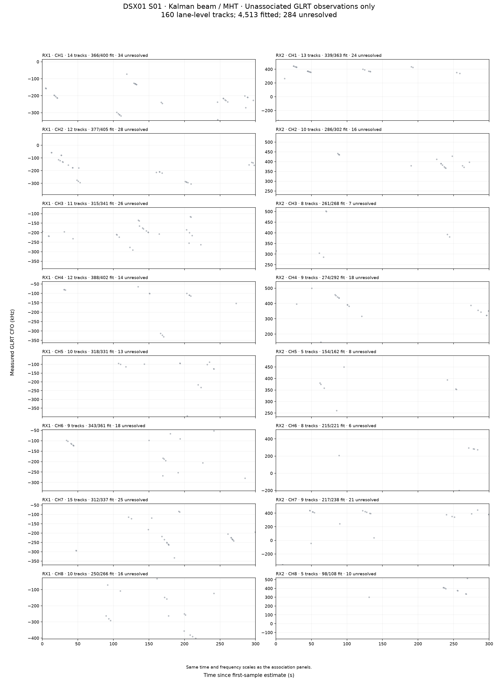

*S01, 284 MHT leftovers. These are observed GLRT measurements, with no model
drawn through unsupported intervals or unresolved memberships.*

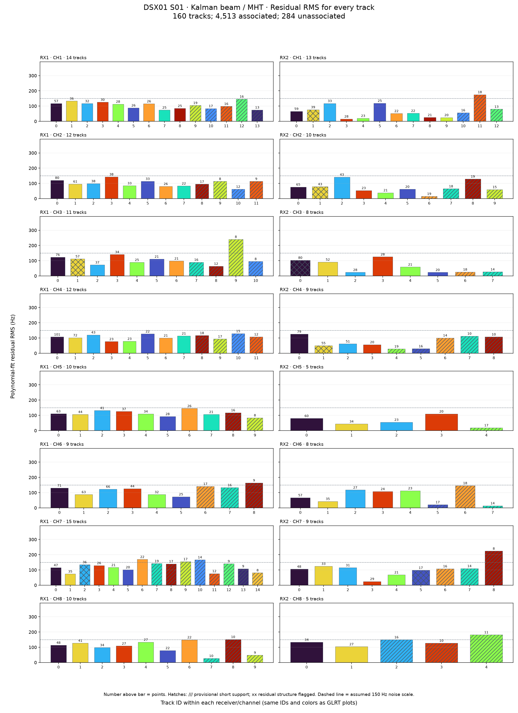

*S01, residual RMS in Hz for all 160 MHT tracks. Point counts, short-support
hatches and structure flags qualify the interpretation of each fitted RMS.*

### RANSAC reference final figures

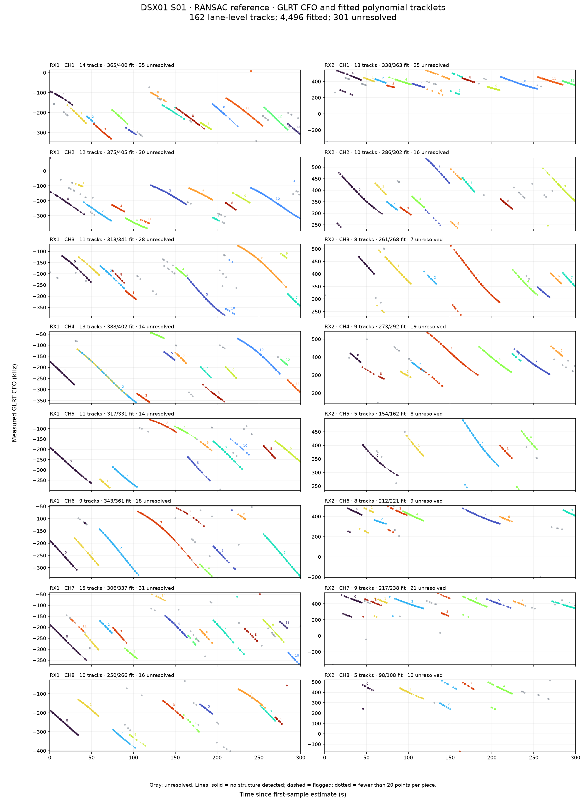

*S01, 4,496/4,797 points associated in 162 lane-level reference tracks after
recovery. Measured CFO in kHz versus seconds; no cross-lane identity is implied.*

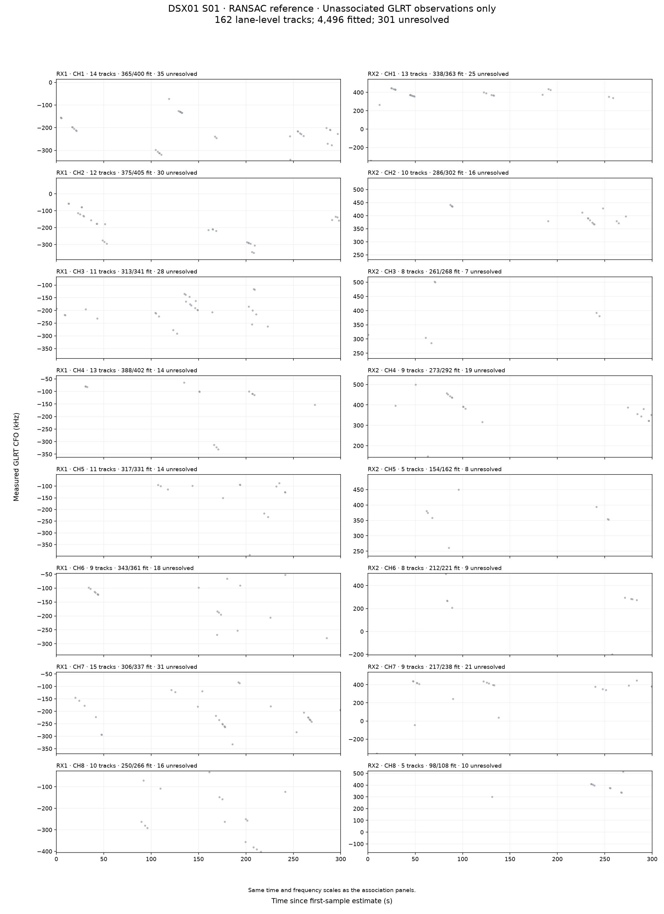

*S01, 301 reference leftovers with the same time/frequency scales as its
association figure. Remaining points are retained in every denominator.*

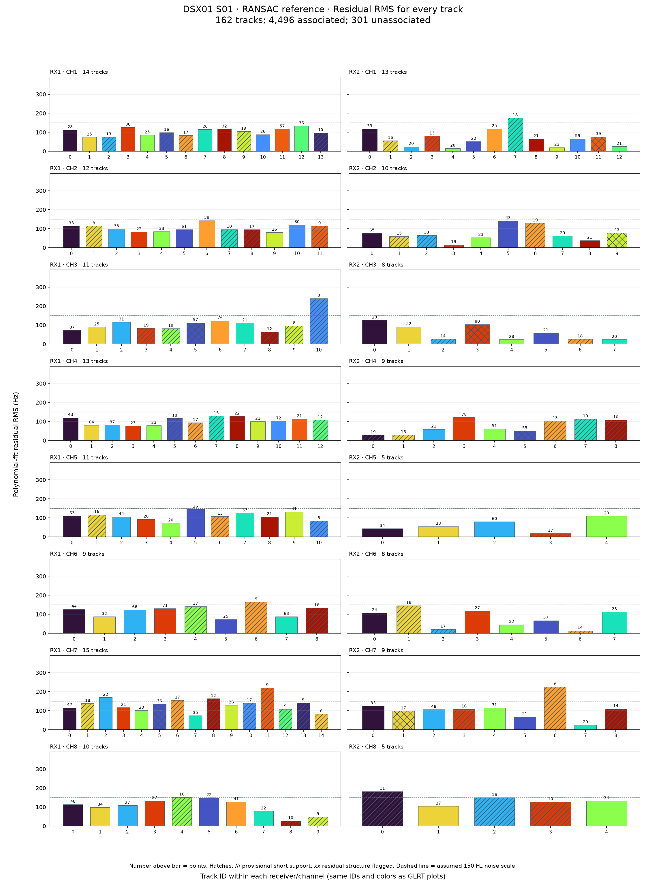

*S01, residual RMS in Hz for all 162 reference tracks. RMS is conditional on
fitted membership; low values on short tracks do not demonstrate white noise.*

## Negative controls and synthetic cases

Every selected primary method associated zero observations in its saved
within-lane frequency-shuffled S01 control. EM's selected control uses seed
20261017; Graph, Hough, MHT and the reference use seed 1701. These controls
preserve time samples and per-lane frequency marginals but destroy temporal
frequency relationships. They test association to that null, not the truth
of real-data track identities.

The new quadratic recovery was tested separately on the same seed-1701
shuffled data under each selected configuration and both support ratios:
all ten runs associated **zero of 4,797 points**. It was also tested on ten
common synthetic cases under each support policy. Both sets recovered 100%
of synthetic signal points and assigned zero synthetic clutter points.
The recovery source, seed and every case are retained in
[controls.json](../2026_10_17_dsx01_residual_review/controls.json).

The selected primary implementations have distinct synthetic weaknesses:
EM recovers 174/181 points on the quartic case, while Graph recovers 153/181
on the C1 curvature-change case. Hough, MHT and the reference recover all
signal points in these selected synthetic runs. Graph and MHT each have one
point of crossing-identity impurity in the corresponding crossing case.
All selected methods assign zero points from the synthetic pure-clutter case
and zero of the 100 added crossing-clutter points. The full 50-case selected
table is preserved as [CSV](tables/selected-synthetic.csv) and
[Markdown](tables/selected-synthetic.md).

## Historical holdout sensitivity

The earlier prediction experiment compares contiguous five-second exclusions
with four balanced random individual-point folds, using seed 1701 and
identical fold assignments for every method. Discovery uses training points
only and each original observation is scored once, without extrapolating
beyond the training curve support.

<!-- table:historical-holdout -->

| Method | Random predicted points | Random predicted % | Interval predicted points | Interval predicted % |
| --- | --- | --- | --- | --- |
| RANSAC reference | 3671 | 76.53 | 2654 | 55.33 |
| EM | 3864 | 80.55 | 2947 | 61.43 |
| Graph | 3718 | 77.51 | 2707 | 56.43 |
| Hough | 3641 | 75.90 | 2673 | 55.72 |
| Kalman/MHT | 3802 | 79.26 | 2890 | 60.25 |

<!-- /table:historical-holdout -->

Source: [holdout protocol and summary](../2026_10_17_dsx01_random_holdout/summary.json)
and [common fold assignments](../2026_10_17_dsx01_random_holdout/folds.csv).
These historical configurations precede the full-data tuning and recovery.
The temporal results retain their original designation; they are not relabeled
as randomized validation. Individual-point randomization can retain correlated
nearby observations and does not provide independent-group validation.

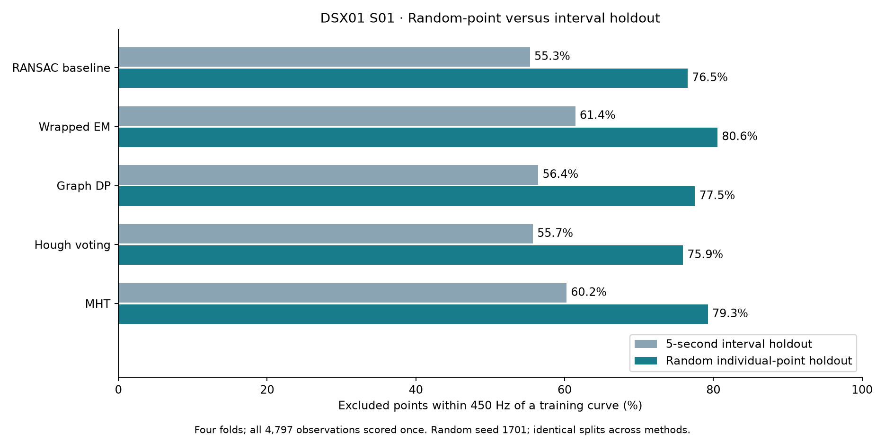

*S01, all 4,797 points scored once per method under the documented random-point
protocol, compared with the historical interval protocol. Prediction proximity
is evaluated against training curves; it is not an identity-accuracy metric.*

At the user's direction, the final objective uses all observations and
residual/support criteria rather than withholding observations to select the
final coefficients. Generalization, formal whiteness and identity accuracy
remain separate questions. A future scientific validation should randomize
whole independent frames, dwells or scans, retain correlated observations
together and freeze preprocessing and hyperparameters before evaluation.

## Runtime and embedded execution estimate

The selected **primary fits before residual recovery** were rerun sequentially
three times on one pinned desktop CPU core, with `OPENBLAS_NUM_THREADS=1`,
`OMP_NUM_THREADS=1` and `MKL_NUM_THREADS=1`. The host is x86_64 with an Intel
Core Ultra 9 285K CPU. Each sample covers all 16 lanes. Timing includes the
numerical `fit_lane` calls and their internal finalization, and excludes input
loading, exported report diagnostics, plots and the later recovery pass.
All benchmark repetitions reproduced their selected track and point counts.

<!-- table:host-runtime -->

| Method | Median fit time s | Relative to Graph |
| --- | --- | --- |
| Graph | 1.170 | 1.00 |
| RANSAC reference | 7.620 | 6.51 |
| Kalman/MHT | 9.815 | 8.39 |
| Hough | 10.598 | 9.06 |
| EM | 22.886 | 19.57 |

<!-- /table:host-runtime -->

Source: [all runtime samples and environment](../2026_10_17_dsx01_full_data_tuning/pairwise/runtime.json).
Wall time and process CPU time were close, consistent with CPU-bound fitting
in this configuration. These measurements do not represent the final hybrid
recovery workflow or a native embedded implementation.

Graph is the leading embedded CPU candidate: its current bounded local search
is about 8.4 times faster than MHT and 19.6 times faster than EM. An initial
native implementation should retain the predecessor cap and explicit memory
bounds. Hough searches a substantial voting grid, MHT grows competing branch
histories, and EM repeatedly evaluates responsibilities and weighted fits.
The exact native ranking can change with data layout, numerical libraries
and vectorization; [Arm's optimization guidance](https://learn.arm.com/learning-paths/mobile-graphics-and-gaming/using-neon-intrinsics-to-optimize-unity-on-android/5-the-optimizations/)
explains why organization of data is important for SIMD optimization.
Embedded wall time and memory need a bounded replay on the target hardware.

## Reproduction and verification

The report is reproducible from the versioned observation export without
radio, database, network storage or a reference repository. Required Python
dependencies are NumPy, Matplotlib and pytest. The publication branch starts
from remote-main base `e3710d09c`; algorithm file digests identify the exact
numerical sources independently of surrounding repository revisions.

The 13 component/tool test files below passed **95 tests** in the clean
publication worktree. No golden scientific fixture was updated.
The [publication validation receipt](validation.json) also records the selected
primary replays and their independently audited counts and support categories.

```bash
PYTHONPATH=src python -m pytest -q \
  tests/analysis/test_polynomial_tracklets.py \
  tests/analysis/test_tracklet_fitting.py \
  tests/analysis/test_em_tracklets.py \
  tests/analysis/test_graph_tracklets.py \
  tests/analysis/test_hough_tracklets.py \
  tests/analysis/test_mht_tracklets.py \
  tests/analysis/test_evaluate_polynomial_tracklets.py \
  tests/analysis/test_polynomial_tracklet_predictions.py \
  tests/analysis/test_compare_tracklet_methods.py \
  tests/analysis/test_full_data_tracklet_tuning.py \
  tests/analysis/test_selected_tracklet_comparison.py \
  tests/analysis/test_residual_tracklets.py \
  tests/analysis/test_residual_tracklet_review.py

PYTHONPATH=src python tools/build_dsx01_tracklet_report.py --check
```

To replay the selected primary fits without replacing historical receipts,
run the following in a fresh checkout. It saves new outputs to a temporary
directory and verifies each selected count.

```bash
PYTHONPATH=src python - <<'PY'
import importlib
import json
import sys
import tempfile
from pathlib import Path
sys.path.insert(0, "tools")
from compare_tracklet_methods import METHODS
from evaluate_polynomial_tracklets import load_observations, DEFAULT_INPUT, evaluate_lanes, save_results
from tune_full_data_tracklets import annotate_full_data_quality, audit_real_result
from leo.analysis.polynomial_tracklets import TrackConfig
root = Path("reports/2026_10_17_dsx01_full_data_tuning")
out = Path(tempfile.mkdtemp(prefix="dsx01-selected-replay-"))
rows, _ = load_observations(DEFAULT_INPUT)
for method, module_name in METHODS.items():
    selected = json.loads((root / method / "selected.json").read_text())
    cfg = TrackConfig(**selected["config"])
    summary, exports = evaluate_lanes(rows, cfg, importlib.import_module(module_name).fit_lane)
    annotate_full_data_quality(summary, exports)
    audit_real_result(rows, summary, exports, cfg)
    assert summary["assigned"] == selected["assigned"]
    assert summary["track_count"] == selected["track_count"]
    save_results(out / method, summary, exports)
print(out)
PY
```

The same `run_search` function in
[tune_full_data_tracklets.py](../../tools/tune_full_data_tracklets.py) accepts
the saved `(trial name, TrackConfig)` pairs from each `search.json` and a new
output directory to replay all 49 configurations. The default CLI grid is
only eight configurations; it is not a replacement for all saved method
specific search records.

For residual recovery in a separate output directory, import
`review_unassociated_tracklets`, set its `OUTPUT` to a fresh path and call
`main()`. This reuses the versioned selected primary results as the frozen
starting state. For new plot renders, `plot_recovered_tracklet_results.py`
recomputes every per-track RMS from assignment exports and asserts agreement
with the fitted track's stored RMS before plotting. The report builder derives
all generated tables from JSON/CSV evidence and checks every local report link
and evidence-file digest.

## Conclusions and next falsifiers

The scan has a large common core of reproducible CFO curves. Finite discovery
budgets and shared support floors still left visually coherent fragments
unassociated. Direct quadratic seeding and an explicit support-ratio ablation
recover additional points while preserving all previous memberships and
retaining the same residual gate. The final raw coverage reaches 94.08%, but
short-support additions must remain distinguishable from supported tracks.

For a lean embedded CPU implementation, Graph is the first candidate to port
and measure. For this scan's supported full-data coverage, EM is the strongest
primary result. A production choice should compare the final recovery-enabled
workflows, including memory, on the actual embedded target.

The next scientific falsifiers are a frozen-configuration replay on other
scans, grouped random validation, denser signal-like clutter and near-crossing
controls, and a blinded inventory of remaining coherent fragments. The
experiment does not establish optimal clustering, completeness, physical
spacecraft identities or localization accuracy. Shared finalization and an
inspected development scan limit the independence of the comparisons.

## Complete evidence navigation

- [Every figure, PDF variant and exported table](ASSETS.md).
- [Latest GLRT, unassociated and per-track RMS gallery](../2026_10_17_dsx01_residual_review/track-plots/review.html).
- [All per-track RMS values, support categories and recovery origins](../2026_10_17_dsx01_residual_review/track-plots/all-track-rms.csv).
- [All 49 tuning configurations](tables/all-tuning-trials.md).
- [All 50 selected synthetic-case rows](tables/selected-synthetic.md).
- [Pairwise comparison table](tables/pairwise-comparison.md).
- [Frozen historical random-point and interval sensitivity](tables/historical-holdout.md).
- [Byte counts and SHA256 evidence bindings](evidence-manifest.json).
