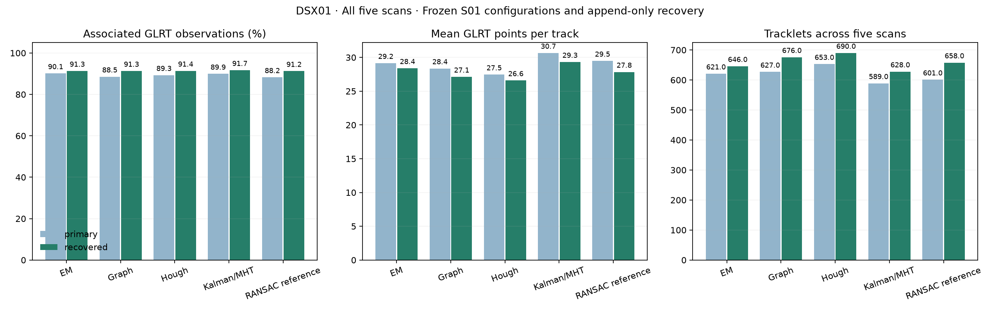

# DSX01 full cohort polynomial tracklet comparison

## Motivation

Compare association coverage and GLRT observations per track across every
recording in DSX01, rather than selecting a method from the first scan alone.

## Problem

DSX01 has two relevant populations: five complete source scans containing
20,084 GLRT observations, and 693 challenge observations in 15 inspected
windows. Fitting only those windows would change the discovery problem and
truncate track lengths. The complete scans are fitted independently; challenge
coverage is then measured on the original challenge membership IDs.

## Solution

Kalman/MHT has the highest whole-scan recovered coverage, **91.68%**, and the
largest mean track size, **29.32 GLRT observations**. EM has the most points
in adequately supported fits with no detected residual structure, **14,361**.
All association counts include provisional short and flagged tracks.

## Method

All five methods use their previously selected S01 configurations unchanged.
Each source scan and receiver/channel lane is fitted separately. The recovery
pipeline reruns the same method on leftovers, adds quadratic-seed discovery
with the original support rule, then adds the explicit two-points-per-coefficient
recovery trial. Existing memberships and coefficients remain frozen during
recovery. Every phase retains all observations, the 150 Hz assumed noise scale,
450 Hz gate, degree limit of four, eight-point floor and positive complexity
penalties. No observations are withheld and no hyperparameters are retuned.

The input loader verifies the frozen manifest, source counts, all 16 lanes per
scan and unique source/observation identities. Original satellite/association
labels are stripped before fitting. DSX01 is an inspected retrospective
development dataset; these are descriptive transfer results, not independent
identity validation.

## Whole scan results after recovery

| Method | Associated / 20,084 | Associated % | Tracks | Mean GLRT points/track | Median GLRT points/track |
| --- | ---: | ---: | ---: | ---: | ---: |
| EM | 18,341 | 91.32% | 646 | 28.39 | 23 |
| Graph | 18,338 | 91.31% | 676 | 27.13 | 22 |
| Hough | 18,350 | 91.37% | 690 | 26.59 | 21 |
| Kalman/MHT | 18,414 | **91.68%** | 628 | **29.32** | 23 |
| RANSAC reference | 18,324 | 91.24% | 658 | 27.85 | 22 |

Mean track size is total associated observations divided by total tracklets,
not an unweighted average of scan means. A tracklet belongs to one scan,
receiver and channel; track counts do not identify unique emitters.



*All five scans, 20,084 observations per method. Panels show associated
percentage, mean GLRT observations per track and total tracklets. Primary and
recovered phases are distinguished. Source: [aggregate CSV](comparison.csv).
Short and flagged tracks remain in these descriptive counts.*

## Association percentage by scan after recovery

| Scan | GLRT observations | EM | Graph | Hough | Kalman/MHT | Reference |
| --- | ---: | ---: | ---: | ---: | ---: | ---: |
| S01 | 4,797 | 93.54% | 93.54% | 93.79% | 94.08% | 93.73% |
| S02 | 3,524 | 90.69% | 90.38% | 90.75% | 90.89% | 90.15% |
| S03 | 3,988 | 90.65% | 90.50% | 90.50% | 91.05% | 90.30% |
| S04 | 3,719 | 89.00% | 90.02% | 89.94% | 90.02% | 89.78% |
| S05 | 4,056 | 92.04% | 91.44% | 91.20% | 91.69% | 91.49% |

Source: [per-scan counts, mean sizes, medians and durations](per-scan.csv).
Every method exactly reproduces its earlier S01 recovered point count, track
count and residual-quality category totals.

## Coverage of the 693 challenge observations

| Method | Associated challenge observations | Associated % |
| --- | ---: | ---: |
| EM | 677 / 693 | 97.69% |
| Graph | 671 / 693 | 96.83% |
| Hough | 677 / 693 | 97.69% |
| Kalman/MHT | 676 / 693 | 97.55% |
| Reference | 673 / 693 | 97.11% |

These are observations inside the original challenge windows evaluated after
whole-scan fitting. They do not represent a separate fit on 693 samples or a
withheld validation population. Source: [challenge summary](challenge-summary.csv).
Every method also exports a `challenge-regions.csv` with the 15 window results
for both phases.

## Residual support and null controls

The number of recovered points in adequately supported fits with no detected
residual structure is 14,361 for EM, 14,048 for Graph, 13,799 for Hough, 14,024
for Kalman/MHT and 13,777 for the reference. Adequate diagnostic support still
requires at least 20 observations per polynomial piece. Lower-support fits
remain provisional; small fitted RMS does not establish white noise.

Matched CFO shuffles preserve all times and within-lane frequency marginals.
The same seed and permutation are used for every method on a scan: seeds
1701 through 1705 for S01 through S05. All primary methods associate zero
shuffled observations across the five scans. After recovery, EM still
associates zero; each other method associates one eight-point null track.
Graph, Hough and MHT do so on S04, and the reference on S02. These counts
measure this particular null control and are not calibrated false-discovery
rates. Source: [all 25 null runs](shuffled-controls.csv).

## Reproduction and checks

```bash
OPENBLAS_NUM_THREADS=1 OMP_NUM_THREADS=1 MKL_NUM_THREADS=1 \
  PYTHONPATH=src python tools/evaluate_dsx01_cohort_tracklets.py --method graph
# Repeat with em, hough, mht and baseline, then:
PYTHONPATH=src python tools/evaluate_dsx01_cohort_tracklets.py --summarize
PYTHONPATH=src python -m pytest -q tests/analysis/test_dsx01_cohort_tracklets.py
```

Use `--output` to write a fresh replay without replacing this evidence bundle.
Independent integrity checks cover all 50 real-data result sets, namely two
phases for each method and scan, and both phases of all 25 null runs. They
check original identities, exclusive ownership, aliases, polynomial degree and
support, spans/gaps, residual gates, analytic slopes, RMS and C1 joins.
All numerical sources remain unchanged during execution. The cohort tool's
four tests pass; the receipt is in [validation.json](validation.json).

The methods were executed concurrently with BLAS thread limits. Their elapsed
times are not a controlled embedded-speed comparison; the earlier pinned-core
S01 runtime study remains separate.

## Output navigation

- [Aggregate primary and recovered results](comparison.csv).
- [Per-scan primary and recovered results](per-scan.csv).
- [Full summary and all track-size distributions](summary.json).
- [Challenge coverage](challenge-summary.csv).
- [Matched shuffled controls](shuffled-controls.csv).
- Each method directory contains its configuration, provenance, source hashes
  and controls in `results.json`, plus per-source `primary` and `recovered`
  directories with all assignments, lane metrics and polynomial coefficients.
