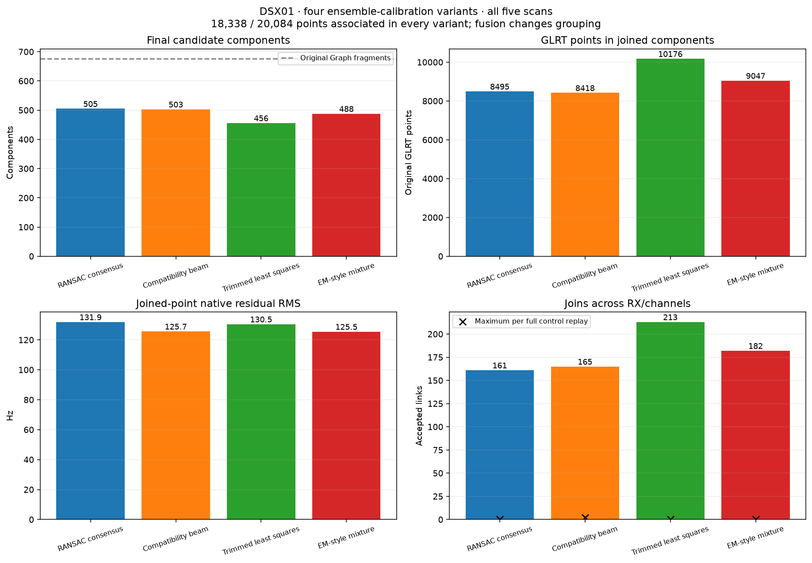
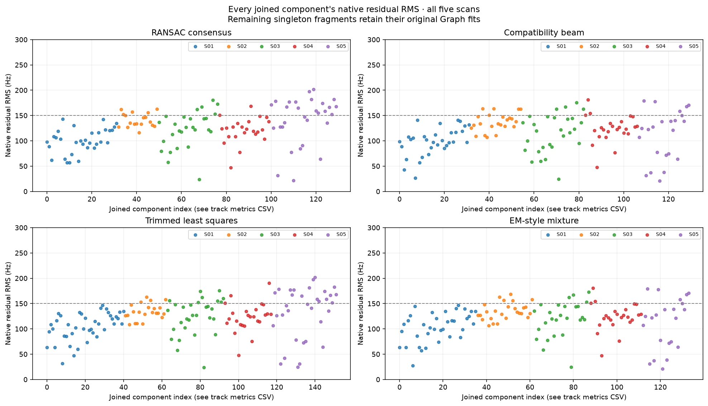
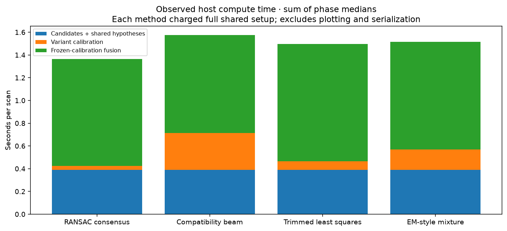
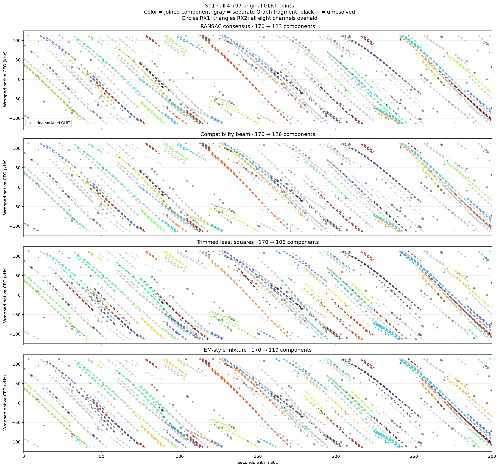

# DSX01: four shared ensemble-calibration variants

## Motivation

Learn scan-specific receiver/band offsets and drifts without allowing one linear
track pair to justify its own calibration. Several different linear trajectories
can provide evidence when one shared correction explains them all. Curved tracks
remain valuable identity evidence. Every method allows unmatched hypotheses.

## Problem

Local residual whiteness and an overdetermined numerical fit do not establish
correct correspondence. Alias choices, candidate selection, correlated channel
copies and weak calibration directions must be included in the evaluation.

## Solution

Four separate optimizers share the same original observations, candidate pool,
native alias bounds, physical drift limits and final fusion checks:

1. **RANSAC consensus:** random disjoint subsets generate shared-calibration
   hypotheses, followed by maximum-consensus selection and hard local refinement.
2. **Compatibility beam:** bounded search over jointly consistent correspondence
   sets, with skip branches, fragment exclusivity and six retained beam states.
   This is an approximate beam search, not an exact maximum-clique/JCBB solver.
3. **Trimmed least squares:** repeated selection of the best disjoint, evidence-cell
   balanced subset and shared bounded least-squares fitting, followed by consensus.
4. **EM-style mixture:** soft correspondence/unique-alias probabilities, explicit
   unmatched mass, approximate fragment capacities and evidence-cell balancing.
   The final hard consensus is validated identically to the other methods. Capacity
   normalization means this is not exact one-to-one EM with a monotonic objective.

## Results

| Variant | % associated | Components | GLRT / component | Cross-lane joins | Points in joins | Native RMS (Hz) | Control cross-lane joins, three seeds | Median host compute (s/scan) |
| --- | --- | --- | --- | --- | --- | --- | --- | --- |
| RANSAC consensus | 91.31 | 505 | 36.31 | 161 | 8495 | 131.93 | 0/0/0 | 1.37 |
| Compatibility beam | 91.31 | 503 | 36.46 | 165 | 8418 | 125.66 | 0/0/2 | 1.56 |
| Trimmed least squares | 91.31 | 456 | 40.21 | 213 | 10176 | 130.48 | 0/0/0 | 1.55 |
| EM-style mixture | 91.31 | 488 | 37.58 | 182 | 9047 | 125.49 | 0/0/0 | 1.47 |

**Trimmed least squares is the preliminary candidate for further work:** it
produces 456 components and 10,176 points in joined groups, with no cross-lane
joins observed in the three full control replays. RANSAC has the lowest measured
host compute time. EM has the lowest joined-point RMS, but its selected point set
differs, so that is not evidence of better identity accuracy.

Compatibility produces two cross-channel joins in the S05, seed-243 control.
That false-consensus case has six selected calibration pairs, data rank eight,
four redundant affine constraints and good numerical stationarity. It directly
demonstrates that an overdetermined, noise-compatible fit can still choose wrong
correspondences. These controls were retained; acceptance thresholds were not
retuned to erase the observed failure. Three negative-control replays are too few
to certify any method's physical identity accuracy.

All variants retain the same **18,338 / 20,084 = 91.31%** Graph-associated points.
The remaining **1,746** detections are unresolved in all four. This experiment
changes fragment grouping, not original point association. GLRT/component includes
both joined components and separate original fragments. Joined-point RMS values
cover different selected observations and cannot establish better identity accuracy.



| Scan | Variant | Components | Cross-lane joins | Cal pairs | Linear cal pairs | Both curved | Rank / 8 | Redundancy DOF |
| --- | --- | --- | --- | --- | --- | --- | --- | --- |
| S01 | RANSAC consensus | 123 | 45 | 22 | 1 | 10 | 8 | 36 |
| S02 | RANSAC consensus | 97 | 18 | 14 | 0 | 5 | 4 | 24 |
| S03 | RANSAC consensus | 99 | 33 | 23 | 2 | 6 | 6 | 40 |
| S04 | RANSAC consensus | 81 | 33 | 19 | 1 | 10 | 8 | 30 |
| S05 | RANSAC consensus | 105 | 32 | 20 | 0 | 8 | 6 | 34 |
| S01 | Compatibility beam | 126 | 42 | 25 | 0 | 13 | 8 | 42 |
| S02 | Compatibility beam | 87 | 28 | 18 | 0 | 5 | 8 | 28 |
| S03 | Compatibility beam | 100 | 31 | 22 | 2 | 3 | 8 | 36 |
| S04 | Compatibility beam | 75 | 41 | 22 | 0 | 13 | 8 | 36 |
| S05 | Compatibility beam | 115 | 23 | 18 | 1 | 4 | 8 | 28 |
| S01 | Trimmed least squares | 106 | 62 | 25 | 0 | 11 | 8 | 42 |
| S02 | Trimmed least squares | 89 | 27 | 17 | 0 | 5 | 6 | 28 |
| S03 | Trimmed least squares | 87 | 45 | 24 | 2 | 7 | 8 | 40 |
| S04 | Trimmed least squares | 76 | 40 | 20 | 0 | 10 | 6 | 34 |
| S05 | Trimmed least squares | 98 | 39 | 20 | 0 | 10 | 8 | 32 |
| S01 | EM-style mixture | 110 | 58 | 24 | 0 | 12 | 8 | 40 |
| S02 | EM-style mixture | 86 | 30 | 16 | 0 | 7 | 6 | 26 |
| S03 | EM-style mixture | 101 | 31 | 23 | 2 | 5 | 8 | 38 |
| S04 | EM-style mixture | 75 | 41 | 22 | 0 | 13 | 8 | 36 |
| S05 | EM-style mixture | 116 | 22 | 16 | 1 | 7 | 8 | 24 |

| Variant | Calibration pairs | Both degree ≤1 | Weak/one-sided curvature | Both actively curved |
| --- | --- | --- | --- | --- |
| RANSAC consensus | 98 | 4 | 55 | 39 |
| Compatibility beam | 105 | 3 | 64 | 38 |
| Trimmed least squares | 106 | 2 | 61 | 43 |
| EM-style mixture | 101 | 3 | 54 | 44 |

On DSX01 only a few selected calibration overlaps are strictly linear by BIC.
Many others have weak or one-sided curvature, while 38–44 pairs per variant
have strong curvature in both tracks. These are mixed-ensemble results; the
pure-linear identifiability claim is independently exercised by the synthetic
seven-pair experiment. Polynomial degree alone does not supply identity confidence.

The original Graph baseline has 676 fragments. The earlier exploratory RF-scaled
prototype had 465 components under different calibration and acceptance rules;
that count is a historical reference, not a matched accuracy benchmark.



The [per-track table](merged-track-metrics.csv) identifies every plotted component,
its original members, point count, degree, RMS, maximum residual and support status.

| Variant A | Variant B | Common co-clustered fragment pairs | Co-membership Jaccard |
| --- | --- | --- | --- |
| ransac | compatibility | 159 | 0.55 |
| ransac | trimmed | 171 | 0.47 |
| ransac | em | 151 | 0.46 |
| compatibility | trimmed | 177 | 0.49 |
| compatibility | em | 198 | 0.69 |
| trimmed | em | 230 | 0.67 |

Co-membership compares all unordered pairs of original fragments in a shared final
component, including transitive membership. It does not confuse different choices
of tree edges with different partitions, and does not use satellite identity labels.
All four variants agree on 95 non-singleton membership groups,
containing 5509 original GLRT points. This
[shared membership view](common-membership-core.csv) is a post-hoc intersection
of partitions, not a fifth fitted method or proof of physical identity.

## Method and safeguards

Each scan has four additive hardware paths: RX1 low/high and RX2 low/high. All
eight native offset/drift coordinates are shared over the scan. Fit native
`y = q * p(t) + a[path] + d[path] * (t - 150)` with known carrier ratio `q` and
degree 0–4 complexity-penalized shared curves. Native integer aliases are applied
before RF scaling. There is no learned RF coefficient, satellite/orbital identity,
historical calibration prior, permanent holdout, new RF collection or localization.

Calibration candidates require at least 10 seconds of actual overlap and 12
original points on each side. Independently BIC-selected degrees determine the
nuisance shared polynomial. Profiling that polynomial compresses each candidate
to two whitened affine constraints; interpolation does not add measurements.
An orthogonal residual RMS above 200 Hz rejects incompatible nonlinear shapes.
Both strongly curved and linear candidates are allowed.

All methods use one common deterministic bank: zero initialization, up to 16
single-pair seeds and 72 random subset seeds. Random subsets alternate between
curvature-prioritized and unrestricted pools. RANSAC refines 12 starts; beam search
uses four starts and at most 80 candidate expansions per start; trimming and EM
use eight starts. These are bounded research budgets, not claims of exhaustive
search or identical optimizer work. Every variant then receives the same maximum
24-round hard-consensus polishing step.

Offsets occupy the canonical ±113,636.36 Hz box; each native path drift is bounded
to ±20 Hz/s. An active-set solver minimizes the eight-coordinate bounded quadratic;
final selected-set coordinate stationarity must be within 1 Hz before calibration
promotion. Bound contact is reported in the shift
table and is not evidence for the physical bound value. The numerical ridge only
chooses representatives of unresolved modes and is excluded from reported data
information. Full rank alone is insufficient.

Calibration support is capped to one selected pair per **45 s × 400 Hz/s**
time/slope evidence cell; no fragment or calibration observation is reused.
These cells are a proxy for independent track families, not known emitter labels.
Promotion requires at least six selected pairs in three time bins spanning at
least 120 seconds. The redundancy DOF is `2 * pairs - data rank`; because matches
and aliases were selected, this is not a chi-square significance test.

Before a join, its particular hardware contrast must be observable, have formal
conditional standard error ≤150 Hz at both overlap/gap ends, remain within 300 Hz
under each selected-cell deletion, and agree within 300 Hz across discovered
calibration modes scoring at least 90% of the winner. Deletions also check rank
loss; remaining correspondence and alias choices stay fixed in these conditional
deletion fits. All selected observations return to the final fit. Native
alias-equivalent changes are compared consistently. The mode search
is bounded; stability is not proof that no other mode exists. Same-path/same-RF
hardware cancels and does not require calibration promotion.

Calibration is then frozen. Every whole-component join, including linear joins,
must improve complexity cost, keep all original residuals below 450 Hz, have no
gap above 10 seconds or slope above 8,000 Hz/s, and pass pooled and per-RX/channel
residual structure checks. Every newly introduced pairwise hardware contrast is
also checked, preventing a weak path from entering indirectly through a bridge.
Fusion is greedy and preserves established native alias branches within a
component. It can miss valid alternative or larger unions; these component counts
are not proven global optima.

## Controls and practical interpretation

There are **60 full control fits**: four methods × five scans × three lane-time
shift seeds (41, 142, 243). Each control independently regenerates candidate
matches, hypotheses and calibration before fusion, using the same budgets.
Tiny wrap-boundary fragments below eight points are excluded; excluded observation
counts are recorded per case. Other measurements, RF metadata and native CFO
values are preserved by the shift transformation.

Cross-RX/channel joins are the relevant false-consensus diagnostic. Same-channel
continuations survive a lane-time shift by construction and are reported separately
in [the numerical comparison](method-comparison.csv). Three replays do not yield a
calibrated false-discovery rate. Residual tests also have finite power, especially
on short fragments. No count here is a verified number of physical transmitters.

The comparison should favor repeatable cross-lane support with low control
consensus, rather than simply the smallest component count. Method disagreements
are available as [pairwise fragment co-membership comparisons](pairwise-partitions.csv).



Runtime is measured on this host, excludes plotting/export, and charges every
method the full shared candidate/hypothesis setup. Sum-of-phase medians in the
figure can differ from the median total in the table. These are not embedded
benchmarks.

## Visual review



Per-scan panels below show the 18,338 Graph-associated observations, calibrated
candidate groups and native residuals. Gray points are separate Graph fragments,
not the 1,746 unresolved GLRT detections. The S01 figure above includes all raw
detections and shows its unresolved points explicitly.

| Scan | RANSAC | Compatibility | Trimmed | EM |
|---|---|---|---|---|
| S01 | [RANSAC consensus](real/S01/ransac/overview.png) | [Compatibility beam](real/S01/compatibility/overview.png) | [Trimmed least squares](real/S01/trimmed/overview.png) | [EM-style mixture](real/S01/em/overview.png) |
| S02 | [RANSAC consensus](real/S02/ransac/overview.png) | [Compatibility beam](real/S02/compatibility/overview.png) | [Trimmed least squares](real/S02/trimmed/overview.png) | [EM-style mixture](real/S02/em/overview.png) |
| S03 | [RANSAC consensus](real/S03/ransac/overview.png) | [Compatibility beam](real/S03/compatibility/overview.png) | [Trimmed least squares](real/S03/trimmed/overview.png) | [EM-style mixture](real/S03/em/overview.png) |
| S04 | [RANSAC consensus](real/S04/ransac/overview.png) | [Compatibility beam](real/S04/compatibility/overview.png) | [Trimmed least squares](real/S04/trimmed/overview.png) | [EM-style mixture](real/S04/em/overview.png) |
| S05 | [RANSAC consensus](real/S05/ransac/overview.png) | [Compatibility beam](real/S05/compatibility/overview.png) | [Trimmed least squares](real/S05/trimmed/overview.png) | [EM-style mixture](real/S05/em/overview.png) |

## Reproduction and validation

```bash
.venv/bin/python tools/evaluate_dsx01_consensus_calibration.py
.venv/bin/python tools/render_dsx01_consensus_review.py
.venv/bin/python -m pytest -q tests/analysis/test_dsx01_consensus_calibration.py
```

Synthetic tests cover each optimizer's recovery and joining of seven independent
linear pairs with native aliases, single-pair abstention, correlated-copy vote
limits, cross-band alias arithmetic, unobservable paths and short temporal support.
The bounded solver is independently checked against exhaustive enumeration of
active drift-bound configurations on a coupled quadratic. The 13 new cases plus
the existing offset, multilane, receiver and cohort suites total 50 passing tests.
Every real/control output is independently audited for original-point ownership,
native residual arithmetic, degrees, gaps, analytic slope extrema and stored flags.

- [Aggregate method table](method-comparison.csv)
- [Twenty real scan summaries](real-scan-summary.csv)
- [All 80 real/control metric rows](scan-metrics.csv)
- [All 80 receiver/band contrast estimates and conditional precision](calibration-shifts.csv)
- [Every joined track's original members and residual metrics](merged-track-metrics.csv)
- [Input/source hashes and search configuration](provenance.json)
- [Complete artifact hashes](artifact-manifest.json)

Per-case results store calibration alternatives, selected original pairs and
native aliases, cell deletion fits, rejection counts, final ownership and shared
polynomials. Per-case observations CSVs preserve every eligible input observation.
The original published analyses and fixtures are unchanged.
