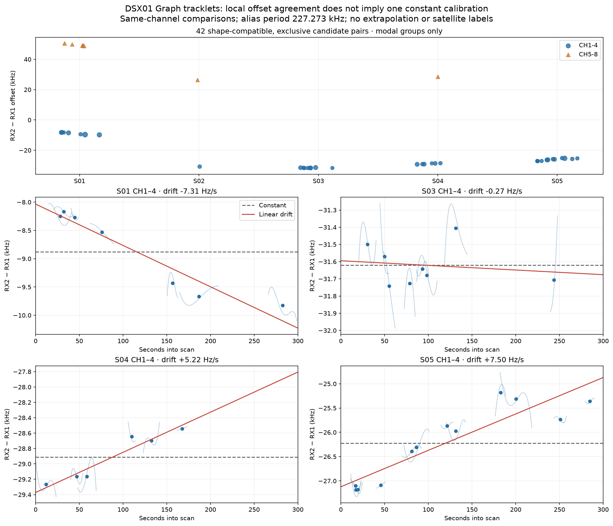
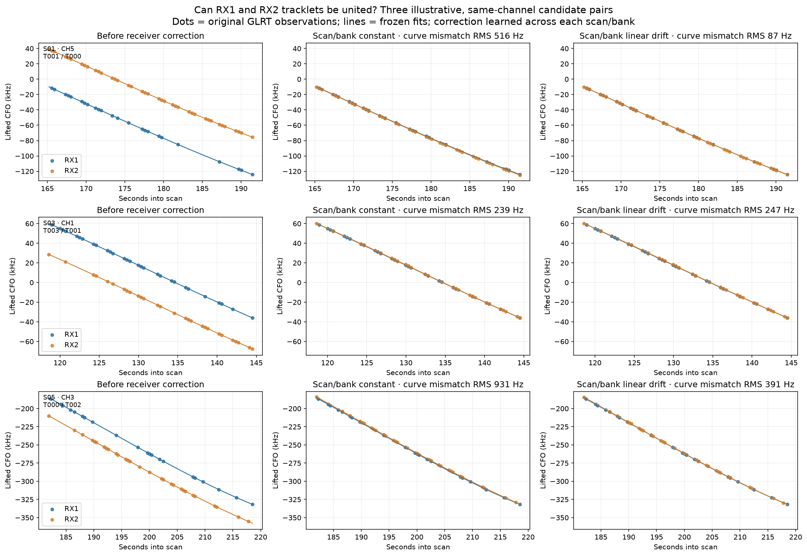
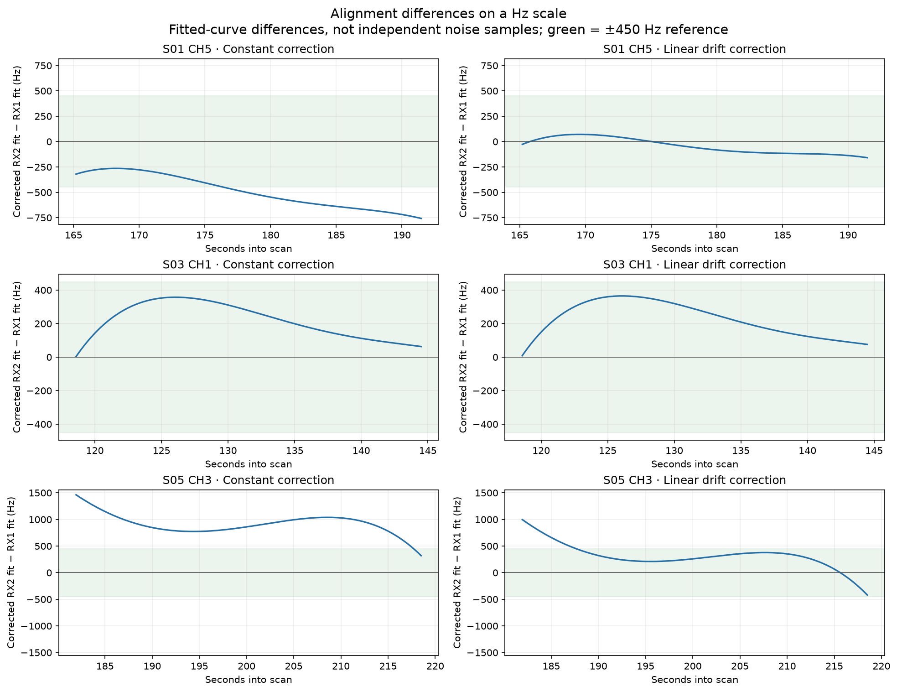

# DSX01 Graph RX1/RX2 preliminary alignment

## Motivation

Determine whether Graph tracklets from the two receivers follow common CFO
curves after a frequency shift, and illustrate the limits of combining them.

## Problem

A shared curve shape can suggest a counterpart without proving transmitter
identity. Receiver offsets may change between scans, between frequency groups
and over time. Matching, fitting and evaluating the same selected curves is
an exploratory comparison rather than independent validation.

## Solution

There is **no single constant offset for all DSX01 tracks**. S03 CH1–4 is a
plausible constant-shift case: RX2 minus RX1 is about **−31.621 kHz**, with
112 Hz RMS scatter across eight pair centers. Other supported groups show
slow drift. The next fusion experiment should calibrate by scan and frequency
group, allowing drift only where supported, before testing original-point
residuals and receiver-specific structure.

## Method

The inputs are the 676 frozen Graph tracklets after shared recovery from the
[five-scan cohort](../2026_10_17_dsx01_all_scans_tracklets/README.md). The
comparison uses existing exports and no physical satellite labels, new RF
collection, localization fit or learned RF-dependent calibration coefficient.

Candidate RX1/RX2 pairs must share source scan, channel and RF setting, overlap
for at least eight seconds and contain at least four observations per receiver
inside the overlap. Polynomial curve differences are compared modulo the
227,272.727 Hz alias period. After removing a constant difference, shape RMS
must be at most 300 Hz. Within each scan and descriptive CH1–4 or CH5–8 group,
a modal cluster within ±1,500 Hz and exclusive greedy pairing select pairs.
This is a bounded candidate search, not a global identity assignment.

There are 338 overlapping pairs, 48 shape-compatible pairs and 42 selected
modal pairs. Five groups contain at least three pairs across at least two
channels; these groups account for 39 pairs. The other three groups contain
one pair each and do not support calibration. Group support is distinct from
the original track residual-support category: only 22 of the 39 pairs have
both original tracklets adequately supported with no detected structure.

## Offset results and illustrations

Define Δ(t) = RX2 CFO − RX1 CFO, modulo the alias period. Align RX2 to RX1
with `wrap(RX2 − Δ(t), alias_period)`. For a linear drift model,
`Δ(t) = a150 + b * (t − 150)`, where time is seconds since that scan's
first-sample estimate. Constant means and linear intercepts are separate fits.

| Scan / frequency group | Pairs / channels | Constant Δ (kHz) | Linear a150 (kHz) | Drift b (Hz/s) | Pair-center RMS: constant / linear (Hz) |
| --- | ---: | ---: | ---: | ---: | ---: |
| S01 CH1–4 | 7 / 3 | −8.877 | −9.131 | −7.31 | 677 / 182 |
| S01 CH5–8 | 6 / 4 | +49.416 | +49.300 | −11.62 | 560 / 42 |
| S03 CH1–4 | 8 / 3 | −31.621 | −31.635 | −0.27 | 112 / 111 |
| S04 CH1–4 | 6 / 4 | −28.913 | −28.589 | +5.22 | 290 / 80 |
| S05 CH1–4 | 12 / 4 | −26.222 | −25.996 | +7.50 | 734 / 313 |

Source: [all offset models](offset-models.csv), including the three unvalidated
one-pair groups. S03's linear model offers little improvement over a constant.
S01's fitted constant CH5–8 minus CH1–4 difference is 58.293 kHz. This is a
descriptive frequency-group difference with no confirmed hardware cause.
Sparse higher-frequency matches in other scans do not calibrate those groups;
absence of a match must not be replaced with an extrapolated offset.



*Offsets and time trends for the selected pairs. The frequency groups are
descriptive rather than an established hardware mechanism.
[PDF](receiver-offsets.pdf); [pair CSV](selected-pairs.csv).*



*Three illustrative same-channel candidate pairs, before correction and after
constant or linear correction. S03 illustrates a plausible constant shift;
S01 and S05 illustrate why a constant can leave time-dependent differences.
Curves and corrections are fitted on the displayed data.
[PDF](receiver-alignment-examples.pdf).*

Among the 39 pairs in the five supported groups, 23 satisfy fitted-curve
alignment RMS ≤450 Hz after a constant correction, compared with 37 after a
linear correction. These are in-sample curve comparisons, not original-point
association gates, whiteness checks or validated merges. Equal pair weights
are used, and curve quadrature samples are not independent observations.

The same 42 selected candidates also permit a direct comparison of correction
models. More flexible models improve their descriptive least-squares fit:

| Correction model | Parameters | Fitted-curve RMS (Hz) |
| --- | ---: | ---: |
| One global constant | 1 | 28,195 |
| Constant per scan | 5 | 19,176 |
| Constant per scan and frequency group | 8 | 550.5 |
| Linear per supported scan/frequency group, constants otherwise | 13 | 221.4 |

Source: [correction-model comparison](correction-model-comparison.csv).
The candidate set is fixed across these models. This is an in-sample model
comparison, not statistical validation or evidence of improved localization.



*Corrected RX2 fit minus RX1 fit for the illustrative pairs, with the 450 Hz
alignment reference shown. The Hz scale exposes differences obscured by the
original kHz curves. [PDF](receiver-alignment-differences.pdf).*

## Controls and sensitivity

Circularly shifting RX2 by 57, 113 and 179 seconds yields 6, 9 and 7 selected
modal pairs, respectively, but zero groups with multi-channel support.
Time reversal yields zero shape-compatible or selected pairs. These controls
support investigating simultaneous alignment; they do not establish physical
identity or a calibrated false-match probability.
[Complete temporal controls](temporal-controls.csv).

The [shape-gate sensitivity table](shape-gate-sensitivity.csv) repeats selection
at 150, 300 and 450 Hz. The main multi-channel groups persist, while individual
pairs and slopes vary. Sparse higher-frequency results are unstable: for
example, S02 CH5–8 changes its selected mode under the 450 Hz gate, and S05
CH5–8 appears only there as a one-pair group. Such groups are unvalidated and
should not supply a calibration.

Restricting the calibration to pairs whose two original tracks are adequately
supported gives S01 CH1–4 and CH5–8 slopes of −6.42 and −10.80 Hz/s and S05
CH1–4 +6.43 Hz/s, broadly agreeing with the full fits. S03 retains only three
pairs over approximately 53 seconds, yielding +6.12 Hz/s instead of −0.27
Hz/s. Its drift is weakly identified and its constant correction is already
adequate; do not extrapolate that slope. S04 has only two such pairs.
[Supported-track sensitivity](supported-track-sensitivity.csv). These results
do not support requiring a linear correction in every group.

## Reproduction and checks

```bash
PYTHONPATH=src python3 tools/compare_dsx01_graph_receivers.py
PYTHONPATH=src python3 -m pytest -q tests/analysis/test_dsx01_graph_receivers.py
```

The [summary](summary.json) records parameters, input digests and analysis
provenance. [All overlapping pairs](all-overlapping-pairs.csv) retain the
broader candidate population. No source assignments or coefficients are
changed by this analysis. See the tool's `--help` for an alternative output
directory when replaying without replacing this exploratory bundle.
The five component-owned tests pass, including frequency-group separation
and preservation of the circular temporal-shift boundary; Ruff checks pass.

## Conclusions and next falsifiers

Use scan- and frequency-group calibration as a preliminary alignment model;
S03 CH1–4 can start with a constant, while several other groups warrant a
supported slow-drift comparison. Before production fusion, test original
measurements against the 450 Hz circular gate and run residual diagnostics
separately by receiver as well as jointly. A shared fit should preserve
observation identities and unresolved alternatives. Freeze calibration and
test on independent receiver pairs or time groups before interpreting fit
improvements as evidence for merging tracks. This analysis does not establish
transmitter identity or localization accuracy.
