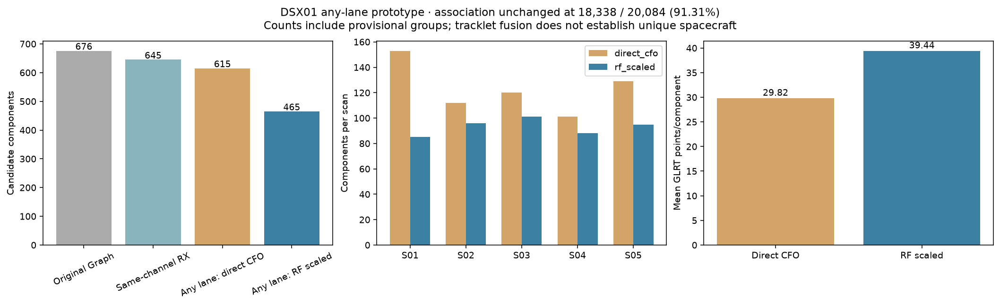
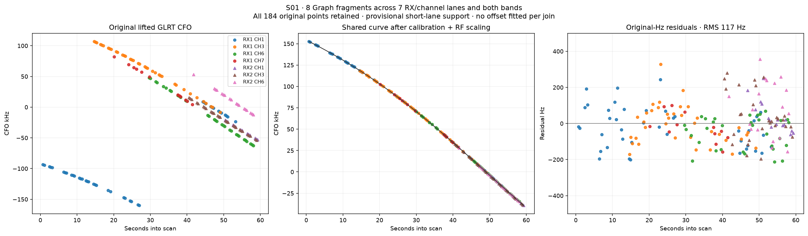
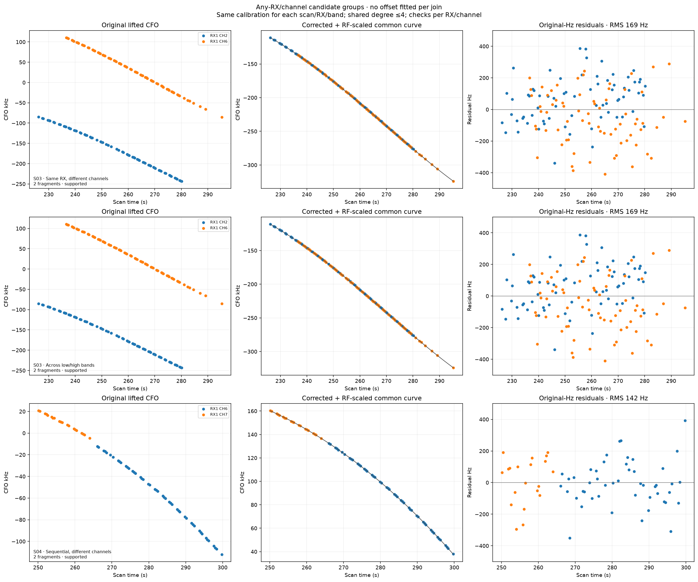

# DSX01 any-receiver/channel polynomial grouping prototype

## Motivation

Group Graph tracklets on the same or different receivers, channels and bands,
including overlapping supports and sequential continuations. Review the five
current scans with original-point residuals and matched time controls.

## Problem

The [previous receiver model](../2026_10_17_dsx01_receiver_model/README.md)
joined only the same RF channel across receivers. Different channels require
a common calibration frame and potentially RF scaling; otherwise one physical
frequency evolution has a different slope on each carrier. Similar polynomial
curves can also match by chance, even when their fitted residuals look clean.

## Solution

The prototype considers any pair of RX/channel lanes within each scan and
refits entire connected components after every proposed addition. Both overlap
and gaps up to ten seconds are supported. No frequency offset is fitted per
join. A shared scan/RX/band calibration must explain all accepted members.

The RF-scaled version produces **465 candidate components from 676 Graph
tracklets**, compared with 615 for direct CFO alignment. It finds 211 links:
183 overlapping and 28 sequential. Of these, 176 join different channels on
the same receiver, 17 join different channels across receivers, and 82 cross
bands. These categories overlap. The remaining 18 links are within a channel.

**These are candidate components, not validated spacecraft identities.**
Independent lane-time controls still produce 30–39 RF-scaled links per full
dataset replay. Residual checks alone do not resolve two-track ambiguity.
More encouragingly, the real scans contain **44 groups spanning at least
three distinct lanes**, compared with zero in the three matched control
replays. Three of those real groups also meet every lane's support floor and
the prototype's calibration checks. This corroboration view is post hoc and
does not establish a calibrated false-discovery rate.

## Method

The two versions use the same 20,084-observation cohort and 676 frozen Graph
tracklets, containing 18,338 associated observations. They are independent
fusion runs from those tracklets, not sequential stages of one algorithm.
The 1,746 unresolved observations are unchanged. There is no holdout selection.

The observation model, in native Hz, is:

```text
y_i + k_i P = q_i p_j(t_i) + a_scan,RX,band + d_scan,RX,band (t_i − 150) + ε_i
P = 227272.727 Hz
q_i = 1                         (direct CFO version)
q_i = actual_RF_i / 11.5 GHz     (RF-scaled version)
```

Shared polynomials have degree 0 through 4. Integer alias lifts are applied
before RF normalization. The normalized alias period differs by channel; the
code does not incorrectly wrap every normalized channel onto one common circle.
The RF ratio is fixed from the exported carrier frequencies. There is no
learned RF calibration coefficient c, orbit-label input or localization fit.

Calibration starts from the earlier relative RX/band estimates and adds
disjoint cross-channel overlap anchors. New anchors need eight seconds of
overlap, four observations from each track and shape RMS at most 300 Hz;
modal grouping uses a 4,000 Hz radius. Whole original tracklets are disjoint
across calibration anchors, preventing repeated observations from inflating
the fit. Historical anchors are retained as proposals, not treated as truth.

The optimizer profiles shared polynomial coefficients and alternates alias
branch selection with robust joint calibration. It uses coefficient complexity
costs, a 100 kHz offset prior, a 10 Hz/s drift prior and an explicit **±20 Hz/s
drift bound**. Earlier supported relative RX offsets/drifts supply 300 Hz and
2 Hz/s constraints; weak historical offsets use 1,000 Hz constraints without
asserting zero drift. These are regularizers derived from the same inspected
data, not independent observations or validation evidence. After an initial
fit, inconsistent anchor pairs are removed as entire hypotheses, not by
selectively deleting their observations.

Direct CFO has an explicit RX1-low offset/drift gauge; RF scaling allows all
eight RX/band parameters to be fitted under the stated priors. Those fitted
coordinates remain conditional on selected aliases and the shared-curve model;
they are not established absolute hardware calibrations. Low/high references
must be connected through the anchor graph before cross-band proposals are
allowed. An invertible local normal matrix does not establish global
identifiability or uniqueness of the alias/calibration mode.

Each proposed component must retain every original member point, keep every
native-Hz residual strictly within 450 Hz, maintain observation gaps at most
ten seconds, and keep analytic slopes within 8,000 Hz/s. Coefficient penalties
and the existing 18-unit track penalty must favor the union over the current
components. One shared polynomial enforces value/slope continuity; this first
prototype does not add extra polynomial knots.

Residual diagnostics run jointly and **separately for every RX/channel lane**,
including means, linear trends, local means, cumulative structure, adjacent
correlation, sign runs and steps. Support requires 20 observations per lane.
Calibration checks require three anchors, two channels, 60 seconds of anchor
coverage and no active drift bound. Passing these descriptive checks is not
an identity or whiteness certificate. Greedy branch freezing and bounded alias
search can miss legitimate unions.

## Whole-dataset comparison

| Fusion run | Candidate components | Mean GLRT points/component | Links | Cross-band links | Groups passing support/calibration gates |
| --- | ---: | ---: | ---: | ---: | ---: |
| Original Graph tracklets | 676 | 27.13 | — | — | — |
| Earlier same-channel RX prototype | 645 | 28.43 | 31 | 0 | 10 |
| Any lane, direct CFO | 615 | 29.82 | 61 | 3 | 24 |
| Any lane, RF scaled | 465 | 39.44 | 211 | 82 | 37 |

Association stays **18,338 / 20,084 = 91.31%** for every row. A smaller
component count does not establish better identity association. Discovery and
calibration differ between the two versions; this is a prototype model
comparison, not a strictly isolated causal measurement of RF scaling alone.
[Aggregate CSV](comparison.csv).



*Counts include provisional groups and inspected-data calibration choices.
[PDF](comparison.pdf).*

| Scan | Original tracklets | Direct CFO components | RF-scaled components | RF-scaled sequential links |
| --- | ---: | ---: | ---: | ---: |
| S01 | 170 | 153 | 85 | 10 |
| S02 | 116 | 112 | 96 | 2 |
| S03 | 132 | 120 | 101 | 4 |
| S04 | 116 | 101 | 88 | 8 |
| S05 | 142 | 129 | 95 | 4 |

Source: [per-scan counts and link classes](per-scan.csv). RF-scaled merged
groups contain 9,037 observations; the 141 groups include many short-support
lanes. All other associated points remain in unmerged original tracklets.

## Visual inspection



*S01: eight fragments on seven RX/channel lanes, spanning both receivers and
bands, align with one quartic. All 184 original observations are retained;
native-Hz RMS is 117 Hz. Short individual lanes keep this group provisional.
[PDF](seven-lane-example.pdf); [exact selected members](seven-lane-example-selection.json).*



*Examples show original lifted CFO, corrected common curves and original-Hz
residuals. The first example simultaneously illustrates same-RX cross-channel
and cross-band joining, so it appears under both labels. The last example
shows a sequential cross-channel continuation. [PDF](examples.pdf).*

Each scan overview shows original associated GLRT points, calibrated shared
groups, unmerged points in gray and native-Hz residuals of joined components.
Gray points keep their original alias branches and are not necessarily in the
same display branch as the colored accepted components.

| Scan | RF-scaled overview | Direct CFO overview |
| --- | --- | --- |
| S01 | [PNG](rf_scaled/S01/overview.png) / [PDF](rf_scaled/S01/overview.pdf) | [PNG](direct_cfo/S01/overview.png) / [PDF](direct_cfo/S01/overview.pdf) |
| S02 | [PNG](rf_scaled/S02/overview.png) / [PDF](rf_scaled/S02/overview.pdf) | [PNG](direct_cfo/S02/overview.png) / [PDF](direct_cfo/S02/overview.pdf) |
| S03 | [PNG](rf_scaled/S03/overview.png) / [PDF](rf_scaled/S03/overview.pdf) | [PNG](direct_cfo/S03/overview.png) / [PDF](direct_cfo/S03/overview.pdf) |
| S04 | [PNG](rf_scaled/S04/overview.png) / [PDF](rf_scaled/S04/overview.pdf) | [PNG](direct_cfo/S04/overview.png) / [PDF](direct_cfo/S04/overview.pdf) |
| S05 | [PNG](rf_scaled/S05/overview.png) / [PDF](rf_scaled/S05/overview.pdf) | [PNG](direct_cfo/S05/overview.png) / [PDF](direct_cfo/S05/overview.pdf) |

## Calibration limitations

The final RF-scaled calibration-core RMS values are approximately 114, 189,
169, 166 and 172 Hz for S01 through S05. Calibration is scan-specific, not
shared across the dataset. The fit prunes 1, 11, 4, 10 and 9 inconsistent
anchor hypotheses, respectively.

S02 RX1 high and S05 RX1/RX2 high hit the ±20 Hz/s drift bound. S04 RX2 high
has inadequate calibration coverage. Groups involving these nodes remain
provisional. S02's weak historical low-band relative offset is also not
reproduced closely by the new cross-channel calibration, indicating a mode
ambiguity needing review. More joined points do not resolve such ambiguities.
[All calibration coordinates and flags](calibration.csv).

The [learned receiver and band shifts](learned-shifts.md) give the final
RF-scaled offsets and drifts for each scan, including receiver-to-receiver
and low-to-high hardware differences. Offsets are evaluated at 150 seconds;
cross-band alignment also requires the known carrier-frequency scaling in
the observation model above. Active bounds and weak calibration are marked
alongside the values.


*Native-Hz hardware differences over each scan. Dashed curves have weak,
bound-limited or ambiguous calibration. Cross-band correction also includes
the RF-scaled shared curve. [Offset and drift tables](learned-shifts.md);
[PDF](learned-shifts.pdf).*

## Time controls and a more conservative review view

Controls independently circularly shift each RX/channel lane in time while
preserving its CFO samples and within-track shape. Calibration is frozen at
the real-data estimate. The same seeds and lane shifts are used for both
versions. Boundary fragments with fewer than eight points are ineligible;
89–135 observations per full replay are excluded from candidate search for
this reason. The time transform itself preserves every original observation.

| Version | Real links | Links under seeds 41 / 142 / 243 | Real groups with ≥3 lanes | Such groups under controls |
| --- | ---: | ---: | ---: | ---: |
| Direct CFO | 61 | 24 / 24 / 21 | 2 | 0 / 0 / 0 |
| RF scaled | 211 | 30 / 39 / 30 | 44 | 0 / 0 / 0 |

Many null two-track groups also pass support gates. This directly shows why
noise-like residuals alone are insufficient for identity association. These
controls neither refit calibration under the null nor estimate a calibrated
false-discovery rate.

A stricter review view keeps only the 44 RF-scaled groups spanning at least
three distinct lanes, containing 3,656 points, and restores the other proposed
unions to their original fragments. It would leave **563 components**, with
32.57 points/component on average. This is a post hoc corroboration view;
most of these groups still have short lanes and remain provisional. Only
three meet the 20-point floor on every lane and the calibration checks.

Sources: [control totals](temporal-control-totals.csv),
[all 30 control runs](temporal-controls.csv),
[all merged groups and lane/support counts](merged-groups.csv).

## Reproduction and audit

```bash
OPENBLAS_NUM_THREADS=1 OMP_NUM_THREADS=1 \
  .venv/bin/python tools/prototype_multilane_tracklets.py
OPENBLAS_NUM_THREADS=1 OMP_NUM_THREADS=1 \
  .venv/bin/python tools/validate_multilane_tracklets.py
.venv/bin/python tools/render_multilane_tracklet_review.py
.venv/bin/python tools/report_dsx01_learned_shifts.py
.venv/bin/python -m pytest -q tests/analysis/test_multilane_tracklet_prototype.py
```

The numerical runner supports `--output` for a scratch replay; the audit tool
uses the default evidence directory. Fifteen focused tests cover arbitrary
RX/channel combinations with overlaps and gaps, RF scaling, native alias
handling, scan boundaries, missing calibration connections and sample-preserving
time controls. All ten real result sets pass ownership, residual/RMS, slope,
gap, degree and input/source digest checks. The receipt is in
[validation.json](validation.json).

[summary.json](summary.json) records priors, bounds, comparisons and provenance.
Each method/scan `results.json` contains calibration, anchor memberships,
accepted component coefficients, original track members, alias adjustments,
per-lane residual diagnostics and rejected-proposal counts. Assignment exports
retain every associated original observation:
[RF-scaled observations](rf_scaled/all-observations.csv) and
[direct CFO observations](direct_cfo/all-observations.csv).
No original numerical evidence or association is overwritten. No new RF
collection or localization analysis is performed.

The publication bundle includes this report, all figures and tables, frozen
results and controls, the preceding cohort and receiver investigations, and
their tools and tests. [publication-manifest.json](publication-manifest.json)
binds the included files by byte count and SHA256; the original S01 evidence
remains bound by its earlier manifest. Before publication, all 30 focused
cohort/receiver/multilane tests passed in a clean checkout of main, and all ten
real fits plus 30 stored control runs passed the independent result audit.
