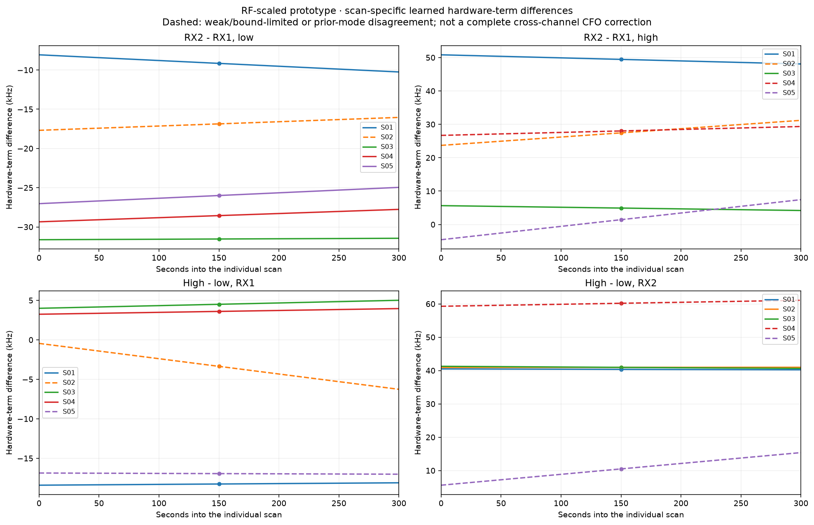

# Learned scan-specific RX and band shifts

These values come from the final **RF-scaled any-lane prototype**, not the
earlier same-channel fit. They are differences of the fitted native-Hz
hardware terms in:

```text
y + kP = (actual_RF / 11.5 GHz) p(t) + a_RX,band + d_RX,band (t − 150) + noise
```

Each scan has its own four offsets and four drifts. All offset values below
refer to **150 seconds into that scan**. For a named relation B − A:

```text
hardware_difference(t) = (a_B − a_A) + (d_B − d_A) (t − 150)
```

Subtract each path's native-Hz hardware term before RF normalization. For the
same RF channel and common underlying curve, subtracting the RX2−RX1
difference aligns RX2 to RX1. Across different RF channels, the raw difference
also includes `(q_B − q_A) p(t)`: the band-difference table is not by itself a
complete raw-CFO correction. Integer alias lifts must precede RF scaling.

## Learned offsets at scan midpoint

All values are **kHz**. A dagger marks a weak, bound-limited or ambiguous
calibration relation; see the qualifications below.

| Scan | RX2 − RX1, low | RX2 − RX1, high | High − low, RX1 | High − low, RX2 |
| --- | ---: | ---: | ---: | ---: |
| S01 | −9.161 | +49.450 | −18.256 | +40.356 |
| S02 | −16.869 † | +27.442 † | −3.359 † | +40.951 |
| S03 | −31.539 | +4.915 | +4.501 | +40.955 |
| S04 | −28.557 | +28.018 † | +3.599 | +60.174 † |
| S05 | −25.998 | +1.436 † | −16.941 † | +10.492 † |

## Learned relative drifts

All values are **Hz/s**, with the same B − A sign convention.

| Scan | RX2 − RX1, low | RX2 − RX1, high | High − low, RX1 | High − low, RX2 |
| --- | ---: | ---: | ---: | ---: |
| S01 | −7.29 | −9.15 | +1.01 | −0.85 |
| S02 | +5.49 † | +25.00 † | −19.38 † | +0.13 |
| S03 | +0.61 | −4.86 | +3.38 | −2.08 |
| S04 | +5.28 | +8.89 † | +2.39 | +5.99 † |
| S05 | +6.92 | +40.00 † | −0.50 † | +32.59 † |

The per-path drift bound is ±20 Hz/s; a difference between two paths can
therefore reach ±40 Hz/s. The S05 high-band +40 Hz/s result comes from
opposing active bounds and must not be treated as a measured physical drift.



*Solid lines pass the prototype calibration checks and have no listed mode
qualification. Dashed lines have the qualifications described here. All lines
are conditional model fits, not independently validated hardware measurements.
[PDF](learned-shifts.pdf).*

## Interpretation and qualifications

- **S01:** all four paths pass the prototype's calibration checks. The low/high
  RX differences are substantially different, supporting separate band offsets.
- **S02:** RX1 high reaches the −20 Hz/s drift bound. The new low-band RX
  offset differs from the earlier weak single-channel estimate of −30.691 kHz
  by approximately +13.823 kHz. This is a calibration/matching-mode ambiguity,
  not evidence that either fit is a confirmed hardware measurement.
- **S03:** all four paths pass the prototype checks. The high-band value is
  newly constrained through cross-channel associations and remains conditional
  on those associations and alias choices.
- **S04:** RX2 high has only three anchors over approximately 25.7 seconds,
  insufficient for scan-wide calibration support. Relations using it remain
  provisional.
- **S05:** RX1 high and RX2 high reach −20 and +20 Hz/s respectively. Their
  relative high-band offset/drift and both cross-band relations are provisional.

RX2's high-minus-low offset is similar in S01, S02 and S03—approximately
40.4–41.0 kHz—but that descriptive agreement does not establish one constant
for the dataset. The model continues to fit each scan independently.

Absolute calibration coordinates depend on the fixed RF-scaling model,
selected alias branches, priors and local matching solution. Low residuals or
a full-rank local normal matrix do not remove those ambiguities. These results
do not establish transmitter identities or localization accuracy.

## Data and reproduction

- [Exact differences, start/end values, support flags and prior discrepancies](learned-shifts.csv).
- [All 20 fitted RX/band node coordinates and support metadata](learned-calibration-nodes.csv).
- [Input/source digests and sign convention](learned-shifts-provenance.json).
- [Prototype methodology, complete scan visualizations and time controls](README.md).

```bash
.venv/bin/python tools/report_dsx01_learned_shifts.py
```

The generator checks each stored offset/drift against the parameter vector and
verifies four-node cycle closure separately for offsets and drifts. It reads
the frozen results and does not refit calibration or alter any memberships.
