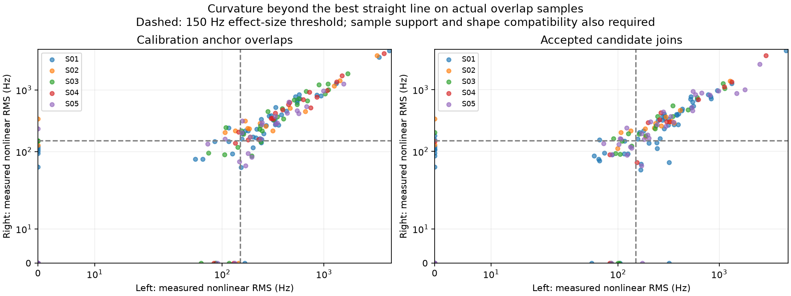

# DSX01: offset confidence and curvature-only calibration audit

## Motivation

Avoid forcing unrelated tracks together. Linear tracks can overlap and join after
calibration is fixed. They must contribute **zero observations to learning the
receiver/band offsets and drifts**. Curvature must be resolved by observations,
rather than inferred from a polynomial's declared degree.

## Problem

The published any-lane prototype learned scan-specific, four-path offset/drift
coordinates and reduced 676 Graph fragments to 465 candidate components. Its
small conditional parameter errors and noise-like union residuals do not establish
correct identity. Existing independent lane-time controls still produced 30, 39,
and 30 joins, respectively. Historical calibration priors also reused observations
and could include nearly linear tracks.

Offset precision and identity confidence are different. A numerical covariance
conditions on the selected track matches, native alias branches, polynomial model,
noise scale, and weighting. It omits alternative identities and calibration modes.
No percentage probability of a correct match is available from these experiments.

## Solution

This audit adds a prior-free, fixed-hypothesis calibration using only actual
overlaps with substantial, compatible nonlinear signal in **both** tracks. Linear
and insufficiently curved overlaps are excluded internally. No historical offset
or drift prior enters this fit. The original four native drift bounds of ±20 Hz/s
remain explicit physical assumptions. Hitting a bound is a warning about weak or
inconsistent calibration, rather than supporting evidence.

The original identities and alias branches remain conditional hypotheses. This
audit does not independently rediscover those hypotheses, prove their identities,
or overwrite the published calibrations and assignments. Its fixed hypotheses
originally came from the broader prototype; selection uncertainty remains.

The fitting and joining stages have separate eligibility rules:

1. Learn calibration from overlaps with resolved nonlinear signal only.
2. Freeze scan-specific calibration before evaluating additional track joins.
3. Allow linear overlaps under that fixed calibration, with the existing sample
   residual, continuity, complexity, and ownership checks. Joining them must not
   feed observations back into calibration.
4. If calibration is unresolved or alternative identities remain competitive,
   retain separate hypotheses. Do not enlarge matching gates merely to absorb
   calibration uncertainty.

## Method

Use the frozen 18,338 associated original observations in 676 Graph fragments,
independently for each scan. No new observations, random holdout, or RF collection
are used. Known carrier-frequency ratios are retained; no RF-dependent learned
coefficient or localization estimate is introduced.

On each original track's actual overlap samples, compare a straight line with
degree 1–4 Legendre fits using BIC and the existing 150 Hz nominal noise scale.
Project the selected curve onto, and subtract, its best affine approximation.
Subtract the expected extra noise degrees of freedom from its nonlinear power.
Require all of the following for calibration eligibility:

- At least 20 actual samples in each track's overlap.
- At least 150 Hz of noise-corrected nonlinear RMS in each track.
- Improvement over a straight line of at least 25 in chi-square and 10 in BIC.
- After known RF normalization and removal of affine differences, independently
  fitted nonlinear shapes differ by no more than 150 Hz RMS on the overlap.

These exploratory thresholds express sample support and effect size; they are not
a calibrated multiple-comparison test. No polynomial degree alone qualifies a
track. Offset, linear drift, and constant native alias lifts disappear under
affine projection, making this test independent of their numerical values.
Changing curvature can provide a more distinctive signature than constant
quadratic curvature, but neither by itself proves common identity.

For eligible fixed pair/alias hypotheses, profile out a separate degree-four
shared curve per pair and solve the remaining eight-parameter linear calibration.
There are no historical or Gaussian regularization priors. Enumerate all 81
configurations of free/upper/lower drift bounds and select the constrained
least-squares solution. Report data rank and estimability explicitly. Unobservable
contrasts are left blank, rather than reporting arbitrary minimum-norm values as
measured offsets. Standard errors use the unbounded data information at the fixed
150 Hz noise assumption; they do not include active-bound or selection uncertainty.

The earlier curved-only sensitivity fit **with historical priors retained** is
also saved for comparison, clearly separate from the prior-free fit. All original
proposals were reconstructed and refitted: all five scans reproduced the original
eight calibration coordinates exactly. Restarting from the retained anchors alone
is a distinct pruning sensitivity experiment, not an identical-input repeat.

## Results

All offsets below are native-Hz hardware-term differences, evaluated at 150 seconds
within the scan. The applied difference is `a + d * (t - 150)`. Cross-band raw CFO
differences additionally contain the carrier-scaled common signal curve; subtract
hardware terms before RF normalization.

The prior-free numbers below are **conditional diagnostics, not replacement
calibrations or identity confidence intervals**. The `±` values are one formal
standard error under the fixed hypothesis. Drift bounds and covariance omissions
can dominate their practical interpretation.

| Scan | Difference | Curved direct anchors / all direct anchors | Prior-free offset at 150 s (Hz ± conditional SE) | Relative drift (Hz/s ± conditional SE) |
|---|---|---:|---:|---:|
| S01 | RX2 − RX1, low | 5 / 7 | −9,093 ± 17 | −6.93 ± 0.17 |
| S01 | RX2 − RX1, high | 1 / 6 | +49,443 ± 123 | −18.06 ± 4.48 |
| S01 | High − low, RX1 | 1 / 17 | −18,406 ± 202 | +3.61 ± 3.36 |
| S01 | High − low, RX2 | 1 / 10 | +40,129 ± 125 | −7.52 ± 1.87 |
| S02 | RX2 − RX1, low | 0 / 1 | Unobservable | Unobservable |
| S02 | RX2 − RX1, high | 0 / 1 | Unobservable | Unobservable |
| S02 | High − low, RX1 | 4 / 4 | −14,869 ± 998 | −1.37 ± 8.62 |
| S02 | High − low, RX2 | 0 / 9 | Unobservable | Unobservable |
| S03 | RX2 − RX1, low | 1 / 8 | −31,398 ± 114 | −0.76 ± 5.83 |
| S03 | RX2 − RX1, high | 0 / 0 | +5,399 ± 415 | −6.52 ± 8.35 |
| S03 | High − low, RX1 | 2 / 6 | +3,717 ± 260 | +4.14 ± 3.08 |
| S03 | High − low, RX2 | 1 / 9 | +40,514 ± 478 | −1.61 ± 6.29 |
| S04 | RX2 − RX1, low | 0 / 6 | −29,776 ± 6,125 | +35.33 ± 109.06 |
| S04 | RX2 − RX1, high | 0 / 1 | +26,887 ± 6,662 | +37.95 ± 118.72 |
| S04 | High − low, RX1 | 3 / 7 | +3,764 ± 76 | +2.05 ± 5.22 |
| S04 | High − low, RX2 | 1 / 2 | +60,427 ± 551 | +4.67 ± 9.77 |
| S05 | RX2 − RX1, low | 2 / 12 | −25,766 ± 31 | +9.00 ± 0.50 |
| S05 | RX2 − RX1, high | 0 / 0 | Unobservable | Unobservable |
| S05 | High − low, RX1 | 2 / 7 | −17,320 ± 795 | +2.68 ± 45.34 |
| S05 | High − low, RX2 | 0 / 2 | Unobservable | Unobservable |

Direct anchor counts are not counts of independent emitters; channel copies may
share a physical curve. A zero direct count can still yield a numerical estimate
through indirect paths or small within-band carrier-ratio leverage. In S04 that
leverage is particularly weak: the two receivers have no direct eligible curved
anchor and their relative corrections are poorly determined despite full rank.

| Scan | Eligible curved pairs | Calibration observations | Data rank / 8 | Drift bounds active in prior-free fit | Pooled native residual RMS (Hz) |
|---|---:|---:|---:|---|---:|
| S01 | 12 | 806 | 8 | None | 114.9 |
| S02 | 4 | 280 | 4 | RX1 high | 135.1 |
| S03 | 6 | 424 | 8 | RX2 high | 153.9 |
| S04 | 7 | 465 | 8 | RX1 low, RX2 high | 127.6 |
| S05 | 5 | 265 | 6 | RX2 low | 148.6 |

### Practical confidence assessment

S01 low-band RX calibration has the strongest support: five curved direct
overlaps, across several scan times and channels. S05 low-band RX calibration is
also promising, with two curved direct overlaps near 81 and 200 seconds. Both
remain conditional on matching and alias hypotheses. No confidence percentage is
justified.

S03 low-band midpoint offset is tentative, but its drift is weakly determined.
S01 high-band midpoint RX offset is substantially more stable than its drift;
the prior-free drift differs by approximately 8.9 Hz/s from the published value.
The one-anchor band differences in S01 and S03 need more independent support.

S02 cannot calibrate any RX2 contrast from the eligible curved data. Even its
four curved RX1 cross-band anchors support a different mode from the published
fit, with approximately 1 kHz formal offset uncertainty and an active drift bound.
S04 RX alignment is weak, with approximately 6–7 kHz formal offset uncertainty.
S05 RX2 high is completely unobserved by eligible curved anchors. These cases
must not use the old linear-supported estimates as calibration fallback.

### Diagnostic curvature comparison, not a track-joining rule

| Dataset | Previously accepted joins | Both tracks have active curvature | Also compatible nonlinear shape |
|---|---:|---:|---:|
| Real five-scan dataset | 211 | 27 | 24 |
| Time-shift control, seed 41 | 30 | 4 | 0 |
| Time-shift control, seed 142 | 39 | 5 | 0 |
| Time-shift control, seed 243 | 30 | 4 | 0 |

The remaining real joins are **not rejected for being linear**. These counts only
show how additional curvature evidence discriminates among existing hypotheses.
The three controls used frozen original calibration and were not recalibrated
using the new curved-only procedure. The screen is exploratory and was evaluated
on existing controls; zero passes is not evidence of zero false-match probability
or a calibrated false-discovery rate.



## Validation and artifacts

The seven audit tests check noise/weak curvature rejection, invariance to affine
hardware terms and aliases, actual-overlap support, incompatible curvature,
known RF scaling, zero linear-track influence on calibration, and successful
linear-overlap joining under fixed calibration. Together with the existing
multilane, receiver, and cohort tests, 37 focused tests pass.

Reproduce with:

```bash
.venv/bin/python tools/audit_dsx01_offset_confidence.py
.venv/bin/python -m pytest -q tests/analysis/test_dsx01_offset_confidence.py tests/analysis/test_multilane_tracklet_prototype.py tests/analysis/test_dsx01_receiver_model.py tests/analysis/test_dsx01_graph_receivers.py tests/analysis/test_dsx01_cohort_tracklets.py
```

- [All 20 contrasts, formal errors and sensitivity results](offset-evidence.csv)
- [Original calibration anchor curvature measurements](anchors.csv)
- [Previously accepted edge curvature measurements](accepted-edges.csv)
- [Diagnostic control counts](screening-counts.csv)
- [Conditional curved fits and sensitivity fits](curved-anchor-refits.json)
- [Input, numerical dependency and source hashes](provenance.json)

No original observation assignments, published fit files, or main-branch report
were modified. The 465-component fusion was not rerun or promoted by this audit.
