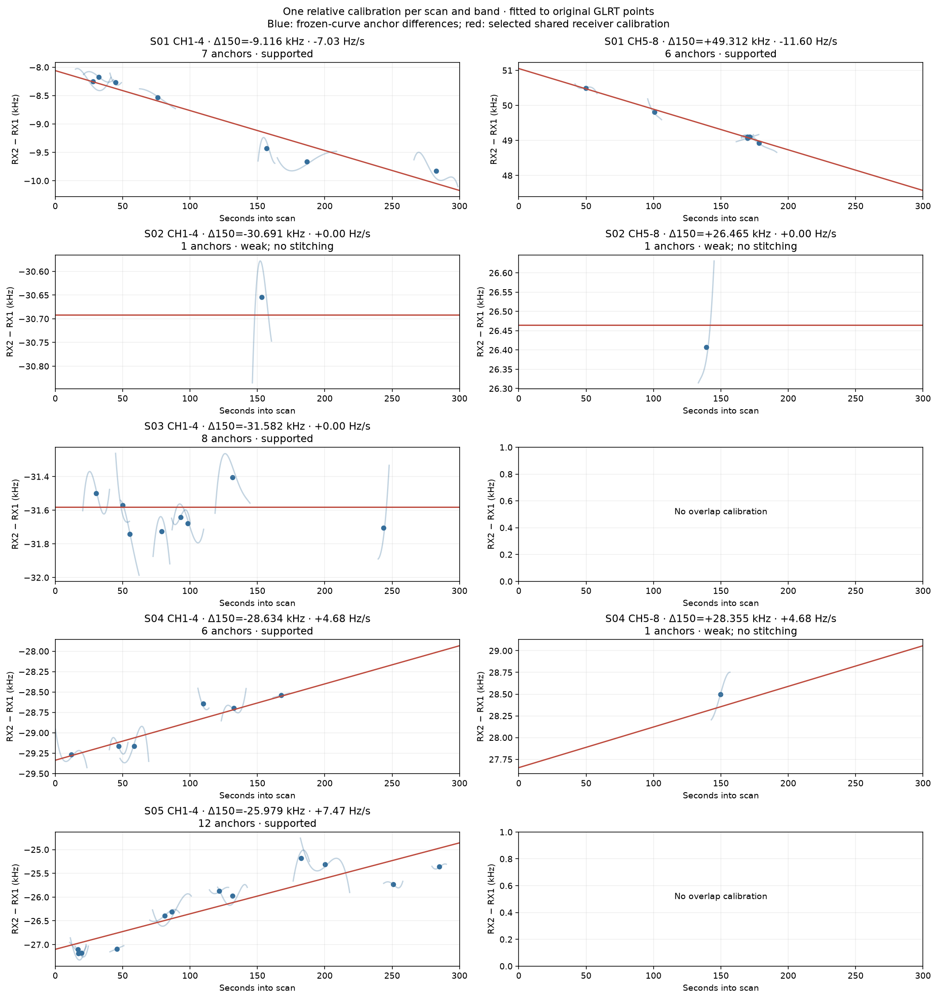
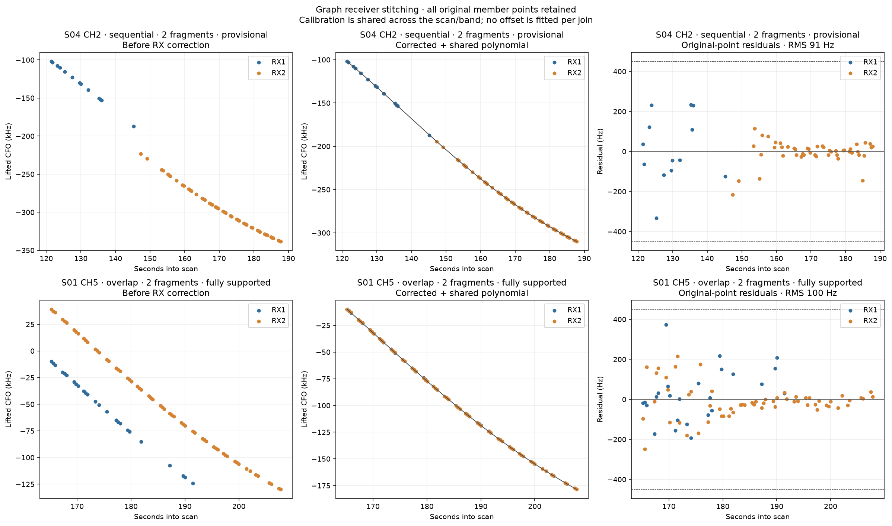
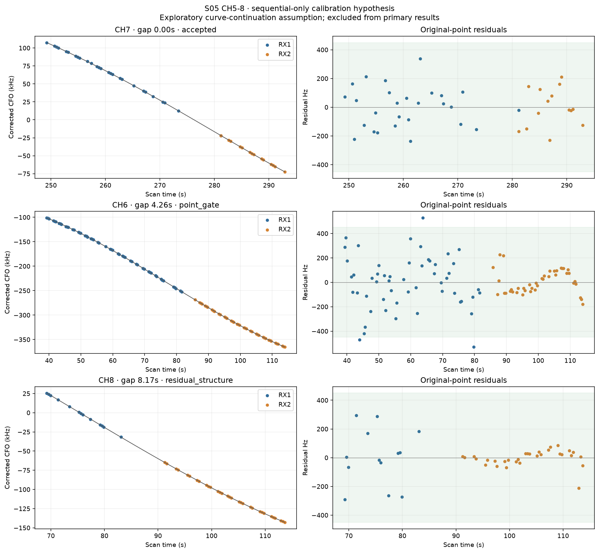

# DSX01 scan-specific receiver/band calibration and tracklet stitching

## Motivation

Use one receiver calibration per scan and band to unite Graph tracklets that
overlap or continue across a receiver handoff. A transmitter curve can have
several fragments on either receiver; overlap is not a requirement for a join.

## Problem

Each receiver can have its own constant low/high-band offset and small linear
drift. The previous [RX comparison](../2026_10_17_dsx01_graph_rx_alignment/README.md)
used fitted-curve differences, required eight seconds of overlap and imposed
exclusive pairs. It demonstrated relative calibration but omitted sequential
continuations and fragmented many-to-one matches.

Unknown polynomial curves also create a gauge ambiguity: their constant and
linear coefficients can absorb a common receiver offset and drift. These GLRT
data identify RX2 relative to RX1 within a band, not the separate absolute
hardware offsets/drifts of both receivers. Independent frequency information
would be needed to make that physical split.

## Solution

Fit scan-specific relative low/high-band offsets and drifts jointly with shared
polynomials, using original GLRT observations in overlapping anchor pairs.
Then freeze that calibration and test full tracklet unions, including short
gaps, without fitting another offset at a join or dropping difficult points.

The conservative primary pass finds **31 candidate links: 29 overlapping and
two sequential**. This forms 30 merged groups from 61 original tracklets and
reduces the descriptive inventory from **676 to 645**, preserving all 18,338
associated observations. Ten merged groups have at least 20 points from each
receiver and no detected residual structure. The other 20 groups, including
both sequential joins, remain provisional. Keeping only the ten adequately
supported groups would leave 666 tracks.

## Method

For observation i in scan s, receiver r, band b and latent curve j:

```text
y_i + k_i P = p_j(t_i) + a_s,r,b + d_s,r,b (t_i − 150) + ε_i
P = 227272.727 Hz
```

Use RX1 as the frequency reference independently in each band. The identifiable
relative parameters are A_s,b = a_s,2,b − a_s,1,b and
D_s,b = d_s,2,b − d_s,1,b. RX2 is corrected by subtracting
`A_s,b + D_s,b * (t − 150)`; integer alias lifts remain explicit. The reference
curve includes RX1's hardware nuisance and is not asserted to be true Doppler.
Low band is CH1–4 and high band CH5–8 in these scans. Only matching RF channels
are joined. No orbital identities, localization fit or learned RF coefficient c
enter this experiment.

The 42 exclusive overlap anchors from the previous bounded modal search supply
1,487 original observations. Shared degree-0-through-4 Legendre polynomials are
profiled out while fitting calibration, with Huber reweighting and a relative
drift prior of 10 Hz/s. Three models are compared on the same observations:
separate band offsets with zero relative drift, a shared relative band drift,
and separate band drifts. The descriptive selection score is:

```text
sum(residual² / 150²)
  + sum_over_curves((degree + 1) log(curve_observations))
  + calibration_parameter_count log(total_observations)
  + sum((relative_drift / 10)²)
```

This is a local robust fitting and model-selection procedure, not a globally
optimal or independently validated clustering result. All observations take
part; there is no holdout-based selection. The anchor memberships and alias
branches were selected from these same scans.

Calibration is eligible for scan-wide stitching only with at least three
anchors across two channels, at least 60 seconds of anchor-center coverage,
and a conditional endpoint standard error below 300 Hz. Reported errors are
conditional on selected memberships and polynomial degrees; they exclude
matching uncertainty. A weak constant fit does not establish zero drift.

## Calibration results

Offsets are RX2 minus RX1 at **150 seconds into the individual scan**.

| Scan / band | Relative offset at 150 s (kHz) | Relative drift (Hz/s) | Use |
| --- | ---: | ---: | --- |
| S01 low | −9.116 | −7.03 | Supported calibration |
| S01 high | +49.312 | −11.60 | Supported calibration |
| S02 low | −30.691 | Unresolved | One anchor; no stitching |
| S02 high | +26.465 | Unresolved | One anchor; no stitching |
| S03 low | −31.582 | 0 selected | Constant adequately describes anchors |
| S03 high | — | — | No qualifying overlap anchor |
| S04 low | −28.634 | +4.68 | Supported calibration |
| S04 high | +28.355 | +4.68 assumed | Shared-drift model; one anchor, no stitching |
| S05 low | −25.979 | +7.47 | Supported calibration |
| S05 high | — | — | Sequential hypothesis investigated separately |

| Scan | Zero-drift RMS (Hz) | Shared-drift RMS (Hz) | Separate-band-drift RMS (Hz) | Selected model |
| --- | ---: | ---: | ---: | --- |
| S01 | 342.6 | 147.7 | 135.2 | Separate band drifts |
| S02 | 106.3 | 106.3 | 105.9 | Constant, weak support |
| S03 | 138.3 | 138.2 | 138.2 | Constant |
| S04 | 169.2 | 122.4 | 122.3 | Shared drift; high band weak |
| S05 | 337.1 | 181.2 | 181.2 | Drift, low band only |

These are original-point calibration-core residuals, not the previous
fitted-curve mismatch RMS. S05 has only one anchored band, so its shared and
separate-drift designs are identical. Model selection uses the penalized score,
not the smallest RMS alone. Sources: [all model scores](calibration-models.csv),
[selected calibration and conditional errors](scan-band-calibration.csv).



*Blue curves describe the frozen overlap-anchor differences; red lines come
from joint fitting of the original observations. Weak groups do not authorize
stitching. [PDF](scan-band-calibration.pdf).*

## Overlaps and sequential continuations

Candidate edges connect opposite receivers on the same scan/channel, with
overlap or a gap of at most ten seconds. Gap proposals use bounded polynomial
endpoint extrapolation, frequency agreement and derivative agreement. The
maximum extrapolation from an endpoint is five seconds. All acceptance residuals
use actual observations, not extrapolated values.

A proposed union fits one shared polynomial of degree at most four across all
original member points. This enforces value and slope continuity, including
through a gap. Every residual must stay strictly within 450 Hz, the polynomial
slope must stay within 8,000 Hz/s analytically, and the observation gap must
remain within ten seconds. A positive complexity gain is required versus
keeping the original Graph fragments, using the existing 18-unit track cost
and positive coefficient costs. Merging components must also improve the
current component cost; pairwise-compatible edges cannot bypass this check.

Residual checks run jointly and separately for RX1 and RX2: nonzero mean,
linear trend, local means, cumulative residuals, sign runs, adjacent correlation
and mean steps. Passing descriptive checks is not proof of whiteness, especially
on short supports. At least 20 observations from each receiver are required
for the adequately supported category. No point is removed to make a union fit.

Greedy component unions permit several fragments from one receiver to meet
one curve on the other. The primary result includes one three-fragment group.
Shared piecewise models with extra knots were not added in this first pass;
the single-polynomial restriction can reject legitimate longer continuations.

| Scan | Original tracklets | After candidate stitching | Overlap links | Sequential links | Adequately supported merged groups |
| --- | ---: | ---: | ---: | ---: | ---: |
| S01 | 170 | 159 | 11 | 0 | 5 |
| S02 | 116 | 116 | 0 | 0 | 0 |
| S03 | 132 | 125 | 7 | 0 | 3 |
| S04 | 116 | 107 | 8 | 1 | 0 |
| S05 | 142 | 138 | 3 | 1 | 2 |
| Total | 676 | 645 | 29 | 2 | 10 |

The two sequential links are S04 CH2, gap **2.131 s**, 61 points, RMS
**90.6 Hz**, and S05 CH1, gap **8.165 s**, 39 points, RMS **148.0 Hz**.
Both need quartics and are provisional: S04 has only 13 RX1 points; S05 has
only nine RX2 points. The 30 merged groups contain 1,560 points, of which 663
are in the ten adequately supported groups.

Association coverage stays **91.31%**: 18,338 points associated and 1,746
unassociated, out of 20,084. Fusion changes the number of tracklets rather than
claiming new detections. Mean points per resulting component rises from 27.13
to 28.43 when provisional unions are included.



*Top: the S04 CH2 receiver handoff. Bottom: a supported S01 high-band overlap.
Dots are original GLRT observations; the middle line is one shared polynomial;
the right panels show original-point residuals. [PDF](stitching-examples.pdf).*

Sources: [per-scan results](per-scan-stitching.csv), [accepted links](accepted-links.csv),
[all component ownership and support categories](components.csv),
[every associated observation with correction, alias lift and residual](fused-observations.csv).

## Sequential-only calibration hypothesis

Missing overlap does not mean calibration is impossible. A separate search
tests short-gap endpoint/slope consensus in weak or missing bands. S05 high
band has three candidates on CH6, CH7 and CH8. Joint fitting suggests a relative
offset of **+30.689 kHz at 150 s** and drift **+9.72 Hz/s**. This depends on
the assumed continuations and is excluded from primary calibration/stitching.

Only the CH7 continuation passes the complete union checks and it remains
provisional. CH6 fails the 450 Hz point gate; CH8 retains residual structure.
The approximately zero CH7 gap is 14 ns in the exported timestamps and should
be interpreted as touching supports, not a meaningful measured time gap.



*A visually plausible shared curve can retain a point-gate failure or structured
residuals on the Hz scale. [PDF](S05-sequential-calibration-hypothesis.pdf);
[all weak-band sequential offset candidates](sequential-offset-candidates.csv).*

## Whole-scan inspection and controls

Each gallery shows all eight channels: original associated GLRT, corrected
GLRT with accepted common curves, and original-point residuals of merged groups.
Gray points in the corrected view indicate weak/absent calibration and remain
uncorrected. Plot wrapping at the alias boundary is not a physical discontinuity.

- [S01](S01-all-channels.png) / [PDF](S01-all-channels.pdf).
- [S02](S02-all-channels.png) / [PDF](S02-all-channels.pdf).
- [S03](S03-all-channels.png) / [PDF](S03-all-channels.pdf).
- [S04](S04-all-channels.png) / [PDF](S04-all-channels.pdf).
- [S05](S05-all-channels.png) / [PDF](S05-all-channels.pdf).

With the learned calibration frozen, circular RX2 time shifts of 57 and 113
seconds produce zero joins. The 179-second shift produces one provisional
sequential join and no adequately supported group. Splitting tracks at the
circular boundary changes the number of input fragments in these controls.
These are bounded descriptive controls, not a calibrated false-discovery rate
and not a repeat of calibration discovery under the null.
[Control table](temporal-controls.csv).

## Reproduction and validation

```bash
OPENBLAS_NUM_THREADS=1 OMP_NUM_THREADS=1 \
  .venv/bin/python tools/model_dsx01_receiver_tracklets.py
.venv/bin/python -m pytest -q tests/analysis/test_dsx01_receiver_model.py \
  tests/analysis/test_dsx01_graph_receivers.py
```

Use `--output` for a fresh replay. [results.json](results.json) contains every
merged coefficient, membership, alias adjustment, diagnostic, calibration
model, sequential hypothesis, and input/source SHA256. Existing numerical
sources and Graph evidence remain unchanged. Eleven focused tests cover known
calibration recovery, gauge ambiguity, true/false sequential joins, gap limits,
receiver-specific trends, weak calibration, aliases and temporal controls.

This is a conservative preliminary model investigation. Parameters and matches
are conditional on an inspected development dataset. It does not establish
physical spacecraft identities or localization accuracy.
