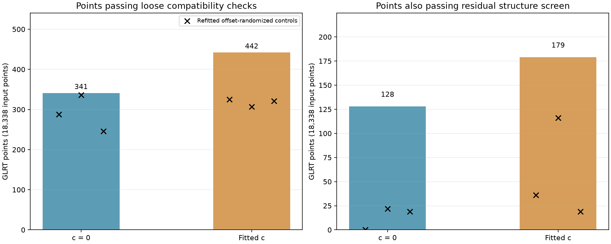
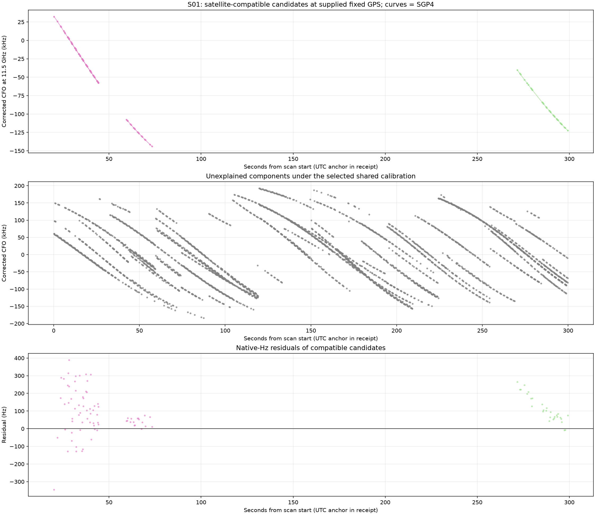
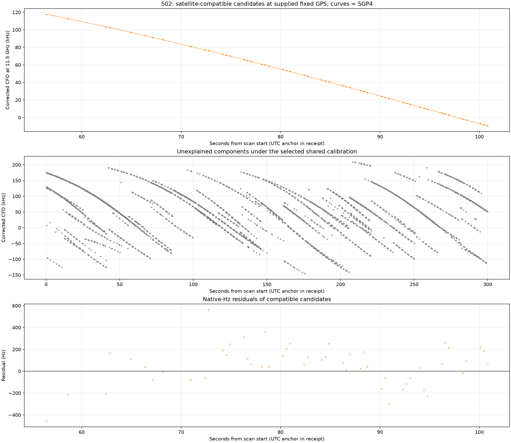
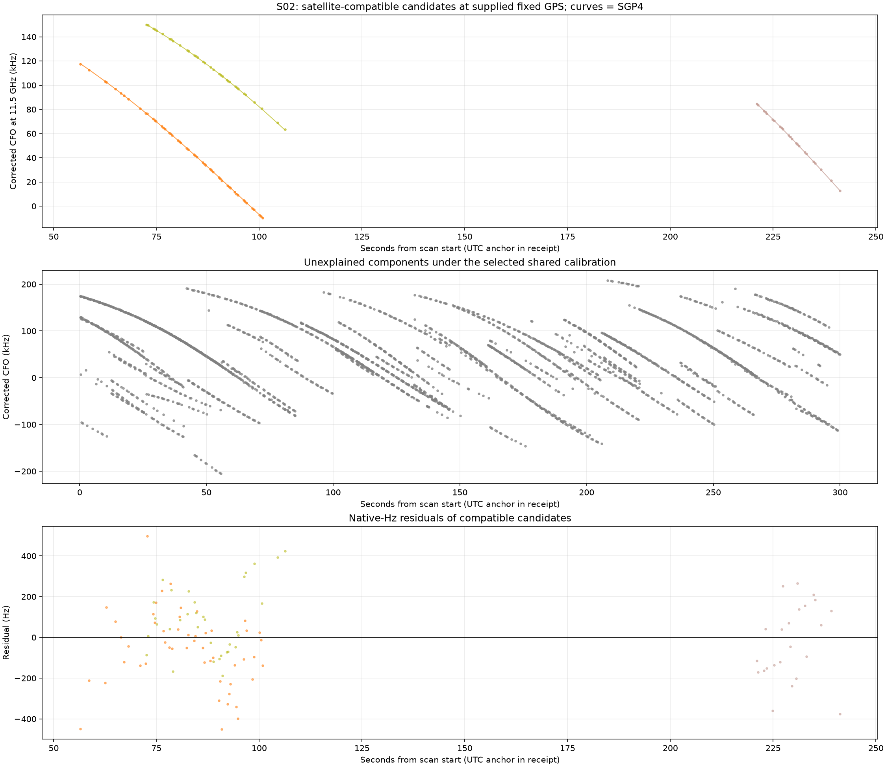
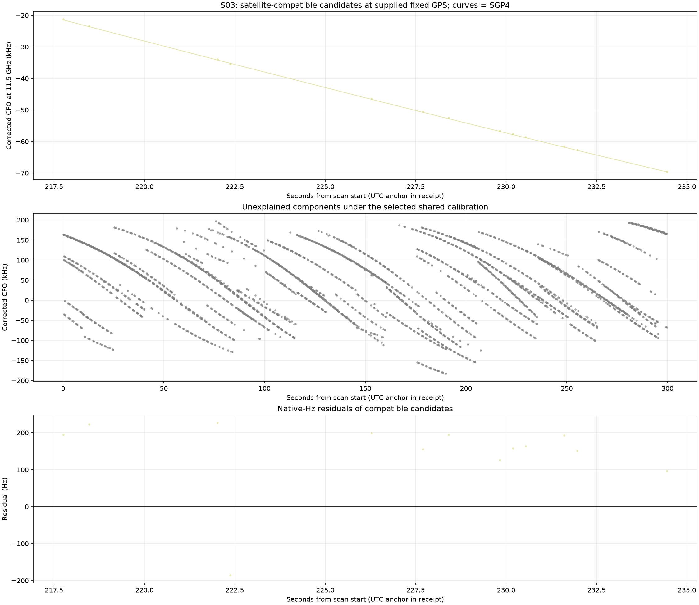
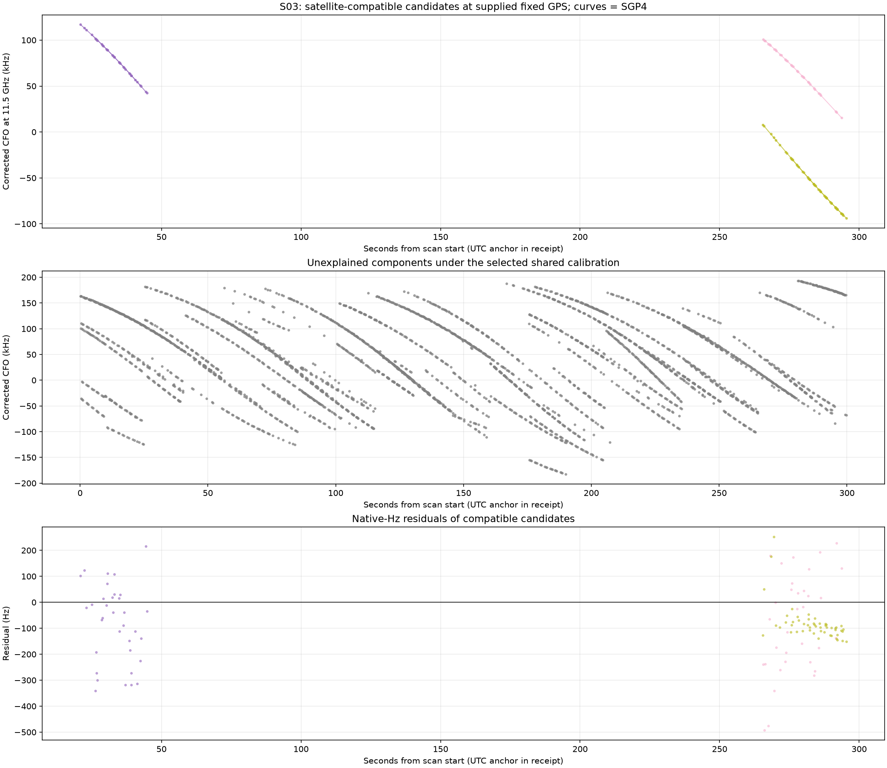
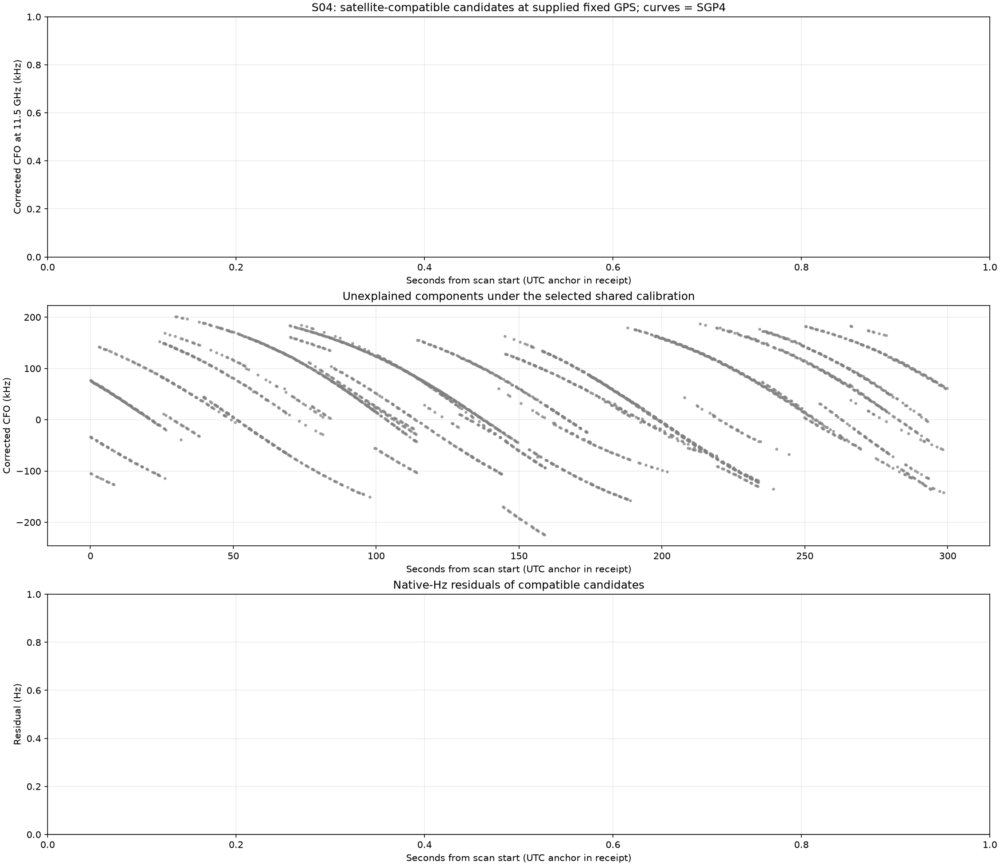
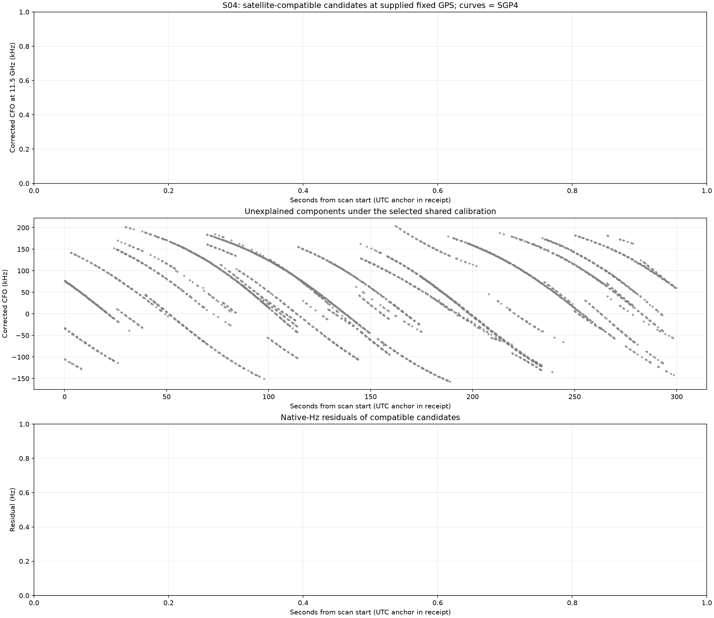
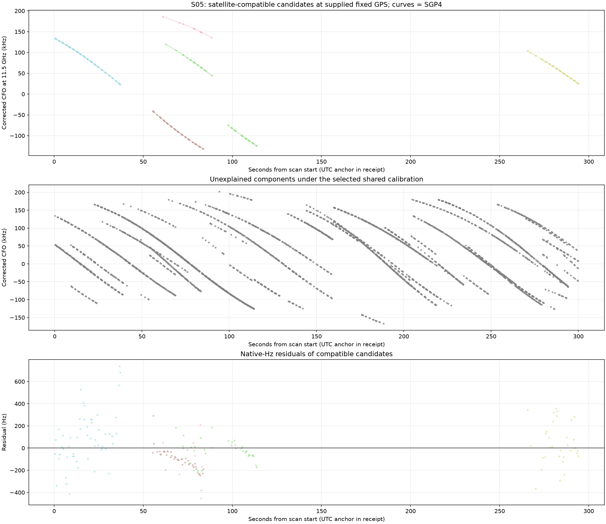
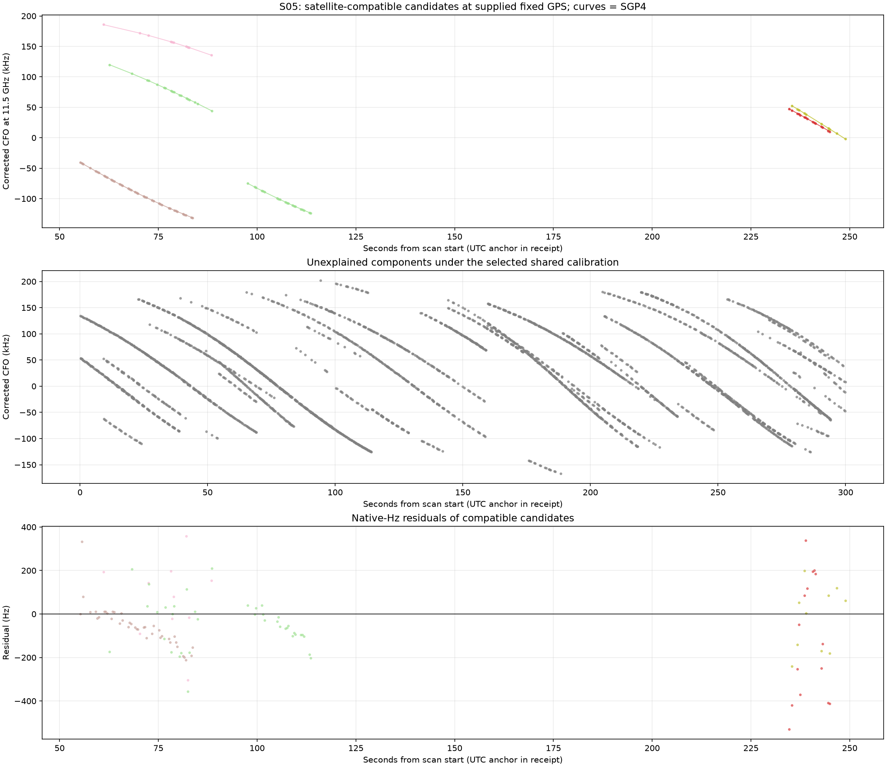

# DSX01: fixed-site satellite association investigation

Fixed ground truth: **37.849061591561885, -122.48574968092912**. Latitude and longitude are never fitted. WGS84 ellipsoidal height is assumed 0 m because measured altitude is unavailable. This is a bounded existing-recording experiment, with no new RF collection.

The previous [four-variant report is published on main](https://github.com/misko/leo-tracker-reduxredux/blob/main/reports/2026_10_17_dsx01_consensus_calibration/README.md), commit `329e8a0c7276d112641d610937ec363e83ebfeb8`.

**Result: the present shared-calibration prototype does not establish confident satellite identities.** Its candidate counts are small, residual structure removes more matches, and independent component frequency translations also produce apparent matches. No claim of physical satellite identification or improved localization follows from these fits. A bounded local search is not a certificate that a better joint assignment does not exist.

The inputs are all **456 trimmed least-squares components**, containing **676 original Graph fragments / 18,338 GLRT points**, from 20,084 total GLRT detections. The 1,746 points outside the Graph components are outside this experiment. Component membership is fixed. A component receives one candidate NORAD; failed components are not silently split. The trimmed-LS calibration initializes the search; its coefficients are reestimated rather than imposed as hard constraints. All points are fitted; none are withheld in the primary fit.

## Hardware model: separate paths, small drifts, and per-scan shifts

For observation i in original fragment j, component h, scan s, receiver r and band b:

```text
y_i + k_j * P = Doppler(NORAD_h, true_position, exact_UTC_i, actual_RF_i)
                + a[s,r,b] + d[s,r,b] * (time_i - 150 seconds)
                + c[s] * (actual_RF_i - 11.5 GHz)
                + known_nominal_tuner_correction_i + residual_i
P = 227272.7272727 Hz, k_j integer in native Hz
```

Each scan has four offset parameters and four drift parameters: **RX1-low, RX1-high, RX2-low, RX2-high**. Consequently the model includes both cross-band offsets and cross-receiver offsets, and allows the band difference to differ between receivers. The main arm uses a zero-centered Gaussian drift preference with sigma **2 Hz/s**, and a hard limit **±5 Hz/s**. These are declared small-drift hypotheses, not measured hardware specifications. The offsets are constant within each scan; they are not shared across DSX01. All recorded nominal tuner corrections were zero. The recorded RF/LNB mapping remains a hypothesis.

The ninth parameter is an optional shared RF-dependent coefficient c, with c=0 versus fitted-c arms. It is dimensionless when RF is in Hz. This is a frequency-fit ablation at a fixed known position; it is not a localization experiment. Candidate sets, observations, drift priors, gates and maximum discovery-seed budget are matched. No per-track continuous offset or slope is available in the physical fit. Aliases are profiled separately for each original fragment, before RF scaling.

Only fragments with **measured active curvature** calibrate hardware: at least 20 seconds span and at least 250 Hz RMS departure from their best affine fit. Linear fragments cannot calibrate even when another fragment in their merged component is curved. This is a heuristic curvature screen, not a proof of distinct identity. Linear fragments can be evaluated with the resulting calibration.

The four offset contrasts obey a cycle: RX2-low minus RX1-low; RX2-high minus RX1-high; RX1-high minus RX1-low; RX2-high minus RX2-low. Only three contrasts are independent. Their native-Hz differences have integer-alias alternatives; wrapped differences alone are not unique physical LO measurements. Full path coefficients and support flags are in [calibration_paths.csv](calibration_paths.csv). Unsupported paths must not be interpreted as measured calibration.

## Causal Space-Track orbit evidence

For each NORAD we select the newest eligible element epoch, using only Space-Track archive snapshots collected by scan start, with both epoch and collection in the preceding 48 hours. Repeated identical payloads are deduplicated with the latest eligible collection tie-break. No future collection, nearest-future snapshot, or previous association labels enter the candidate selection. Requiring a past element epoch is an additional conservative rule: availability and epoch are distinct quantities. [Space-Track documents GP and historical GP separately](https://www.space-track.org/documentation).

SGP4 is evaluated at the actual GLRT timestamps. TEME to ECEF uses UTC as an approximation to UT1 and neglects polar motion; the observer is stationary. Doppler sign is positive for an approaching satellite. [Vallado et al.](https://celestrak.org/publications/AIAA/2006-6753/) provide the SGP4 reference and verification work. A broad coarse horizon guard selects candidates; final component membership requires the candidate above the geometric horizon at every observation. Antenna beam poses are not sufficiently measured to impose a narrow angular gate.

| Scan | Causal Starlinks | Broad sky bank | Min TLE age (h) | Median (h) | 95th percentile (h) | Max (h) |
| --- | --- | --- | --- | --- | --- | --- |
| S01 | 11144 | 1246 | 1.54 | 13.03 | 27.10 | 47.41 |
| S02 | 11145 | 1027 | 5.02 | 10.85 | 23.83 | 45.05 |
| S03 | 11143 | 1005 | 5.53 | 11.14 | 23.96 | 47.42 |
| S04 | 11142 | 1033 | 6.03 | 11.66 | 25.46 | 47.50 |
| S05 | 11139 | 1014 | 6.54 | 12.47 | 24.08 | 47.65 |

Selected element sets and per-NORAD epoch/collection/digest provenance are frozen under [inputs](inputs). Orbit matrices are local reproducible caches at `/tmp/dsx01-fixed-site-20261017-inputs`; they are not the primary orbit authority. Across these banks, ±100 m height changes reference-frequency Doppler by at most about 37.3 Hz. This is a geometric sensitivity calculation with fixed labels and calibration, not a complete refit or an altitude estimate.

## Results and interpretation

Loose compatibility requires per-fragment RMS ≤450 Hz, absolute mean ≤150 Hz, fitted trend excursion ≤300 Hz, half-to-half mean difference ≤300 Hz, and maximum absolute residual ≤1500 Hz. A separated candidate additionally has runner-up RMS at least max(600 Hz, twice the best RMS), conditional on the chosen calibration.

The stricter residual screen checks zero mean and slope at a 3-sigma heuristic threshold; a quadratic alternative must not improve BIC by more than 10; maximum split-mean z must be ≤4; lag-one correlation must be ≤4/sqrt(n) in magnitude. A 75-Hz noise floor avoids overstating precision. These diagnostics do not prove white noise, and their joint false-positive rate is not calibrated.

A further calibration evidence screen requires each participating hardware path to have at least three separated, noise-screened curved components, at least two candidate NORADs, ≥30 s time coverage, and no active drift bound. Even passing this screen would still require stability and independent validation before claiming identity.

| Scan | Arm | Components | Input points | Compatible components | Compatible points | % of input points | Also noise-screened components | Also noise-screened points | Full evidence-screened components |
| --- | --- | --- | --- | --- | --- | --- | --- | --- | --- |
| S01 | c0 | 106 | 4487 | 3 | 103 | 2.30% | 1 | 17 | 0 |
| S01 | fitted_c | 106 | 4487 | 3 | 103 | 2.30% | 0 | 0 | 0 |
| S02 | c0 | 89 | 3185 | 1 | 51 | 1.60% | 1 | 51 | 0 |
| S02 | fitted_c | 89 | 3185 | 3 | 108 | 3.39% | 2 | 74 | 0 |
| S03 | c0 | 87 | 3609 | 1 | 13 | 0.36% | 0 | 0 | 0 |
| S03 | fitted_c | 87 | 3609 | 3 | 118 | 3.27% | 2 | 67 | 0 |
| S04 | c0 | 76 | 3348 | 0 | 0 | 0.00% | 0 | 0 | 0 |
| S04 | fitted_c | 76 | 3348 | 0 | 0 | 0.00% | 0 | 0 | 0 |
| S05 | c0 | 98 | 3709 | 7 | 174 | 4.69% | 4 | 60 | 4 |
| S05 | fitted_c | 98 | 3709 | 6 | 113 | 3.05% | 3 | 38 | 0 |



For denominator clarity, compatible points are measured against the 18,338 input component points in the table; dividing by 20,084 instead includes the unresolved Graph detections. These candidate counts are not confirmed satellite associations.

**Curvature alone is permissive.** The following diagnostic removes a separate continuous affine term from each fragment, solely to measure a shape-fit lower bound. It is explicitly not the accepted association model:

| Scan | Components | Best shape-only RMS <200 Hz | Median best shape-only RMS (Hz) |
| --- | --- | --- | --- |
| S01 | 106 | 94 | 114.6 |
| S02 | 89 | 84 | 140.9 |
| S03 | 87 | 80 | 130.3 |
| S04 | 76 | 66 | 136.1 |
| S05 | 98 | 80 | 142.0 |

Thus many curves look satellite-like when arbitrary affine freedom is allowed. Their failure under the shared hardware model can reflect incorrect component joins, unmodeled signal bias, or a missed joint optimum. It does not establish that their emitters are absent from the catalogue.

## Controlled c ablation and calibration diagnostics

The research score below is a capped squared frequency error over curved components, with each component capped at 50 point-votes, divided by 150-Hz noise variance; a drift-prior penalty and k log(N) parameter penalty are shown separately. Capping residual RMS at 900 Hz creates a clutter option. This is a descriptive penalized score, not a likelihood-calibrated posterior or formal BIC for a mixture. N is the capped curved-component vote count; k is 8 or 9. A better value is a better in-sample frequency fit only.

| Scan | Arm | Capped frequency score | Drift prior | Parameter penalty | Total |
| --- | --- | --- | --- | --- | --- |
| S01 | c0 | 71329.3 | 12.6 | 62.6 | 71404.5 |
| S01 | fitted_c | 71344.9 | 12.6 | 70.4 | 71428.0 |
| S02 | c0 | 57559.1 | 16.6 | 61.1 | 57636.7 |
| S02 | fitted_c | 57163.0 | 11.6 | 68.7 | 57243.2 |
| S03 | c0 | 62478.0 | 13.5 | 61.9 | 62553.3 |
| S03 | fitted_c | 60577.7 | 22.5 | 69.6 | 60669.8 |
| S04 | c0 | 58016.4 | 21.6 | 61.2 | 58099.2 |
| S04 | fitted_c | 60430.9 | 10.4 | 68.8 | 60510.1 |
| S05 | c0 | 44753.7 | 1.0 | 60.6 | 44815.4 |
| S05 | fitted_c | 44405.0 | 0.9 | 68.2 | 44474.0 |

| Scan | Arm | Path | Offset at 150 s (Hz) | Drift (Hz/s) | Data rank | Qualified curved components | At drift bound | Calibration screen |
| --- | --- | --- | --- | --- | --- | --- | --- | --- |
| S01 | c0 | RX1-low | -5430.8 | 0.204 | 2 | 0 | False | False |
| S01 | c0 | RX1-high | -24714.6 | 5.000 | 2 | 0 | True | False |
| S01 | c0 | RX2-low | -14450.8 | -5.000 | 2 | 0 | True | False |
| S01 | c0 | RX2-high | 22630.1 | 0.709 | 2 | 0 | False | False |
| S01 | fitted_c | RX1-low | -5413.7 | 0.276 | 2 | 0 | False | False |
| S01 | fitted_c | RX1-high | -24743.9 | 5.000 | 2 | 0 | True | False |
| S01 | fitted_c | RX2-low | -14432.2 | -5.000 | 2 | 0 | True | False |
| S01 | fitted_c | RX2-high | 22595.8 | 0.716 | 2 | 0 | False | False |
| S02 | c0 | RX1-low | 72612.7 | -3.838 | 2 | 1 | False | False |
| S02 | c0 | RX1-high | 55826.3 | -5.000 | 2 | 0 | True | False |
| S02 | c0 | RX2-low | 44215.3 | -1.287 | 2 | 0 | False | False |
| S02 | c0 | RX2-high | -9323.0 | 5.000 | 0 | 0 | True | False |
| S02 | fitted_c | RX1-low | 72835.1 | 0.886 | 2 | 1 | False | False |
| S02 | fitted_c | RX1-high | 56362.1 | -4.359 | 2 | 1 | False | False |
| S02 | fitted_c | RX2-low | 44128.4 | -1.246 | 2 | 0 | False | False |
| S02 | fitted_c | RX2-high | -6338.0 | 5.000 | 0 | 0 | True | False |
| S03 | c0 | RX1-low | 16551.3 | 1.511 | 2 | 0 | False | False |
| S03 | c0 | RX1-high | 1163.6 | 5.000 | 2 | 0 | True | False |
| S03 | c0 | RX2-low | -13518.8 | -1.252 | 2 | 0 | False | False |
| S03 | c0 | RX2-high | -11999.2 | -5.000 | 0 | 0 | True | False |
| S03 | fitted_c | RX1-low | 16219.0 | 3.866 | 2 | 2 | False | False |
| S03 | fitted_c | RX1-high | 1377.7 | 5.000 | 2 | 0 | True | False |
| S03 | fitted_c | RX2-low | -13616.5 | -5.000 | 2 | 0 | True | False |
| S03 | fitted_c | RX2-high | -15560.3 | -5.000 | 0 | 0 | True | False |
| S04 | c0 | RX1-low | 68643.8 | 5.000 | 2 | 0 | True | False |
| S04 | c0 | RX1-high | 51160.3 | -5.000 | 2 | 0 | True | False |
| S04 | c0 | RX2-low | 39396.8 | 3.375 | 2 | 0 | False | False |
| S04 | c0 | RX2-high | -5703.3 | -5.000 | 0 | 0 | True | False |
| S04 | fitted_c | RX1-low | 68194.7 | 5.000 | 2 | 0 | True | False |
| S04 | fitted_c | RX1-high | 52019.6 | -0.469 | 2 | 0 | False | False |
| S04 | fitted_c | RX2-low | 39254.0 | 2.193 | 2 | 0 | False | False |
| S04 | fitted_c | RX2-high | -7616.0 | -3.402 | 0 | 0 | False | False |
| S05 | c0 | RX1-low | 7889.9 | 0.874 | 2 | 3 | False | True |
| S05 | c0 | RX1-high | -8896.4 | 0.767 | 2 | 0 | False | False |
| S05 | c0 | RX2-low | -18272.9 | 0.129 | 2 | 0 | False | False |
| S05 | c0 | RX2-high | 21979.2 | -1.663 | 2 | 0 | False | False |
| S05 | fitted_c | RX1-low | 7927.9 | 0.716 | 2 | 2 | False | False |
| S05 | fitted_c | RX1-high | -9149.3 | -0.743 | 2 | 0 | False | False |
| S05 | fitted_c | RX2-low | -18184.3 | -0.273 | 2 | 0 | False | False |
| S05 | fitted_c | RX2-high | 21837.7 | -1.510 | 2 | 0 | False | False |

Many paths either hit their drift bound or lack qualified curved support. The numerical offsets above are candidate-mode coefficients, not trustworthy independent LNB calibration measurements. In particular, apparent regression rank does not establish that the participating tracks have the correct satellite identities.

## Refitted frequency-coherence controls

Each control adds an independent uniform reference-frequency offset in [-P/2,P/2] to every component, scaling by actual_RF/11.5GHz in each member fragment. Times, measured curvature, membership, RF, sky candidates and noise are retained. Both satellite assignment and hardware calibration are rerun with the same budget. This specifically tests shared frequency-calibration coherence conditional on the upstream components. Because real Doppler curvature survives the transformation, it is not a satellite-absent null and cannot estimate physical identity FDR. Three replay seeds are insufficient for a calibrated probability in any event.

| Arm | Seed | Compatible components | Compatible points | Also noise-screened components | Also noise-screened points | Full evidence-screened components |
| --- | --- | --- | --- | --- | --- | --- |
| c0 | 11 | 5 | 288 | 0 | 0 | 0 |
| c0 | 29 | 7 | 336 | 1 | 22 | 0 |
| c0 | 47 | 4 | 246 | 1 | 19 | 0 |
| fitted_c | 11 | 7 | 325 | 1 | 36 | 0 |
| fitted_c | 29 | 6 | 307 | 2 | 116 | 0 |
| fitted_c | 47 | 5 | 321 | 1 | 19 | 0 |

Loose candidate point totals overlap the controls. The stricter residual and calibration screens are more informative: compare those counts directly in the tables. A real-data advantage on only three conditional replays is exploratory evidence, not a calibrated identity probability. A small residual and a distant runner-up within one selected calibration mode are insufficient to authorize identities.

## Whole-component deletion stability

For components passing the full evidence screen, remove each such component from hardware calibration in turn and rerun the complete bounded candidate/calibration search. All other components, candidates, priors and budgets remain fixed; every original point remains available for subsequent evaluation. Removing an already-linear component is a negative control because it had no calibration vote. These are post-fit sensitivity audits; the primary fit above uses all observations.

| Scan | Arm | Removed from calibration | Evaluated component | Primary NORAD | Refitted NORAD | Same NORAD | Refitted RMS (Hz) | Max path calibration change at scan endpoints (Hz) |
| --- | --- | --- | --- | --- | --- | --- | --- | --- |
| S05 | c0 | S05-RX1-CH1-T006 | S05-RX1-CH1-T006 | 59550 | 59550 | True | 405.8 | 295.7 |
| S05 | c0 | S05-RX1-CH1-T006 | S05-RX1-CH1-T007 | 59550 | 59550 | True | 291.2 | 295.7 |
| S05 | c0 | S05-RX1-CH1-T006 | S05-RX1-CH1-T015 | 58362 | 58362 | True | 181.6 | 295.7 |
| S05 | c0 | S05-RX1-CH1-T006 | S05-RX1-CH3-T009 | 59488 | 59488 | True | 151.9 | 295.7 |
| S05 | c0 | S05-RX1-CH1-T007 | S05-RX1-CH1-T006 | 59550 | 59550 | True | 220.2 | 0.0 |
| S05 | c0 | S05-RX1-CH1-T007 | S05-RX1-CH1-T007 | 59550 | 59550 | True | 129.3 | 0.0 |
| S05 | c0 | S05-RX1-CH1-T007 | S05-RX1-CH1-T015 | 58362 | 58362 | True | 192.8 | 0.0 |
| S05 | c0 | S05-RX1-CH1-T007 | S05-RX1-CH3-T009 | 59488 | 59488 | True | 160.5 | 0.0 |
| S05 | c0 | S05-RX1-CH1-T015 | S05-RX1-CH1-T006 | 59550 | 59550 | True | 214.3 | 956.2 |
| S05 | c0 | S05-RX1-CH1-T015 | S05-RX1-CH1-T007 | 59550 | 59550 | True | 135.4 | 956.2 |
| S05 | c0 | S05-RX1-CH1-T015 | S05-RX1-CH1-T015 | 58362 | 58362 | True | 799.3 | 956.2 |
| S05 | c0 | S05-RX1-CH1-T015 | S05-RX1-CH3-T009 | 59488 | 59488 | True | 770.5 | 956.2 |
| S05 | c0 | S05-RX1-CH3-T009 | S05-RX1-CH1-T006 | 59550 | 59550 | True | 214.3 | 956.2 |
| S05 | c0 | S05-RX1-CH3-T009 | S05-RX1-CH1-T007 | 59550 | 59550 | True | 135.4 | 956.2 |
| S05 | c0 | S05-RX1-CH3-T009 | S05-RX1-CH1-T015 | 58362 | 58362 | True | 799.3 | 956.2 |
| S05 | c0 | S05-RX1-CH3-T009 | S05-RX1-CH3-T009 | 59488 | 59488 | True | 770.5 | 956.2 |

This audit tests reliance on individual anchors and competing calibration modes. Even a stable candidate is not independently authenticated. Failure should prevent promotion of a candidate despite its primary-fit residual score.

## Proposed next analysis

The strongest next model is a **joint, alias-aware factor graph with shared hardware calibration and a penalized satellite/channel bias hierarchy**. Keep GPS fixed and preserve an unmatched/clutter state. Use curved tracks to discover candidate identities and constrain hardware; then admit linear tracks only against independently supported calibration. Score whole components from the native measurements, including every member RX/channel.

1. Build candidate lists with curvature and physically possible Doppler slopes, retaining alternatives. Improve initialization using consensus votes over shared offset/drift modes rather than relying on one curved component at a time. The current bounded multistart fit is a prototype, not an exhaustive combinatorial search.
2. Keep four receiver/band offsets and four small drifts per scan, with explicit priors and alias branches. Carry forward independently supported trimmed-LS relative-calibration contrasts and their uncertainty, retaining alternative alias modes rather than imposing one absolute calibration. Contrast priors are a proposed next arm; the present prototype uses initialization only. Fit a common scan timing correction only within the recorded clock uncertainty, if tested. Do not give individual tracks a free time shift or geographic position.
3. Compare the present hardware-only model with a sparse, shrinkage-regularized constant bias for an independently supported satellite/channel family, shared across RX observations. Charge a parameter/group penalty, fix the global hardware/transmitter gauge, and require rank and deletion stability. A new bias per short component would restore the original ambiguity and should not count as identification. Add slopes or change points only when their cost is supported by repeatable evidence.
4. Compare c=0 and fitted-c with identical observations, candidate sets, priors and budgets in every new bias arm. Report raw residual changes, complexity penalties and identifiable parameter combinations separately. Do not infer position accuracy at a position fixed to truth.
5. Require separation from competing NORADs across credible shared-calibration modes, stability when curved anchors are removed, residual mean/trend/step/curvature checks, and refitted controls. Audit a failed merged component by its original fragments without silently changing the primary population. Report compatible, ambiguous and unconfirmed results separately.

There is a physical reason to test a signal-bias hierarchy: Saroufim, Hayek and Kassas report channel-dependent CFO behavior, including bias and sawtooth corrections and synchronized channel groups, in their peer-reviewed [Mind the Beam (ION GNSS+ 2026) abstract](https://www.ion.org/publications/abstract.cfm?articleID=20898). This supports an extension hypothesis; it does not establish that such corrections cause the DSX01 failures. The full paper was not available in this review.

## Candidate audit and visualizations

The following candidates pass the loose and residual screens. They still need the calibration evidence screen and independent identity validation:

| Scan | Arm | Component | Candidate NORAD | Points | RMS (Hz) | Component has active curvature | Full evidence screen |
| --- | --- | --- | --- | --- | --- | --- | --- |
| S01 | c0 | S01-RX2-CH6-T005 | 54771 | 17 | 45.7 | False | False |
| S02 | c0 | S02-RX1-CH1-T002 | 68532 | 51 | 187.9 | True | False |
| S02 | fitted_c | S02-RX1-CH1-T002 | 68532 | 51 | 191.0 | True | False |
| S02 | fitted_c | S02-RX1-CH7-T008 | 62212 | 23 | 184.9 | True | False |
| S03 | fitted_c | S03-RX1-CH2-T001 | 59841 | 34 | 168.7 | True | False |
| S03 | fitted_c | S03-RX1-CH4-T005 | 61931 | 33 | 206.1 | True | False |
| S05 | c0 | S05-RX1-CH1-T006 | 59550 | 20 | 220.2 | True | True |
| S05 | c0 | S05-RX1-CH1-T007 | 59550 | 12 | 129.3 | False | True |
| S05 | c0 | S05-RX1-CH1-T015 | 58362 | 10 | 192.8 | True | True |
| S05 | c0 | S05-RX1-CH3-T009 | 59488 | 18 | 160.5 | True | True |
| S05 | fitted_c | S05-RX1-CH1-T015 | 58362 | 10 | 188.9 | True | False |
| S05 | fitted_c | S05-RX1-CH3-T009 | 59488 | 18 | 153.8 | True | False |
| S05 | fitted_c | S05-RX1-CH7-T009 | 68045 | 10 | 143.6 | False | False |

Each per-scan figure shows corrected measured GLRT points with candidate SGP4 curves, unexplained points under the same selected calibration, and native-Hz residuals. Colors can repeat; candidate NORAD labels and all residual diagnostics are authoritative in the adjacent CSV/JSON. All native observations, including unexplained components, are exported as `Sxx_observations.csv` in each real arm. IDs in those files are hypotheses, including for unexplained rows.


**S01, c0** — [components](c0/S01_components.csv), [native observations](c0/S01_observations.csv), [receipt and results](c0/S01_results.json)



**S01, fitted_c** — [components](fitted_c/S01_components.csv), [native observations](fitted_c/S01_observations.csv), [receipt and results](fitted_c/S01_results.json)


**S02, c0** — [components](c0/S02_components.csv), [native observations](c0/S02_observations.csv), [receipt and results](c0/S02_results.json)



**S02, fitted_c** — [components](fitted_c/S02_components.csv), [native observations](fitted_c/S02_observations.csv), [receipt and results](fitted_c/S02_results.json)



**S03, c0** — [components](c0/S03_components.csv), [native observations](c0/S03_observations.csv), [receipt and results](c0/S03_results.json)



**S03, fitted_c** — [components](fitted_c/S03_components.csv), [native observations](fitted_c/S03_observations.csv), [receipt and results](fitted_c/S03_results.json)



**S04, c0** — [components](c0/S04_components.csv), [native observations](c0/S04_observations.csv), [receipt and results](c0/S04_results.json)



**S04, fitted_c** — [components](fitted_c/S04_components.csv), [native observations](fitted_c/S04_observations.csv), [receipt and results](fitted_c/S04_results.json)



**S05, c0** — [components](c0/S05_components.csv), [native observations](c0/S05_observations.csv), [receipt and results](c0/S05_results.json)



**S05, fitted_c** — [components](fitted_c/S05_components.csv), [native observations](fitted_c/S05_observations.csv), [receipt and results](fitted_c/S05_results.json)



## Reproduction and checks

The implementation is `tools/analyze_dsx01_fixed_site.py`; report generation is `tools/render_dsx01_satellite_report.py`. Preparation uses public read-only archive/storage ports, not reference repositories or private storage-path construction. A locally readable frozen bank can be used without privileged storage access.

```bash
sudo -n -u leo .venv/bin/python tools/analyze_dsx01_fixed_site.py prepare --output /tmp/dsx01-fixed-site-20261017-inputs-NEW
OPENBLAS_NUM_THREADS=1 .venv/bin/python tools/analyze_dsx01_fixed_site.py run --inputs /tmp/dsx01-fixed-site-20261017-inputs-NEW --output /tmp/dsx01-c0-NEW --seed-budget 160
OPENBLAS_NUM_THREADS=1 .venv/bin/python tools/analyze_dsx01_fixed_site.py run --inputs /tmp/dsx01-fixed-site-20261017-inputs-NEW --output /tmp/dsx01-c-NEW --seed-budget 160 --fit-rf-c
.venv/bin/python -m pytest -q tests/analysis/test_dsx01_fixed_site.py tests/operations/test_causal_tle_catalogue.py
```

Controls add `--null-seed 11`, `29` or `47`. The small-drift hypotheses can be changed explicitly with `--drift-bound-hz-s` and `--drift-sigma-hz-s`. All present cases use a maximum budget of 160 generated discovery seeds plus the initial calibration; fewer seeds can pass the physical eligibility gates. Current numerical tests cover native alias scaling, shared RF-coefficient identifiability, zero free track intercepts, linear-fragment exclusion even within curved components, drift prior/bound enforcement, component-level NORAD consistency, visibility and structured-residual rejection. Causal-catalogue tests exclude future collection and future element epochs. No golden fixtures were changed.

[analysis_receipt.json](analysis_receipt.json) binds source inputs and implementation. [artifact_manifest.json](artifact_manifest.json) binds the report artifacts. The large orbit-bank arrays are caches outside the report, with hashes in each preparation receipt. The selected TLE and original point timestamps suffice to regenerate the geometry; preparation can also be replayed against the read-only local archive.
