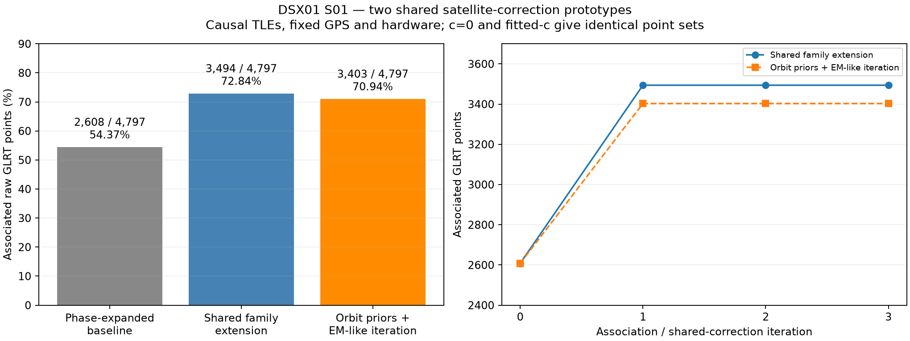
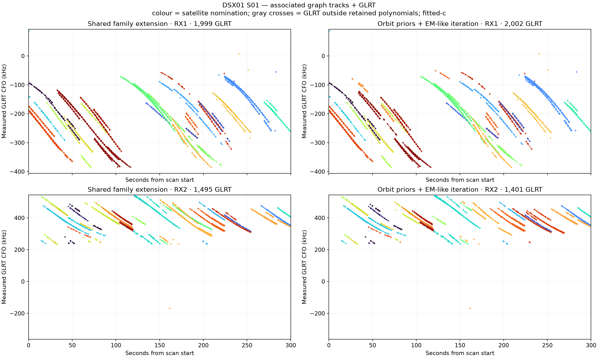
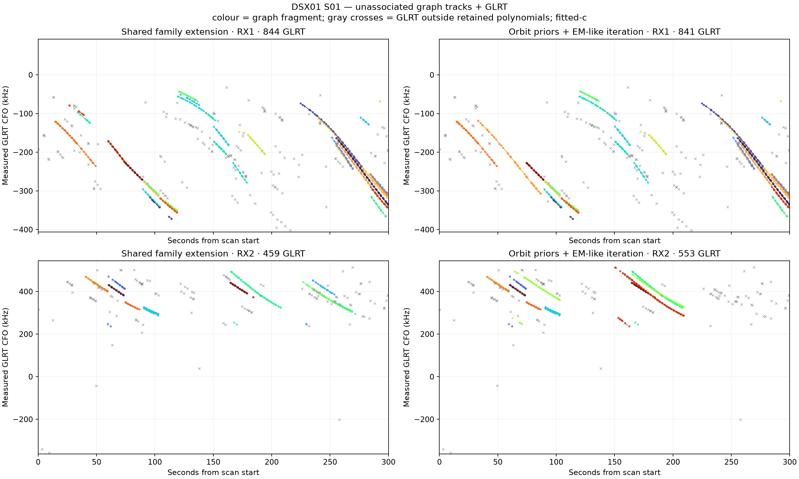
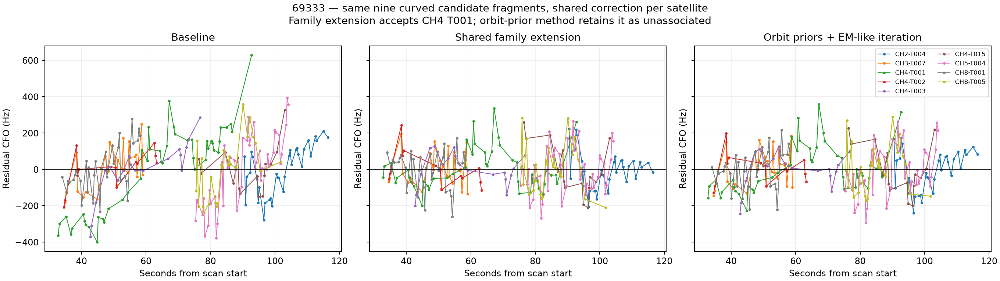

# DSX01 S01: sharing satellite corrections across GLRT tracks

Report published 2026-10-18 from the completed 2026-10-17 research run.

Fitting a correction shared by tracks assigned to one satellite raises provisional
GLRT association coverage from **54.37% to 72.84%** with an empirical phase-and-rate
model, or **70.94%** with phase and regularized eccentricity corrections. Both
methods preserve the original graph fragments and use measured curved tracks to
learn satellite corrections. These are frequency-compatible candidate
associations; several pooled family residual checks still fail.

## Controlled comparison

The observation population is the same **4,797 raw S01 GLRT points** in every
comparison. The fixed graph partition contains 4,486 points in retained polynomial
fragments. The other 311 points remain in the denominator and remain unassociated.
No graph fragments are merged, and no observations are removed to improve the
percentage.

The supplied receiver coordinates are fixed at latitude 37.849061591561885°,
longitude −122.48574968092912°. Receiver and RF calibration are frozen separately
in the `c0` and `fitted_c` arms. This experiment measures frequency compatibility
and association coverage; it does not estimate position or establish position
accuracy.

The candidate bank contains 1,707 satellites. The extra correction is available
for the 27 candidates nominated by measured curved support in the existing
baseline. Linear curves never calibrate corrections or rank calibration
proposals. A learned extra correction requires curved support on at least two
channels. A linear curve can associate afterward when an admitted curved owner
supports the learned correction; an unshifted, unadjusted TLE retains the baseline
policy and needs no learned owner.

All orbital fitting and prior construction use past-only TLEs. The archival cutoff
is **2026-10-16 16:15:42.484895 UTC**, or `1792167342484895460` UTC nanoseconds.
Both element epoch and archive collection time must precede that cutoff. Future
TLEs from the separate bracketing-orbit diagnosis do not enter the fits or priors.

## Method A: extend nearby families with one shared phase and rate

Each eligible satellite has one shared phase shift, bounded to ±15 s, and one
shared frequency slope at the 11.5 GHz reference RF, bounded to ±20 Hz/s. The
satellite's SGP4 Doppler is recomputed for phase proposals; the empirical slope
adds a time-linear frequency correction. Predictions scale to each track's RF.
The slope is an empirical correction and has not been identified as receiver
drift or a unique orbital error.

Already accepted curved seed labels are preserved. Additional curved tracks are
tested near the seed family, within a 30 s interval gap. Proposals include pooled
fits and pairs from different channels. Corrections require support from at
least two channels and must preserve the accepted curved seeds. The updated
shared prediction then tests nearby curved and linear tracks. This procedure can
extend a family without joining or rewriting its graph fragments.

## Method B: one regularized orbital correction per satellite

Each eligible satellite has a shared phase shift and corrections to
`e cos(omega)` and `e sin(omega)`. SGP4 predicts their joint Doppler effect.
Gaussian priors regularize the shared parameters, with the satellite prior charged
once across all supporting curves.

The eccentricity covariance comes from differences between up to four distinct
past TLE epochs per candidate in the previous 48 hours, after expressing the
elements at a common epoch. There are 23 unique historical archive payloads;
14 candidates have three past epochs, ten have four, two have two, and one has
only one. With no differences the prototype uses an isotropic `1e-8` covariance
fallback. Covariance eigenvalue standard deviations are clipped to the range
`2e-5`–`3e-4`. Phase prior sigma has a 1 s floor. Phase is bounded to ±15 s;
eccentricity components are bounded to ±`8e-4`, with joint prior Mahalanobis
radius at most five.

Whole-curve signal/clutter responsibilities propose curved support; a shared
regularized tangent fit updates the parameters, and all candidate assignments
are reconsidered. These responsibilities are experimental proposal weights,
not calibrated satellite identity probabilities. The final assignments must
still pass the hard per-curve gates. The run uses three bounded iterations;
this is a generalized EM-like search, with no claim of a global optimum.

Both methods retain a single native integer frequency alias and a Gaussian
constant offset per curve. Numerical noise scale is 150 Hz and constant-offset
prior sigma is 1,000 Hz. Final acceptance requires visibility, RMS ≤450 Hz,
absolute constant offset ≤3,000 Hz, and the existing residual-structure screen:
mean and slope z ≤3, quadratic BIC improvement ≤10, maximum step z ≤4, and
absolute lag-one autocorrelation within `4/sqrt(N)`.

## Coverage and agreement

| Method | Associated raw GLRT | Coverage | Unassociated | Accepted graph fragments | Points/fragment |
|---|---:|---:|---:|---:|---:|
| Phase-expanded baseline | 2,608 | 54.37% | 2,189 | 113 | 23.08 |
| A: shared family extension | 3,494 | 72.84% | 1,303 | 129 | 27.09 |
| B: orbital priors + iteration | 3,403 | 70.94% | 1,394 | 132 | 25.78 |

The table applies independently to both calibration arms. Accepted fragments are
the original graph fragments, rather than newly merged trajectories.

| Change from baseline | Method A | Method B |
|---|---:|---:|
| Newly accepted points | 942 | 803 |
| Previously accepted points lost | 56 | 8 |
| Net gain | 886 | 795 |
| Accepted points on measured curved tracks | 2,439 | 2,279 |
| Accepted points on linear tracks | 1,055 | 1,124 |
| Candidate satellite labels represented | 28 | 29 |

Every lost baseline point is on a linear fragment; no retained baseline
association changes its satellite label. Coverage reaches its reported value
after iteration one. Iterations two and three refine corrections without
changing associated point counts.

The methods share **3,260 points**, with identical satellite labels for every
shared point. Method A alone accepts 234 points and method B alone accepts 143;
their accepted-point Jaccard overlap is 0.8963. Each accepted curve has only one
candidate passing the implemented frequency gates. That result depends on the
candidate bank and model and does not authenticate the satellite's identity.







## Matched c = 0 versus fitted-c ablation

The observations, candidate set, priors, bounds, graph partition, iteration count,
and search procedure are matched. Within each method, the two arms return the
same associated point IDs and satellite labels. Frequency fits differ slightly:

| Method | Accepted-point residual RMS, c = 0 | Accepted-point residual RMS, fitted c |
|---|---:|---:|
| A: shared family extension | 117.199 Hz | 117.209 Hz |
| B: orbital priors + iteration | 119.249 Hz | 119.241 Hz |

RMS here pools the saved residuals over accepted points, after each curve's
constant-offset and alias profiling. The A and B rows describe different
accepted populations, so their RMS values do not compare performance on a
common held-out sample. The ablation shows essentially unchanged frequency
compatibility and no coverage gain from fitted `c` in these runs. No position
accuracy claim follows from these fits.

## Case study: candidate 69333

Method A accepts all **264 points in ten fragments** nominated for 69333. Method
B accepts 219 points in nine fragments, leaving the 45-point
`S01-RX1-CH4-T001` curve unassociated. In the fitted-c arm its RMS is about
112.3 Hz under A and 129.0 Hz under B. B still rejects the curve because its
residual structure fails the final screen; low RMS alone is insufficient.



## Remaining limitations

Per-curve gates pass for every accepted fragment, but pooled curved residuals
pass the same screen for only **20 of 24 families under A** and **18 of 25 under
B**, in both calibration arms. Separate fragment offsets and residual
correlations can conceal family-wide structure. The pooled failures remain
visible in [family_diagnostics.json](family_diagnostics.json); they were not
converted into a claim of independent family evidence.

The boundary audit flags candidate **67954** at the A rate boundary in the
fitted-c arm and **69333** at the B eccentricity prior-radius boundary in both
arms. A has no flagged boundary in the c0 arm. These are useful targets for
orbital-model and TLE-age diagnosis, not a reason to widen limits automatically.

Corrections are estimated on the same bounded observation set used for
association. There is no independent identity truth or held-out validation of
these new assignments, and short-arc orbital directions remain partially
degenerate. Additional flexibility can absorb model error. The result supports
shared corrections as a promising association mechanism while preserving
uncertainty about individual labels.

## Artifacts and reproducibility

The published directory contains the **final corrected-support-policy** outputs.
The local `pre_support_policy_fix` directory is superseded and intentionally
omitted from publication; it must not be mixed with these counts.

- [summary.csv](summary.csv), [summary.json](summary.json): both methods and both c arms.
- [protocol.json](protocol.json): fixed population, limits, gates, and comparison controls.
- [baseline_control.json](baseline_control.json), [validation.json](validation.json): reproduced baseline IDs/labels and run accounting checks.
- [comparison_audit.json](comparison_audit.json), [family_diagnostics.json](family_diagnostics.json): overlap, boundaries, and pooled residual checks.
- [causal_prior_inputs.json](causal_prior_inputs.json), [orbital_priors.json](orbital_priors.json): archived past TLE lines, timestamps, provenance digests, and derived prior covariances.
- [family_extension](family_extension), [prior_orbit_em](prior_orbit_em): per-arm associations, point IDs, parameters, calibration membership, and iteration history.
- [run_sources](run_sources): frozen research runner, numerical kernel, prior exporter, audit, renderer, and kernel tests. These snapshots preserve method provenance; they are not installed runtime components.
- [publication_manifest.json](publication_manifest.json): SHA-256 hashes of published artifacts and referenced local research inputs.
- [publication_validation.json](publication_validation.json): fresh checks against the original raw corpus and graph partition, including accepted IDs/labels, gains/losses, saved gates, causal timestamps, and the 16-test command.

The published outputs can be inspected without radio hardware or archive access.
Full rerunning requires the existing DSX01 local corpus and the working research
tree, including `inventory_clipped_phase_cohort.py`,
`search_track_evidence_position.py`, `fit_s01_69333_tle_parameter.py`,
`analyze_dsx01_fixed_site.py`, `associate_merged_track_catalogue.py`, and the
research phase/geometry/diagnostic modules they import. Those dependencies are
not all published runtime APIs. Input locations and digests are recorded in the
manifest; the bracketing-TLE input contains both past and future entries, but
the runner reads only `past` for these experiments. The archive exporter is a
read-only adapter to `/var/lib/leo/tle`.

In the existing research checkout the bounded sequence is:

```bash
.venv/bin/python tools/export_s01_causal_element_prior_inputs.py > /tmp/s01-causal-priors.json
# Confirm the exported causal-prior digest against the recorded input before reuse.
.venv/bin/python tools/run_s01_shared_satellite_prototypes.py
.venv/bin/python tools/audit_s01_shared_satellite_prototypes.py
.venv/bin/python tools/render_s01_shared_satellite_prototypes.py
.venv/bin/python -m pytest \
  tests/analysis/test_shared_satellite_correction.py \
  tests/analysis/test_polynomial_satellite_diagnostics.py \
  tests/analysis/test_phase_linear_geometry.py \
  tests/analysis/test_phase_family_nomination.py -q
```

The last command was rerun for publication: **16 tests passed**. Saved validation
also verifies complete disjoint raw-point accounting, original baseline
reproduction, causal priors, exclusion of linear calibration, per-track gates,
and identical accepted point sets across c arms. No new RF collection or golden
fixture change was performed.
