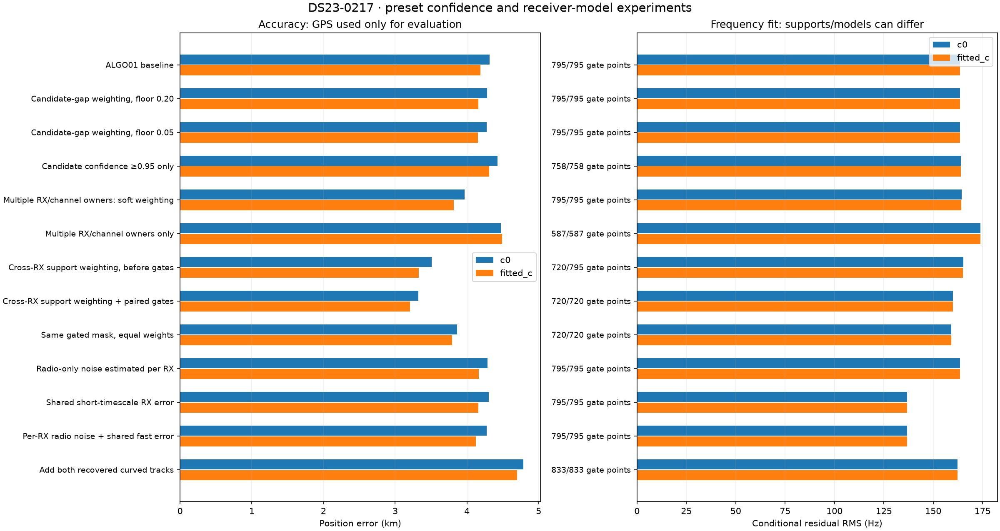
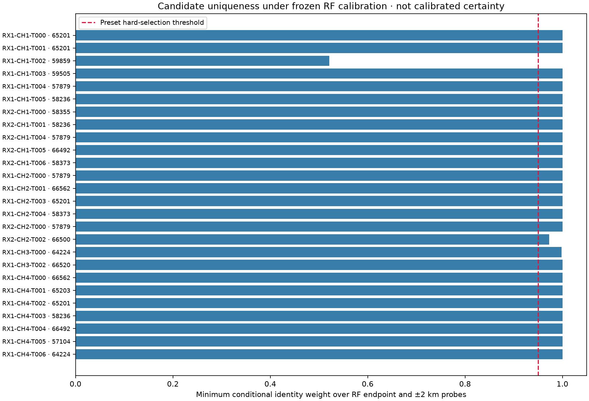
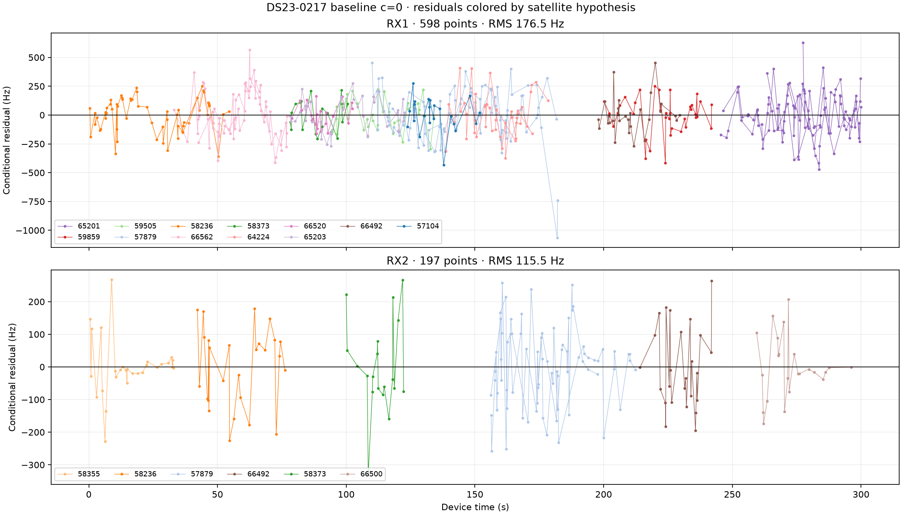
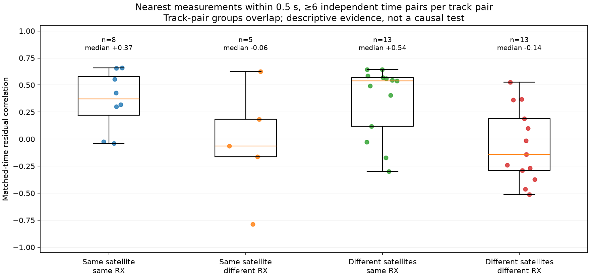
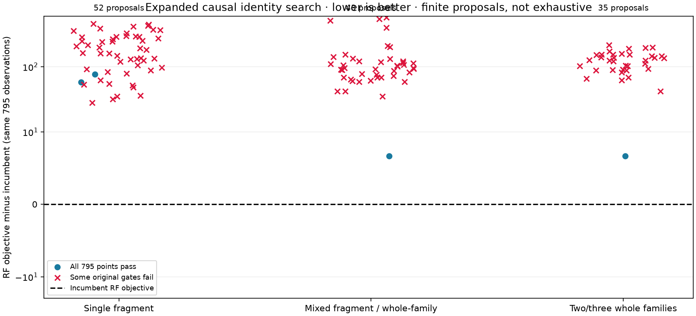
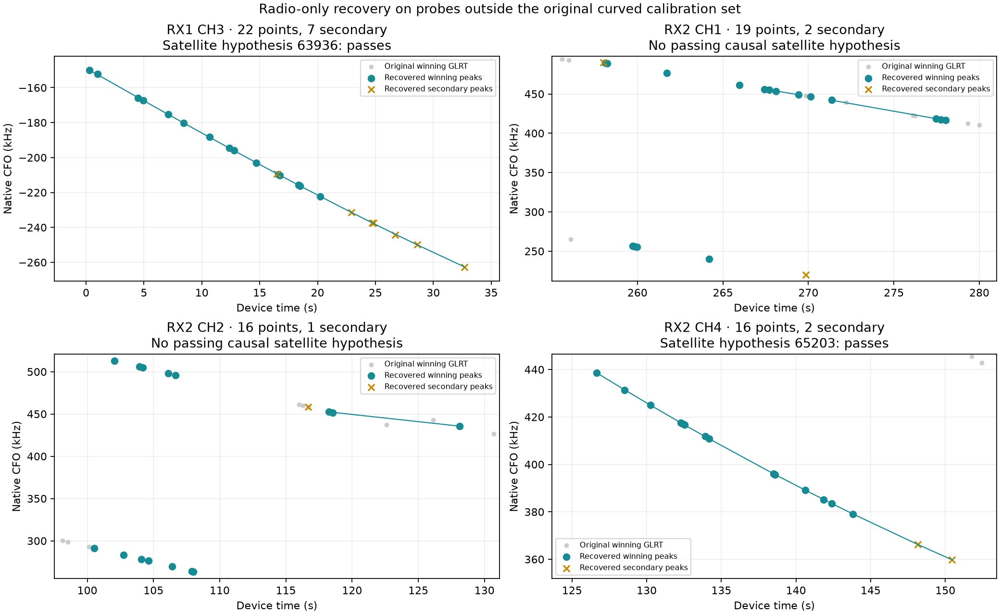

# DS23-0217: confidence weighting, receiver residuals, joint identities and additional GLRT peaks

These are bounded, single-scan development experiments on ALGO01, following
[DBG01](../DBG01/README.md) and the [original scan-217 investigation](../2026_10_18_algo01_ds23_0217/README.md).
The original benchmark is unchanged. None of these experiments demonstrates a
sub-kilometer correction. Candidate-gap weighting alone hardly moves the
position. Family-replication weighting helps more, but requires the original
gates to remain enforced; the result is still a development observation.

## Controlled inputs and scope

All inference uses the same frozen DS23-0217 radio archive, 1,411-member causal
candidate bank, latest causal TLE means, genuine earlier causal TLE uncertainty,
original 25×25 km box centered at 37.906, −122.545, Gaussian physical nuisance
priors and five phase-reference refresh rounds with at most 48 position steps
per round. Fits begin at the regional center. RF-derived endpoints are used
only for proposal screening/limited-search warm starts; final identity finalists
receive the same cold budget as the incumbent. No following TLE or GPS-selected
identity enters inference. The externally supplied GPS is used only by this
reporter for error calculation.

Every position experiment pairs c=0 and fitted-c with identical observations,
labels, alias integers, weighting, other priors and search budget. A changed
observation mask is shared between the arms. No short linear track learns
receiver calibration or orbit corrections. The scan contains CH1–4 only, so
high-versus-low-band behavior cannot be independently tested here. RX2 has
curved calibration evidence on CH1 and CH2 only.

## Results

| Method | Input points | Passing c0 / fitted c | Error c0, km | Error fitted c, km | RMS c0, Hz |
|---|---:|---:|---:|---:|---:|
| ALGO01 baseline | 795 | 795 / 795 | 4.315 | 4.191 | 163.5 |
| Candidate-gap weighting, floor 0.20 | 795 | 795 / 795 | 4.284 | 4.160 | 163.6 |
| Candidate-gap weighting, floor 0.05 | 795 | 795 / 795 | 4.277 | 4.154 | 163.6 |
| Candidate confidence ≥0.95 only | 758 | 758 / 758 | 4.428 | 4.311 | 163.9 |
| Multiple RX/channel owners: soft weighting | 795 | 795 / 795 | 3.968 | 3.814 | 164.3 |
| Multiple RX/channel owners only | 587 | 587 / 587 | 4.475 | 4.492 | 173.8 |
| Cross-RX support weighting, before gates | 795 | 720 / 720 | 3.509 | 3.329 | 165.2 |
| Cross-RX support weighting + paired gates | 720 | 720 / 720 | 3.325 | 3.207 | 160.0 |
| Same gated mask, equal weights | 720 | 720 / 720 | 3.866 | 3.792 | 159.2 |
| Identity search: best single | 795 | 769 / 769 | 4.906 | 4.760 | 170.0 |
| Identity search: best joint | 795 | 795 / 795 | 4.730 | 4.602 | 163.5 |
| Best whole-family joint replacement | 795 | 795 / 795 | 4.730 | 4.602 | 163.5 |
| Add both recovered curved tracks | 833 | 833 / 833 | 4.786 | 4.701 | 162.2 |
| Add recovered track 000 alone | 817 | 817 / 817 | 4.695 | 4.628 | 163.6 |
| Add recovered track 003 alone | 811 | 811 / 811 | 4.441 | 4.302 | 162.1 |
| Radio-only noise estimated per RX | 795 | 795 / 795 | 4.288 | 4.165 | 163.5 |
| Shared short-timescale RX error | 795 | 795 / 795 | 4.306 | 4.159 | 136.7 |
| Per-RX radio noise + shared fast error | 795 | 795 / 795 | 4.274 | 4.127 | 136.7 |

Passing counts include the existing residual, visibility, alias and independent
owner checks. A fit using 795 points but passing fewer is an ungated proposal,
not an accepted replacement for ALGO01. RMS values on different masks are not
direct comparisons. Generalized weighted losses are not compared to unweighted
losses as normalized probabilities; lower training RMS does not establish
better localization.

## 1. What “certain association” means in this test

For every original curved fragment, all 1,411 satellites are screened using
a frozen RF-selected receiver calibration and a phase-plus-constant model.
Phase widths come from the same pre-scan TLE history; the constant prior is
1,000 Hz and phase is bounded by ±15 s. Costs include the Gaussian prior and
integration determinant. The score-gap weight normalizes exp(−cost/2) over
visible candidates. For stability, the minimum incumbent weight over the RF
endpoint and four ±2 km axial perturbations is retained.

This is **conditional uniqueness under an approximate model, not calibrated
identity certainty**: calibration is conditioned on, independent per-fragment
screening omits shared physical orbit modes, and a wrong model can confidently
favor a wrong identity. Final replacement fits restore the full physical model.

RX1 CH1 T002, assigned to 59859, is the one strongly ambiguous fragment:
endpoint weight about 0.614, minimum local weight about 0.521; its close
competitor is 66500. RX2 CH2 T002 has minimum weight about 0.973. All other
fragments exceed approximately 0.998. Soft powers are 0.2+0.8w and 0.05+0.95w;
the hard cutoff is w≥0.95. They were fixed without GPS tuning. These tests
mostly reweight one fragment, explaining their small effect. Removing that
fragment worsens position.

The stronger focus tests use independent ownership: “replicated” means a family
has curved support in at least two different (RX,CH) combinations and the
fragment meets the 0.95 uniqueness threshold. Soft replicated weights are 1
versus 0.2. Cross-receiver support weights are 1 for families observed on both
RXs, 0.6 for other replicated families, and 0.2 otherwise. All powers are at
most 1; no observation is counted as multiple independent measurements.
Families 57879 and 58236 provide the cross-RX support (263 of 795 input points).
The hard replicated-only test uses 587 points and worsens the estimate.

The ungated cross-RX-weighted fit improves evaluation error but one 66562
fragment crosses the unchanged quadratic residual gate: BIC gain 10.271 versus
threshold 10 at c=0. Its second fragment then fails the two-owner requirement,
so the two fragments' 75 points cannot simply remain accepted. A paired,
monotone gate/refit removes failed components from both arms and refits without
changing the weights. The table includes this gated result and an equal-weight
control on the exact same final mask, separating weighting from deletion.
The gated fit reaches 3.325 km at c=0 and 3.207 km with fitted c, retaining 720 input points. The nuisance design remains fixed under masking, as in the original influence
analysis; this is a research prototype rather than a new production default.

## 2. Does the discrepancy follow receiver or satellite?

At the baseline endpoint, RX1 has 598 calibration points with RMS 176.5 Hz;
RX2 has 197 with RMS 115.5 Hz. Independently estimating radio noise from graph
polynomial residuals gives 157.6 Hz for RX1 and 112.7 Hz for RX2; neither RX
selects the extra margin-dependent variance parameter by BIC. Replacing the
global radio noise by these fixed per-RX estimates changes position only a
little. It uses no orbital residuals to estimate radio uncertainty.

Track pairs match distinct measurements within 0.5 s, requiring at least six
time pairs. There are 39 track pairs per c arm. At c=0 the median correlations
are +0.37 (same family, same RX; 8 pairs), −0.06 (same family, different RX;
5 pairs), +0.54 (different families, same RX; 13 pairs), and −0.14 (different
families, different RX; 13 pairs). Cross-RX same-family pairs involve only
57879 and 58236. These overlapping, small pair sets do not provide independent
replication for 39 hypothesis tests and are not causal identification.

The stronger coherence across different families on one RX is evidence for
a receiver/acquisition-shared contribution. It does not distinguish LNB behavior,
timing or GLRT estimation artifacts, and does not rule out orbital error.
All residuals are conditioned on the existing fitted model, which already has
shared receiver smooth terms and shared family orbit terms.

| Diagnostic deletion | Error c0, km | Error fitted c, km |
|---|---:|---:|
| Remove receiver 1 | 2.788 | 4.984 |
| Remove receiver 2 | 4.667 | 4.422 |
| Remove channel 1 | 3.530 | 3.494 |
| Remove channel 2 | 5.006 | 4.924 |
| Remove channel 3 | 5.212 | 5.046 |
| Remove channel 4 | 4.798 | 5.047 |

Deletion preserves original nuisance design/support and masks data in matched
c pairs. RX2-only c=0 improves, but fitted-c becomes unstable in accuracy;
neither single-RX test justifies discarding RX1. Geometry and frequency-dependent
calibration are less constrained after deleting a receiver.

The bounded receiver follow-up adds shared Gaussian columns with 4 s center
spacing, 2 s width and coefficient prior sigma equal to the original radio
sigma/√2 (about 104.5 Hz). The constant and linear components are projected out
on the full 0–300 s reference grid. Separate coefficients apply to each RX,
shared by every channel/satellite on that RX. These are zero-mean nuisance
priors, not corrections learned from GPS. They are added as physical covariance
terms, distinct from deleting data or independently fitting each curve.
They reduce RMS to about 136.7 Hz, but do not resolve the position error.
Thus some shared residual structure is real enough to fit, while removing it
does not establish that it was the source of the geographic displacement.

## 3. Broader simultaneous identity search

The full candidate bank is screened at six RF-defined anchors: the incumbent
endpoint, the regional center, and four ±2 km perturbations. The two best
alternative labels per fragment from this pool give 52 single replacements.
Every proposal retains all 795 original calibration observations and is scored
with the original physical priors, not the phase/constant screening surrogate.

The next stage tests 43 joint proposals: pairs/triples of the six RF-best
distinct-fragment changes plus coherent whole-family replacements. A further
35 proposals change two or three **entire original families simultaneously**:
each operation changes every fragment bearing that original family label.
Operations are selected by RF cost, with one operation per source family.
These are 130 scored proposals in total, with overlap possible between stages,
not 130 guaranteed distinct assignments or an exhaustive combinatorial search.

All proposed alternatives have worse full-model RF objective than the incumbent.
The best tested joint alternative swaps 59859 and 66500 for RX1 CH1 T002 and
RX2 CH2 T002. It passes all 795 points but has about +6.68 RF loss and worse
position error in both c arms. The incumbent is therefore retained by the
RF-only decision rule. Better GPS error, where present among other proposals,
is not used to select labels. Passing a residual gate still does not certify
the incumbent identities.

The finite proposal pool, screening approximation and restricted pair/triple
depth remain limitations. This test substantially expands the previous
three-mode pool, but cannot rule out another coordinated identity explanation.

## 4. Additional curved evidence from alternative peaks

Discovery excludes every physical probe already in the original 795-point
curved calibration set. It retains all remaining gated GLRT peaks, clusters
circular-frequency replicas within 300 Hz, and proposes quadratic/cubic curves
using 1,800 deterministic seeds per RX/channel/actual-RF lane. Seeds are proposals
only: final fits use the frozen degree≤4, 150 Hz noise, ±450 Hz membership,
support, gap, complexity and structure checks. At most one peak per physical
probe is selected, and added tracks have exclusive physical ownership.
Curved eligibility still requires ≥20 s and ≥250 Hz deviation from an affine
fit. A fixed 2log(1800) discovery-search penalty is included in the proposal
gain; it is not a calibrated false-alarm guarantee.

Four exclusive radio curves pass these checks. Full-bank causal satellite
screening and exact phase-shifted follow-up accept two:

| New hypothesis | Lane | Span, s | Points | Winning / secondary | Curvature RMS, Hz |
|---|---|---|---:|---:|---:|
| 63936 | RX1 CH3 | 0.273–32.706 | 22 | 15 / 7 | 951.2 |
| 65203 | RX2 CH4 | 126.659–150.446 | 16 | 14 / 2 | 1072.8 |

Neither was selected by a satellite whitelist. The other two radio curves
(RX2 CH1 at 258–278 s, RX2 CH2 at 100–128 s) fail the tested satellite gates.
The RX1 CH1 243–270 s fragment discussed earlier is not recovered under these
unchanged tests; its secondary continuation also uses probes already assigned
to an original calibrating curve and cannot be added as independent votes.

The accepted curves add 38 physical-probe factors: 29 original winning peaks
and nine secondary selections. They are not 38 extra original winning GLRT
points. Physical probe IDs remain stable while selected peak metadata records
the alternative choice. None of these probes was originally associated in
the saved baseline. We do not claim a new full-scan association percentage:
this experiment evaluates 833 calibration factors, not a full reassignment of
every original short/linear extension.

Both new curves pass the existing joint residual/alias/visibility/support gates
after position refit, but position worsens. Each is also evaluated individually
against the original calibration set, without allowing the absent new track
to create extra two-owner requirements or orbital nuisance modes;
both individual additions worsen position. This is direct evidence that a
larger accepted count and lower residual RMS are insufficient quality metrics.
The added identities and independence assumptions remain hypotheses to audit.

## Interpretation and next use

The tested weak association is not the main driver. Independent family support
is a more useful weighting signal than the current conditional score gap on
this scan, but the gated result is still several kilometers off. The same-mask
equal-weight control is necessary to attribute any benefit to weighting.
The receiver-shared residual signal does not explain the entire displacement:
modeling it improves RF fit substantially without comparable geographic gain.

Keep these as development variants. Before changing ALGO01, freeze the
replication weights and paired-gate rule and test them on untouched scans/sites;
do not tune weights or delete families to minimize this scan's GPS error.
Further diagnosis should examine independent timing/CFO evidence and the
new 63936/65203 hypotheses across receiver/channel support, rather than
increasing every satellite's nuisance freedom or forcing the missing arc.

## Reproduction and validation

The inference tool is `tools/probe_algo01_0217_improvements.py`; the
evaluation-only reporter is `tools/report_algo01_0217_improvements.py`.
Use the repository .venv, PYTHONPATH=src:tools, OPENBLAS_NUM_THREADS=1 and
OMP_NUM_THREADS=1. Run stages in this order: `prepare`; `weighted`,
`replicated_weights`, `residuals`, `identities`, `recovery`, `receiver_models`;
then `family_combinations` and `gated_weight`; finally the reporter.
Independent numerical stages may run as bounded subprocesses. No new RF or
QNAP mutation is involved. Source snapshots/hashes and scientific controls
are recorded in [validation.json](validation.json).

Six synthetic tool tests cover confidence powers/normalization, full-bank
visibility and alias invariance, unique probe votes, receiver basis affine
projection, and recovery of a known curved signal through the native gates.
The baseline endpoint replay reproduces the original objective and position;
all changed c pairs share their data/masks and discrete hypotheses. Existing
benchmark fixtures and runtime components are unchanged.

[Numerical comparison CSV](comparison.csv) · [Evaluation JSON](evaluation.json) ·
[RF preparation and candidate pool](preparation.json) ·
[Residual pairs and group controls](residuals.json) ·
[Joint whole-family search](identity_whole_family_combinations.json) ·
[Recovered-peak evidence](recovery_proposals.json) · [Recovery fits](recovery_result.json)
