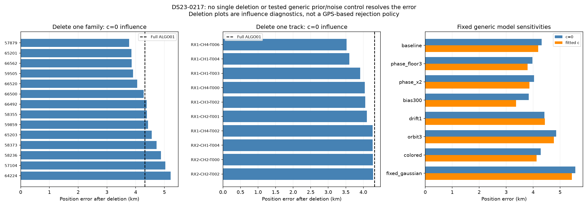
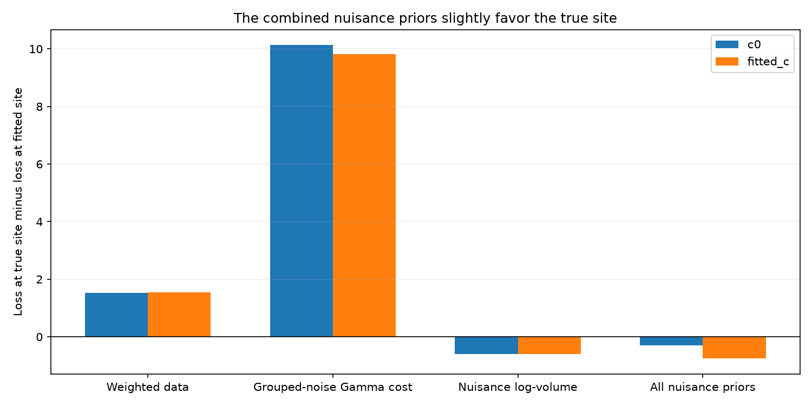

# ALGO01 deep dive: DS23-0217

**The optimizer reproducibly reaches a displaced minimum of the current
frequency/prior objective.** All 81 regional starts reach approximately
**4.315 km error at c=0, or 4.191 km with fitted c**. Starting a diagnostic fit
at the supplied true site also returns to that endpoint. There is no single
rejected large polynomial analogous to scan 342, and no single-track or
single-family deletion resolves the displacement.

The physical source of the remaining model/data discrepancy is **not uniquely
identified**. These diagnostics rule out several simple explanations; they do
not certify the satellite labels, TLE accuracy, RF estimates or nuisance priors.
The original random-sample results and ALGO01 settings are unchanged.

## Unassociated GLRT and graph tracks

| Quantity | Count |
|---|---:|
| Original winning GLRT points | 1,374 |
| Points owned by original graph tracks | 1,126 |
| Graph tracks | 49 |
| Curved calibration tracks / points | 26 / 795 |
| Associated points, including frozen extensions | 972 (70.74%) |
| Unassociated points | **402** |
| Unassociated points outside graph tracks | 248 |
| Unassociated points in 12 graph tracks | 154 |

All 26 actively curved calibration tracks pass the existing profile,
conditional-residual, visibility, alias and support checks in both c arms.
The 12 remaining graph tracks do not qualify as active-curvature calibrators;
most are short. The longest by point count has 18 points over 17.5 seconds.
They can be association-only evidence under independently learned calibration,
but cannot determine satellite phase, receiver drift or position by themselves.
Unassociated evidence is not automatically clutter.

Gray shows all original GLRT marks, red the 402 unassociated marks, and colored
lines unassociated graph polynomials. These are native measured CFO axes,
with no satellite or position correction applied to the measurements.

As a bounded missed-track check, rerunning the **same frozen graph
configuration on the 402 unassociated observations** returns 154 points in
12 tracks and **no additional active-curvature track**. This does not prove
that the other points contain no real signal or that another track-construction
algorithm could not recover it. The diagnostic neither adds calibration votes
nor changes position. See [leftover graph check](leftover_graph_check.json).

[Associated GLRT and satellite-colored tracks](associated_GLRT.png) and
[curved-track residual overview](track_residuals.png) provide the complementary
view of the accepted evidence.

## View 1: 10 km loss and gradient

The upper panels sample a **1 km grid inside a 10 km radius** around the
declared regional center **37.906, −122.545**, within the unchanged 25×25 km
search square. The lower panels sample **0.25 km spacing over ±2 km** around
the supplied true site. That local diagnostic view uses GPS explicitly for
its axes; it never changes production initialization or fitting rules.

At **each of the 606 sampled positions**, the satellite identities, integer
aliases and 795 calibration observations are held fixed, while Gaussian
nuisances and grouped noise precisions are refit. Satellite phase references
are refreshed five times **at that fixed position**. Thus this map also
checks the earlier final-tangent approximation. It is a conditional profiled
loss, **not a full GLRT/graph/association rerun at every pixel**, nor a
normalized position probability. Both c arms use the same pixels and data.

The star is the supplied true site; the X is the original ALGO01 endpoint.
Orange arrows are **normalized descent directions** estimated from the map;
their lengths do not encode gradient magnitude. Contours and colors are loss
relative to each arm's saved endpoint. The endpoint is outside the lower
±2 km zoom.

| Diagnostic | c=0 | Fitted c |
|---|---:|---:|
| Endpoint error km | 4.315 | 4.191 |
| Loss at true site minus endpoint loss | 10.764 | 10.003 |
| RMS at endpoint Hz | 163.509 | 163.509 |
| RMS at true site after nuisance/phase refit Hz | 165.094 | 165.016 |
| East gradient at true site, loss/km | −0.899 | −0.824 |
| North gradient at true site, loss/km | −5.258 | −5.030 |
| Accepted calibration points at true site | 795 / 795 | 795 / 795 |

Negative gradients mean that moving east/north locally decreases the declared
objective. The true site is not a stationary point of that objective. Endpoint
gradient norms are below 1.1e−5 loss/km. Exact joint-SGP4 conditional predictions
differ from the final orbital tangent by at most **0.156 / 0.151 Hz** across
the calibration observations, much smaller than the 147.8 Hz radio noise
scale. This gives no evidence that a missed phase-refresh step or large
linearization error explains the four-kilometer displacement.

The fully phase-profiled local Hessian gives principal displacement scales
of approximately **1.84 and 1.13 km** for a one-unit quadratic loss increase
at c=0 (2.05 / 1.16 km with fitted c). These are model curvature scales,
**not validated confidence intervals**.

## View 2: 81 starts with satellite-branch reselection

Starts are the **81 points on a 2 km grid inside the same regional 10 km disk**.
Each red circle is labeled S00–S80. Lines are the actual recorded accepted
position iterations within the five phase-reference rounds. X marks are
endpoints; the green star is added only for evaluation. The enclosing position
box remains ±12.5 km independently in east/north.

This experiment permits satellite/alias changes through a **finite bank of
RF-discovered whole-assignment hypotheses**. Thirteen fresh cold RF discoveries
at 5 km grid starts screen the same full causal catalogue, with proposal budget
four. Their discrete hypotheses are combined with the original three RF
branches; learned positions, receiver calibrations and satellite phases are
discarded before restart fitting. Deduplication leaves **three distinct modes**.

During c=0 descent all three modes are rescored after every accepted step;
the lower-loss mode can take over. Every phase round preserves absolute
zero-centered nuisance priors. Fitted c follows the c=0-selected branch
schedule so each endpoint pair has matched identities, aliases and data.
Both arms restart position at the same declared grid coordinate.

**All 81 starts select mode 0, with zero accepted branch switches.** Endpoint
error ranges are 4.315025044–4.315025070 km at c=0 and
4.190736905–4.190736940 km with fitted c. This tight numerical agreement
does not establish geographic accuracy.

The alternatives differ from mode 0 in only one fragment each: they exchange
59859 and 66500 for RX1 CH1 T002 or RX2 CH2 T002. The finite search does not
enumerate arbitrary label combinations or rerun all-catalogue discovery at
every numerical trial. Its agreement therefore rules out another basin
**within this tested RF pool**, not every possible satellite explanation.
Acquisition, measured GLRT and graph extraction remain common upstream data.

[Per-start endpoints, errors and switches](restart_comparison.csv) ·
[Restart summary](restart_summary.json) · [RF hypothesis bank](hypothesis_bank.json)

## Influence and model sensitivity

All 14 satellite-family deletions and all 26 curved-track deletions were
cold-refit with five phase rounds and at most48 Gauss–Newton steps per round,
in both c arms. Deletions retain the original nuisance design/support to isolate
the effect of observations. Scores across different masks are not compared.
These are **influence diagnostics**, not a GPS-based rejection policy.

| Diagnostic intervention | c=0 error km | Fitted-c error km |
|---|---:|---:|
| Full ALGO01 | 4.315 | 4.191 |
| Best single-family deletion by evaluation error: 57879 | 3.771 | 3.709 |
| Best single-track deletion by evaluation error: RX1 CH4 T006 | 3.521 | 3.359 |

Neither deletion gets close to one kilometer. The direction of a deletion's
effect cannot establish that its satellite identity was wrong. Multiple
observations and shared nuisance terms contribute to the compromise.

Generic controls use **all the same 795 observations, labels, aliases and
search budgets**; none is chosen as a new default by GPS error:

| Control | c=0 error km | Fitted-c error km |
|---|---:|---:|
| Causal ALGO01 baseline | 4.315 | 4.191 |
| Phase-prior floor 3 s | 3.973 | 3.793 |
| Double causal phase widths, capped at15 s | 4.038 | 3.862 |
| Fragment-constant prior 300 Hz instead of1000 Hz | 3.835 | 3.368 |
| Receiver mean-drift prior 1 Hz/s instead of10 Hz/s | 4.423 | 4.433 |
| Three-times wider physical orbit modes | 4.857 | 4.773 |
| Correlated residual noise,150 Hz /10 s control | 4.283 | 4.131 |
| Fixed radio Gaussian precision instead of grouped Gamma learning | 5.565 | 5.434 |

The first seven rows are the fixed initial sensitivity set, including baseline.
The fixed-precision Gaussian control is a subsequent mechanism ablation
motivated by the loss decomposition below. It retains the same radio noise
and Gaussian nuisance priors and fixes every fragment precision to1; it does
not tune a new scale. Its lower163→162 Hz RMS accompanies **worse position**.
Likewise, wider orbit modes slightly lower RMS while increasing position error.
Better frequency fit is not sufficient evidence of better localization.

## Why the objective prefers the wrong site

For c=0, true-site loss exceeds fitted-site loss by10.764 units:

| Component: true minus fitted | Loss difference |
|---|---:|
| Weighted data quadratic | +1.536 |
| Grouped-noise Gamma terms | +10.130 |
| Integrated nuisance log-volume | −0.602 |
| **All nuisance priors combined** | **−0.299** |
| **Total** | **+10.764** |

The combined nuisance-prior penalty is slightly **lower at the true site**.
Satellite phase prior alone is higher there (9.062 versus6.424), but reductions
in other nuisance penalties offset it. This scan is therefore different from
scan39's original strongly restrictive phase-prior case: widening phase alone
does not address most of the endpoint preference.

The grouped-noise terms are part of the Gaussian/Gamma objective: the model
pays for the per-fragment variance adjustments needed to explain residuals.
Their contribution locates the statistical preference; it is **not evidence
of a Gamma implementation defect**. The fixed-precision ablation worsens
error, so simply removing robust noise inference is not supported either.
Radio/model errors, transmitter/receiver frequency behavior, causal orbital
uncertainty and alternative identities remain candidate physical explanations.
The current evidence does not distinguish them uniquely.

## Interpretation and next step

For this scan the immediate failure is a **biased but well-converged minimum
of the present model**. All tested starts and a reference-start diagnostic
reach it; all active tracks pass gates even at the reference; and no one
family/track or tested simple prior/noise change resolves it. Do not force
short linear tracks to calibrate offsets, blacklist a satellite because a
GPS-based deletion looks better, or report the best sensitivity as ALGO01.

The most informative next evidence would independently constrain CFO/timing
or receiver/transmitter drift, and test shared residual behavior across
receivers/channels. A broader identity search can still be useful, but the
three-mode restart test alone does not validate identities. The original
random sample remains a fixed benchmark; this scan is now development data.

## Reproduction and validation

`tools/report_algo01_ds23_0217.py --stage prepare` creates the GLRT figures and
the606-point surface request. `tools/investigate_algo01_ds23_0217.py` provides
`audit` (explicit externally supplied diagnostic point), `discover` (indices0–12),
`bank`, `restart` (0–80), `grid` (chunks0–7), `family` (0–13), `track` (0–25),
and `prior` (0–7). The reporting stages `surfaces`, `restarts` and `details`
generate the evaluation figures and CSVs. Run with `PYTHONPATH=src:tools`,
`OPENBLAS_NUM_THREADS=1`, `OMP_NUM_THREADS=1` and the repository `.venv`.
Four-worker bounded subprocess batches completed without failed jobs.

The inference module contains no reference coordinate. The reporting module
uses the supplied coordinate only for maps, errors and explicitly marked
reference-start/gradient diagnostics. Original latest/previous TLE receipts
and observations come from the sealed20-scan ALGO01 input directory. All
elements remain pre-observation; there is no new RF acquisition or future TLE.
The initial inference source snapshot binds the original experiments; the
additional fixed-Gaussian control is explicitly recorded as a follow-up.

**82 component and related tests pass; Ruff passes.** Runtime checks replay
the saved endpoint objective to1e−5, preserve matched c arms and unique measured
IDs, verify exact loss-component addition, and retain accepted-step traces.
The finite-difference Hessian and fixed-precision ablation have owned tests.

[Audit and gradients](audit.json) · [Details and Hessians](details.json) ·
[All interventions CSV](interventions.csv) · [Protocol](diagnostic_protocol.json) ·
[Surface request](surface_request.json) · [Validation](validation.json)
