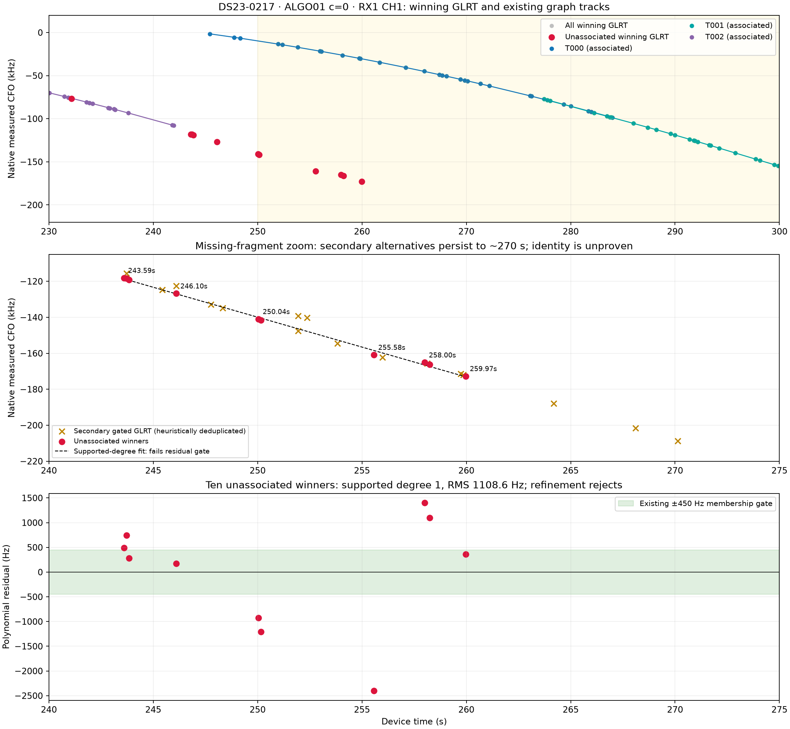
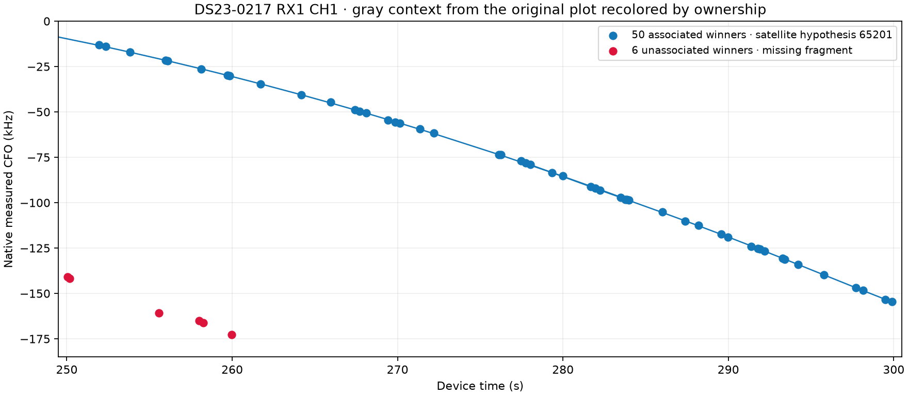

# DS23-0217: missing RX1 CH1 fragment around 250–300 seconds

The visible red fragment is lost **during graph/polynomial construction, before
satellite association**. It deserves further recovery work; absence from the
graph is not evidence that it is clutter. However, the retained winning points
also fail the existing polynomial noise test, so simply lowering the graph's
minimum point count would not establish a valid track.

This is a targeted [DBG01](../DBG01/README.md) missing-curve audit of the frozen
[ALGO01 random-20 result](../2026_10_18_algo01_ds23_random20/DS23-0217/result.json).
It does not modify the inference, candidate identities, noise, priors, calibration,
or position estimates. The displayed ownership uses the original `c=0` result;
there is no new localization comparison requiring a fitted-`c` arm.



## What is present in the requested interval?

The upper panel separates the already-associated curve from the missing red
fragment. T000 and T001 cover the main curve through 300 seconds and are both
assigned to satellite 65201 by the saved pipeline. T002 ends at 241.950 seconds
and is assigned to 59859. These are saved hypotheses, not independently proven
satellite identities. The lines are graph polynomials, not predicted orbits.

There are **six unassociated winning observations between 250 and 300 seconds**,
at 250.044, 250.164, 255.578, 258.003, 258.243 and 259.966 seconds. Including
243.593–246.097 seconds gives ten points across 16.373 seconds. There are no
unassociated RX1 CH1 winners after 259.966 seconds: after that, the winning
observations belong to the already-associated main curve.

This distinction concerns *winning* GLRT points. Other gated peaks were archived
at the same physical probes and are excluded by ALGO01's one-maximum-margin-peak
representation. The middle panel shows their native CFO values without changing
the archived GLRT measurements or treating a secondary peak as a new physical
probe.

In the original unassociated overview, **gray is context showing all winning
GLRT points**, with unassociated points overplotted red. The many gray points
visible by themselves are therefore already associated. Of 56 RX1 CH1 winners
in 250–300 s, 50 belong to the associated 65201 hypothesis and six are
unassociated. The lower panel of the user's cropped screenshot is RX2 CH1:
its red curves are a different receiver's already-constructed, unassociated
graph tracks. They are not evidence that the RX1 missing fragment was tracked.
No shared physical identity across those panels is established by this audit.



## Exact rejection sequence

The original public observation adapter was replayed exactly, including device
counters, within-visit offsets and midpoint timing. Full RX1 CH1 graph extraction
then reproduced all ten saved graph-track memberships exactly.

| Stage | Observed behavior |
|---|---|
| Original graph discovery | A 34-point path over 200.167–255.578 s includes six of the eleven unassociated winners in the wider 230–300 s audit. Its score is +234.762. |
| First polynomial refinement | A quadratic keeps 17 points, including only the unassociated point at 232.151 s. The proposed red tail points at 243.593, 243.833, 246.097, 250.044 and 255.578 s are dropped. |
| Polynomial growth/refinement | The quadratic grows to 37 points on the earlier T002 curve and drops the remaining 232.151 s point. None of the eleven target unassociated winners survives in this model. |
| Remaining graph extraction | No alternative accepted track recovers the red fragment. Re-running the frozen graph on the eleven remaining 230–300 s winners extracts **zero paths**. |
| Satellite association | The fragment never becomes an input track. It is not rejected by a satellite RMS, phase, visibility or orbit gate. |

The graph needs at least eight points over six seconds, limits edges to ten
seconds, excludes edges shorter than **0.15 seconds**, and penalizes velocity
changes using a 150 Hz noise scale and a 20 Hz/s² acceleration scale. Several
of these physical probes are spaced only about **0.120 seconds** apart. They
cannot be consecutive graph vertices under the current hardcoded time rule.
The 232.151→243.593 s gap also exceeds the ten-second horizon when other,
already-owned points are removed.

An exhaustive enumeration of the eleven-point remainder under the same edge
and additive-cost rules gives:

| Path length | Best score | Current eligibility |
|---|---:|---|
| 5 | +19.659 | Too few points |
| 6 | +5.834 | Too few points |
| 7 | −3.885 | Too few points and negative score |
| 8 | −319.991 | Negative score |
| 9–11 | No admissible path | Edge constraints |

Thus this remainder is not merely missing because the greedy extractor chose
another path: there is no positive eight-point path under the frozen local
cost. This local exhaustive check does not establish global optimality of the
full-lane extraction.

## Why not just accept the apparent curve?

The ten winning observations after 240 seconds support at most a linear fit
under the policy requiring four points per coefficient. That fit has
**1,108.6 Hz RMS**, with the 255.578 s point **−2,402.9 Hz** from the fitted line.
The point-membership threshold is **±450 Hz**. Three of the ten are initially
inside that threshold, fewer than the minimum eight; refinement returns no
model. The lower panel makes the deviations visible at their actual scale.

Even bypassing the coefficient-support rule for diagnosis does not fit *all ten*
within the gate:

| Polynomial degree | RMS, Hz | Maximum absolute residual, Hz | Enough points under existing support rule? |
|---|---:|---:|---|
| 1 | 1,108.6 | 2,402.9 | Yes |
| 2 | 791.5 | 1,719.3 | No, needs 12 |
| 3 | 782.2 | 1,515.9 | No, needs 16 |
| 4 | 658.9 | 1,404.4 | No, needs 20 |

These are ordinary least-squares fits on identical support, not accepted tracks.
They demonstrate that higher degree alone does not explain every winning point
at the current noise scale. They do not rule out a subset of these points, a
different combination of GLRT peaks, or a longer supported curved fit.

## Secondary peaks and limits of the current representation

Between 230 and 300 seconds, the archive contains 261 gate-passing candidate
entries from 77 physical probes. The existing 300 Hz circular-frequency
deduplicator retains 109 representatives. This is heuristic: some correlated
timing/alias replicas remain separated by slightly more than 300 Hz. **109 is
not a count of independent signals**, and multiple alternatives from one probe
cannot all count toward a single track's support.

There are plausible secondary continuations of the lower curve:

| Time, s | Secondary CFO, kHz | Margin | Candidate rank |
|---|---:|---:|---:|
| 264.194 | −187.817 | 0.300 | 2 |
| 268.102 | −201.503 | 0.324 | 2 |
| 270.125 | −208.746 | 0.270 | 2 |

The winning peak at these probes follows the other, associated curve. These
alternatives are evidence worth testing, but do not yet prove one smooth
physical trajectory. At 246.097 s, for example, another gated peak is at
−122.494 kHz while the red winner is −126.775 kHz, a 4.281 kHz difference.
Treating the visually neighboring red fragment as a continuation of T002
without testing alternative peaks would be unsafe. After 270 s, the archive
does not show an obvious continuation of this lower curve in native CFO;
many later secondary entries are aliases or near-replicas of the main curve.
No extrapolated continuation to 300 s is asserted.

## Recommended correction to prototype

Use a **candidate-aware extension/proposal stage**: retain distinct gated peaks
per physical probe, propose across the short-cadence measurements, and permit
alternative paths to grow from existing tracks or a curved seed. Then apply
the same penalized polynomial fit and noise/structure tests, with at most one
peak per track/probe and unique physical ownership. Compare competing peak
choices rather than fixing the highest-margin peak before any trajectory
context exists.

The present audit establishes a representation/proposal limitation and residual
inconsistency of the selected winners. It does **not** establish whether the
physical cause is mixed satellite peaks, GLRT estimation errors, or a different
signal. No satellite identity, calibrated offset or improved position is claimed.
Lowering the eight-point floor or widening the 450 Hz gate alone would evade
the diagnostic rather than resolve that ambiguity.

## Reproduction and evidence

Run from the repository root:

```bash
PYTHONPATH=src:tools OPENBLAS_NUM_THREADS=1 OMP_NUM_THREADS=1 \
  .venv/bin/python tools/debug_algo01_0217_rx1_ch1_tail.py
PYTHONPATH=src:tools OPENBLAS_NUM_THREADS=1 OMP_NUM_THREADS=1 \
  .venv/bin/pytest -q tests/analysis/test_algo01_0217_tail_tool.py
```

[Audit JSON](audit.json) stores input/source hashes, exact target observations,
full-lane path/model/refinement traces, exhaustive local-path scores, residuals,
degree sweeps and every gated candidate in the inspected window. The numerical
replay verifies exact public-observation and graph-membership agreement with the
frozen result. Four tool-owned tests pass for partial acceptance masks, timing
offsets and winner ties, additive graph-score agreement, and short-cadence edge
rejection. Existing benchmark inputs and runtime components remain unchanged.
