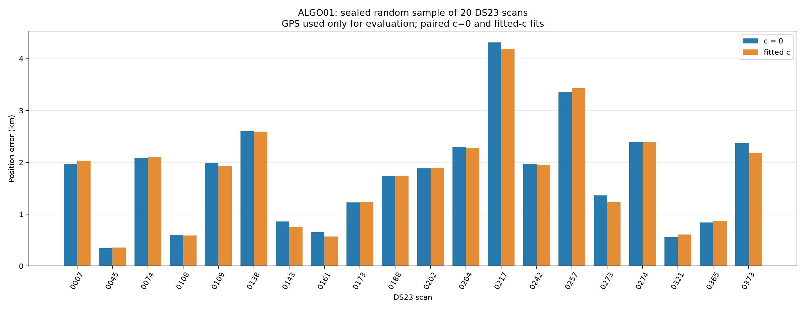

# ALGO01 on 20 random DS23 scans

A uniform sample without replacement from the frozen 413-member DS23 authority, seed **2026101802**, selected before new fitting. There are 9 adaptive and 11 fast recordings. DS23-0321 overlaps the earlier random ten-scan sample; the other 19 were not in that sample. No format, readiness, association or location filter and no outcome-based replacements were used. All 20 yielded existing tracking inputs.

| Arm | Completed | Mean km | Median km | P90 km | Maximum km | <1 km | <2 km |
|---|---:|---:|---:|---:|---:|---:|---:|
| c0 | 20 | 1.771 | 1.924 | 2.676 | 4.315 | 6 | 13 |
| fitted_c | 20 | 1.747 | 1.913 | 2.679 | 4.191 | 6 | 12 |

| Scan | Format | Error c=0 km | Error fitted c km | GLRT points | Calibration points | Status |
|---|---|---:|---:|---:|---:|---|
| DS23-0007 | adaptive | 1.962 | 2.033 | 1629 | 899 | complete |
| DS23-0045 | adaptive | 0.342 | 0.359 | 1211 | 808 | complete |
| DS23-0074 | fast | 2.092 | 2.095 | 3375 | 2259 | complete |
| DS23-0108 | fast | 0.603 | 0.586 | 3680 | 2367 | complete |
| DS23-0109 | adaptive | 1.994 | 1.937 | 1736 | 1031 | complete |
| DS23-0138 | fast | 2.599 | 2.595 | 3812 | 2300 | complete |
| DS23-0143 | adaptive | 0.859 | 0.758 | 1677 | 755 | complete |
| DS23-0161 | adaptive | 0.656 | 0.571 | 1878 | 1018 | complete |
| DS23-0173 | adaptive | 1.225 | 1.240 | 1953 | 1342 | complete |
| DS23-0188 | fast | 1.741 | 1.738 | 4848 | 2892 | complete |
| DS23-0202 | fast | 1.886 | 1.890 | 4305 | 2646 | complete |
| DS23-0204 | fast | 2.294 | 2.281 | 3314 | 1719 | complete |
| DS23-0217 | adaptive | 4.315 | 4.191 | 1374 | 795 | complete |
| DS23-0242 | fast | 1.974 | 1.952 | 3304 | 1756 | complete |
| DS23-0257 | adaptive | 3.363 | 3.432 | 1121 | 655 | complete |
| DS23-0273 | adaptive | 1.359 | 1.234 | 1040 | 649 | complete |
| DS23-0274 | fast | 2.401 | 2.388 | 3175 | 2042 | complete |
| DS23-0321 | fast | 0.558 | 0.607 | 2789 | 1656 | complete |
| DS23-0365 | fast | 0.840 | 0.870 | 3013 | 1906 | complete |
| DS23-0373 | fast | 2.366 | 2.185 | 3488 | 2268 | complete |

## Fixed algorithm and scope

This is a general batch composition of the published conservative ALGO01 rules, rather than reuse of the two hand-inspected scan outcomes. The sample and source hashes were sealed before inference. Graph tracks and radio-only noise are rebuilt from archived GLRT contracts. Broad causal satellite discovery uses the original finite RF branch search and its unit-phase nomination score, then the selected RF branch is refit from the regional center with the updated causal phase prior. Near-duplicate earlier epochs under 1 second are rejected. Phase uncertainty uses the frozen age/disagreement formula with 1–15 second scales. No future TLE or reference coordinate enters inference.

The 25×25 km box is centered on 37.906, −122.545. Every controlled fit starts at local (0,0), with five phase-reference rounds and at most48 Gauss–Newton steps per round. Receiver/band offsets and drifts, receiver smooth terms, satellite phase/eligible causal orbit modes and fragment constants retain ALGO01's priors. The full nuisance design is retained under exclusion masks, matching the published controlled composition. Identities remain the finite RF nomination branch except where the all-catalogue salvage shortlist proposes a supported replacement.

Rejections in either c arm update one common mask; both arms are cold-refit on matched data, aliases and identities, up to4 monotone rounds per stage. Excluded curves are tested for whole/prefix/suffix salvage using independent calibration, the published 3-second nomination penalty, RMS/bias/structure/visibility gates and a six-radio-sigma tail check. Children require at least12 points,20seconds and250Hz departure from a line. Maximize accepted support; use RF score to break ties. No scan-specific breakpoint, satellite list or GPS-tuned threshold is used. The repaired set is jointly refit and gated again. Linear extensions never vote for calibration or position. Failed/unstable runs remain in the table.

This prospective application differs from the original two-case diagnostic composition by explicitly enforcing paired-arm gate consistency and active curvature on every salvaged child, rather than inheriting eligibility. It does not include the expanded multi-peak greedy/joint/EM reconstruction branches.

Errors are great-circle distances to the supplied evaluation coordinate 37.849061591561885, −122.48574968092912, used only in this reporting tool. We assume that reference applies to all sampled recordings, as in the earlier DS23 evaluation; no independent per-recording survey is available. Receiver height is fixed to0m. Better frequency fit is not interpreted as better localization. A numerical endpoint is not a global-optimum or calibrated-confidence claim.

## Reproduction and evidence

`sample.json` binds the frozen DS23 manifest; `run_protocol.json` fixes source hashes and thresholds. `tools/run_algo01_ds23_sample.py` stages are `seal`, `export`, `prepare`, `discover`, `infer`; export uses the same-repository deployed read-only public port. Preparation reads the causal archive, with privileges only where its filesystem permissions require them. All output is under this new report directory; original reports, raw radio files and production state are untouched. Discovery and inference use separate processes because the discovery audit hook is process-wide. Worker budgets are bounded and BLAS/OMP threads are1. No new RF or GLRT acquisition/remeasurement is performed.

[Errors and diagnostics CSV](position_errors.csv) · [Summary](summary.json) · [Sample](sample.json) · [Protocol](run_protocol.json) · [Validation](validation.json)
