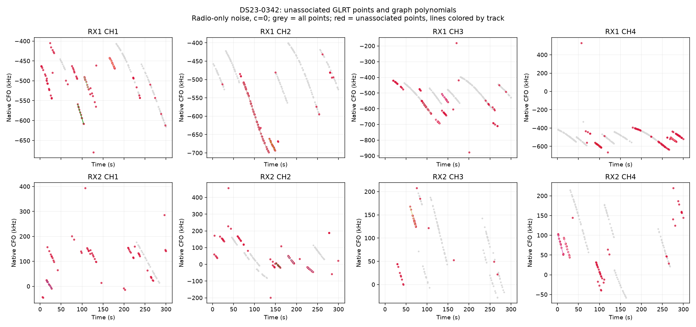
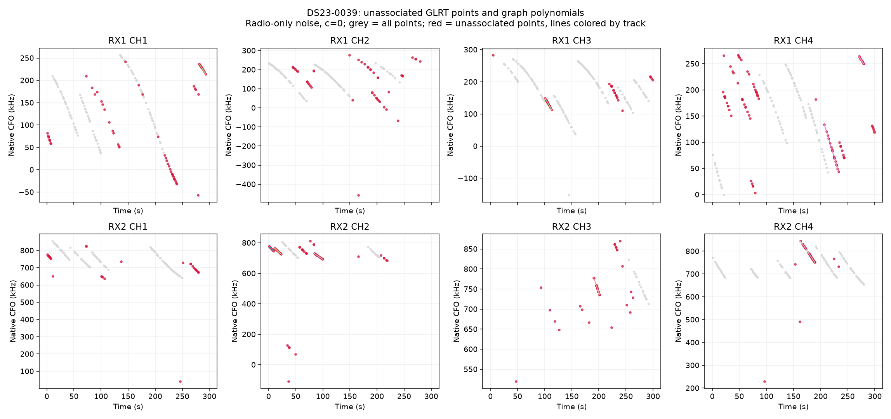

# DS23-0342 and DS23-0039 localization failure investigation

The large errors have different immediate causes. **Scan 342 contains a graph path consistent with a switch between two satellite tracks, and a residual-rejected curve still influenced localization. Scan 39 is primarily pulled away by an overly narrow satellite phase prior.** Both scans expose the ambiguity between position and satellite phase. A separate causal-prior audit found near-duplicate TLE epochs in scan 342's previous-element selection.

The controlled prototype reduces error from **5.000 to 1.786 km** for scan 342, and **3.372 to 0.760 km** for scan 39. Fitted-c results are **1.736 and 0.893 km**. These are diagnostic results on two inspected scans, not an independent generalization benchmark or a claim that every candidate identity is correct. No future TLE, reference-position seed, GPS-based satellite selection or new RF measurement was used for these prototypes. The original published pilot is unchanged.

| Intervention | 342 c=0 error km | 342 fitted-c km | 39 c=0 error km | 39 fitted-c km |
|---|---:|---:|---:|---:|
| Published baseline | 5.000 | 4.998 | 3.372 | 3.502 |
| Genuinely earlier TLEs; original unit phase prior | 4.890 | 4.862 | 3.372 | 3.502 |
| Also remove residual-failing curve from calibration | 3.165 | 3.132 | 3.372 | 3.502 |
| Also widen phase scale to 3 s: sensitivity control | 1.678 | 1.610 | 0.681 | 0.813 |
| Instead use age/disagreement phase uncertainty | 2.023 | 1.962 | 0.760 | 0.893 |
| Retain 342's valid 36-point suffix with age/disagreement uncertainty | **1.786** | **1.736** | **0.760** | **0.893** |

Every c=0/fitted-c pair uses the same observations, identities, aliases, other priors and five-round/48-step search budget. Masks differ between intervention rows; objective values across different masks must not be ranked against each other. GPS evaluates completed fits and defines the diagnostic map axes. It does not choose the trim, identity, nuisance estimates or causal prior widths.

**Original unassociated points and graph tracks.** These are the radio-noise, c=0 pilot outputs. Grey is the full scan, red is unassociated GLRT points and colored curves are unassociated graph tracks. A polynomial fit passing its own residual checks does not establish one satellite identity.

**342: the position fit used a curve which the association gate rejected.** RX1 CH2 T002 has 48 points over 73.582–133.486 s. The graph fitted one fourth-order polynomial with 157.9 Hz polynomial residual RMS and no detected residual structure. The original satellite assignment, NORAD 68214, has 1,302.7 Hz RMS, slope z=4.02, quadratic BIC gain=75.03, maximum step z=6.29 and lag-one residual correlation=0.902. It clearly fails the satellite residual gates.

Those gates were applied after position fitting. The curve still entered the robust objective with group precision 0.01083, rather than being excluded. Its geometry and time support gave it substantial influence despite that small weight. Removing this single curve moves the fixed-tangent solution by 1.780 km and reduces reference error from 5.000 to 3.238 km. A full phase-refreshed refit gives 3.289 km with the original causal prior, or 3.165 km after fixing the previous-element selection. Other single-track deletions have much smaller effects. This directly establishes the need for a gate-and-refit loop rather than treating the displayed accepted set as the set that produced the position.

**342: a plausible two-family explanation retains the points.** The path contains 12 points from 73.582 to 83.020 s, followed by a 6.428 s gap and 36 points from 89.448 to 133.486 s. The graph permits 10 s edges and fourth-order fits. Its greedy path packing and local velocity-continuity cost can bridge this gap; polynomial residual whiteness alone does not test emitter consistency. This is one graph polynomial piece, not a recorded post-fit join between two archived pieces.

After calibrating from other curved tracks, a causal candidate search and prefix/suffix residual test retain the latter 36 points as 68214. Their independent frozen-calibration test has 151.2 Hz RMS; after the joint corrected fit they have **143.8 Hz RMS**, slope z=0.028, quadratic BIC gain=-10.74, maximum step z=1.20 and lag-one correlation=0.235. These look consistent with noise around zero.

The first 12 points fit **65504**, whose phase and radio calibration come from a separate actively curved 37-point RX1 CH3 track. With that calibration frozen, the prefix has **205.0 Hz RMS**, bias about 388 Hz, slope z=2.87, quadratic BIC gain=9.92 and maximum radio-standardized residual=3.14. It passes the existing gates in both c arms but only narrowly passes the structure limits. Its span is just 9.44 s: **it never votes for calibration or position**. This makes a two-satellite graph switch a plausible explanation, but the prefix identity remains tentative; it is not ground truth or a reason to relax the gates.

The two-family explanation offers a candidate interpretation of all 48 original points, while only the 36-point curved suffix enters the revised position fit. The 12-point prefix's attachment has no effect on the reported position. For conservative association output, leave that prefix unassigned pending stronger confirmation: its structure statistics are too close to the thresholds to call the identity secure. Overall whole-scan association totals were not recomputed here.

A radio-only polynomial change-point check independently favors segmentation. Using the same frozen observation noise, a common N=48 in all BIC parameter penalties, four points per coefficient and one additional breakpoint parameter, the best single polynomial is degree 4 with BIC **87.98**. The best split has BIC **73.47**. The physically motivated 12/36 split uses degrees 2 and 3 and has BIC **78.71**, improving BIC by 9.28 even after its extra complexity. The radio-only best breakpoint is later, between 93.08 and 95.79 s; polynomial evidence supports a split but does not uniquely locate an emitter handover. The satellite and companion-channel evidence distinguish the earlier partition.

**An additional gate weakness appeared during salvage.** Maximizing retained points with only the existing RMS, bias and structure gates kept 38 points, including a boundary residual of roughly -1,837 Hz. Overall RMS was still below 450 Hz. The structure screen estimates its noise scale from the same residuals and tests steps with at least four points on either side; two bad boundary points can inflate that scale and evade the test. That loose trim worsened the causal-prior result to 3.427 km.

Adding a conservative **six-sigma maximum residual check against the independently learned radio noise** selects 36 points instead. It produces the 1.786 km result above. This extra check prevents the residuals under test from defining their own permissive noise scale. It is a prototype boundary-contamination safeguard; its false-alarm rate and sensitivity need validation over the remaining sample, rather than further tuning to these coordinates.

**39: the optimizer converged, but the phase prior favored the wrong position.** All nominated curved tracks pass the original satellite residual gates. No single deletion repairs the error: the best single-track deletion still leaves 2.994 km error. Starting the same diagnostic optimizer at the supplied reference returns the original approximately 3.37 km-error endpoint. The endpoint gradient is near zero. This is not evidence of a missed descent step or one dominant bad join.

At the supplied reference, after re-expanding phase and refitting nuisance variables, raw residual RMS is actually slightly **better: 61.68 Hz versus 62.15 Hz**. However, the model assigns every satellite an absolute zero-mean **one-second phase scale**, despite element ages of approximately 18–24 hours. Several required phases are around four seconds. The phase-prior penalty is **96.01 at the reference versus 72.96 at the fitted position**. That extra 23.05 penalty units outweigh the small improvement in the data terms: the full objective is 3100.65 versus 3086.73.

The geometry can trade a few kilometers of receiver position against fractions of a second in each satellite phase. The uniform narrow prior therefore acts as an indirect position constraint. Widening it to three seconds changes residual RMS by less than one hertz while moving reference error from 3.372 to 0.681 km. The three-second setting is a sensitivity experiment, not a value fitted to GPS for deployment.

**Causal prior audit and a location-independent prototype.** The previous-element selector accepted any strictly older epoch. In scan 342, **9 of the 17 nominated satellite families** had a purported previous entry only **0.864 milliseconds** older, with the other orbital elements identical. For example, 58441's epoch differed only in the last displayed TLE digit. Such entries provide essentially no independent disagreement information and push orbital uncertainty estimates toward their floors. Across the broad candidate catalogue, 646 identities had at least one such near-duplicate entry during the audit. Scan 39's selected previous entries did not have this problem.

The repaired selector rejects epoch differences under one second, then selects the latest genuinely earlier eligible entry. Both collection and epoch must still precede the original observation cutoff. The latest mean orbit, observations and regional candidate bank stay fixed. The repair alone changes scan 342's error only modestly, to 4.890 km, so it must not be presented as the entire explanation for the five-kilometer error.

For the phase-prior prototype, project previous-versus-latest propagated state disagreement onto along-track time at the scan, without a receiver position. Use

`sigma_phase = clip(hypot(1 s, alignment_difference × latest_age / epoch_gap), 1 s, 15 s)`.

The 15 s cap respects the existing numerical phase-bank support. This is a conservative forecast-uncertainty proxy, **not a calibrated orbit-error distribution**. It uses only genuine causal element differences and their epochs, not GLRT residuals, satellite labels selected by GPS or the reference coordinate. Applying it to the frozen nominations gives 0.760 km error for scan 39. Combining it with the 342 curve repair gives 1.786 km. An initial experimental width calculation using the near-duplicate entries was invalid and is not the recommended result; its local artifacts are retained to document how the issue was detected.

**Other controlled hypotheses.** The original-nomination controls below use the same data and candidates within each c pair. Merely adding orbital flexibility, changing the RF/native receiver smoothness model or adding colored noise does not solve these failures. All numerical arms, including fitted-c controls, are in [results.csv](results.csv).

| Original-prior control, c=0 | 342 error km | 39 error km |
|---|---:|---:|
| Baseline | 5.000 | 3.372 |
| Smaller receiver mean-drift prior, 1 Hz/s | 4.765 | 3.032 |
| Three-second phase prior | 4.355 | 0.681 |
| Three-times wider physical orbit modes | 5.193 | 4.548 |
| Additional eccentricity modes | 5.152 | 3.629 |
| Native-band nonlinear receiver drift | 5.109 | 3.404 |
| Colored residual covariance | 5.086 | 7.406 |
| Smaller independent fragment constants, 300 Hz | 3.103 | 2.277 |

After rejecting the failed 342 curve and using the repaired causal phase prior, changing the fragment-constant scale to 300 Hz gives 1.269 km error; this shows remaining nuisance/position coupling. That scale has not been independently justified, so the lowest GPS error is not used to select the recommended result. Receiver offset/drift terms and fitted-c remain in all paired experiments.

**What remains uncertain.** The corrected loss valleys are broader and much closer to the reference. At the reference, the fixed-final-tangent loss increase is about **2.06 for 342** and **0.73 for 39**, compared with 16.84 and 13.52 in the original models. The local quadratic position scales are approximately 1.35/0.82 km and 1.00/0.43 km. Those are model-sensitivity scales, not validated confidence intervals. The remaining point-estimate displacement is therefore compatible with weak location information and engineering prior choices; it is not evidence that another specific satellite must be deleted. The exact prefix identity, correct transmitter/fragment frequency covariance and calibrated causal TLE error distribution remain unresolved.

These maps sample a **0.5 km grid** over east -5…+7 km and north -5…+5 km from the reference, entirely inside the fixed 25×25 km regional search box. At each point, nuisance coefficients and grouped noise precisions are refitted. Satellite identities, alias integers and the final phase tangent are fixed separately for each panel. They are **conditional profiled loss surfaces, not full-pipeline reruns or normalized position probabilities**. Stars are continuous phase-refreshed endpoints, not grid minima. Both c arms were computed; c=0 is shown.

**Recommended implementation direction.** Preserve graph discovery, but add an outer association-quality/refit loop so a curve failing satellite residual gates cannot continue voting for position. Before dropping a large curve, test penalized partitions and contiguous trims against calibration learned from other curved tracks; keep short fragments eligible for association only. Add independently scaled boundary-tail checks. Reject near-duplicate causal TLE updates and use a causal, age-dependent phase uncertainty model with an explicit fallback when no genuine prior update is available. Then evaluate these fixed rules on the other randomly sampled scans without selecting hyperparameters by GPS error.

**Scope and verification.** This investigation reuses the sealed adaptive input contracts, graph observations and broad causal candidate catalogues. It withholds no observations at random. The prototype repairs operate on the existing RF-selected nomination branch; this is a controlled root-cause study, not a new exhaustive identity search. Continuous fits start at the regional center. Only the explicitly labelled optimizer diagnostic starts at the reference. Prefix/suffix selection maximizes supported points subject to RF residual gates, with RF score breaking ties. No reference coordinate chooses an association, trim or prior width.

Position errors use the supplied coordinate 37.849061591561885, -122.48574968092912 and retain the original fixed-zero receiver height assumption. All causal checks retain the original cutoff; there are no post-observation elements. The eccentricity diagnostic helper was also made portable to a scan-owned, checksum-bound previous-TLE path. The published pilot inputs, results and source snapshot have not been rewritten. **39 component and related tests pass**, including near-duplicate epoch rejection, uncertainty scaling, independent tail gates, polynomial complexity penalties and causal prior path/hash checks. Ruff passes for the new and modified tools/tests.

[Validation and provenance](validation.json) · [All diagnostic results](results.csv) · [Investigation source](../../tools/investigate_ds23_adaptive_failures.py) · [Causal-input repair source](../../tools/prepare_ds23_genuine_causal_prior.py) · [Figure source](../../tools/plot_ds23_adaptive_failures.py)
