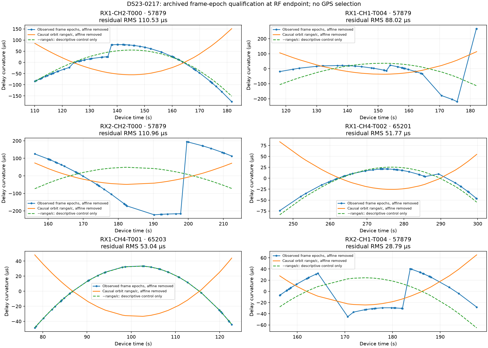

# DS23-0217: archived frame-epoch curvature qualification

This is a **diagnostic, not a new position solution**. The existing GLRT
snapshot supplies both CFO and fractional frame epochs, so no IQ was read and
no RF was collected. All 26 original curved calibration tracks are retained.
Geometry uses the original RF-selected endpoint and causal orbital corrections;
the supplied GPS coordinate is not used.



For each physical probe, the first detected epoch is constructed positively:

```
t_epoch = (valid_start_counter + round(probe_start_ms*Fs/1000)
           - session_start_counter + integer_epoch_sample
           + fractional_epoch_offset_samples)/Fs
```

The physical frame period is1/750s, not the rounded3333-cell acquisition ring.
Candidate ties use the public maximum-margin/lower-rank rule and reproduce
the selected CFO. Satellite geometry is queried at the frame epoch, rather
than at the20ms probe midpoint. This contemporary-range diagnostic has not
added retarded propagation or a validated transmitter clock model.

The phase branch is unwrapped relative to the original nominated geometric
delay; the unknown transmitted cycle count is not established. Constant and
linear trends are removed separately from observed phase and geometric range/c.
This destroys absolute range, phase origin and linear range-rate information.

The median RMS to **positive** range curvature is29.42µs. Some traces instead
have a close **negative** relation: eight have RMS below0.5µs to negative range,
including RX2 CH1 T005 at about0.034µs. Others contain large discontinuities or
fail either sign control. These are conditional descriptive residuals, not
measured ranging accuracy or evidence that the satellite labels are correct.

This reproduces the previously documented [DSX01 phase-sign audit](../../2026_10_17_dsx01_iteration6/frame_phase_audit/README.md).
Positive arrival semantics were independently checked there, including an
injected positive-delay control. The negative relation is **not** a definition
of the reported epoch. Globally negating epochs into a geolocation measurement
would be an unsupported model change. The repeated pattern motivates further
source/clock investigation, rather than qualifying an estimator.

Published work finds that frame clocks can have jumps, substantial drift and
beam-dependent behavior, and need not share the carrier-clock behavior. See
[Qin et al., Timing Properties of the Starlink Ku-Band Downlink](https://arxiv.org/html/2501.05302v1)
and [Pilots and Other Predictable Elements](https://arxiv.org/abs/2602.02627).
Those findings identify plausible confounds; they do not determine the physical
cause of this dataset's negative relation.

[All26 tracks and input/source hashes](qualification.json) record both sign
controls. Reproduce with `tools/probe_ds23_delay_curvature.py --case DS23-0217`
using the repository .venv and PYTHONPATH=src:tools. No frame-timing measurement
was used to select a position or tune a prior in the DS23 weighting experiments.
