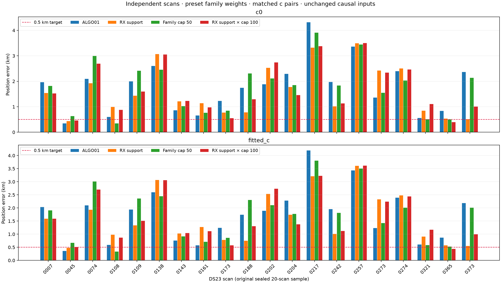
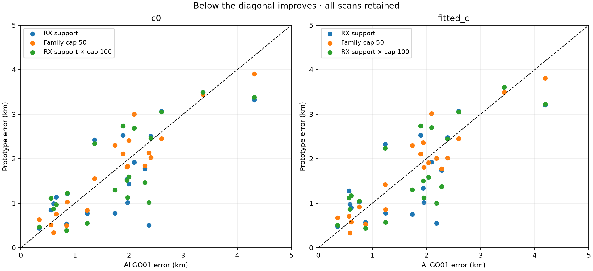

# DS23: frozen family-weighting benchmark

The independent receiver-support rule improves median error on the original
20-scan sample, but **neither mean nor median reaches the 0.5 km target**.
All scans, including regressions and development scan 217, are retained.
These are development results, not validation on new locations or all 413 DS23
recordings. [ALGO01](../ALGO01/README.md) remains the baseline specification.

| Rule | c0 mean / median, km | Fitted-c mean / median, km | Valid scans |
|---|---:|---:|---:|
| ALGO01 | 1.771 / 1.924 | 1.747 / 1.913 | 20 / 20 |
| RX support | 1.612 / 1.325 | 1.607 / 1.305 | 20 / 20 |
| Family cap 50 | 1.773 / 1.841 | 1.754 / 1.859 | 20 / 20 |
| RX support × cap 100 | 1.688 / 1.378 | 1.681 / 1.338 | 20 / 20 |

## Prespecified rules and controls

Use the same final original ALGO01 identities, aliases, qualified observations,
causal latest/previous TLE inputs, receiver/orbit priors, radio-noise law and
25×25 km box. Each fit starts at the regional center, with five phase-reference
rounds and at most48 Gauss–Newton steps per round. The fitted-c arm uses the
same mask, labels, aliases and likelihood powers as its c0 partner.

The RF-conditional uniqueness proxy screens every satellite in the original
causal bank at the RF-derived endpoint and four ±2 km axial perturbations.
No GPS position is used. Only original **retained** points contribute confidence,
family sizes or independent owner votes. Masked/rejected observations do not
create cross-receiver support. The original nuisance design is still retained
under masks to preserve the controlled ALGO01 prior-support convention.

RX support powers are 1 for a family observed by both receivers, 0.6 for other
families supported by at least two distinct receiver/channel combinations with
conditional uniqueness≥0.95, and 0.2 otherwise. Powers never exceed1. Family
cap50 uses min(1,50/N_family); the combined control multiplies receiver support
by min(1,100/N_family). These rules were frozen before reading cohort outcomes;
they are generalized likelihoods, not calibrated probability weights.

If either arm fails an original residual, alias, visibility or independent-owner
gate, its failed component is masked in **both** arms and both are cold-refit.
There are at most four monotone gate rounds. This is an exclusion/weighting
prototype, not a new association search or a claim that excluded points are
noise. No linear/short fragment determines calibration. Reassociation and
salvage are not rerun after this experiment's additional exclusions.

## Interpretation and next step

The signal is independent family replication, not simply giving more weight to
a low-RMS or conditionally unique identity. Family-size capping alone does not
improve mean error. The receiver-support rule improves the median more than
the mean; individual failures remain. The [scan-217 investigation](../2026_10_18_algo01_0217_improvements/README.md)
shows that some of its gain is weighting and some is quality-gated removal.

Do not select different rules per scan using GPS, shift endpoints toward the
known site, drop regressions from aggregate results, or infer accuracy from a
lower frequency objective. The reference coordinate is used only here for
evaluation, with the same unverified assumption that it applies to every scan
in the sample. Fixed height remains0m.

Continue with controlled physical-prior and timing/RF diagnostics. Any candidate
default must then be frozen and evaluated on previously untouched DS23 members.
The original 20-scan results and ALGO01 remain unchanged.

## Evidence and reproduction

[Summary](summary.json) · [All scan/arm results](comparison.csv) ·
[Protocol](protocol.json) · [Execution receipts](execution.json) ·
[Validation](validation.json)

Inference: `tools/evaluate_ds23_family_weighting.py --workers 2`.
Reporting: `tools/report_ds23_family_weighting.py`.
Use `.venv/bin/python`, PYTHONPATH=src:tools, OPENBLAS_NUM_THREADS=1 and
OMP_NUM_THREADS=1. Every scan directory stores raw fit/phase/gate histories,
weights, masks, confidence proxies and input/source hashes. No new RF was
collected; all radio inputs are read-only archived authorities.

An initial interrupted trial used the full original support when counting
owners. It is retained separately under `2026_10_18_ds23_family_weighting` and
is **not** mixed into this active-support benchmark. Three owned tests prevent
masked observations creating receiver votes, enforce active-point family caps,
and distinguish cross-channel from cross-receiver replication.
