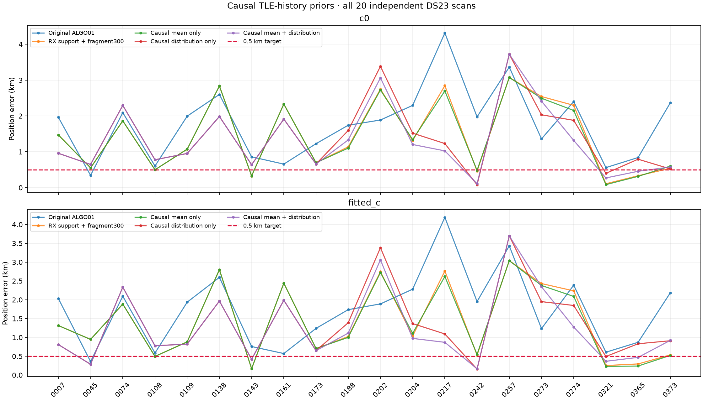
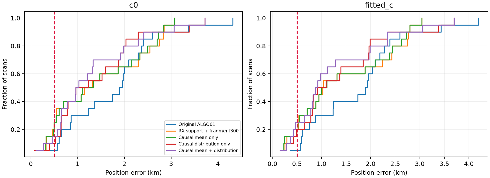

# DS23: phase priors learned from causal TLE history

The 0.5 km mean/median target remains unmet. Every scan and regression is retained.
The primary rule was declared as **mean_and_distribution** before the cohort run;
GPS is used only by this reporter, never to select a prior or endpoint.

| Method | c0 mean / median, km | Fitted-c mean / median, km |
|---|---:|---:|
| Original ALGO01 | 1.771 / 1.924 | 1.747 / 1.913 |
| RX support + fragment300 | 1.452 / 1.225 | 1.427 / 1.030 |
| Causal mean only | 1.435 / 1.220 | 1.407 / 1.055 |
| Causal distribution only | 1.399 / 1.094 | 1.359 / 1.002 |
| Causal mean + distribution | 1.315 / 0.991 | 1.266 / 0.896 |

## Experiment

These are the same 20 scans from the original sealed random sample, now development
data, rather than an untouched validation set or all 413 DS23 scans. The control is
receiver-support weighting plus a 300 Hz fragment-offset prior. Regional search
remains a 25×25 km square centered at 37.906, −122.545, cold start at its center.
Satellite labels and alias integers are inherited from the original causal ALGO01
run. This experiment changes phase priors; it does not redo full association search.

For each scan separately, export up to 72 h of earlier TLEs for every satellite in
its regional causal candidate bank. Require collection and encoded epochs before
that scan. Deduplicate epochs, retaining earliest publication. Consecutive A/B/C
versions predict the next update in the along-track time coordinate, using only
states available when C was published. The innovation is a TLE-update proxy,
not measured orbit truth. Exclude triples whose encoded epoch was still future
at that past validation instant. No later-scan catalogue is used for earlier RF.

Use the first 70% of historical publication times for learning and the later 30%
for predictive validation, all before RF. Grid-select signed forecast shrinkage,
phase standard-deviation multiplier, and Gaussian versus unit-variance Student
tails. The Student t scale is sigma*sqrt((nu−2)/nu); sigma denotes standard deviation.
Require at least 30 later historical transitions and better predictive density
than the original Gaussian; otherwise use the zero-mean Gaussian fallback.
After qualification, relearn on all pre-scan history for the current scan. The
candidate-bank-wide fit is not selected from RF-associated satellites.

Only satellite phase coefficients receive heavy tails. Physical orbit modes,
receiver drift, cross-band terms and other priors stay unchanged. Nonzero means
are in physical seconds; the latent prior penalty and posterior native-coordinate
scaling are preserved. Every c0/fitted-c pair starts with identical observations,
labels, aliases, weights and budgets: five phase-reference rounds, at most 48
position steps, and four paired gate/exclusion rounds. A failure in either arm
removes that component from both. Masks may differ between methods: this is a
quality-gated policy comparison, not a pure fixed-observation attribution.

## Interpretation

Scan217 improves from 2.846/2.764 km under the weighted fragment300 control to
1.025/0.869 km with the learned mean and distribution. That selection uses past
TLE prediction, unlike choosing the 0.493/0.415 km combination by known GPS.
It does not establish that the same prior is optimal for every scan or location.

Raw RF residual scores have different normalization constants across Gaussian
and Student models and cannot be compared as normalized model probabilities.
More associated GLRT points and lower frequency RMS also do not imply better
position. Retained calibration counts and RMS are in the CSV. Satellite-family
and receiver correlations, alternative-peak additions, and simultaneous identity
searches are documented in the linked scan217 investigation; they are not rerun
inside this prior-only cohort.

The next work is to diagnose remaining regressions and validate any frozen rule
on untouched independent DS23 scans before changing ALGO01 defaults. No timing
or pseudorange claim is made from the unresolved frame-epoch sign behavior.

## Reproduction and evidence

[Protocol](protocol.json) · [Summary](summary.json) · [All outcomes](comparison.csv) ·
[Validation](validation.json) · [Execution](execution.json).

Run tools/run_ds23_history_calibrated_phase.py then this reporter in the repository
venv with PYTHONPATH=src:tools and BLAS/OMP threads set to 1. Histories and forecast
receipts are in ../2026_10_18_ds23_causal_phase_mean/history/. The archive reader is
read-only; no new RF, QNAP mutation, post-observation TLE, or GPS fitting occurs.
ALGO01 and DBG01 remain published; this is a research extension, not a replacement
of their specifications or golden fixtures.
