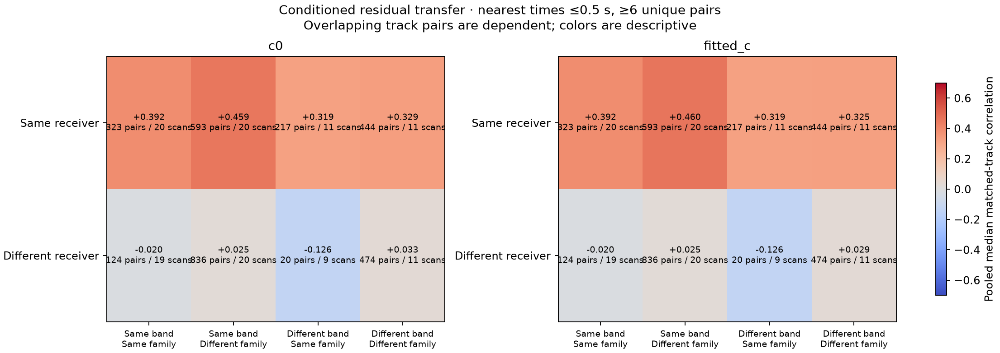

# DS23: residual transfer across receivers, bands and satellite families

Replay the final causal scalar-history/RX-support fit on all20 scans, with
the exact phase-reference history, masks, labels and alias integers. No new
position inference or GPS is used. Both c arms are included. This extends
the low-band-only scan217 comparison to the eleven scans with high
channels. Curved calibration evidence is analyzed; these are not residuals
for every associated linear/short output track or every winning GLRT point.

| Receiver / band | Scans | Points | Median scan RMS, Hz | Median scan RMS / radio sigma |
|---|---:|---:|---:|---:|
| RX1 / low | 20 | 13299 | 119.4 | 1.18 |
| RX1 / high | 11 | 6704 | 147.9 | 1.20 |
| RX2 / low | 20 | 8130 | 79.7 | 0.64 |
| RX2 / high | 11 | 2402 | 108.6 | 0.88 |

The table uses c0 and the median of per-scan group statistics, rather than
letting scans with more points dominate. The standardized RMS divides each
point by its independently estimated radio sigma before taking RMS; it does
not divide by the posterior group-noise adjustment. Group precisions and
per-track means/slopes/RMS are retained in the CSV.

At c0, different-family residuals have pooled median correlation+0.459
within the same receiver/band, and+0.329 across bands on the same receiver.
Same-family residuals across receivers in the same band have median−0.020.
The corresponding medians of per-scan medians are+0.449,+0.304 and−0.039,
so the pattern is not solely a scan-count pooling artifact. This supports
testing receiver-common plus band-specific covariance. It does not establish
that a receiver-only correction will improve position; the original217 fast
receiver model already reduced RMS without fixing localization.

## What the comparison can establish

Match actual observations within0.5s using nearest-distance-first unique
pairs; never interpolate or reuse a point within a track pair. Require six
pairs per comparison. Summarize all eight same/different RX×band×family
strata. The CSV includes both pooled track-pair medians and the median of
per-scan medians; it records how many scans contribute to each cell.

A positive same-RX/different-family correlation is consistent with shared
receiver behavior. A same-family/cross-RX correlation is consistent with
remaining shared orbit/transmitter behavior. These are descriptive clues,
not causal identification: all residuals have been conditioned on a joint
fit that already removes shared receiver and satellite terms. Overlapping
pairs are dependent, timing support and radio noise vary, and their sample
counts cannot be used as independent significance tests. A near-zero
cross-RX correlation does not prove that TLE errors are absent; phase and
orbit modes can already have absorbed them. Cross-band comparisons apply
only to recordings containing both bands; missing data are not zero noise.

The broad position-error controls remain in the [prior-refinement report](../2026_10_18_ds23_prior_refinements/README.md)
and [remaining-failure report](../2026_10_18_ds23_remaining_failures/README.md).
These residual plots do not justify choosing labels or priors from known GPS.

## Reproduction

[Protocol](protocol.json) · [Execution](execution.json) · [Summary](summary.json) ·
[Receiver/band groups](receiver_band_by_scan.csv) · [Track RMS, means and slopes](track_residuals.csv) ·
[Matched pairs](matched_pairs.csv) · [Stratified correlations](correlation_summary.csv) ·
[Validation](validation.json).

Run tools/audit_ds23_learned_residuals.py --case CASE for the20 cases listed
in protocol.json, then tools/report_ds23_learned_residuals.py, using the
repository venv with PYTHONPATH=src:tools and BLAS/OMP threads1. The completed
cohort used two workers with120s per-case bounds. The original GLRT/track and
causal-prior snapshots are required; no IQ reread, new RF, archive mutation
or post-observation TLE is used. Source snapshots overlay the earlier reports.
