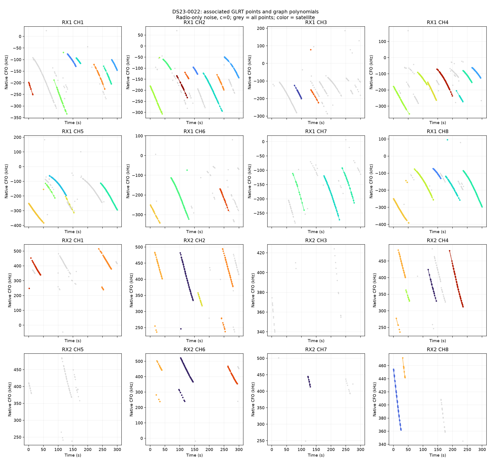
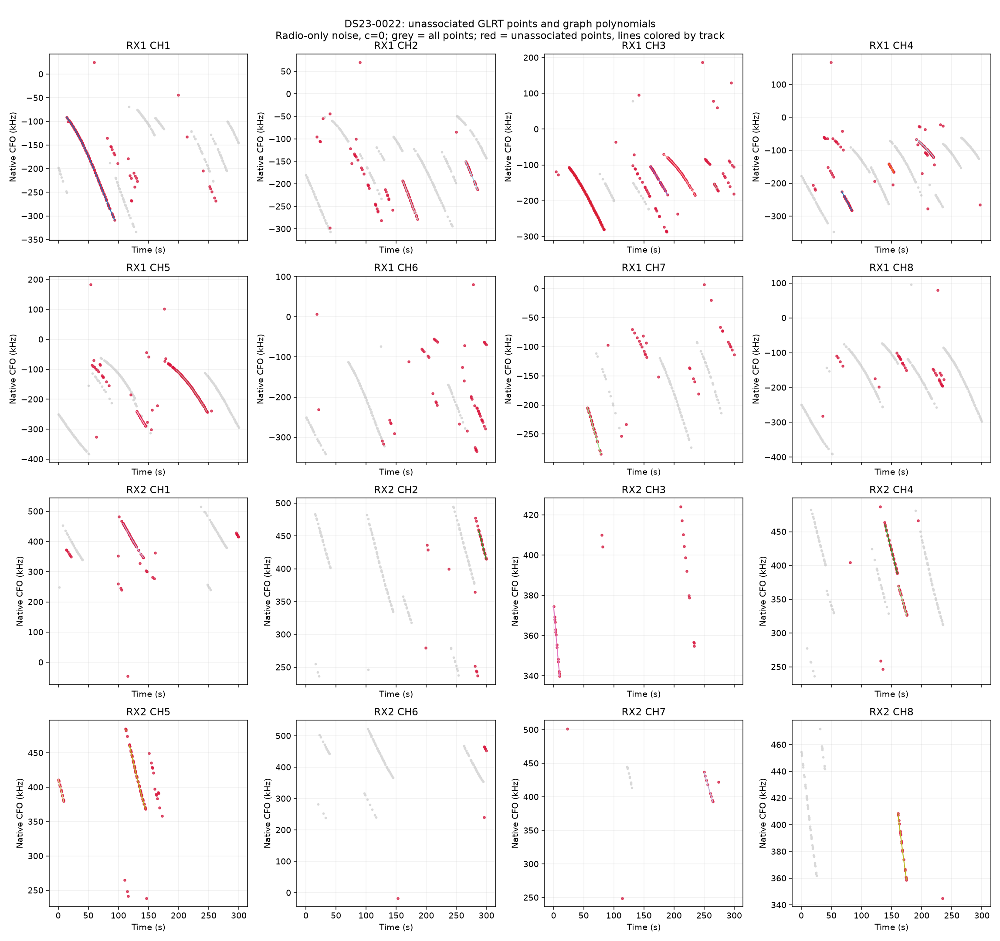
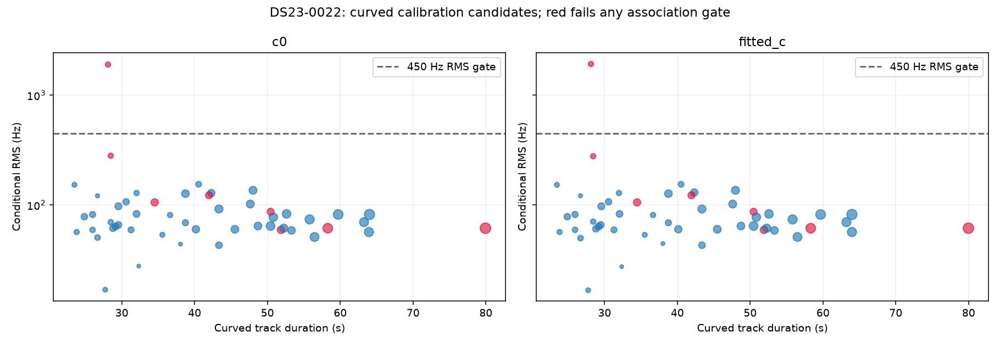

# DS23-0022

Recording `fast8-auto-20261014-200539-e66a9eee-1-lower`.

| Scan | Noise | c | Associated / GLRT | % | Tracks | Points/track | Error km | RMS Hz |
|---|---|---|---:|---:|---:|---:|---:|---:|
| DS23-0022 | fixed150 | c0 | 2,129 / 3,179 | 66.97 | 56 | 38.0 | 3.349 | 218.4 |
| DS23-0022 | fixed150 | fitted_c | 2,129 / 3,179 | 66.97 | 56 | 38.0 | 3.360 | 218.1 |
| DS23-0022 | radio | c0 | 2,093 / 3,179 | 65.84 | 56 | 37.4 | 1.891 | 219.1 |
| DS23-0022 | radio | fitted_c | 2,093 / 3,179 | 65.84 | 56 | 37.4 | 1.936 | 219.9 |

RMS covers all nominated curved calibration points before acceptance gates; association totals additionally include tracks accepted with calibration frozen. GPS errors are post-fit evaluations against the stated rooftop reference.

[Numerical summary](summary.json) · [Protocol and limitations](../README.md)
