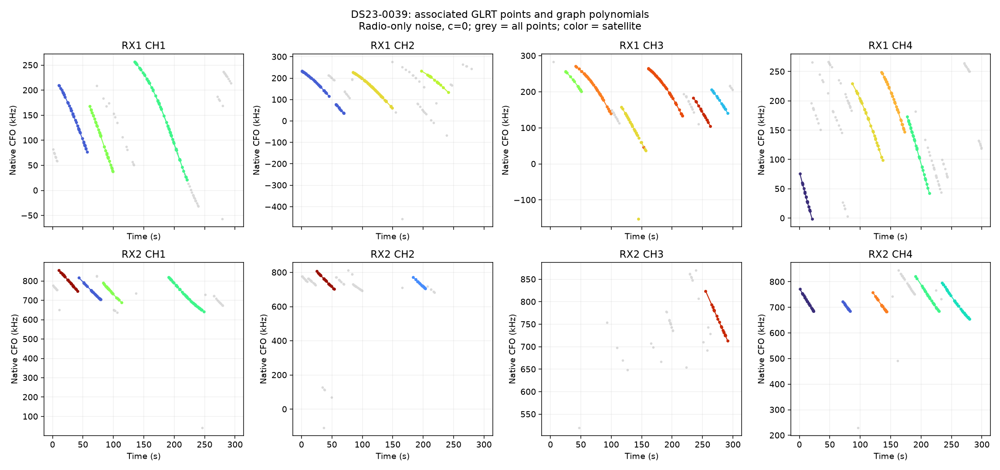
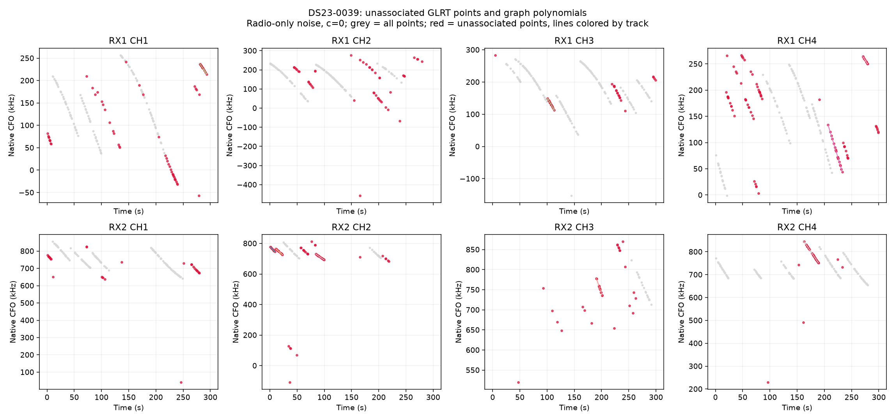
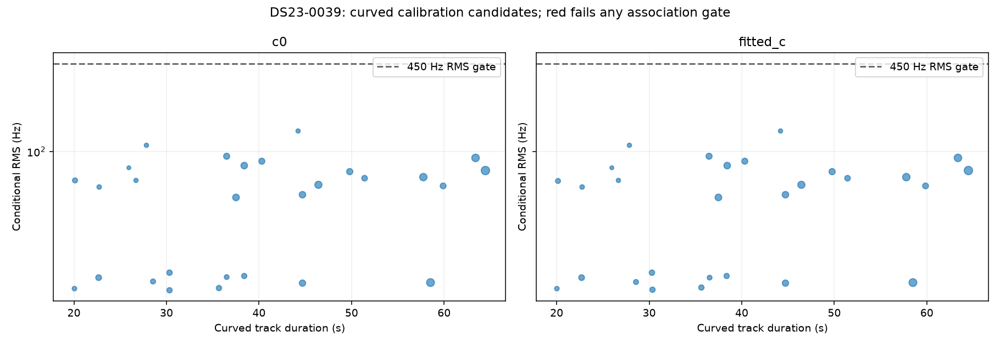

# DS23-0039

Recording `scan-fw-d89efe0882082b08`.

| Scan | Noise | c | Associated / GLRT | % | Tracks | Points/track | Error km | RMS Hz |
|---|---|---|---:|---:|---:|---:|---:|---:|
| DS23-0039 | fixed150 | c0 | 889 / 1,279 | 69.51 | 31 | 28.7 | 4.273 | 62.1 |
| DS23-0039 | fixed150 | fitted_c | 889 / 1,279 | 69.51 | 31 | 28.7 | 4.358 | 62.1 |
| DS23-0039 | radio | c0 | 889 / 1,279 | 69.51 | 31 | 28.7 | 3.372 | 62.1 |
| DS23-0039 | radio | fitted_c | 889 / 1,279 | 69.51 | 31 | 28.7 | 3.502 | 62.2 |

RMS covers all nominated curved calibration points before acceptance gates; association totals additionally include tracks accepted with calibration frozen. GPS errors are post-fit evaluations against the stated rooftop reference.

[Numerical summary](summary.json) · [Protocol and limitations](../README.md)
