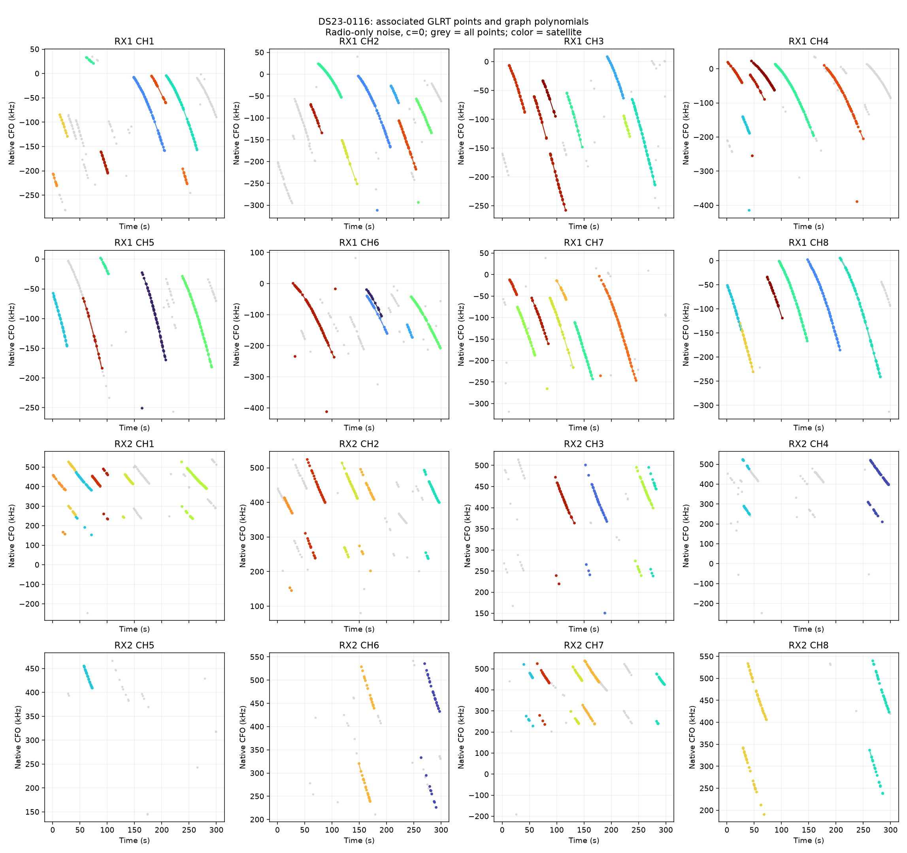
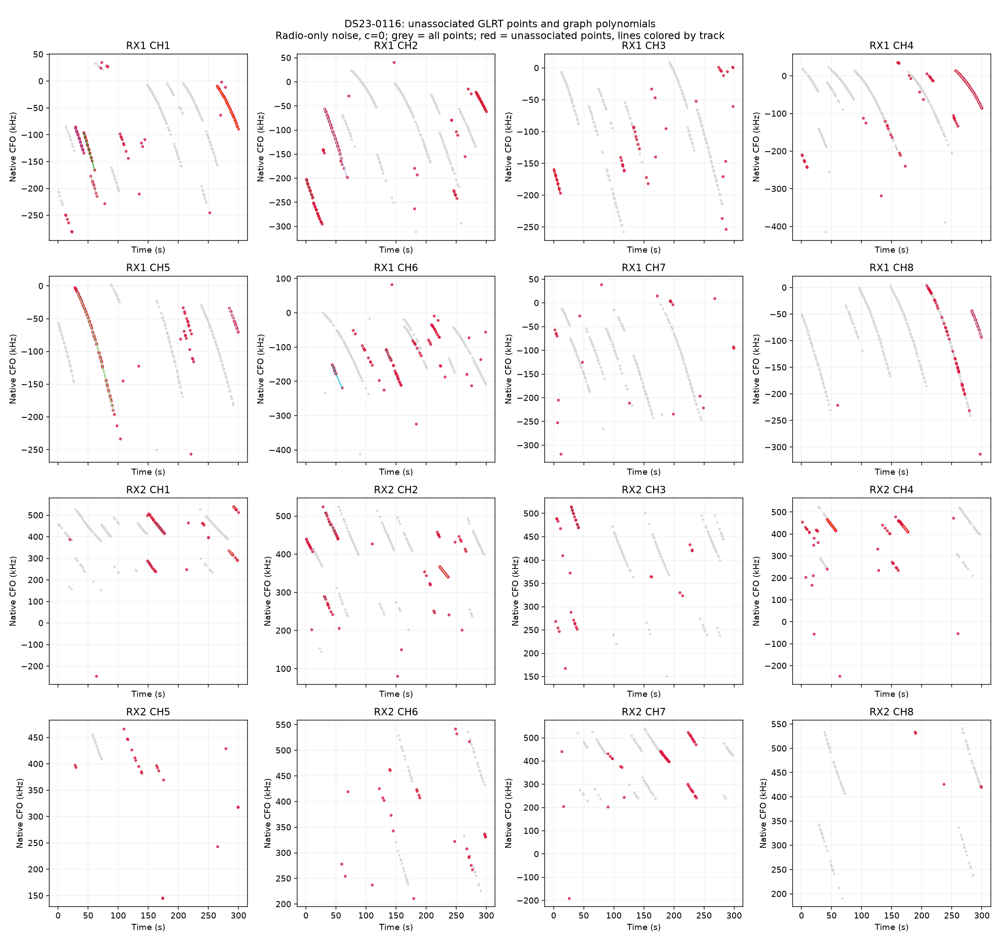
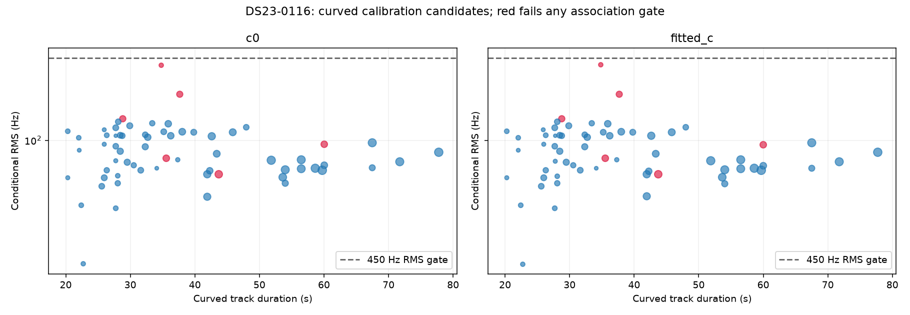

# DS23-0116

Recording `fast8-auto-20261015-203537-01522e1b-1-upper`.

| Scan | Noise | c | Associated / GLRT | % | Tracks | Points/track | Error km | RMS Hz |
|---|---|---|---:|---:|---:|---:|---:|---:|
| DS23-0116 | fixed150 | c0 | 2,790 / 3,809 | 73.25 | 85 | 32.8 | 2.481 | 97.7 |
| DS23-0116 | fixed150 | fitted_c | 2,790 / 3,809 | 73.25 | 85 | 32.8 | 2.508 | 97.7 |
| DS23-0116 | radio | c0 | 2,757 / 3,809 | 72.38 | 83 | 33.2 | 3.447 | 97.5 |
| DS23-0116 | radio | fitted_c | 2,757 / 3,809 | 72.38 | 83 | 33.2 | 3.544 | 97.6 |

RMS covers all nominated curved calibration points before acceptance gates; association totals additionally include tracks accepted with calibration frozen. GPS errors are post-fit evaluations against the stated rooftop reference.

[Numerical summary](summary.json) · [Protocol and limitations](../README.md)
