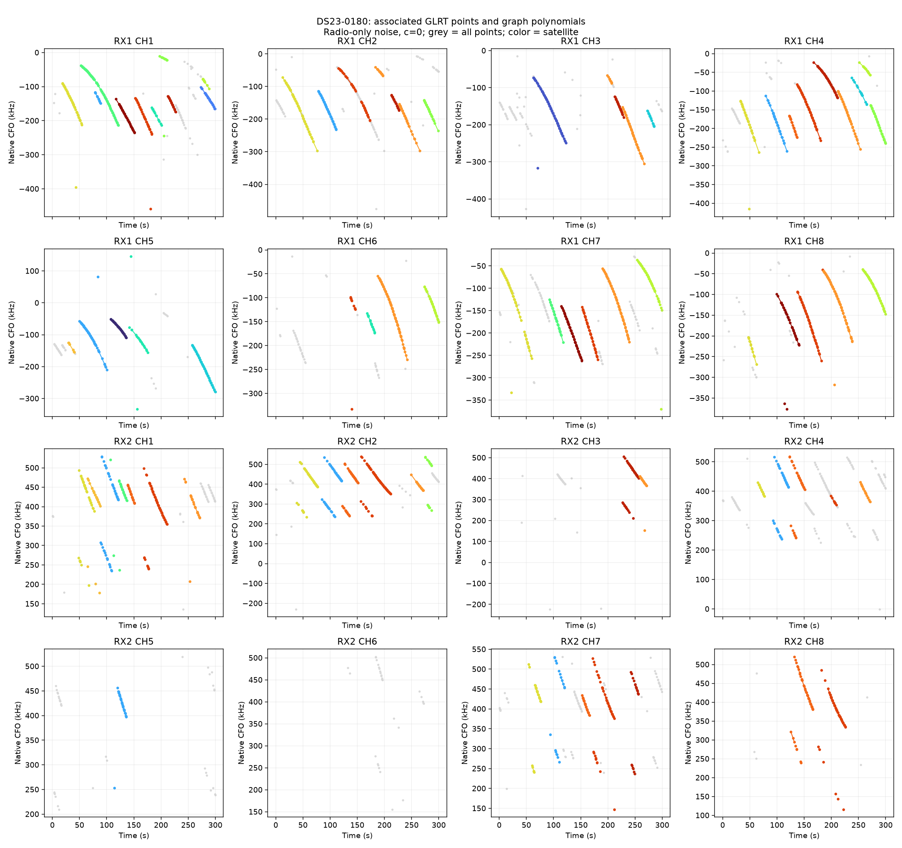
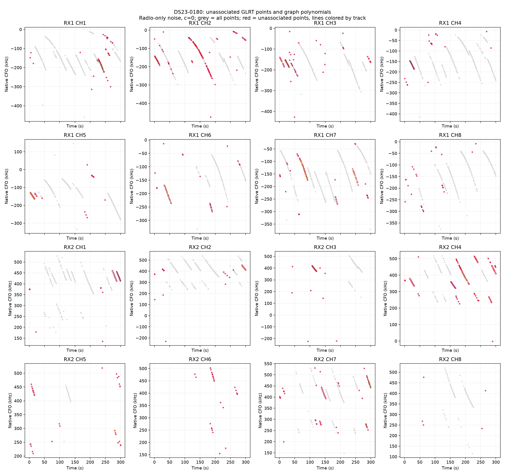
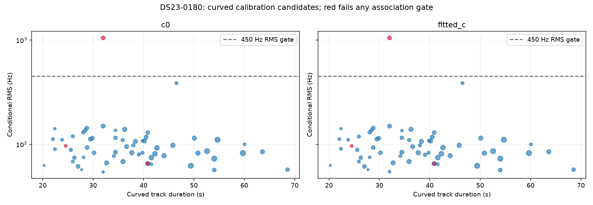

# DS23-0180

Recording `fast8-auto-20261016-124348-a59d9608-1-upper`.

| Scan | Noise | c | Associated / GLRT | % | Tracks | Points/track | Error km | RMS Hz |
|---|---|---|---:|---:|---:|---:|---:|---:|
| DS23-0180 | fixed150 | c0 | 2,763 / 3,617 | 76.39 | 87 | 31.8 | 2.064 | 167.7 |
| DS23-0180 | fixed150 | fitted_c | 2,763 / 3,617 | 76.39 | 87 | 31.8 | 2.065 | 167.7 |
| DS23-0180 | radio | c0 | 2,742 / 3,617 | 75.81 | 86 | 31.9 | 2.117 | 168.4 |
| DS23-0180 | radio | fitted_c | 2,742 / 3,617 | 75.81 | 86 | 31.9 | 2.118 | 168.4 |

RMS covers all nominated curved calibration points before acceptance gates; association totals additionally include tracks accepted with calibration frozen. GPS errors are post-fit evaluations against the stated rooftop reference.

[Numerical summary](summary.json) · [Protocol and limitations](../README.md)
