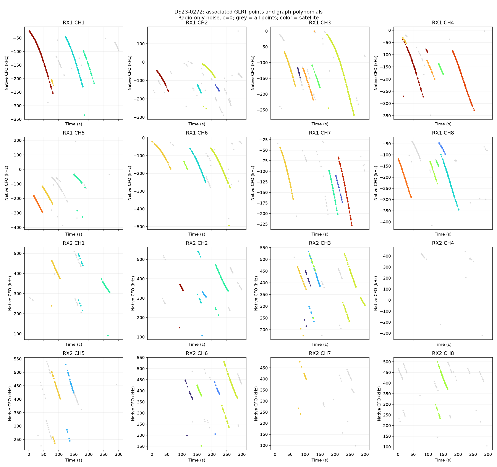
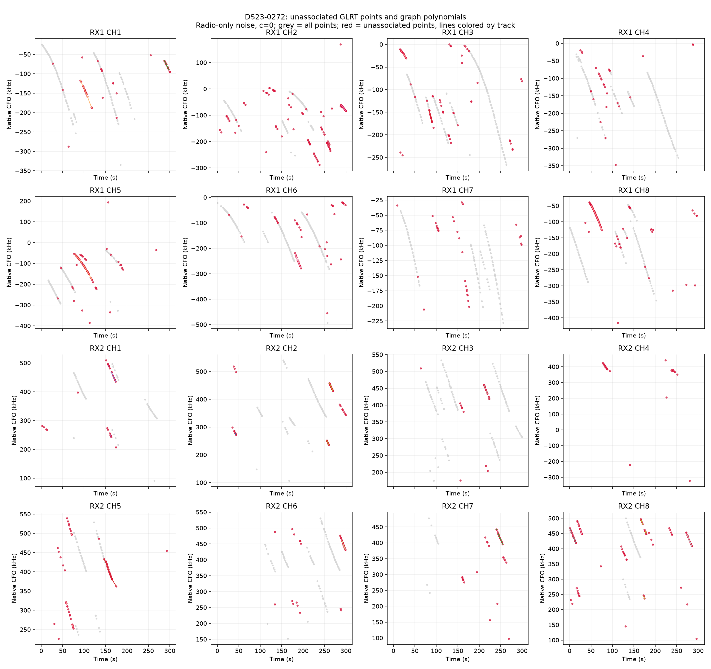
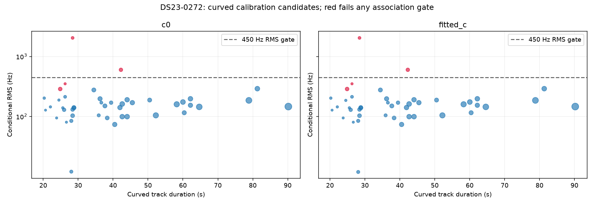

# DS23-0272

Recording `fast8-auto-20261017-120904-5ebd2188-1-upper`.

| Scan | Noise | c | Associated / GLRT | % | Tracks | Points/track | Error km | RMS Hz |
|---|---|---|---:|---:|---:|---:|---:|---:|
| DS23-0272 | fixed150 | c0 | 1,964 / 2,723 | 72.13 | 57 | 34.5 | 2.370 | 300.8 |
| DS23-0272 | fixed150 | fitted_c | 1,964 / 2,723 | 72.13 | 57 | 34.5 | 2.356 | 301.1 |
| DS23-0272 | radio | c0 | 1,964 / 2,723 | 72.13 | 57 | 34.5 | 2.646 | 285.0 |
| DS23-0272 | radio | fitted_c | 1,964 / 2,723 | 72.13 | 57 | 34.5 | 2.661 | 284.8 |

RMS covers all nominated curved calibration points before acceptance gates; association totals additionally include tracks accepted with calibration frozen. GPS errors are post-fit evaluations against the stated rooftop reference.

[Numerical summary](summary.json) · [Protocol and limitations](../README.md)
