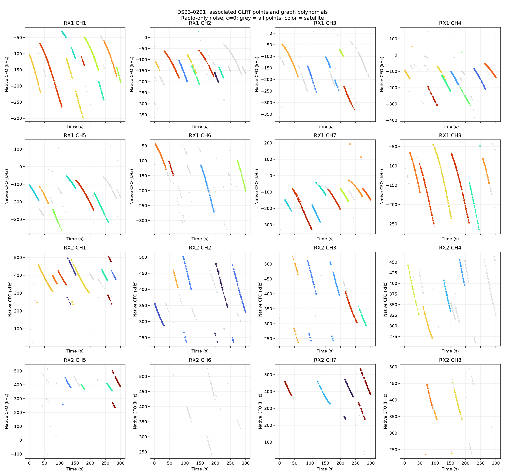
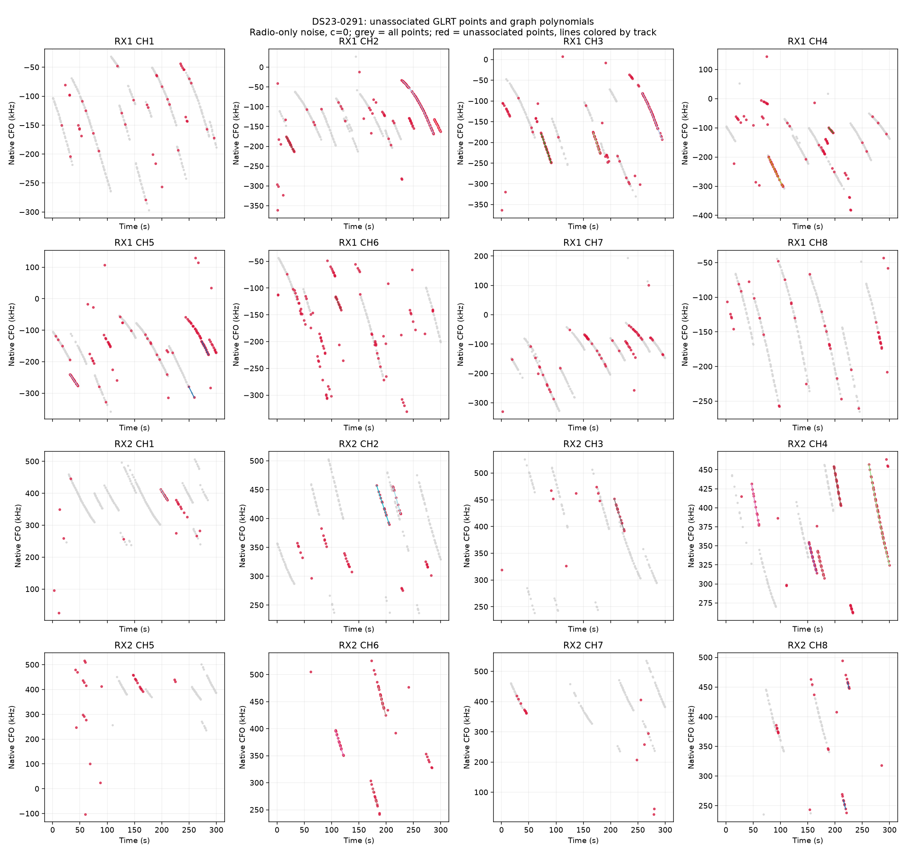
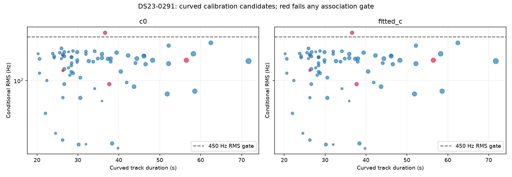

# DS23-0291

Recording `fast8-auto-20261017-165218-0f9d31df-1-lower`.

| Scan | Noise | c | Associated / GLRT | % | Tracks | Points/track | Error km | RMS Hz |
|---|---|---|---:|---:|---:|---:|---:|---:|
| DS23-0291 | fixed150 | c0 | 2,979 / 4,176 | 71.34 | 95 | 31.4 | 3.188 | 209.0 |
| DS23-0291 | fixed150 | fitted_c | 2,979 / 4,176 | 71.34 | 95 | 31.4 | 3.186 | 209.0 |
| DS23-0291 | radio | c0 | 3,064 / 4,176 | 73.37 | 98 | 31.3 | 3.251 | 209.0 |
| DS23-0291 | radio | fitted_c | 3,064 / 4,176 | 73.37 | 98 | 31.3 | 3.248 | 209.0 |

RMS covers all nominated curved calibration points before acceptance gates; association totals additionally include tracks accepted with calibration frozen. GPS errors are post-fit evaluations against the stated rooftop reference.

[Numerical summary](summary.json) · [Protocol and limitations](../README.md)
