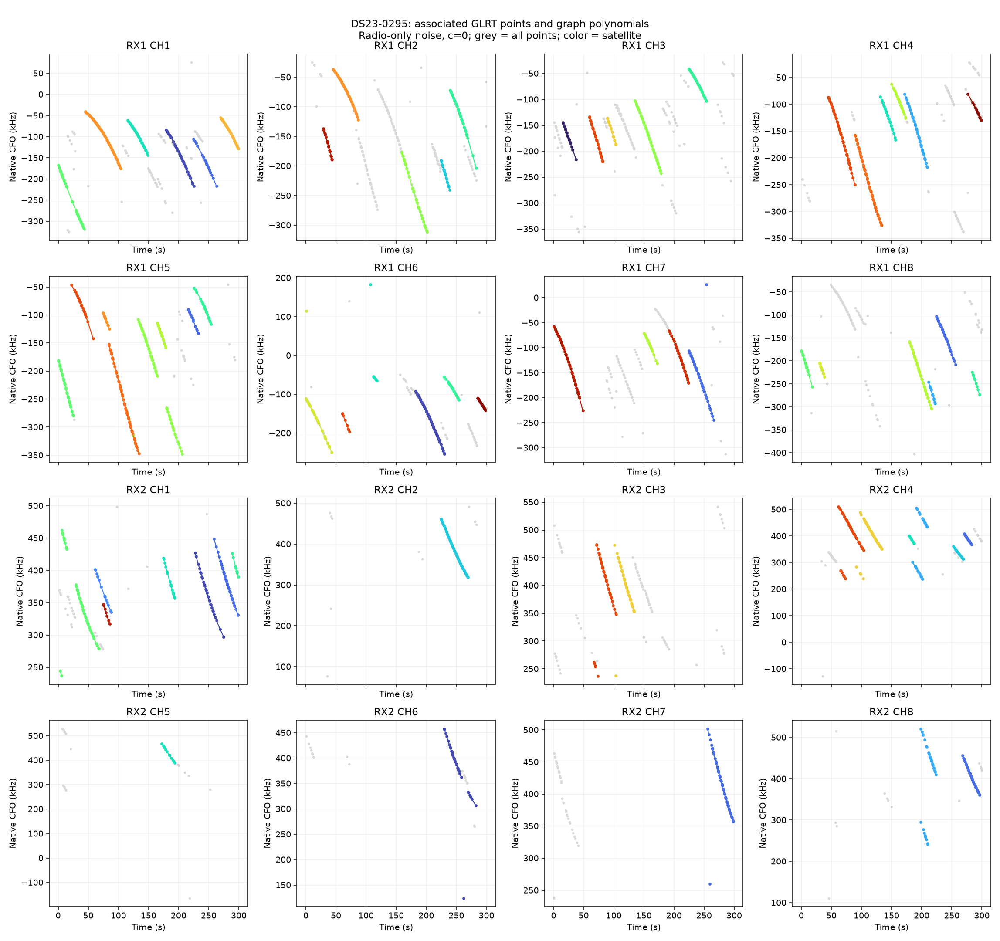
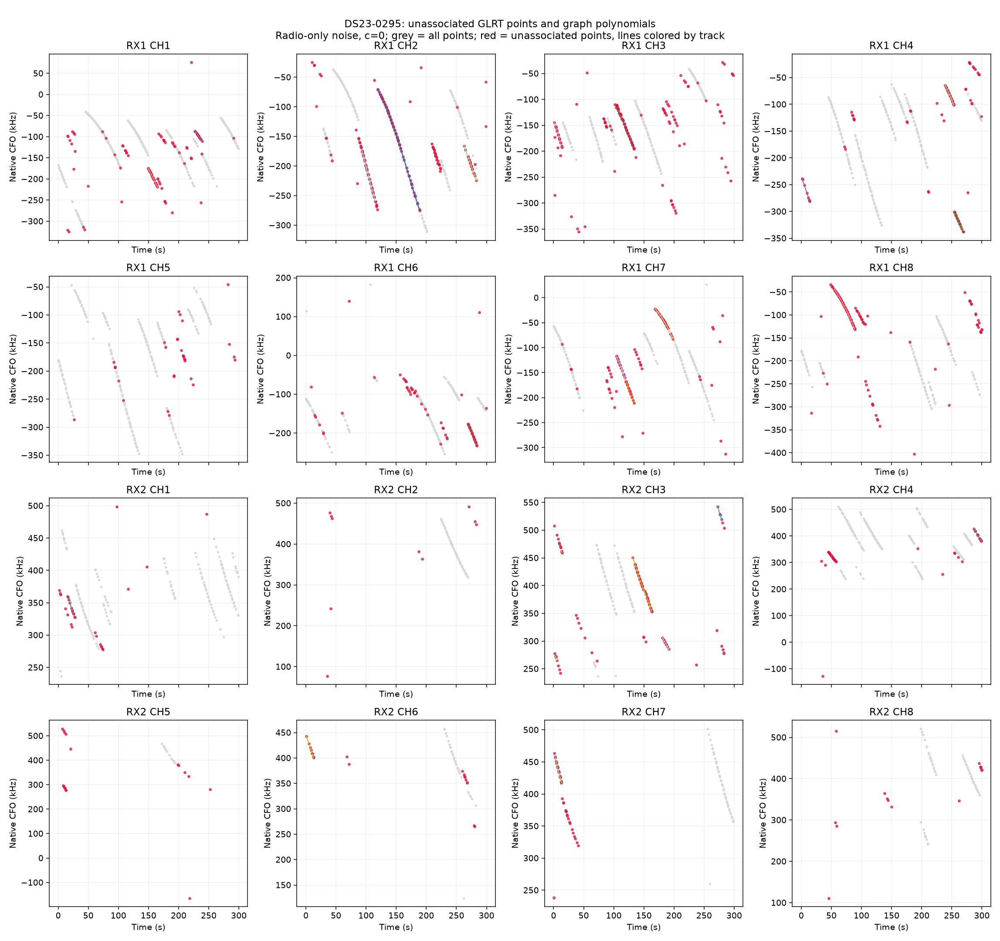
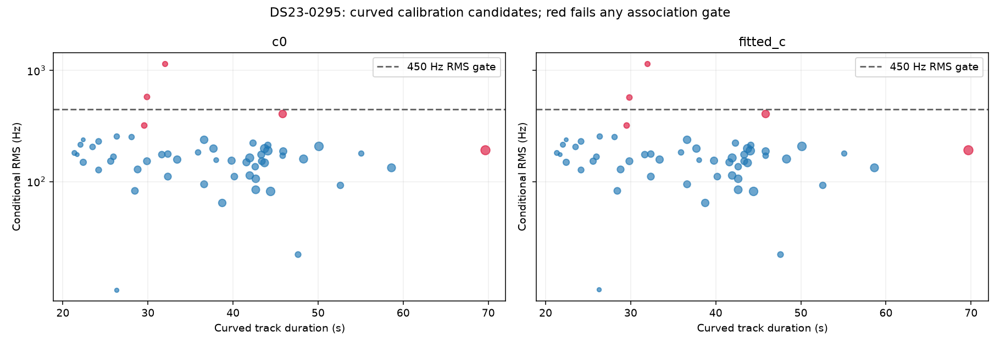

# DS23-0295

Recording `fast8-auto-20261017-175250-da61ca87-1-lower`.

| Scan | Noise | c | Associated / GLRT | % | Tracks | Points/track | Error km | RMS Hz |
|---|---|---|---:|---:|---:|---:|---:|---:|
| DS23-0295 | fixed150 | c0 | 2,260 / 3,285 | 68.80 | 71 | 31.8 | 3.584 | 221.0 |
| DS23-0295 | fixed150 | fitted_c | 2,260 / 3,285 | 68.80 | 71 | 31.8 | 3.593 | 221.1 |
| DS23-0295 | radio | c0 | 2,260 / 3,285 | 68.80 | 71 | 31.8 | 3.583 | 221.0 |
| DS23-0295 | radio | fitted_c | 2,260 / 3,285 | 68.80 | 71 | 31.8 | 3.592 | 221.1 |

RMS covers all nominated curved calibration points before acceptance gates; association totals additionally include tracks accepted with calibration frozen. GPS errors are post-fit evaluations against the stated rooftop reference.

[Numerical summary](summary.json) · [Protocol and limitations](../README.md)
