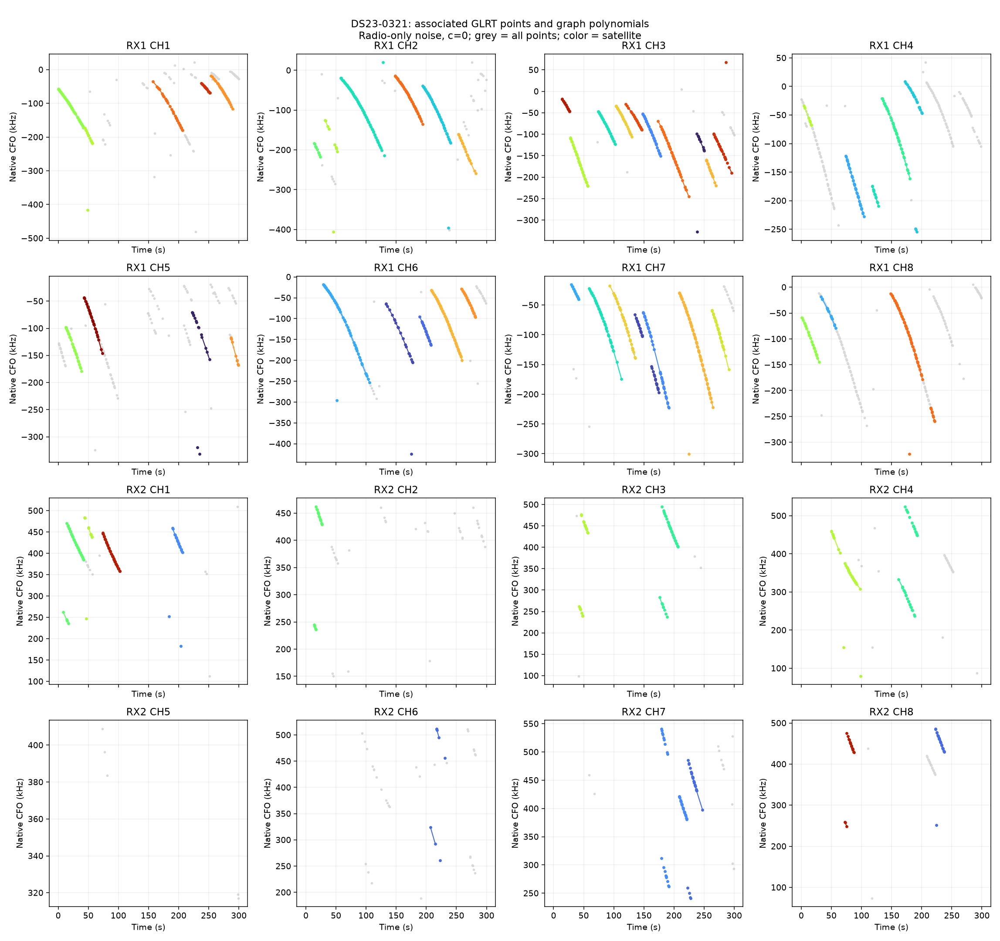
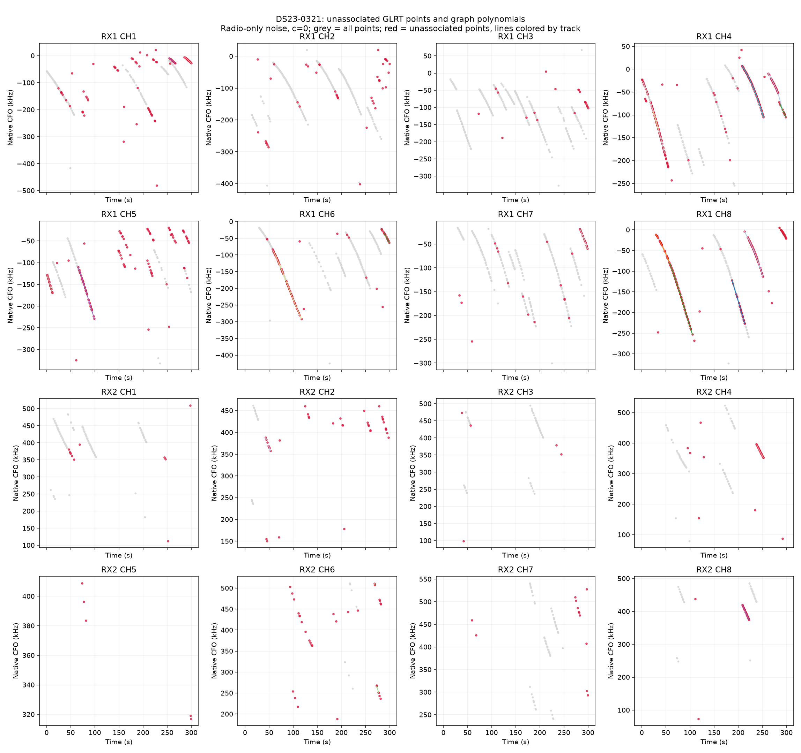
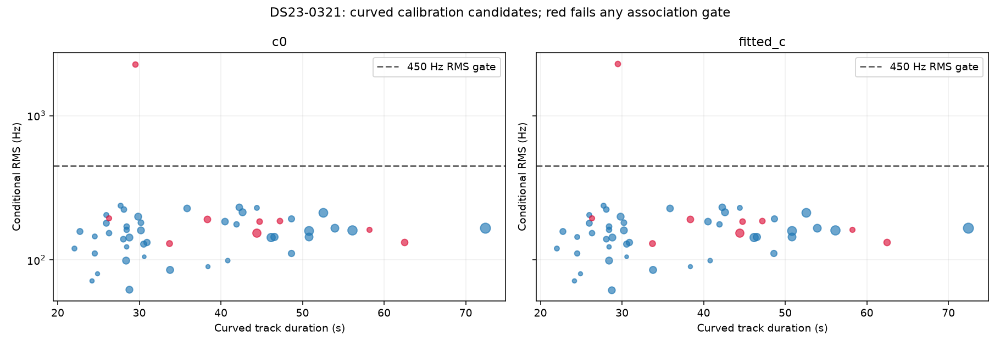

# DS23-0321

Recording `fast8-auto-20261018-003752-f25bf6ea-1-upper`.

| Scan | Noise | c | Associated / GLRT | % | Tracks | Points/track | Error km | RMS Hz |
|---|---|---|---:|---:|---:|---:|---:|---:|
| DS23-0321 | fixed150 | c0 | 1,933 / 2,789 | 69.31 | 70 | 27.6 | 1.693 | 317.7 |
| DS23-0321 | fixed150 | fitted_c | 1,933 / 2,789 | 69.31 | 70 | 27.6 | 1.764 | 318.3 |
| DS23-0321 | radio | c0 | 1,933 / 2,789 | 69.31 | 70 | 27.6 | 1.818 | 317.8 |
| DS23-0321 | radio | fitted_c | 1,933 / 2,789 | 69.31 | 70 | 27.6 | 1.895 | 318.4 |

RMS covers all nominated curved calibration points before acceptance gates; association totals additionally include tracks accepted with calibration frozen. GPS errors are post-fit evaluations against the stated rooftop reference.

[Numerical summary](summary.json) · [Protocol and limitations](../README.md)
