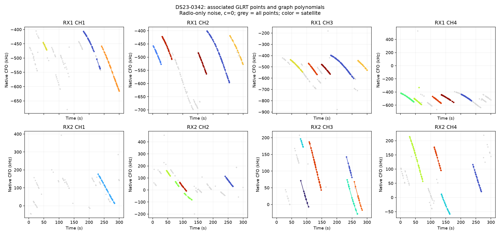
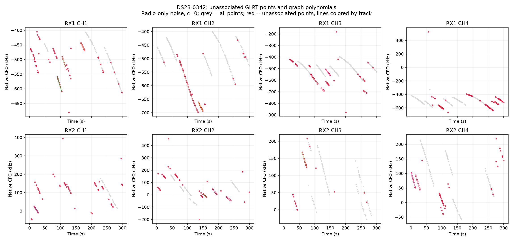
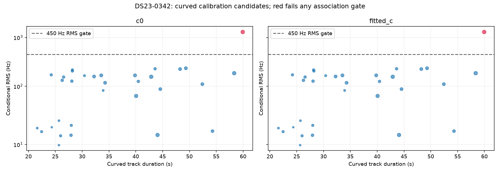

# DS23-0342

Recording `scan-fw-633590086a3110e8`.

| Scan | Noise | c | Associated / GLRT | % | Tracks | Points/track | Error km | RMS Hz |
|---|---|---|---:|---:|---:|---:|---:|---:|
| DS23-0342 | fixed150 | c0 | 967 / 1,560 | 61.99 | 37 | 26.1 | 5.044 | 324.2 |
| DS23-0342 | fixed150 | fitted_c | 967 / 1,560 | 61.99 | 37 | 26.1 | 5.043 | 324.2 |
| DS23-0342 | radio | c0 | 967 / 1,560 | 61.99 | 37 | 26.1 | 5.000 | 324.7 |
| DS23-0342 | radio | fitted_c | 967 / 1,560 | 61.99 | 37 | 26.1 | 4.998 | 324.7 |

RMS covers all nominated curved calibration points before acceptance gates; association totals additionally include tracks accepted with calibration frozen. GPS errors are post-fit evaluations against the stated rooftop reference.

[Numerical summary](summary.json) · [Protocol and limitations](../README.md)
