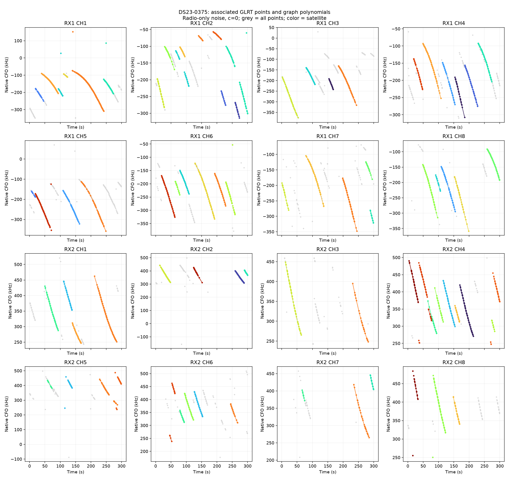
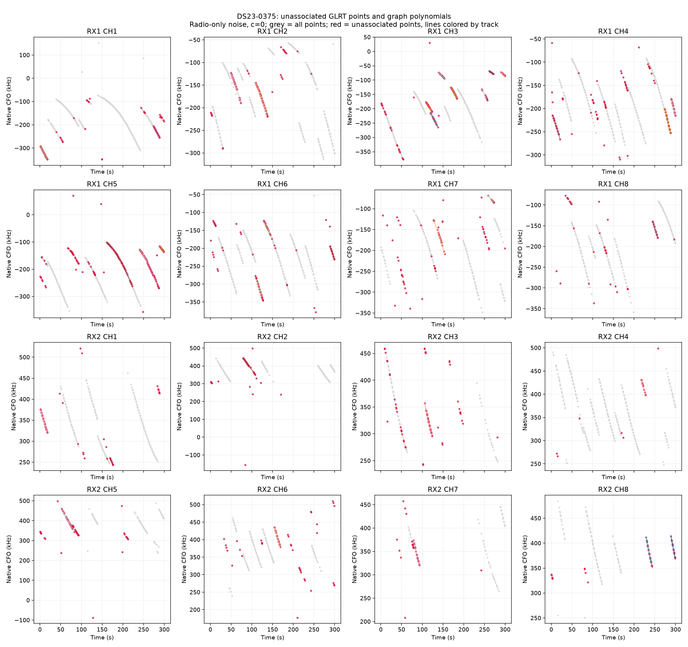
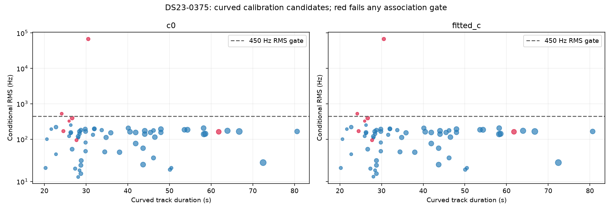

# DS23-0375

Recording `fast8-auto-20261018-141546-3b102abe-1-lower`.

| Scan | Noise | c | Associated / GLRT | % | Tracks | Points/track | Error km | RMS Hz |
|---|---|---|---:|---:|---:|---:|---:|---:|
| DS23-0375 | fixed150 | c0 | 3,017 / 4,169 | 72.37 | 89 | 33.9 | 1.887 | 6964.9 |
| DS23-0375 | fixed150 | fitted_c | 3,017 / 4,169 | 72.37 | 89 | 33.9 | 1.890 | 6962.1 |
| DS23-0375 | radio | c0 | 3,017 / 4,169 | 72.37 | 89 | 33.9 | 1.830 | 6965.2 |
| DS23-0375 | radio | fitted_c | 3,017 / 4,169 | 72.37 | 89 | 33.9 | 1.834 | 6962.4 |

RMS covers all nominated curved calibration points before acceptance gates; association totals additionally include tracks accepted with calibration frozen. GPS errors are post-fit evaluations against the stated rooftop reference.

[Numerical summary](summary.json) · [Protocol and limitations](../README.md)
