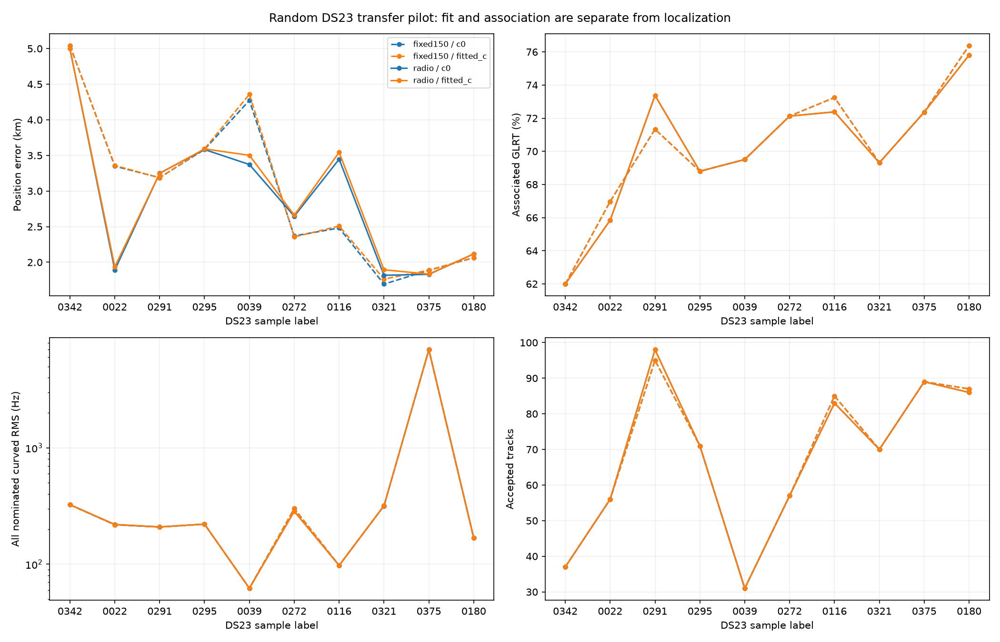
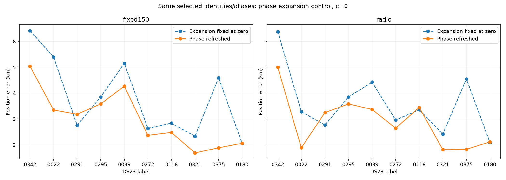

# DS23 random ten-scan phase-refreshed transfer pilot

All **10 presealed random scans** completed, with no replacements: eight fast and two adaptive recordings from the 413-member post-DS22 dataset. Seed **2026101801**. The sample was selected before localization or association results.

**Coverage transfers better than localization:** radio-only noise, c=0 accepts 21,686 of 30,586 GLRT points (70.90%) in 678 tracks, but median position error is 2.949 km, maximum 5.000 km, and none of these ten runs is below 1 km. Fitted c gives almost the same coverage and a 2.955 km median error. The fixed-noise control has a 2.835 km c=0 median error. These results do not yet reproduce DSX01's tighter localization.

| Scan | Noise | c | Associated / GLRT | % | Tracks | Points/track | Error km | RMS Hz |
|---|---|---|---:|---:|---:|---:|---:|---:|
| DS23-0342 | radio | c0 | 967 / 1,560 | 61.99 | 37 | 26.1 | 5.000 | 324.7 |
| DS23-0342 | radio | fitted_c | 967 / 1,560 | 61.99 | 37 | 26.1 | 4.998 | 324.7 |
| DS23-0022 | radio | c0 | 2,093 / 3,179 | 65.84 | 56 | 37.4 | 1.891 | 219.1 |
| DS23-0022 | radio | fitted_c | 2,093 / 3,179 | 65.84 | 56 | 37.4 | 1.936 | 219.9 |
| DS23-0291 | radio | c0 | 3,064 / 4,176 | 73.37 | 98 | 31.3 | 3.251 | 209.0 |
| DS23-0291 | radio | fitted_c | 3,064 / 4,176 | 73.37 | 98 | 31.3 | 3.248 | 209.0 |
| DS23-0295 | radio | c0 | 2,260 / 3,285 | 68.80 | 71 | 31.8 | 3.583 | 221.0 |
| DS23-0295 | radio | fitted_c | 2,260 / 3,285 | 68.80 | 71 | 31.8 | 3.592 | 221.1 |
| DS23-0039 | radio | c0 | 889 / 1,279 | 69.51 | 31 | 28.7 | 3.372 | 62.1 |
| DS23-0039 | radio | fitted_c | 889 / 1,279 | 69.51 | 31 | 28.7 | 3.502 | 62.2 |
| DS23-0272 | radio | c0 | 1,964 / 2,723 | 72.13 | 57 | 34.5 | 2.646 | 285.0 |
| DS23-0272 | radio | fitted_c | 1,964 / 2,723 | 72.13 | 57 | 34.5 | 2.661 | 284.8 |
| DS23-0116 | radio | c0 | 2,757 / 3,809 | 72.38 | 83 | 33.2 | 3.447 | 97.5 |
| DS23-0116 | radio | fitted_c | 2,757 / 3,809 | 72.38 | 83 | 33.2 | 3.544 | 97.6 |
| DS23-0321 | radio | c0 | 1,933 / 2,789 | 69.31 | 70 | 27.6 | 1.818 | 317.8 |
| DS23-0321 | radio | fitted_c | 1,933 / 2,789 | 69.31 | 70 | 27.6 | 1.895 | 318.4 |
| DS23-0375 | radio | c0 | 3,017 / 4,169 | 72.37 | 89 | 33.9 | 1.830 | 6965.2 |
| DS23-0375 | radio | fitted_c | 3,017 / 4,169 | 72.37 | 89 | 33.9 | 1.834 | 6962.4 |
| DS23-0180 | radio | c0 | 2,742 / 3,617 | 75.81 | 86 | 31.9 | 2.117 | 168.4 |
| DS23-0180 | radio | fitted_c | 2,742 / 3,617 | 75.81 | 86 | 31.9 | 2.118 | 168.4 |

| Noise | c | Median error km | Mean km | Max km | Below 1 km | Associated % |
|---|---|---:|---:|---:|---:|---:|
| fixed150 | c0 | 2.835 | 2.993 | 5.044 | 0/10 | 70.92 |
| fixed150 | fitted_c | 2.847 | 3.012 | 5.043 | 0/10 | 70.92 |
| radio | c0 | 2.949 | 2.896 | 5.000 | 0/10 | 70.90 |
| radio | fitted_c | 2.955 | 2.933 | 4.998 | 0/10 | 70.90 |

The `c=0` and fitted-`c` treatments use the same observations, candidate catalogue, identities,
aliases, other priors and search budgets. The branch is selected by the final c=0 frequency/prior
objective, and reused for fitted c. A lower RF loss or larger accepted fraction is not evidence
of better position accuracy or independently verified satellite identities. `RMS` above includes
all nominated curved calibration points, including failures; accepted counts also include eligible
frozen-calibration extensions. Per-track RMS and raw CFO plots are provided for every scan below.

## Protocol

This applies the [DSX01 model](../2026_10_19_dsx01_phase_refreshed_algorithm/README.md)
to new frozen inputs,
with the finite pilot search and observation-noise adaptations described here.

1. Read the sealed existing tracking contracts. Keep one winning gate-passing fractional GLRT
   CFO per probe; withhold no points. This is existing CFO reanalysis, not a new RF collection
   or DSX01's GLRT300 remeasurement. All ten exports succeeded, including both adaptive scans.
2. Use the frozen graph settings, in lanes defined by RX, channel and actual RF. Fit piecewise
   polynomials with alias handling and residual structure checks. Only tracks spanning at least
   20 seconds with at least 250 Hz RMS departure from their best affine fit can calibrate position,
   receiver/band offsets, drifts or satellite corrections. Linear tracks cannot vote for
   calibration.
3. Build a broad regional Starlink catalogue from Space-Track snapshots collected during the
   48 hours preceding the scan. Both collection times and element epochs must be causal. Latest
   elements define the mean; previous distinct causal elements set physical uncertainty directions.
   No satellite whitelist, later TLE or reference GPS is used. The coarse visibility screen uses
   37.5, -122 with a broad elevation guard, not the evaluation position.
4. Search a fixed **25 × 25 km box centered at 37.906, -122.545**, beginning from fresh radio
   state. Use four radio discovery seeds and RF proposals at the center and four corners.
   Rank distinct identity/alias branches using their c=0 center objective, then fully fit the best
   three. Rebuild nuisance and phase states from zero. This pilot does not repeat the earlier
   large radial restart campaign or establish a global optimum.
5. Within each branch use five phase refresh rounds, with up to 48 damped position steps per round.
   Re-expand the orbital frequency curve around the current posterior phase while preserving its
   absolute zero-centered prior. Labels remain fixed inside this continuous solve; alternative
   labels are represented by the finite proposal branches. Keep receiver/band offsets and small
   drifts, physical per-satellite uncertainty modes and regularized per-fragment constants.
   Fit paired c=0 and fitted-c arms.
6. Compare fixed 150 Hz observation noise with a radio-only estimate. The estimate uses
   leverage-corrected residuals from actively curved graph polynomial pieces. A floor-plus-inverse-
   GLRT-margin variance is enabled only when its extra parameter wins BIC. This is an uncertainty
   proxy, not a certified sensor error bar. It uses no GPS, TLE or satellite-fit residuals. Changing
   this covariance can change RF proposals; this is not a fixed-label covariance-only
   ablation, nor a fully marginalized noise-evidence comparison.
7. Apply conditional RMS (450 Hz), regularized fragment-bias (3,000 Hz), residual structure,
   visibility and alias gates. With accepted curved families and calibration frozen, test other
   graph tracks against those satellites, including linear tracks. These extensions do not update
   calibration or position. Untracked isolated GLRT points remain unassociated. Counts are unique
   original observation IDs, not polynomial interpolants.

## Phase control

For each selected branch the control holds the phase expansion reference at zero, using the same
labels and priors. The refreshed endpoint may improve or worsen GPS error. Scores at different phase
tangent expansions are approximation-dependent and should not be interpreted as an exact common
nonlinear likelihood. The final inner stopping reason and last outer phase-reference change are
retained in the CSV; five outer rounds are a budget, not proof of exact joint convergence.

## Evaluation limits

Position errors are computed **after fitting** against the user-provided rooftop coordinate
**37.849061591561885, -122.48574968092912**. That coordinate was not independently surveyed or
verified for each recording, so errors are conditional on all recordings sharing that reference.
Receiver altitude is zero. This tests transfer to additional recordings and two input formats,
not certified performance at a new geographic location. The recording period overlaps previous DSX01
development; membership is disjoint from DS22, but may overlap other research datasets. There was
no per-scan GPS-driven tuning, point replacement, future TLE selection or satellite preselection.

The sample is deliberately small and mixes input formats. Large errors must not be hidden by pooling
favorable fit scores. This prototype's finite identity search, possible graph mistakes, covariance
approximation and flexible nuisance variables remain possible error sources. The results do not
establish every accepted association is correct. The next useful experiment is an identity/track
ablation of the largest failures with a fixed causal candidate set and matched c controls, rather
than tuning toward these reference coordinates.

## Per-scan evidence

- [DS23-0342](DS23-0342/README.md): `scan-fw-633590086a3110e8` (starlink_adaptive_hop_iq).
- [DS23-0022](DS23-0022/README.md): `fast8-auto-20261014-200539-e66a9eee-1-lower` (short_window_iq_recording).
- [DS23-0291](DS23-0291/README.md): `fast8-auto-20261017-165218-0f9d31df-1-lower` (short_window_iq_recording).
- [DS23-0295](DS23-0295/README.md): `fast8-auto-20261017-175250-da61ca87-1-lower` (short_window_iq_recording).
- [DS23-0039](DS23-0039/README.md): `scan-fw-d89efe0882082b08` (starlink_adaptive_hop_iq).
- [DS23-0272](DS23-0272/README.md): `fast8-auto-20261017-120904-5ebd2188-1-upper` (short_window_iq_recording).
- [DS23-0116](DS23-0116/README.md): `fast8-auto-20261015-203537-01522e1b-1-upper` (short_window_iq_recording).
- [DS23-0321](DS23-0321/README.md): `fast8-auto-20261018-003752-f25bf6ea-1-upper` (short_window_iq_recording).
- [DS23-0375](DS23-0375/README.md): `fast8-auto-20261018-141546-3b102abe-1-lower` (short_window_iq_recording).
- [DS23-0180](DS23-0180/README.md): `fast8-auto-20261016-124348-a59d9608-1-upper` (short_window_iq_recording).

[Results CSV](results.csv) · [Aggregate JSON](summary.json) · [Validation](validation.json) ·
[Source bindings](run_sources.json) · [DS23 membership](../2026_10_18_ds23_post_ds22/README.md) ·
[All dataset authorities](../2026_10_18_dataset_manifest_archive/README.md) ·
[Final fits](fit_archive_catalogue.json) · [Source snapshot](source_snapshot/README.md) ·
[Verification](verification.json)

The published compact evidence includes native observations, polynomial tracks, causal elements and
receipts, numerical summaries, source snapshots and 32 figures. Large local tracking contracts,
propagated banks and full exploratory histories are retained locally with checksum bindings;
they are not runtime dependencies of the report. Research source snapshots document the experiment
and are not a supported production API.
