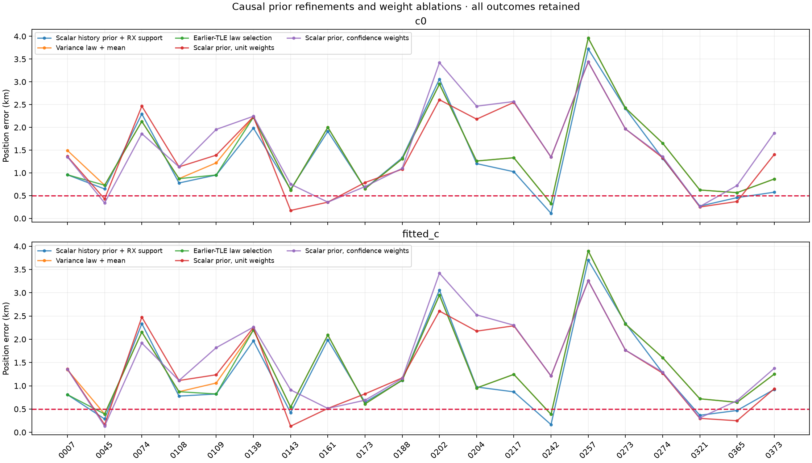
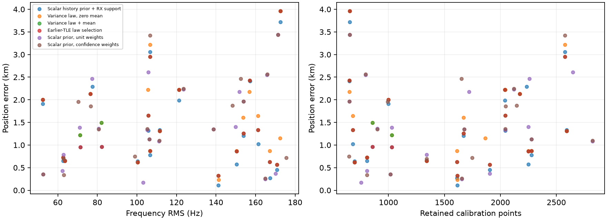

# DS23: causal variance-law and association-weight ablations

These are all 20 development scans, including regressions. No per-scan GPS choice
is used. The independent-scan 0.5 km mean/median target remains unmet.

Receiver-support weighting with the simpler scalar history prior remains best
among these rules: 1.315/0.991 km c0 and 1.266/0.896 km fitted-c. Neither the
more flexible variance law nor removing the support weights improves the
cohort. The variance law qualifies on earlier-TLE prediction for 18/20 scans,
yet its declared causal selection worsens position to 1.420/1.109 km c0.

| Method | c0 mean / median, km | Fitted-c mean / median, km |
|---|---:|---:|
| Scalar history prior + RX support | 1.315 / 0.991 | 1.266 / 0.896 |
| Variance law, zero mean | 1.560 / 1.400 | 1.523 / 1.309 |
| Variance law + mean | 1.461 / 1.284 | 1.419 / 1.183 |
| Earlier-TLE law selection | 1.420 / 1.109 | 1.380 / 1.038 |
| Scalar prior, unit weights | 1.443 / 1.354 | 1.365 / 1.223 |
| Scalar prior, confidence weights | 1.560 / 1.354 | 1.500 / 1.325 |

## Controlled hypotheses

The comparator is the [causal scalar-history prior](../2026_10_18_ds23_history_calibrated_phase/README.md),
with receiver-support powers and 300 Hz independent fragment constants.
First separate the phase uncertainty floor from the age/disagreement gain:
sigma=clip(hypot(floor, gain*alignment*age/epoch_gap),0.02,15) seconds.
Learn these parameters, mean shrinkage and tail degrees solely from earlier
candidate-bank TLE transitions. A bounded 2D log grid with five refinements is
used, without SciPy. The first 70% of historical publication times trains a
prefix model; the later historical transitions qualify it against the scalar
prefix model. All precede RF. At least 30 validation transitions and improved
predictive density are required. Otherwise retain the scalar prior. The
declared causal-selection row uses that rule, not the smallest GPS error.
The two unconditional law rows diagnose its mean/distribution contributions.

Second hold the scalar prior fixed and compare unit measurement powers to
identity-confidence powers. Unit means every retained point has likelihood
power 1. Confidence uses the minimum conditional candidate-gap confidence
over the existing five regional anchors, clipped to [0.05,1]. This is an
uncalibrated proxy, not a posterior identity probability. The comparator
receiver rule also considers replication across receivers and channels.

All fits keep the same original causal catalogue, discrete satellite labels,
integer aliases, independent radio noise and regional cold initialization.
All begin with the original ALGO01 retained observations. Each c0/fitted-c
pair has identical masks and budgets: five phase rounds, at most 48 position
steps, four paired gate/refit rounds. No gate is widened. Final masks can
differ across policies and are recorded. The scalar arm is independently
replayed in the variance-law run, and its endpoints match within 1e-8 km.

## Scope and limits

TLE-update innovation is an orbit-error proxy, not reference ephemeris truth.
Better historical predictive density need not imply better receiver position:
on217 the law qualifies yet worsens the scalar prior's 1.025/0.869 km to
1.332/1.245 km. These regressions are part of the comparison. More retained
calibration points and lower frequency RMS do not establish geographic gain.
Position accuracy and RF behavior are reported separately in the CSV/figure.
The methods use causal external TLE history, with one scan's RF; no scan's
fitted position is a prior for another. These 20 scans are now development
data and do not validate a new site or all 413 DS23 recordings. No timing
position fix or updated ALGO01 production default is claimed.

## Reproduction

[Summary](summary.json) · [All outcomes](comparison.csv) · [Validation](validation.json).
Raw evidence and frozen protocols: [variance-law cohort](../2026_10_18_ds23_phase_variance_law/protocol.json)
and [weight cohort](../2026_10_18_ds23_learned_prior_weights/protocol.json).
Run tools/run_ds23_phase_variance_law.py and tools/run_ds23_learned_prior_weights.py,
then tools/report_ds23_prior_refinements.py in the repository venv with
PYTHONPATH=src:tools and BLAS/OMP threads 1. Each runner uses two subprocess
workers with per-case timeouts. Published source snapshots overlay the earlier
ALGO01/DBG01 and prior-control snapshots. Histories are already causal receipts;
no new RF or archive mutation is required.
