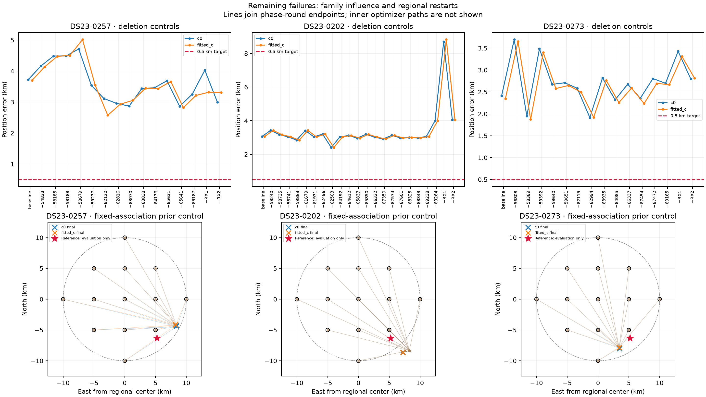
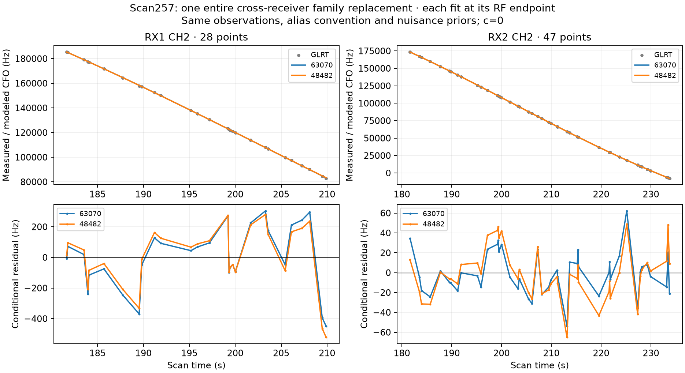

# DS23: remaining failures under the causal learned prior

No single-family deletion fixes these three largest remaining c0 errors.
The best deletions below are **GPS oracle diagnostics**, not an implementable
selection policy. Every tested deletion, including regressions, is in the CSV.

| Scan | Learned-prior error c0 / fitted-c, km | Best single-family deletion c0 / fitted-c, km |
|---|---:|---:|
| DS23-0257 | 3.722 / 3.699 | 2.861 / 2.820 |
| DS23-0202 | 3.061 / 3.060 | 2.406 / 2.402 |
| DS23-0273 | 2.412 / 2.345 | 1.913 / 1.922 |

## Deletion controls

Each control starts with the learned primary rule's final quality-gated mask,
then deliberately removes one family or receiver. Labels, alias integers,
radio noise, causal priors and cold regional-center start are unchanged.
Any subsequent gate failure removes that component in both c arms. Existing
physical-mode support cascades remain active; counts can fall further than
the deliberate deletion. This measures sensitivity, not proof of a bad label.
The final masks, gate reasons, states and five phase histories are retained.

## Regional restarts

Use 13 fixed regional starting points: center, ±5/±10 km on each axis,
and four (±5,±5) km corners. The 10 km disk is centered at the declared
regional center, not at supplied GPS. All starts keep exactly the same
observations, weights, satellite labels, aliases and learned prior. Five
phase-reference rounds and 48 position steps per round are matched. No
observations are trimmed within this control. RF c0 loss selects a branch
only among pairs passing all original gates. This specifically tests whether
the new Student phase prior creates another accessible continuous minimum;
it is **not** a full association-reselecting pipeline restart experiment.
The plot connects successive phase-round endpoints; it does not display
each inner optimizer step. Red stars are evaluation markers only.

All13 starts reach the same endpoint on each of the three scans, to numerical
precision (maximum spread below3e-8 km). This rules out these regional starting
points as a remedy under fixed labels; it does not prove global optimality
over identities, orbit parameters or a different physical model.

## Additional receiver mode

Test one receiver-specific linear drift proportional to RF within each band,
in addition to existing band/receiver mean drift and smooth terms. Its
Gaussian prior standard deviation is 0,0.25 or1 Hz/s/GHz. Fixed band centers
come from distinct recorded RFs, without frequency residuals or GPS. The
mode is sigma*(t−150)*(RF−band_center)/GHz Hz and carries the same marginal
complexity penalty as other nuisance terms. The extra receiver-basis and
seed-state dimensions are expanded consistently. The zero mode reproduces
the comparator to about1e-8 km and1e-10 RF-loss units.

It has little effect: at c0,217 changes1.025→1.009 km and257 remains3.722 km.
Fitted-c changes0.869→0.846 km and3.699→3.695 km. All gates pass. This small
RF-dependent linear rate is not a sufficient explanation of the large error;
no new defaults are selected from these two known-site results.

## Broader identities

The257 search screens the complete original causal catalogue at its RF endpoint,
the regional center and four nearby anchors. It proposes two whole-family
alternatives per original family, then pairs/triples the RF-best six distinct
original-family changes. This permits several entire families to change at
once. Proposal screening approximates phase+constant with a Gaussian; every
trial is refit with the full learned prior and physical modes. Uniqueness is
not claimed. Observations and likelihood powers stay fixed for this controlled
identity test. Score by normalized generalized ELBO, not incomparable raw
prior scores; both arms must pass gates before accepting an RF improvement.
The summary records actual proposal counts and budget truncation. It is a
diagnostic, not a promoted association policy or an exhaustive identity proof.

All26 single-family and35 simultaneous pair/triple proposals were completed
within114.3s. One single-family proposal passes gates; no joint proposal does.
None wins the RF objective. The passing alternative replaces63070 with48482
on two RX/channel fragments. It gives1.083/0.831km instead of3.722/3.699km,
but costs15.268 more normalized generalized RF-loss units at c0. It is
therefore rejected by the declared rule. Its proximity to known GPS is a
diagnostic observation, not identity ground truth or a permitted selection.

[Challenger objective decomposition](challenger_decomposition.json) separates
conditional data cost, hardware/smooth/phase/orbit/fragment prior penalties,
nuisance volume, grouped-noise cost and normalizing constants. Each curve
uses its own RF endpoint and joint calibration, with the same observations
and original alias convention. The figure does not isolate satellite shape
from every nuisance term; it shows the two complete fitted explanations.

| Challenger minus incumbent | RF loss units |
|---|---:|
| Conditional data cost | +2.804 |
| Gaussian hardware/smooth/orbit/fragment priors | +0.869 |
| Phase prior quadratic | +5.318 |
| Nuisance volume | +1.729 |
| Noise Gamma cost | -0.424 |
| Phase Gamma cost | +4.972 |
| Normalizing constants | +0.000 |

Most of the15.268-unit disadvantage is phase regularization:5.318 in the
quadratic term plus4.972 in the phase-Gamma term. Conditional data cost adds
only2.804 units. The challenger uses a −5.612s family phase adjustment versus
−0.980s for the incumbent. This identifies a sensitivity of the identity
decision to the causal phase model; it does not establish which identity is
correct. Arbitrarily widening the prior until GPS improves is not a solution.

## Evidence and implications

[All family/receiver controls](influence.csv) · [Rate controls](frequency_rate.csv) ·
[Summary](summary.json).
Raw inputs/outputs: ../2026_10_18_ds23_learned_prior_influence/,
../2026_10_18_ds23_learned_prior_restarts/,
../2026_10_18_ds23_frequency_rate/ and
../2026_10_18_ds23_learned_family_replacements/.

These controls narrow explanations; they do not prove identities or establish
a unique physical cause. Multiple wrong associations, biased causal orbits,
transmitter/receiver clock covariance and insufficiently informative curves
remain possible. The 0.5 km DS23 mean/median goal is not achieved. The next
useful work is independent RF evidence and causal orbit/clock calibration,
followed by frozen-rule validation on untouched scans. No later TLE, GPS
optimization, new RF collection, or QNAP mutation is part of this experiment.
