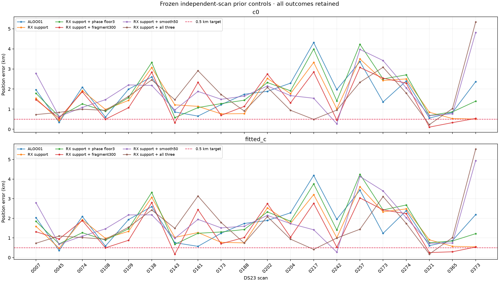

# DS23: controlled priors on receiver-support weighting

**The 0.5 km mean/median target is not achieved.** Tighter fragment-offset
priors improve this 20-scan benchmark more consistently than the scan-217
combination. All outcomes, including regressions, are reported. This is not
new-location validation or the full 413-member DS23 population.

| Rule | c0 mean / median, km | Fitted-c mean / median, km | Valid pairs |
|---|---:|---:|---:|
| ALGO01 | 1.771 / 1.924 | 1.747 / 1.913 | 20/20 |
| RX support | 1.612 / 1.325 | 1.607 / 1.305 | 20/20 |
| RX support + phase floor3 | 1.793 / 1.428 | 1.782 / 1.416 | 20/20 |
| RX support + fragment300 | 1.452 / 1.225 | 1.427 / 1.030 | 20/20 |
| RX support + smooth50 | 1.884 / 1.662 | 1.898 / 1.664 | 20/20 |
| RX support + all three | 1.646 / 1.250 | 1.617 / 1.271 | 20/20 |

## Controlled experiment

The base rule is the frozen [independent receiver-support weighting](../2026_10_18_ds23_family_weighting_active_support/README.md).
The four declared controls are: causal satellite-phase sigma floor3s instead
of1s; independent fragment-constant sigma300Hz instead of1000Hz; shared receiver
smooth sigma50Hz instead of200Hz; and their combination. Linear receiver drift,
cross-band terms, causal TLE mean/history, physical orbit-mode priors, broad
candidate bank, radio noise and discrete satellite/alias labels are unchanged.
The 25×25km box and regional-center initialization remain unchanged.

All controls were declared before the cohort run. Scan217 and scan45 were the
initial development probes, rather than a held-out test set. Every control uses
the same original retained observations at its first round, five phase-reference
rounds, at most48 position steps per round, and at most4 paired exclusion/refit
rounds. A failure in either c arm masks the component in both arms. Final masks
can differ between controls, so the result is a complete quality-gated policy
comparison, not a fixed-mask attribution of every gain to one prior parameter.
Histories preserve the initial common-data endpoints and subsequent exclusions.

The posterior scaling explicitly maps coefficients/precisions back to the native
design coordinates before constructing receiver states or applying gates. This
prevents a 50Hz feature design from incorrectly returning a 200Hz receiver state.
The normalized nuisance-volume and grouped-noise costs remain in the objective.
No threshold was widened to accept a more favorable location. No GLRT measurement
was corrected by its polynomial or by the supplied evaluation coordinate.

## Why scan217 alone is insufficient

The combination reaches **0.493km c0 /0.415km fitted-c** on scan217, retaining681
points that pass all original gates. However, the same combination worsens scan45
to **0.841/1.098km**. It also loses the cohort advantage of the simpler
fragment300 control. A per-scan choice using GPS would be an oracle and is not
reported as an algorithm.

An additional RF-only selection test compares all five prior models on one
common intersection mask, with identical observations, labels, alias integers,
weights and budgets. On scan217 its RF objective selects fragment300 at
**2.846/2.764km**, not the combination within0.5km. The combination costs about
29.74 more RF units at c0 on those same681 points. On scan45 the RF selector
chooses the combination, whose position is worse. Lower marginal RF loss does
not automatically identify the best geographic model in these data.
These two RF-selection probes are diagnostic; a full 20-scan RF-selection
evaluation has not yet been completed.

## Interpretation and continuing work

Receiver-independent support is useful, and a narrower fragment-offset prior
helps the mean and median here. Those changes still leave roughly kilometer
errors, and location cannot be fixed by choosing the best of this table for
each known GPS location. The ambiguity among shared receiver behavior,
transmitter frequency offsets, causal orbit errors and position remains.

Archived frame-epoch timing was also probed. It reproduces the previously
documented [negative-range relation](../2026_10_17_dsx01_iteration6/frame_phase_audit/README.md)
on some clean traces, alongside large discontinuities on others. The coordinate
has positive arrival-epoch semantics: the negative relation is **not** a sign
convention and cannot simply be negated into a pseudorange estimator. No timing
position result is claimed.

This caution is consistent with published findings that Starlink frame and
carrier clocks can differ and that frame timing has discontinuities and
beam-dependent behavior. See [Qin et al., Timing Properties](https://arxiv.org/html/2501.05302v1)
and [Qin et al., Pilots and Other Predictable Elements](https://arxiv.org/abs/2602.02627).
The local data do not identify transmitter clock control as the cause of the
observed sign or the geographic error.

Continue with independently justified timing/CFO evidence, causal orbital-prior
diagnostics and validation on untouched scans, rather than GPS-selected priors.
ALGO01 is unchanged. The successful single-scan fit does not meet the DS23 goal.

## Evidence and reproducibility

[Protocol](protocol.json) · [All results CSV](comparison.csv) ·
[Summary](summary.json) · [Execution receipts](execution.json) · [Validation](validation.json)

`tools/run_ds23_weighted_prior_controls.py` runs two bounded subprocess workers;
`tools/probe_ds23_weighted_priors.py --case DS23-0217` runs one case;
`tools/report_ds23_weighted_priors.py` evaluates after inference. Use the
repository .venv, PYTHONPATH=src:tools, OPENBLAS_NUM_THREADS=1 and OMP_NUM_THREADS=1.
Every scan JSON preserves source/input hashes, common c-arm masks, nuisance
states, gate histories, original-data-round endpoints and final fit details.
No new RF or mutation of QNAP inputs is part of this experiment.
