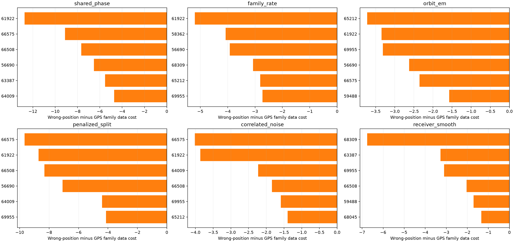
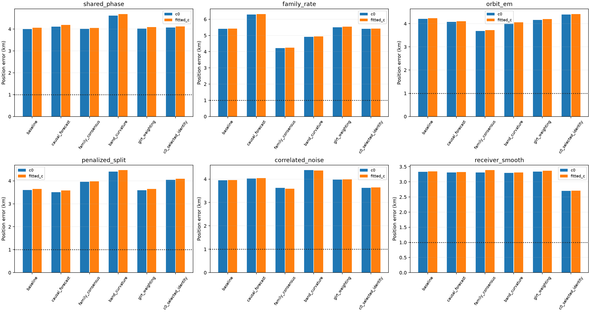
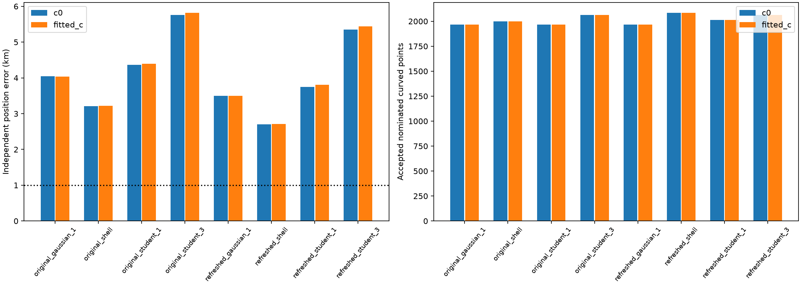

# DSX01 S05: causal repairs, identity ambiguity, and the remaining localization bias

**S05 remains unresolved.** The smooth-receiver model improves from **3.331 / 3.348 km** to **2.702 / 2.711 km** after refreshing satellite identities, for `c=0` / fitted `c`. Adding a shared shell-radius correction gives **2.702 / 2.709 km**, which is not a material further improvement. None of the new S05 experiments reaches 1 km. These results do not undo the earlier independent S01/S04 examples or the all-five-scan joint estimate, but they prevent claiming reliable independent localization across DSX01.

This bounded iteration follows the [orbital-uncertainty report](../2026_10_18_dsx01_orbit_uncertainty/README.md) and [receiver-drift report](../2026_10_18_dsx01_receiver_geometry/README.md). It tests three initial remedies across **all six S05 parent models**, then investigates measurement weighting, candidate identities, more complete orbital uncertainty and shared shell errors. No RF was collected.

## Controls and scope

The blind search retains the **25 × 25 km square around 37.906, −122.545**, 25 grid evaluations, three common `c=0`-selected geographic starts and at most 24 optimization iterations per start. Identity refresh and its continuations inherit an already completed blind-grid fit and rerun that grid procedure with its blind anchor included. GPS **37.849061591561885, −122.48574968092912** enters reporting and the explicitly separated `oracle_only` audit, never the blind objectives, hyperparameter fits, initialization or selection.

Only the original individually curved fragments calibrate or locate: span at least 20 s and affine-residual RMS at least 250 Hz. No GLRT points are held out. Linear fragments do not estimate hardware or position. The receiver mean/contrast drift priors remain 10 / 0.5 Hz/s; four RX/band offsets remain independent. Each matched `c` pair uses the same observations, nominations, aliases, other priors, geographic starts and optimization budget.

Reported accepted counts cover **nominated curved points**, with the existing RMS, bias, residual-structure, visibility and shared-correction ownership gates. They are not full-corpus association percentages. S05 contains **4,056 original GLRT observations**; no new linear-track transfer is included. Candidate labels remain unverified hypotheses. This is development-corpus exploration, not an independent generalization test.

## What rewards the wrong S05 position?

The oracle audit fixes position at GPS, refits nuisance parameters for 24 iterations from the blind nuisance state, and compares the same nominations, aliases and observations. Those oracle parameters are saved separately and never reused by a blind fitter.

| Model | Blind loss | GPS-conditioned loss | Data gain at wrong position | Prior/visibility gain |
| --- | ---: | ---: | ---: | ---: |
| Shared phase | 1843.77 | 1883.08 | 35.72 | 3.59 |
| Family rate | 1752.02 | 1780.92 | 20.50 | 8.41 |
| Orbital correction | 1775.70 | 1794.91 | 11.85 | 7.35 |
| Penalized subdivision | 1834.17 | 1868.50 | 31.09 | 3.25 |
| Correlated noise | 1325.27 | 1337.70 | 8.95 | 3.49 |
| Smooth receiver | 1729.19 | 1746.31 | 16.28 | 0.84 |

For shared phase, the wrong position improves the data term by **35.72** and the prior/visibility term by **3.59**. For smooth receiver, the corresponding improvements are **16.28** and **0.84**. The remaining displacement is principally rewarded by the data model, rather than by its hardware prior alone. The largest shared-phase family rewards are candidates **61922 (−12.74), 66575 (−9.12), 66508 (−7.67), and 56690 (−6.52)**. Their combined contribution can exceed the total because other families oppose the movement. With smooth receiver, the leading families change to **68309, 63387, 69955, and 66508**. This is not a single removable track explaining every model.

All six fitted-`c` baseline optimizers terminate on small step/improvement, have position-gradient components below **0.00051 objective units/km**, and have no active bound. The [local curvature audit](position_curvature.json) projects out nuisance derivatives. GPS lies about **4.0–7.6 unit quadratic-cost distances** from these endpoints. These are local Gauss–Newton objective scales under fixed identities and robust residuals, **not calibrated standard deviations, confidence regions or a proof of global optimality**. They support investigating model/identity bias rather than merely increasing the local iteration budget.

## Three initial remedies: every S05 parent model

1. **Causal prior-mean forecast.** Only past TLE histories are exported to a separate inference file. Each older orbit is aligned in phase to the newer orbit at a common physical epoch. A bounded ridge/robust autoregressive coefficient is learned across past innovations, without CFO or receiver location. The latest innovation predicts a limited correction to the current causal state. S05 learns coefficient −0.582: the correction partially shrinks the latest innovation rather than extrapolating it forward. This state forecast is not a newly validated TLE.
2. **Whole-family consensus.** Normalize each satellite family's data and orbit priors to 50 effective points and smoothly bound its influence; keep receiver priors outside the cap. All original observations remain in the model. This is a robust objective, not calibrated evidence comparable numerically with the baseline loss.
3. **Nonlinear RX/band contrast.** Add quadratic and cubic scan-wide modes with no constant/linear polynomial component. Common RX modes use 300 reference-Hz priors; band contrasts use 100 reference-Hz priors, with ±5-sigma bounds. The smooth-receiver parent already has common nonlinear modes, so it receives only four band-contrast parameters. Other parents receive eight common/contrast parameters. Coefficients are penalized and counted in the complexity term.

Errors below are kilometres, **`c=0` / fitted `c`**. Model identities and observation populations are fixed within each comparison.

| Model | Baseline | Causal forecast | Consensus | Band curvature | GLRT weighting | Identity refresh |
| --- | ---: | ---: | ---: | ---: | ---: | ---: |
| Shared phase | 3.998 / 4.057 | 4.109 / 4.188 | 4.008 / 4.050 | 4.618 / 4.689 | 4.025 / 4.092 | 4.074 / 4.122 |
| Family rate | 5.407 / 5.429 | 6.293 / 6.324 | 4.219 / 4.252 | 4.913 / 4.944 | 5.504 / 5.540 | 5.407 / 5.429 |
| Orbital correction | 4.208 / 4.232 | 4.078 / 4.103 | 3.684 / 3.726 | 4.032 / 4.057 | 4.165 / 4.199 | 4.391 / 4.416 |
| Penalized subdivision | 3.601 / 3.644 | 3.511 / 3.578 | 3.959 / 3.978 | 4.407 / 4.468 | 3.592 / 3.652 | 4.048 / 4.091 |
| Correlated noise | 3.951 / 3.959 | 4.027 / 4.041 | 3.626 / 3.591 | 4.383 / 4.367 | 3.978 / 3.989 | 3.625 / 3.644 |
| Smooth receiver | 3.331 / 3.348 | 3.308 / 3.328 | 3.307 / 3.387 | 3.294 / 3.312 | 3.340 / 3.368 | 2.702 / 2.711 |

The first three remedies do not solve S05. The causal forecast's strictly past-version hindcast improves its mixed position/100-second-scaled-velocity RMS only from **0.2521 to 0.2453 km**. Later versions are treated as proxy orbit references for this diagnostic, not truth; no GLRT is withheld. A slightly better archive prediction does not establish better localization. Every inference history validates both epoch and collection time against the scan cutoff; the future-TLE diagnostic fields are absent from these files.

## Original GLRT margins: an independent noise check

The original tracking inputs preserve winning-peak GLRT margins that the exported context omitted. A read-only export joins the unchanged per-RX/channel observation sequences, checks every winning CFO and RF exactly, and preserves the existing context observation IDs. It recovers **all 20,084 scores** across DSX01. No identifier is regenerated and no UTC authority is fabricated.

Noise is learned from the original **curved radio-polynomial pieces only**, before any satellite or position fit. Refit each existing piece's declared polynomial order, correct squared residuals by `1 − leverage`, and fit `variance = floor² + strength / margin`. The overall variance scale is profiled analytically; a fixed shape grid and bounded one-dimensional refinement select the two coefficients. Scales are frozen for both `c` arms. This is an empirical noise model on a selected polynomial population, not an independently calibrated detector-error law.

S05 uses **2,359** noise-estimation samples, estimates floor **115.8 Hz**, and has median predicted sigma **147.4 Hz**. The 10th/90th sigma percentiles are **140.3 / 164.9 Hz**. Its weighted localization errors barely change. Unequal GLRT noise therefore does not explain the large S05 bias in this test. Native-Hz RMS remains separate from whitened residual metrics and position accuracy.

The [device-time audit](device_time_audit.json) also compares context times with raw sample counters. Across both receivers and all five scans, fitted relative rate differences stay below **0.2 ppm**, with about **0.3 ms** residual RMS. This rules out a large time-axis stretch between these two representations; it does not independently establish absolute UTC accuracy.

## Candidate refresh helps, but is not sufficient

Candidate phases are explored coherently across the full causal inventory at each completed blind position, followed by three wide-RX joint refinements. The legacy tight-drift update is disabled. For a controlled `c` ablation, **select the incumbent or refresh round by its `c=0` objective, and use that same round's rows and starts for both arms**. The original helper's independently selected fitted-`c` endpoint is not substituted when it chooses another round.

The smooth-receiver improvement changes three curved-fragment labels:

| Fragment | Original candidate | Refreshed candidate |
| --- | ---: | ---: |
| S05-RX1-CH3-T009 | 59488 | 60257 |
| S05-RX1-CH5-T003 | 59488 | 60257 |
| S05-RX2-CH6-T000 | 58234 | 64007 |

For fitted `c`, accepted nominated curved points increase **1,999 → 2,085** and fragments **54 → 56**, while error changes **3.348 → 2.711 km**. Native RMS over each fit's own accepted population changes **167.96 → 168.33 Hz**; the populations differ, so this is not a paired RMS improvement claim. The refreshed identities are better-fitting hypotheses, not independently confirmed satellite truth.

## Complete orbital uncertainty and coherent shell radius

The smooth-receiver parent is also tested with five shared orbital-error directions per supported satellite: reference-time mean motion, inclination, RAAN, and two eccentricity-vector components. Eccentricity-vector sigma is `1e−4`; the other three directions retain the preceding causal-disagreement scales. A normalized marginal likelihood includes its covariance-volume penalty. Gaussian, Student, and 3×-scale Student controls are run with both original and refreshed blind identities. None improves S05 below the refreshed baseline. These are saved-state perturbation models; this iteration does not claim an exact-SGP4 reoptimized localization result for them.

A more constrained alternative shares one radius correction across multiple satellites in each `(rounded inclination, mean motion to 0.1 rev/day)` group, requiring at least two different satellites. Radius sigma is 300 m with ±5-sigma bounds; each satellite's derivative holds its mean longitude near scan midpoint. This is an explicitly testable coherent shell-error hypothesis, not an assertion that catalog errors are correlated this way. The three S05 groups have inclinations 43°, 53° and 97°. With refreshed identities, the inferred radius corrections are approximately **+167, −193, −26 m** for fitted `c`. Localization remains **2.709 km**.

| Smooth-receiver control | Error (km), c0 / fitted c | Accepted curved points | Fragments |
| --- | ---: | ---: | ---: |
| original_gaussian_1 | 4.043 / 4.039 | 1966 / 1966 | 52 / 52 |
| original_shell | 3.208 / 3.223 | 1999 / 1999 | 54 / 54 |
| original_student_1 | 4.370 / 4.398 | 1966 / 1966 | 52 / 52 |
| original_student_3 | 5.755 / 5.820 | 2064 / 2064 | 54 / 54 |
| refreshed_gaussian_1 | 3.495 / 3.496 | 1966 / 1966 | 52 / 52 |
| refreshed_shell | 2.702 / 2.709 | 2085 / 2085 | 56 / 56 |
| refreshed_student_1 | 3.749 / 3.808 | 2014 / 2014 | 53 / 53 |
| refreshed_student_3 | 5.351 / 5.439 | 2064 / 2064 | 54 / 54 |

The result discourages simply adding more independent satellite freedom. Candidate calibration modes and how they are initialized deserve further attention: the original centre nominations were learned with tight receiver-drift priors, then inherited by the wider-drift fits. A bounded next experiment should retain several distinct **wide-prior calibration hypotheses at the blind centre**, refine each with coherent candidate phases, and compare the same complete-data objective after the original geographic search. That tests a possible missed calibration/identity basin without selecting a solution by GPS. It is a proposed next experiment, not an achieved result here.

## Verification and saved results

This iteration contains **100 new blind fit records**: 36 initial-repair, 36 identity-refresh, 12 GLRT-weighted, 12 complete-uncertainty and four shell-radius records. The principal comparison evaluates **88 records / 44 matched `c` pairs**, including 12 reused baselines and one `c=0`-selected identity round per parent. Six GPS-conditioned nuisance fits and local curvature calculations are separate diagnostics.

**71 focused tests pass**, also from the [frozen source closure](frozen_source_tests.json), including numerical covariance oracles inherited from the preceding work, score/ID/CFO joins, variance-scale recovery, leverage correction, future-data rejection, receiver/band separation, shared shell ownership and prior-coordinate composition. A [frozen-source figure replay](figure_replay.json) reproduces all three figures byte for byte; this is a figure replay from saved evaluated rows, not a fresh rerun of 100 optimizations. All 44 principal `c` pairs have identical nominations, aliases and starts; every graph observation ID is unique and joins to its original score ([validation](validation.json)). No golden fixtures changed. Changed numerical code is confined to research tools and their tests. No runtime component or persisted contract is modified. Source, input, artifact and test receipts are preserved by the [manifest](manifest.json).

The [evaluation table](evaluation_summary.csv), [matched common-point frequency ablation](c_ablation.csv), [exact saved endpoint bindings](evaluation_binding.json), [test receipt](focused_tests.json), and [oracle-only family audit](oracle_only/DSX01-S05/baseline_drivers.json) support the claims above. Different likelihood families and retained populations must not be ranked by unnormalized score magnitude or own-population RMS alone. The overall sub-1 km independent-scan goal remains active.
