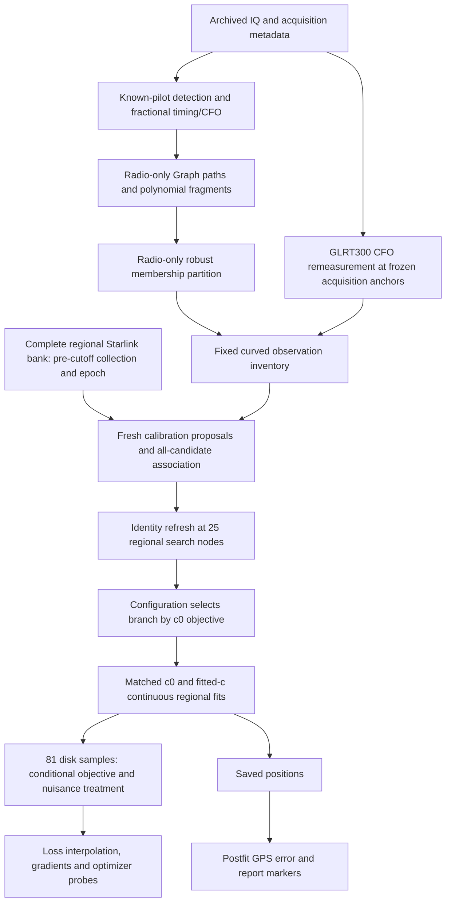
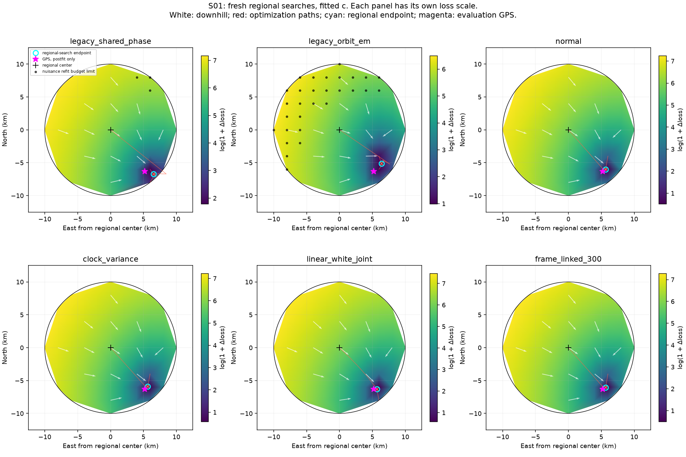
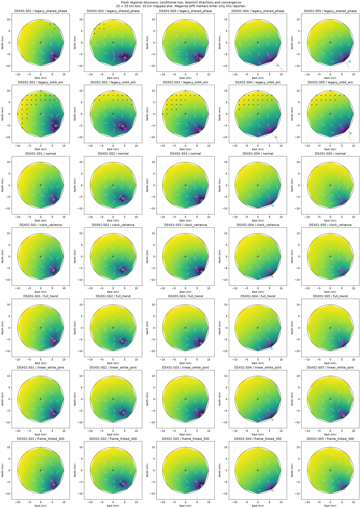

# DSX01: acquisition to regional position, and what the loss maps measure

This report describes the completed five-scan DSX01 analysis, including its causal-input audit and all 49 configurations. **The 10 km plots evaluate a sampled geographic grid, but do not rerun the full acquisition-to-position pipeline at each grid point.** They evaluate the location objective conditional on a satellite/alias branch selected by a fresh regional search. Depending on the configuration, nuisance parameters are integrated, variationally inferred, numerically profiled, or transferred from curved-only calibration.

The **25 × 25 km search square is centered at 37.906° N, 122.545° W**, the declared rounded Mill Valley regional center. The mapping disk has that same center and a 10 km radius. Evaluation GPS does not define either center. The search is regional: it assumes this geographic prior rather than locating an unknown receiver anywhere on Earth.

For all results, see the [49-row all-scan results table](README.md#position-errors), [position, frequency-fit and gradient CSV](position_and_gradient_summary.csv), [input audit](INPUT_AUDIT.md), and [validation record](VALIDATION.md).

## 1. The pipeline and its boundaries

The chart separates radio measurement, discrete hypothesis discovery, continuous inference, and postfit reporting. The current clean localization branch starts from archived radio products; it does not claim a fresh cold execution of acquisition for every configuration. Graph fragments are radio hypotheses, not authenticated satellite tracks. A NORAD label appears only in orbital association.

| Stage | Inputs and operation | Repeated at each plotted geographic point? |
| --- | --- | --- |
| Acquisition | Archived IQ windows, receiver/channel and sample counters; original pilot timing/CFO candidates and gates | No |
| Graph and polynomials | Radio times/CFO, alias-aware graph paths, polynomial validation, robust partition | No |
| GLRT300 | Existing IQ at frozen original acquisition anchors; pilot-based CFO refinement | No |
| Noise preparation | Same-scan radio polynomial/pilot evidence | No |
| Fresh association atlas | Zero-derived calibration proposals, all regional candidates, identity refresh at 25 search nodes | No |
| Configuration branch choice | Evaluate atlas assignments using that configuration's c0 objective | No |
| Position-dependent geometry | Predict Doppler and relevant local orbital/radio design at the trial position | Yes |
| Nuisance treatment | Integration/variational inference, legacy profiling, or declared calibration transfer | Yes, according to model |
| Satellite identities and alias branches | Hold the selected discrete branch fixed during surface evaluation | No reselection |
| GPS error/marker | Compare saved endpoint with supplied truth | Reporting only |

## 2. Archived acquisition and known-pilot evidence

The remeasurement assay explicitly verifies existing **20 ms, 2.5 MS/s** windows. It binds original tracking-input bytes to their recorded SHA-256, selects the original passing acquisition winner by fractional margin and candidate rank, checks its CFO, and matches receiver, channel, valid sample counter and physical IQ window. These values come from the archived source; they are not selected by a satellite or location fit. The report does not assign one invented RF center frequency to the whole scan: each fragment retains its recorded RF.

The original fractional-timing machinery evaluates local timing offsets and interpolates the known-pilot timing peak, then forms exact/control pilot scores and a CFO correction. Exact versus deliberately rolled-control pilot evidence checks waveform structure; it does not identify a satellite. The current assay preserves the original acquisition epoch, fractional timing anchor, aliases and Graph partition. A rejected refinement retains the original measured CFO.

### GLRT300 remeasurement

The implementation correlates the exact Qin edge-pilot template and a control template with symbol roll 17. At 2.5 MS/s, a 4.4 μs symbol spans 11 samples. It uses symbol indices 2 through 301 and up to 16 frame starts separated by the 750 Hz frame cadence, retaining frames with complete interpolation support.

For each frame, it removes the original CFO and sums each symbol against the conjugate template. An FFT across these symbol correlations evaluates residual CFO. The 16,384-bin transform gives about **13.87 Hz** spacing; selection is restricted to ±1,000 Hz. Powers sum across frames. Scores normalize by the summed squared coherent-amplitude ceilings. GLRT64 and GLRT300 compare the first 64 and 300 symbols respectively; GLRT300 is used by the clean localization run.

Acceptance requires **exact score minus control score ≥ 0.02** and **absolute residual CFO ≤ 750 Hz**. The separate midpoint300 diagnostic robustly regresses per-frame frequencies when at least six qualified frames span 7 ms; that diagnostic is not the GLRT300 variant used here. This distinction matters because CFO averaging and within-window rate estimation are different observations.

GLRT300 remeasurement applies to the original **12,724 curved observations**. Added linear fragments keep their original CFO and a 150 Hz point-noise assumption. No new RF was collected for this analysis.

Source: `tools/remeasure_dsx01_pilot_cfo.py`, `tools/dsx01_glrt_remeasurement.py`, `src/leo/analysis/starlink/fast_scan_fractional.py`, and `tools/prototype_dsx01_remeasured_position.py` in the [source snapshot](source_snapshot/).

## 3. Graph paths, alias handling, polynomial fragments and membership

Graph discovery operates separately on radio time/CFO lanes. It constructs a directed acyclic graph with time-ordered edges, lifts frequency differences by integer multiples of the **1 / 4.4 μs ≈ 227.273 kHz** ambiguity period, and limits slopes and time gaps. A second-order dynamic program scores consecutive-edge velocity continuity. Its best path is exact for the current additive graph cost; repeated exclusive path extraction is greedy, and the resulting collection is not a globally optimal track partition.

Discovered paths are refined and checked with polynomial models, may grow to nearby consistent observations, and may split when a single fit fails validation. Unresolved original observations remain represented. The resulting fragments are allowed to belong to different physical satellites; shared frequency shape alone does not authenticate a common source.

The later radio-only membership repair compares polynomial degrees 1–4 using a Gaussian/clutter EM contrast, 150 Hz noise, 2% clutter probability, fixed one-alias-period clutter width, and a `(degree+1) log(n)` complexity penalty. All-point and leave-one-out seeds initialize candidates; **every final score uses all observations**. The repair preserves physical times and CFOs, original IDs, and the input unwrapped branch. Points outside a selected core become explicit background rather than disappearing. The complete Graph population contains 676 fragments and 18,338 points across five scans; the historical repair moved two points to explicit background, both already unassociated.

The clean branch reads this frozen partition, verifies its hashes, classifies raw curvature, and retains the full declared curved inventory. It does not regenerate the partition at each position, fit to smoothed polynomial predictions in place of measured CFO, or use old GPS-conditioned association results. Separate historical fixed-GPS diagnostics exist and remain excluded from the current inference path.

Source: `src/leo/analysis/graph_tracklets.py`, `src/leo/analysis/research/robust_polynomial_order.py`, `tools/prepare_robust_curve_catalogues.py`, `tools/compare_dsx01_retention_localization.py` in the snapshot.

## 4. Causal orbital input and regional assumptions

The complete original regional candidate bank is retained: **1,707 / 1,479 / 1,422 / 1,427 / 1,424 candidates for S01–S05**. There is no manually supplied satellite-ID shortlist. The bank does impose a Starlink-name restriction and a broad 250 km visibility prior around 37.5° N, 122.0° W, with a generous below-horizon guard. These are explicit assumptions about the service and region. They are distinct from the smaller 25 km position-search square.

Nominal and previous elements require **both collection time and element epoch at or before the pre-scan cutoff**. An old epoch downloaded after the scan is insufficient. Checks bind element-line bytes to provenance and hashes, reconstruct bank order, and fail closed on another scan, missing metadata or an incomplete bank. Current nominal input is an isolated per-case `nominal_elements.json`; there is no mixed-catalogue fallback.

Causal histories cover every regional candidate using verified available pre-cutoff catalogue exports. Their historical depth is incomplete because the service archive was unreadable in this session. Earlier scan exports contribute only orbital records already available before the current cutoff, never radio observations, fitted calibration or position. Historical following-TLE diagnostics remain archives and are rejected by the new inference read guard.

The initial mixed-case container was explicitly indexed by scan, and the selected records were causal. Isolating transport subsequently changed no element bytes used by a fit; all 490 endpoint objective replays remained identical. This is a stronger input boundary, not a claim that the old container caused measured leakage.

## 5. Fresh discrete association and calibration discovery

The new run initializes hardware and orbital phase state from zero. At the regional center it constructs candidate statistics from the complete orbital bank, including frequency shape and phase sensitivity. It generates **eight calibration proposals**, performs candidate association and bounded refinement, and retains up to three distinct data-generated center modes. It does not read saved radio states, positions, satellite assignments or alias lists from earlier localization runs.

Identity exploration is refreshed at **25 regional search nodes**: east and north each take `−12.5, −6.25, 0, 6.25, 12.5 km`. Those nodes span the whole square, including corners outside the 10 km plotting disk. A finite atlas of assignment hypotheses is saved. Each configuration evaluates its own c0 score on these atlas nodes, picks a branch, and uses its labels and aliases for both c arms. Quality controls and linear nominations are recomputed from fresh same-scan evidence.

Candidate scoring uses predicted Doppler, visibility, residual shape and model-specific noise/phase criteria. A winning label is an algorithm-selected hypothesis. Enumerating the full bank within proposals does not enumerate every joint combination of satellite assignments, aliases, radio calibration and position. The finite heuristic atlas can miss a better branch; the S04 result demonstrates this practical weakness.

## 6. Continuous position and nuisance models

Location uses local east/north kilometres with bounds ±12.5 km in both axes. Conversion is `latitude = 37.906 + north/111.0` and `longitude = −122.545 + east/(111.32 cos(37.906°))`. Doppler geometry is recomputed for location; orbital phase and other declared correction modes model uncertainty in the pre-scan elements.

A useful schematic measurement equation is:

`measured CFO + integer alias × period = RF-scaled geometric Doppler(position, orbital corrections) + receiver/band offsets and drift + c × (RF_GHz − 11.5) + other declared nuisance terms + noise`.

This is a description of model roles, not one universal likelihood shared by all configurations. The coefficient **c** is learned from the current scan when enabled; it is forced to zero in the control arm. Curved observations calibrate hardware. Linear geometry cannot feed back into that calibration in the cut-transfer variants.

For current configurations, the continuous search uses two phase-linearization rounds, three matched starts per round, and 24 bounded Gauss–Newton iterations per attempt. Starts come from c0 geographic objective values and the retained anchor. Relinearization preserves absolute prior meaning; it does not declare the new expansion point to be a new zero-uncertainty truth. Every pair shares observations, candidates, selected labels/aliases, other priors, starts and budgets.

### The 49 configurations

| Family | Count | What changes |
| --- | ---: | --- |
| Original retention methods | 6 | `shared_phase`, `family_rate`, `orbit_em`, `penalized_split`, `correlated_noise`, `receiver_smooth`: alternative retention, shared phase/rate, splitting, correlated-noise or receiver-smooth treatment; nonlinear nuisance profiles |
| Satellite prior controls | 7 | `normal`, shared-clock covariance, variance-preserving clock control, heavy-tailed orbital priors, and family influence caps |
| Quality/rate controls | 4 | Fresh conditional quality weights and within-window rate evidence, separately and together |
| Prior scale controls | 4 | Alternative phase and constant-bias scales |
| Native drift controls | 3 | Receiver-native, band-native and mixed drift structure |
| RF/time controls | 2 | Alternative RF-dependent time structure scales |
| Causal correlation controls | 6 | Matched diagonal and correlated orbital-mode covariance controls |
| Causal forecast controls | 4 | Phase/full trend and available causal-history means |
| Frame controls | 8 | Independent, linked, pooled, trend/history and eccentricity-sensitive frame/orbit hypotheses |
| Linear transfer | 5 | Joint, shape and continuation predictive geometry, including white-noise controls, after curved-only calibration |
| **Total** | **49** | **49 configurations, not 49 independent algorithms** |

The modern 38 configurations integrate Gaussian nuisance coefficients or use their declared Gaussian/Gamma variational bound. In the Gaussian base, with whitened data `r` and feature matrix `A`, the cost contains `rᵀ(I+AAᵀ)⁻¹r + log det(I+AᵀA)`. The log-volume term penalizes flexibility; the reported conditional residual RMS alone omits this distinction. Gamma noise/robust-prior controls require an iterative bound and have recorded convergence checks. Different likelihood powers and approximations do not produce directly comparable calibrated model probabilities.

The six original methods numerically refit nuisance coefficients at each location with a 48-iteration sparse-Jacobian budget. The five linear methods nominate linears from the fresh curved-only c0 fit, transfer its calibration posterior, and evaluate their declared predictive geometry while preserving the curved-only calibration cut. They do not calibrate the receiver again from linear measurements.

## 7. Exactly how the 10 km radius plots were made

1. Load the fixed same-scan radio evidence and newly generated assignment atlas.
2. Select the configuration's assignment branch using its c0 objective, then fit matched c0/fitted-c regional endpoints.
3. Form east/north axes from −10 to +10 km in **2 km steps**, keeping samples satisfying `east² + north² ≤ 100`. This leaves **81 samples per arm**.
4. At each sample, evaluate the actual location-dependent objective on that fixed assignment/alias branch, with the configuration's nuisance treatment. This is a new geometry/objective evaluation, not a full acquisition, track discovery, or all-candidate satellite-association run.
5. Run three additional conditional optimizer probes: the regional center and the two lowest sampled disk points. These probes illustrate basin behavior. Their starts are chosen from loss, never GPS. Optimization can use the full 25 km square; the disk is a mapping boundary, not the optimizer's search boundary.
6. Triangulate the sampled points for the image. Colors show **`log(1 + max(0, loss − reference minimum))`**; the reference minimum is the lowest of grid, saved endpoint and probe scores for that arm. Gouraud shading interpolates these values. A smooth image is not evidence of dense evaluation between samples.
7. Draw normalized white downhill arrows from derivatives of the **piecewise-linear interpolator of raw sampled loss**, at a coarser display grid. They show direction, not gradient magnitude, and are not the exact derivative used at every location.
8. Independently compute the stored numerical gradient at the center and saved endpoint using central differences of the actual conditional objective, with **0.05 km steps**. The CSV reports these components and norms. Red paths show accepted probe iterates, cyan circles the primary regional-search endpoint, magenta stars postfit GPS, and black dots legacy nuisance refits that hit their cap.

Across five scans this is **245 two-panel maps, 490 arms, and 39,690 disk objective samples**. The 25-node discovery grid and the 81-point plotting grid serve different purposes. Neither grid spacing is the final position resolution: continuous optimization refines endpoints between nodes. Conversely, an optimizer endpoint and a small local gradient do not prove global convergence across alternate satellite/alias branches.

The plots answer: **“How does this model's conditional position objective behave around this selected branch?”** They do not answer: “What is the result of rerunning the entire blind pipeline independently at every possible receiver location?”

All approaches: [S01](DSX01-S01/README.md), [S02](DSX01-S02/README.md), [S03](DSX01-S03/README.md), [S04](DSX01-S04/README.md), [S05](DSX01-S05/README.md).

## 8. Results and what changed after removing inherited hypotheses

The normal configuration's position errors are below. GPS is applied after endpoints have been saved, at **37.849061591561885° N, 122.48574968092912° W**. These are position errors, not residual-frequency scores.

| Scan | Fresh c0 error, km | Fresh fitted-c error, km | Previous inherited fitted-c error, km | Fragments whose label changed |
| --- | ---: | ---: | ---: | ---: |
| S01 | 0.552 | 0.540 | 0.512 | 1 |
| S02 | 1.116 | 1.156 | 1.041 | 3 |
| S03 | 1.808 | 1.878 | 1.629 | 1 |
| S04 | 2.639 | 2.661 | 0.428 | 8 |
| S05 | 1.887 | 1.870 | 1.869 | 0 |

Fresh S04 discovery loses a good earlier hypothesis: eight labels change and fitted-c error rises to 2.661 km. That is evidence of discovery sensitivity. It does not establish that the earlier result used evaluation GPS. The earlier and fresh searches have different hypothesis histories. In the baseline, fitting c slightly improves S01/S05 position error and slightly worsens S02/S03/S04. A better frequency fit cannot be interpreted as improved localization.

The [complete table](README.md#position-errors) and [CSV](position_and_gradient_summary.csv) report all 49 configurations, both arms, endpoint coordinates, residual RMS, objective values and center/endpoint gradients. No GPS-selected combination of per-scan winners is presented as an algorithm. The [fresh-versus-previous comparison](fresh_vs_previous_baseline.json) keeps the comparison explicit.

## 9. Verification, remaining limitations and publication scope

- **71 component tests passed.** They cover the causal audit, fresh-discovery helpers, covariance/integration controls, frame/linear transfer, and sparse derivatives.
- **490/490 endpoint objectives replay exactly**, with maximum score difference zero. This reconstructs saved endpoints; it does not cold-rerun all discovery and optimization paths.
- Nominal/previous element provenance and epoch/collection checks pass for every scan, partition hashes match, and runtime input receipts show no forbidden report reads.
- Changing four imported evaluation constants to Sydney leaves fresh S01 discovery bit-identical and changes **0/152** tested objective evaluations. This is a targeted GPS invariance test, not a universal proof.
- Ten equivalent-control comparisons give exactly identical position parameters in both arms. Sixty endpoint sparse-Jacobian checks have maximum relative derivative error **5.112 × 10⁻⁶**.
- **955/4,860 legacy arm-pixels hit the 48-iteration nuisance budget**. They are marked in the plots. Legacy surfaces therefore remain finite-budget conditional profiles, not certified exact global profiles. Superseded two-step maps are not the current results.
- Three S05 inner solves marginally exceeded tolerance at 256 iterations. A matched 2,048-cap endpoint check satisfies tolerance; largest objective change is **1.385 × 10⁻⁶**, and largest conditional frequency-mean change **0.0415 Hz**. Estimated position effects below 0.031 m are local quadratic estimates, not new position refits.
- Causal history has complete candidate coverage but incomplete temporal depth. Hyperparameters were developed on DSX01; the analysis is not independent new-location validation. No new RF, pooled RF calibration, following TLE or GPS initialization is used.

This publication contains this explanation, all 245 map images and galleries, tables, audit/replay/precision receipts, hash manifests and a source snapshot. Large local per-pixel result JSON, discovery atlases, IQ, nominal element catalogues and causal-history payloads are not duplicated into this report publication. Their original hashes/paths remain in the manifests; they are needed for a complete numerical rerun. The snapshot supports source review and does not pretend the lean report is a standalone raw-data reproduction bundle. Current acquisition source references describe the implementation boundary; archived acquisition outputs and hashes remain the authority for what the original scan actually executed.

### Source map

Paths below are under [source_snapshot/](source_snapshot/), preserving repository-relative names. `source_bindings.json` binds the principal completed-run sources; `source_snapshot_manifest.json` records the published snapshot bytes. These distinguish completed-run provenance from supplementary implementation context.

| Topic | Principal source |
| --- | --- |
| Pilot remeasurement | `tools/remeasure_dsx01_pilot_cfo.py`, `tools/dsx01_glrt_remeasurement.py` |
| Graph / robust partition | `src/leo/analysis/graph_tracklets.py`, `src/leo/analysis/research/robust_polynomial_order.py` |
| Input boundary | `tools/dsx01_inference_audit.py`, `tools/export_dsx01_isolated_elements.py`, `tools/export_dsx01_clean_history.py` |
| Fresh discovery | `tools/run_dsx01_clean_region.py` |
| Modern maps / exact center and endpoint gradients | `tools/map_dsx01_clean_region.py` |
| Legacy nuisance maps | `tools/map_dsx01_clean_legacy.py`, `tools/refine_dsx01_clean_legacy.py`, `tools/dsx01_legacy_jacobian.py` |
| Linear maps | `tools/map_dsx01_clean_linear.py`, `tools/dsx01_cut_linear.py` |
| Gaussian / variational objectives | `tools/dsx01_joint_marginal.py`, `tools/dsx01_hierarchical_bound.py`, `tools/dsx01_satellite_prior_controls.py` |
| Plot interpolation, arrows and GPS markers | `tools/report_dsx01_clean_region.py` |
| Validation | `tools/audit_dsx01_clean_runs.py`, `tools/replay_dsx01_clean_objectives.py`, `tools/probe_dsx01_clean_gps_invariance.py`, `tools/probe_dsx01_clean_precision.py` |
