# DSX01-S03: audited regional loss and gradient maps

Each figure shows zero/fitted c with identical observations, assignment and aliases. GPS is postfit only. These are conditional-assignment surfaces, not exhaustive satellite marginalization.

## normal

## clock_shared

## clock_variance

## tail_4

## tail_8

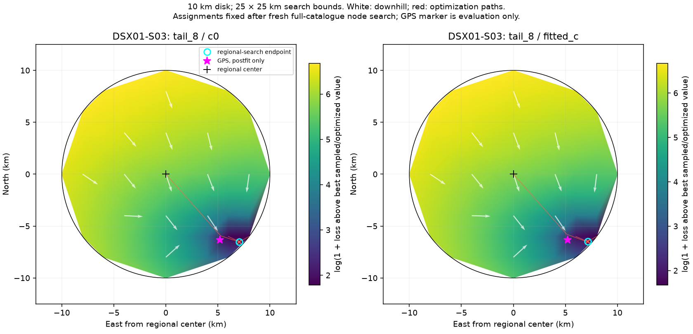

## balance_100

## balance_50

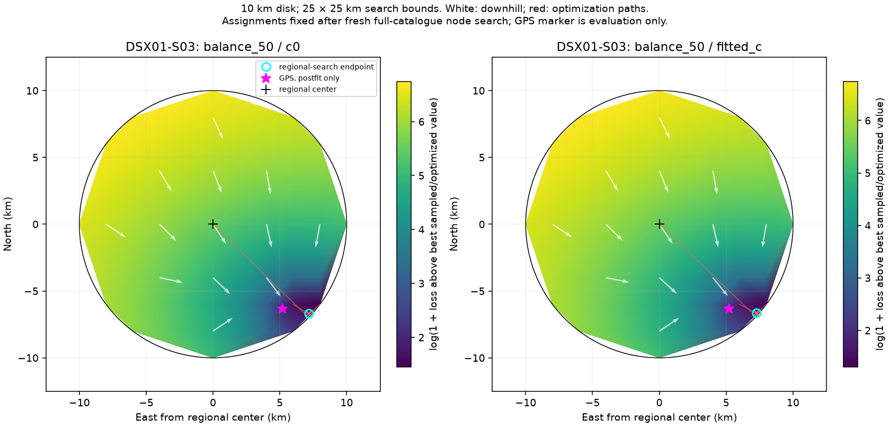

## quality

## rate_0p25

## rate_1

## quality_rate_1

## phase_3

## bias_5

## phase_bias

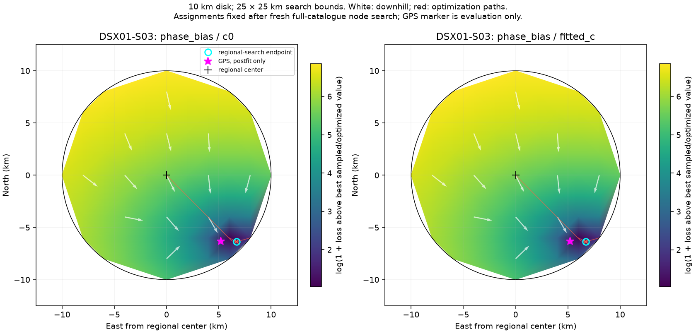

## weak_3

## native_rx

## native_band

## mixed_rx

## rf_time_0p5

## rf_time_2

## diag_4

## corr_4_0p5

## corr_4_0p9

## diag_6

## corr_6_0p5

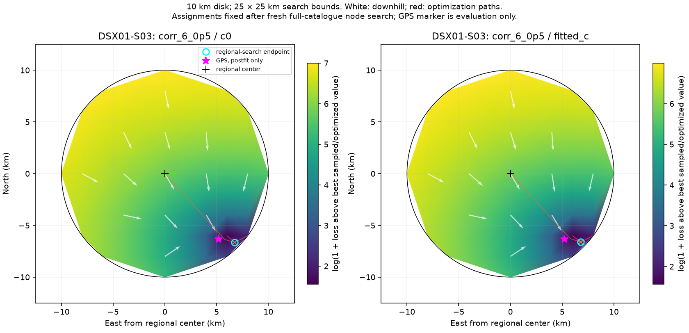

## corr_6_0p9

## phase_trend

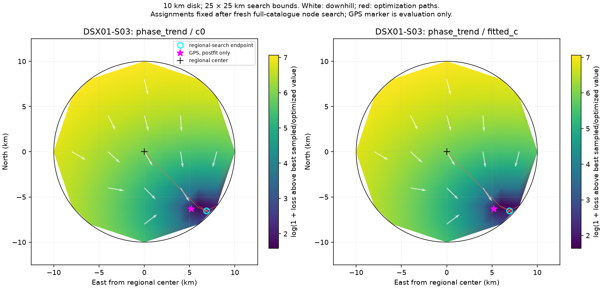

## full_trend

## phase_history

## full_history

## frame_independent

## frame_linked_700

## frame_linked_300

## frame_linked_100

## frame_pooled_300

## frame_trend_300

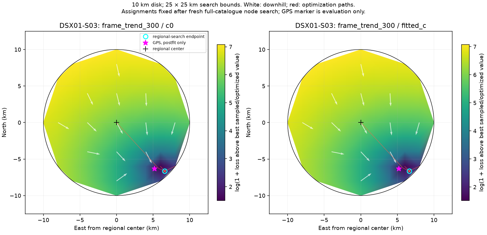

## frame_history_300

## frame_eccentric_300

## legacy_shared_phase

## legacy_family_rate

## legacy_orbit_em

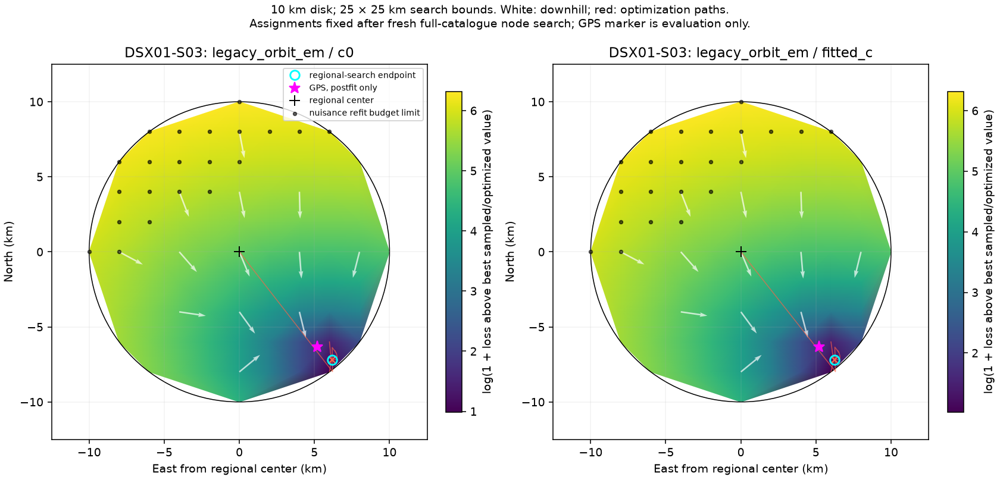

## legacy_penalized_split

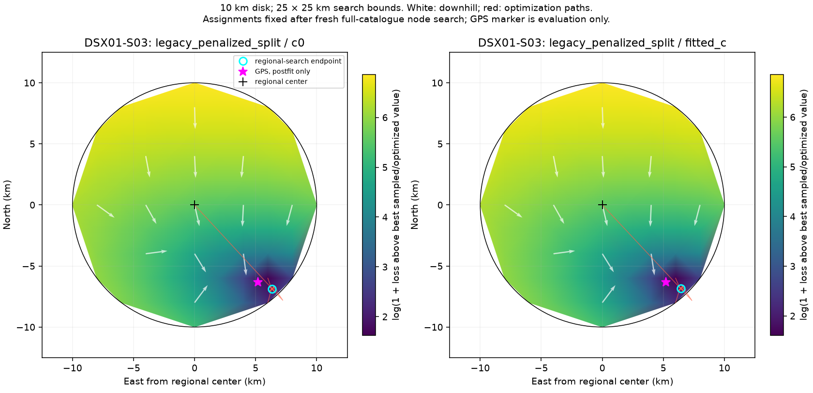

## legacy_correlated_noise

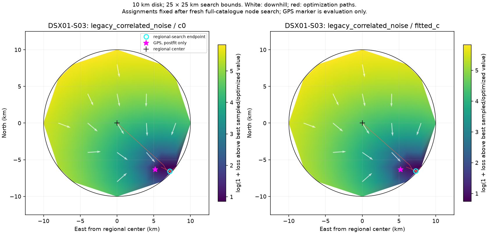

## legacy_receiver_smooth

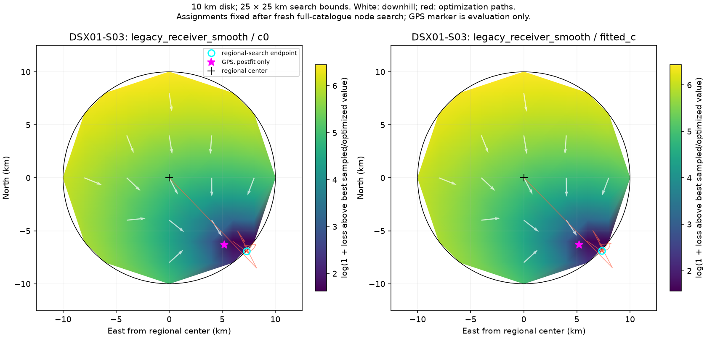

## linear_joint

## linear_shape

## linear_continuation

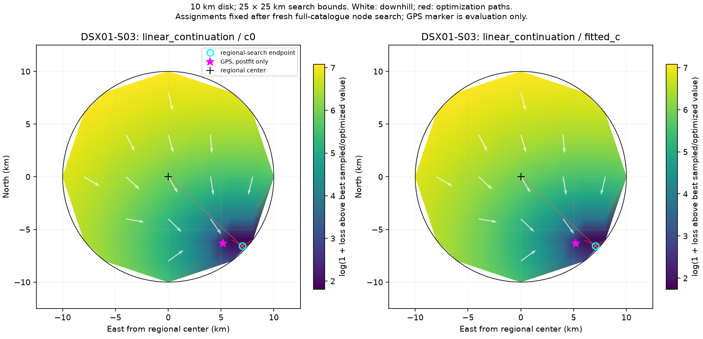

## linear_white_joint

## linear_white_shape

