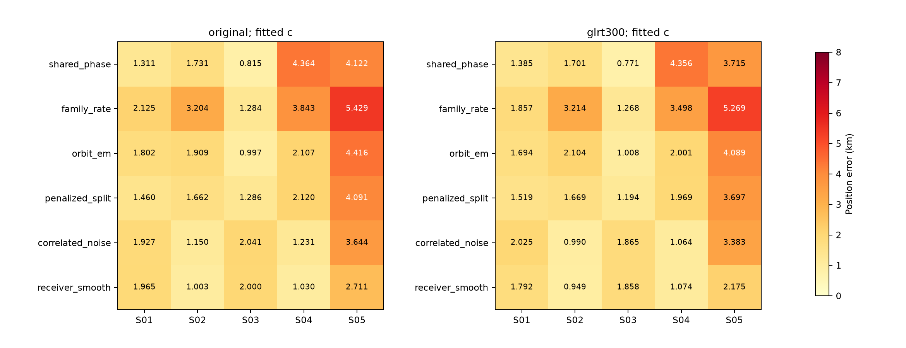
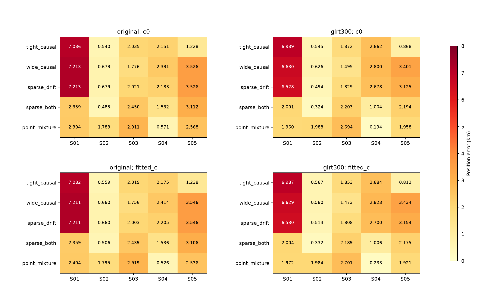
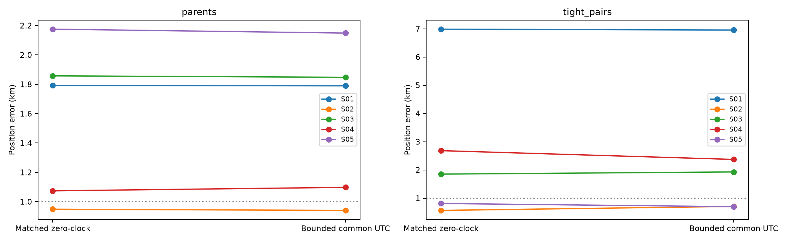
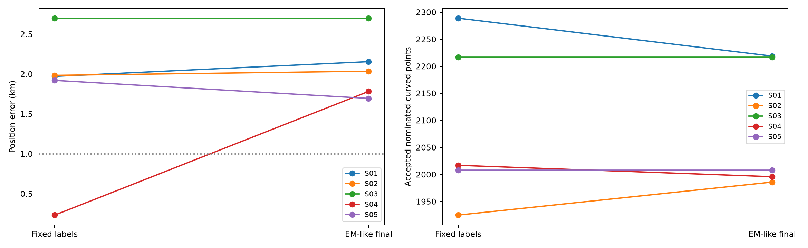

# DSX01: radio remeasurement and calibration transfer

Remeasuring archived IQ reduces polynomial residual noise on every scan, but
does not produce a uniform sub-1 km localization rule. Tight calibration,
heavy-tailed priors, point contamination, common UTC adjustment and iterative
satellite updates each help some cases and harm others. Selecting a different
model for each scan using its known position would be an oracle selection.

## Controls and population

All inference starts from blind states and a 25 × 25 km square centered at
37.906°, −122.545°. Each matched `c=0`/fitted-`c` pair uses the same curved
observations, satellite nominations, aliases, geographic starts and 24-iteration
budget per start. Latest causal frozen candidate banks are retained. GPS
37.849061591561885°, −122.48574968092912° is used only by the reporter.

The original 12,724 actively curved points remain in the fits; none are withheld.
An additional 10,365 IQ observations were remeasured on S01–S04, extending the
previous S05 experiment. Failed refinements retain their original CFO values.
This report evaluates 418 fit records / 209 matched `c` pairs: 394 new records
and 24 reused S05 records. These counts describe nominated curved fragments,
not completed association of every GLRT point or linear-track transfer.

There are four independent receiver/band frequency offsets. Wide drift models
use one mean drift per receiver (Gaussian sigma 10 Hz/s) and a band contrast
(sigma 0.5 Hz/s). The tight model instead retains four independent band drifts
with sigma 0.5 Hz/s and bounds ±1 Hz/s. Mixture weights and scale choices are
engineering hypotheses, not calibrated hardware or satellite probabilities.

## Remeasured radio noise

Leverage-corrected polynomial residual RMS is estimated from radio data alone.
GLRT-300 uses all 300 known pilot symbols in each usable frame from the
archived 2.5 MS/s IQ. It lowers this RMS on every scan:

| Scan | Original RMS (Hz) | Remeasured RMS (Hz) | Corrected / original curved points |
| --- | ---: | ---: | ---: |
| S01 | 107.45 | 96.15 | 2,838 / 2,909 |
| S02 | 139.93 | 127.62 | 2,290 / 2,317 |
| S03 | 137.69 | 131.64 | 2,570 / 2,609 |
| S04 | 127.90 | 115.61 | 2,514 / 2,530 |
| S05 | 150.88 | 145.80 | 2,334 / 2,359 |

## Transfer to all six parent algorithms

Position errors in km below use the remeasured points and fitted `c`.

| Method | S01 | S02 | S03 | S04 | S05 |
| --- | ---: | ---: | ---: | ---: | ---: |
| Shared phase | 1.385 | 1.701 | 0.771 | 4.356 | 3.715 |
| Family rate | 1.857 | 3.214 | 1.268 | 3.498 | 5.269 |
| Orbital EM-like | 1.694 | 2.104 | 1.008 | 2.001 | 4.089 |
| Penalized split | 1.519 | 1.669 | 1.194 | 1.969 | 3.697 |
| Correlated noise | 2.025 | 0.990 | 1.865 | 1.064 | 3.383 |
| Smooth receiver | 1.792 | 0.949 | 1.858 | 1.074 | 2.175 |

## Uniform nuisance-prior and contamination controls

These use the same center nominations, two blind nuisance initializations and
the same geographic search budget. The better initialization is selected using
`c=0` score, then its exact fitted-`c` partner is retained. Position errors in km:

| Rule | S01 | S02 | S03 | S04 | S05 |
| --- | ---: | ---: | ---: | ---: | ---: |
| Tight causal | 6.987 | 0.567 | 1.853 | 2.684 | 0.812 |
| Wide causal | 6.629 | 0.580 | 1.473 | 2.823 | 3.434 |
| Sparse drift prior | 6.530 | 0.514 | 1.808 | 2.700 | 3.154 |
| Sparse drift + phase priors | 2.004 | 0.332 | 2.189 | 1.006 | 2.175 |
| Point-contamination mixture | 1.972 | 1.984 | 2.701 | 0.233 | 1.921 |

The point mixture keeps every common-coordinate observation, combining a
150 Hz Gaussian signal with a 5 kHz contamination component. Pair means are
common coordinates, so a responsibility is not always a single raw-point
probability. A radio-only robust polynomial check finds most curves genuinely
curved: a large population of spurious endpoint-driven curves does not explain
the localization problem. One or two marginal curves become weak under some
mixture weights; the original eligibility population remains unchanged here.

## Common UTC and satellite updates

A single common UTC adjustment is bounded by the original approximately
250 ms host-query bracket; its Gaussian sigma is interval / sqrt(12). This is
a declared approximation to that bracket, not a calibrated absolute clock law.
It improves the tight-pair S05 fitted-`c` result from 0.812 to 0.699 km, but does
not repair the other scans uniformly.

EM-like satellite-group nomination proposals preserve existing timing-linked
groups, then refit the full objective. Accepted changes lower the score; they
do not consistently improve position. S04 moves from 0.233 to 1.783 km despite
an improved objective. The final fitted-`c` errors are 2.156, 2.036, 2.701,
1.783 and 1.696 km on S01–S05. Tiny approximately 1e-10 score changes in later
rounds are numerical no-ops, not meaningful gains.

## Interpretation and limits

The strongest evidence is an ambiguity between shared radio drift, satellite
phase/orbit corrections and position. A better radio measurement or lower
in-sample score alone does not resolve that ambiguity. Pair differences help
measure relative receiver calibration but do not directly constrain its common
mode. Aggregate timing-pair RMS also includes conflicting satellite labels;
it must not be presented as verified physical calibration or independent truth.

The next experiment jointly integrates Gaussian radio, phase and orbital
nuisance modes with their covariance-volume penalty, and compares fixed versus
radio-estimated noise and fitted variance components. This is a proposed follow-up
to this checkpoint, not an achieved result here.

## Saved evidence

[Evaluation validation](evaluation_validation.json) records objective replay for
all 418 records and matched inputs/starts for all 209 `c` pairs.
[Full evaluation table](evaluation_summary.csv), [paired common-point RMS
ablation](c_ablation.csv), [frequency details](frequency_details.json),
[radio noise](radio_noise.json), and [objective replay](objective_replay_checks.json)
separate fit quality, coverage and position error. Fitting `c` has no consistent
position benefit. The full ablation retains both arms; the tables above focus
on fitted `c` for compactness.

Per-run protocols, states, raw measurement deltas and proposal histories remain
under `parents/`, `priors/`, `common_clock/`, `identity_iterations/` and
`remeasurement/`. This local checkpoint has not yet been packaged as a complete
standalone frozen source/input bundle. No new RF was collected and archived IQ
was read-only.
