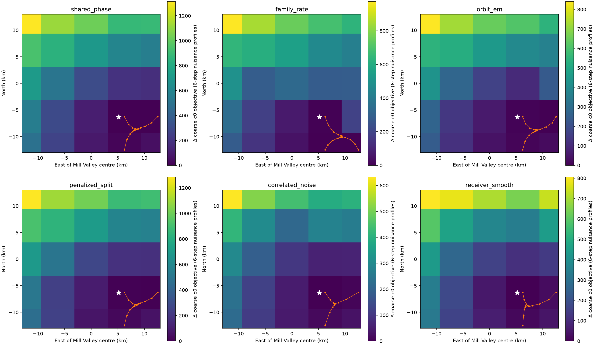
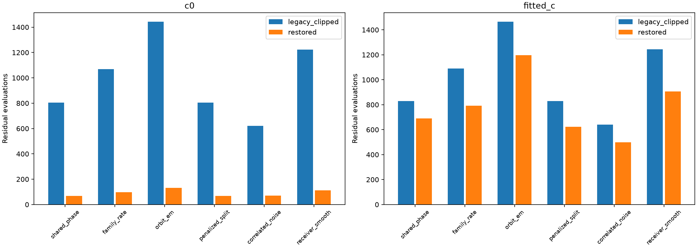
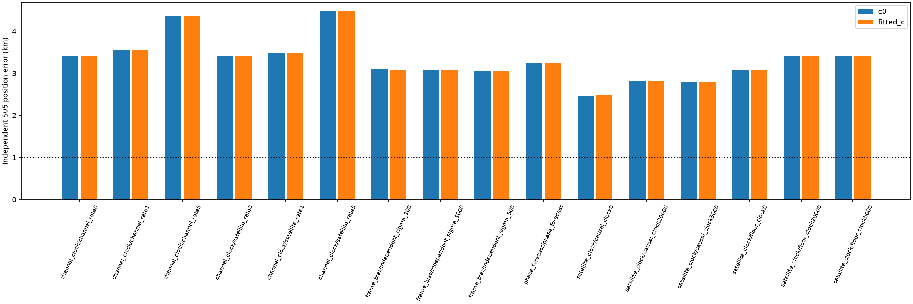
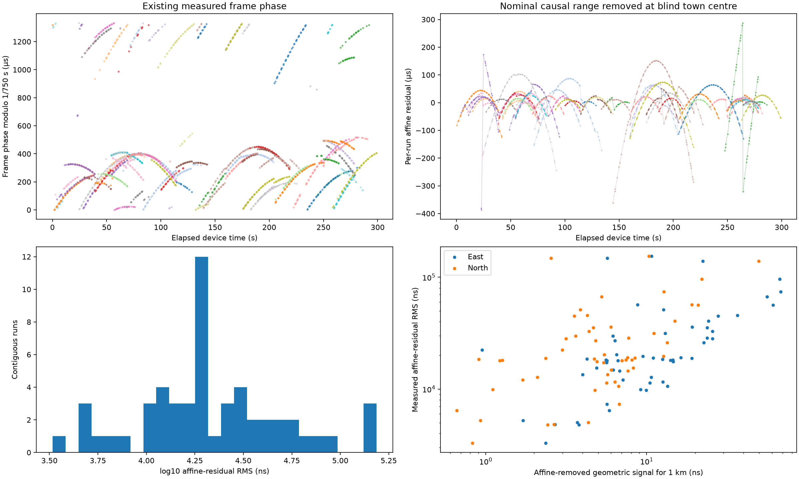
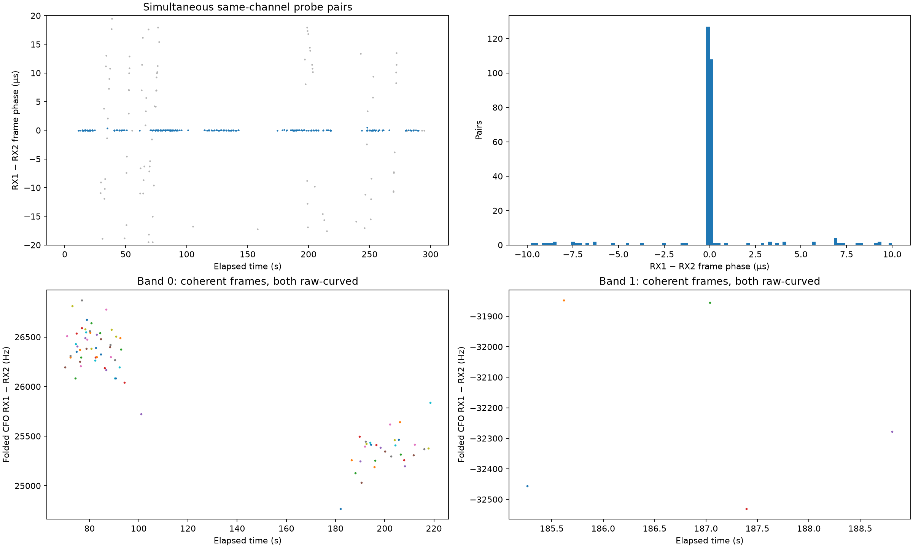

# DSX01 S05: calibration basins, initialization, and transmitter-clock controls

**S05 still does not reach 1 km independent position accuracy.** The closest new control gives **2.469 km with `c=0` and 2.477 km with fitted `c`**, accepting 1,949 nominated curved GLRT points in 53 fragments. Restoring a clipped receiver-drift initialization substantially reduces optimizer evaluations but changes the converged position by less than **0.081 m**. Neither additional calibration hypotheses nor more flexible transmitter clocks resolves the remaining bias.

For the earlier request to probe **S01 within 10 km of the correct position**, see the published [S01 local loss report](../2026_10_18_s01_local_loss/README.md), including its maps, descent paths, local endpoints and matched `c` controls. That experiment intentionally starts at GPS and is an oracle diagnostic. The S05 experiments here instead retain the blind Mill Valley search. The two experiments answer different questions and must not be combined into one localization benchmark.

This report continues the [causal repairs](../2026_10_18_dsx01_causal_repairs/README.md), [receiver geometry](../2026_10_18_dsx01_receiver_geometry/README.md), and [orbital uncertainty](../2026_10_18_dsx01_orbit_uncertainty/README.md) analyses. It records unsuccessful hypotheses as well as useful implementation and measurement findings.

## Scope and controls

The blind search covers a **25 × 25 km square centred at 37.906, −122.545**, using a 5 × 5 geographic grid and three common `c=0`-selected starts, with at most 24 fine optimization iterations per start. GPS **37.849061591561885, −122.48574968092912** is used only to report error and draw reference markers. It is absent from the blind objectives, calibration fits, initialization and selection. No RF was collected, and no GLRT observations were withheld.

Only the original actively curved graph fragments calibrate hardware or position: span at least 20 s and affine-residual RMS at least 250 Hz. Linear tracks do not determine calibration or position. Four RX/band offsets remain independent; receiver mean and band-contrast drift priors are 10 and 0.5 Hz/s. The six parent models are shared phase, satellite-family rate, orbital MAP / EM-like, penalized subdivision, correlated residual noise and smooth receiver error. Their mechanisms are documented in the linked preceding reports; these are variants of the same graph-based association workflow.

Every `c=0` / fitted-`c` pair preserves observations, candidate nominations, aliases, other priors, geographic starts and search budgets. `c` is the RF-dependent calibration coefficient. Frequency residuals and position error are reported separately. Accepted counts cover nominated curved points after the existing RMS, bias, residual-structure, visibility and correction-ownership gates; they are **not full-corpus association percentages**. S05 has 4,056 original GLRT points, of which 2,359 belong to this curved localization population. Candidate satellite identities remain unverified hypotheses.

## Calibration hypotheses and geographic profiles

Nine calibration proposals at the blind centre, including the inherited proposal, are profiled with wide final receiver priors. Two 12-iteration nuisance rounds and coherent candidate-phase updates are used per proposal. The retention rule allows up to four distinct modes, but these proposals effectively collapse to one retained mode. The initial proposal generator retains its legacy 5 Hz/s bound; proposals are projected into the final receiver mean/contrast box before scoring. This does not establish an exhaustive search of calibration modes.

A second experiment profiles calibration and candidate identities at **each of the 25 geographic nodes**, rather than inheriting all nominations from the centre. At each node, the same warm centre state initializes two rounds of coherent identity exploration and six nuisance iterations. Three nodes are selected using only the `c=0` score plus parameter-count penalty, then refined with matched `c` arms. Previously completed blind incumbents remain eligible. No S05 parent model reaches 1 km.

These maps show **coarse, finite-budget `c=0` nuisance profiles with changing candidate labels**, with fine optimization paths superimposed. They are not calibrated probability surfaces or exactly optimized profile likelihoods. GPS markers are drawn after fitting. Across the six methods, redoing calibration geographically does not remove the distant preferred basin.

## An initialization defect that affects speed

The inner legacy family constructor clips native initial band rates to ±1 Hz/s before the wide receiver wrapper reads them. For one S05 warm state, requested rates near −12 to −9 Hz/s therefore initialized as −1 Hz/s. **The final bounds and objective were already wide**; the defect concerns initialization, not the admissible final fit.

An opt-in restoration reinstates the supplied four radio mean/contrast coordinates after construction, clipping only to the declared final bounds. A controlled local restart uses the same completed blind incumbent, anchor, nominations, aliases and 24-iteration budget for legacy/restored × both `c` arms. These are local restart controls, not new independent geographic searches.

| Parent model | `c=0` evaluations, legacy → restored | Fitted-`c` evaluations, legacy → restored |
| --- | ---: | ---: |
| Shared phase | 805 → 68 | 829 → 691 |
| Family rate | 1,068 → 98 | 1,090 → 793 |
| Orbital MAP / EM-like | 1,442 → 132 | 1,464 → 1,198 |
| Penalized subdivision | 805 → 68 | 829 → 622 |
| Correlated noise | 622 → 70 | 640 → 498 |
| Smooth receiver | 1,222 → 112 | 1,244 → 905 |

The largest endpoint difference is **0.0803 m**. Evaluation counts are more portable evidence than wall time on a shared machine. Restoring the warm state is useful computationally, but does not explain the kilometre-scale S05 displacement.

## Phase, RF calibration and transmitter-clock tests

All six parents receive three phase-prior controls: the preceding one-second floor, the original causal-bank Gaussian scales, and a heavy-tailed causal penalty. A separate past-only TLE forecast predicts a **constant phase prior mean**, using chronological orbit-version innovations rather than CFO or GPS. The forecast is a version-based proxy experiment, not a validated orbit-error predictor; later version epochs need not equal their operational availability times.

Errors below are kilometres, **`c=0` / fitted `c`**. The incumbent is selected by the `c=0` objective, retaining its exact fitted-`c` partner. The other columns are specified controls, not selections by GPS error.

| Parent model | Prior blind incumbent | Heavy-tailed causal phase | Past-only phase-mean forecast |
| --- | ---: | ---: | ---: |
| Shared phase | 4.074 / 4.122 | 3.876 / 3.906 | 3.922 / 3.978 |
| Family rate | 5.407 / 5.429 | 4.095 / 4.094 | 5.229 / 5.249 |
| Orbital MAP / EM-like | 4.391 / 4.416 | 3.643 / 3.646 | 4.036 / 4.056 |
| Penalized subdivision | 4.048 / 4.091 | 3.678 / 3.703 | 3.537 / 3.576 |
| Correlated noise | 3.625 / 3.644 | 3.090 / 3.070 | 3.768 / 3.769 |
| Smooth receiver | 2.702 / 2.711 | 2.596 / 2.592 | 3.237 / 3.251 |

Additional RF slopes are tested globally, per receiver and per RX/band, with orthogonal contrast priors. The matched `c=0` arm disables all RF slopes. The smooth-receiver fitted-`c` errors are **2.711, 2.682 and 2.699 km**, respectively. More RF calibration freedom does not materially solve S05.

The smooth-receiver parent also receives normalized satellite-family likelihoods with marginal constant transmitter-frequency uncertainty of 0, 5 or 20 kHz, and linear clock-rate uncertainty shared either per satellite or per satellite/channel. Covariance-volume penalties are included; these are not unpenalized fitted offsets. The channel models keep one transmitter-clock process shared across receivers.

| Smooth-receiver control | Error, `c=0` / fitted `c` (km) | Accepted curved points | Fragments |
| --- | ---: | ---: | ---: |
| Family likelihood, one-second phase floor, no added clock | 3.088 / 3.076 | 1,949 / 1,949 | 53 / 53 |
| Family likelihood, causal Gaussian phase, no added clock | **2.469 / 2.477** | 1,949 / 1,949 | 53 / 53 |
| Causal phase, 5 kHz satellite clock uncertainty | 2.802 / 2.803 | 1,949 / 1,949 | 53 / 53 |
| Causal phase, 20 kHz satellite clock uncertainty | 2.813 / 2.813 | 1,949 / 1,949 | 53 / 53 |
| Satellite/channel clock, 1 Hz/s rate uncertainty | 3.553 / 3.553 | 2,166 / 2,166 | 57 / 57 |
| Satellite/channel clock, 5 Hz/s rate uncertainty | 4.346 / 4.346 | 2,183 / 2,183 | 58 / 58 |

The closest control's common 1,949-point native RMS is **168.028 Hz for `c=0` and 168.050 Hz for fitted `c`**. Adding RF calibration does not improve either this frequency statistic or its position error. More accepted points in the flexible channel-clock models also do not imply better localization. Likelihood families, phase priors and retained populations differ across controls: raw objective magnitudes and own-population RMS must not be ranked as common calibrated evidence. The closest GPS-error result is a diagnostic observation, not a deployable model-selection rule.

## Saved frame timing: useful relative evidence, not direct range

A read-only export joins the original tracking-input frame epochs to all **20,084 unchanged graph observation IDs** across the five DSX01 scans, verifying winning CFO values. It preserves integer epoch, fractional delay and device sample counter. The detector's integer phase-ring period and physical 750 Hz frame period are recorded separately. These values are not validated pseudoranges.

For S05, 54 contiguous same-candidate/RX/channel runs are compared with nominal causal orbital range at the blind town centre. After removing an arbitrary affine clock per run, median timing residual is **18,750.7 ns**. Median expected shape change for a 1 km displacement is only **10.58 ns east and 5.33 ns north**. This diagnostic uses unverified CFO candidate labels and instantaneous geometric range; it does not establish absolute UTC accuracy. Directly treating the saved frame epochs as clean range would be unjustified.

Timing can still identify promising simultaneous RX pairs. Same-channel detections at the same physical sample counter, each with GLRT margin at least 0.1, are selected by proximity to a channel's dominant relative frame-delay mode. No satellite label, TLE or GPS selects these timing pairs or fits their relative CFO line. Coherent pairs must lie within two samples of the mode; only original curved tracks contribute calibration.

| Scan/band | Coherent curved pairs | Span (s) | Channels | RX1 − RX2 relative rate (Hz/s) | Line RMS (Hz) | Support rule |
| --- | ---: | ---: | ---: | ---: | ---: | --- |
| S01 low | 159 | 283.9 | 4 | +6.954 | 293.2 | passes |
| S01 high | 41 | 95.8 | 2 | +11.604 | 176.8 | passes |
| S02 low | 21 | 215.3 | 3 | +4.224 | 149.0 | passes |
| S03 low | 56 | 96.2 | 3 | −6.270 | 290.2 | passes |
| S04 low | 58 | 255.2 | 3 | −5.755 | 231.5 | passes |
| S05 low | 80 | 148.4 | 4 | −8.594 | 213.0 | passes |

The support rule requires at least 20 pairs, 60 s and two channels; it is a coverage heuristic, not a confidence interval. Other high-band results lack this coverage. S05 high band has only five pairs over 3.55 s and must not supply a scan-wide drift estimate. **Timing coherence is additional source evidence, not proof of satellite identity**: coincident peaks and different beams remain possible.

A final covariance prototype links repeatedly coherent curved fragments only when their current candidate identities agree. It keeps each fragment's marginal constant-bias variance at 1,000² Hz², moving variance from independent to shared group bias. Each original CFO is counted once; no pairwise CFO difference is added as independent data. Independent linked-bias sigmas of 1,000, 300 and 100 Hz give fitted-`c` errors **3.076, 3.053 and 3.082 km**. Stronger relative calibration does not resolve the common position bias.

## Interpretation and next bounded experiment

The tests support three conclusions: initialization wastes evaluations but does not cause the final displacement; calibration/identity profiling across the geographic grid does not reveal a nearby winning basin; and simple extra satellite/channel clock freedom can associate more points while worsening position. No tested repair establishes independent sub-1 km accuracy for S05.

The physical motivation for testing channel clocks comes from the primary [Mind the Beam abstract](https://www.ion.org/publications/abstract.cfm?articleID=20898), which reports channel-dependent Starlink Doppler corrections. Only its abstract was available; this is not evidence that the same mechanism causes DSX01's bias. A [receiver-development preprint](https://radionavlab.ae.utexas.edu/wp-content/uploads/morrison_rtsdr_LEOPNT_2.pdf) distinguishes carrier, frame and OFDM symbol clocks, while [Timing Properties of Starlink Ku-Band Downlink](https://arxiv.org/abs/2501.05302) describes frame-clock jumps and instability. These results caution against treating all clock observables as one process.

A useful next experiment is bounded reanalysis of a few already-recorded short IQ windows, first validated synthetically, to estimate carrier CFO and within-frame symbol/sample-clock offset separately. This is a proposed measurement diagnostic, not an implemented solution or authorization for new RF collection. The independent-scan localization goal remains unresolved.

## Saved results and verification

There are **198 new fit/refinement records**: 24 centre-mode, 36 geographic-refinement, 24 local warm-restart, 36 RF-calibration, 36 causal-phase, 12 satellite-clock, 12 channel-clock, six frame-bias and 12 phase-forecast records. Together with 12 reused blind incumbents, the principal table contains **210 evaluated records / 105 matched `c` pairs**. The 24 warm restarts are local controls; the other 174 new records use the documented geographic search/refinement procedure. Centre discovery and geographic preprocessing add **318 short nuisance profiles**.

The [complete evaluation table](evaluation_summary.csv), [common-point frequency ablation](c_ablation.csv), [saved fit bindings](evaluation_binding.json), [focused test receipt](focused_tests.json), [frozen-source test receipt](frozen_source_tests.json), [validation receipt](validation.json), and [source/input/artifact manifest](manifest.json) accompany all five figures and saved endpoints. Figure replay is recorded [separately](figure_replay.json): it regenerates plots from saved evaluations and is not a rerun of the optimization campaign. The frozen source closure includes compatible inherited numerical dependencies and the new research tools/tests. Runtime components, persisted contracts and golden scientific fixtures are unchanged by this report publication.
