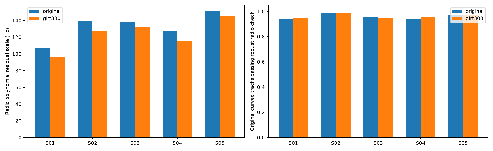

# DSX01: completed radio, orbit and association experiments

The robust joint model locates S01 and S04 within 1 km independently. Broader
orbital uncertainty, residual correlation and variance learning improve other
individual cases, but **no uniform blind rule achieves sub-1 km on all five
scans**. This report collects the completed experiments, their visualizations,
tables and reproducibility receipts. Subsequent live experiments are outside
this publication.

The earlier [S01 local loss-surface audit](../2026_10_18_s01_local_loss/README.md)
provides the original maps around the known coordinate and the local minima
for the graph-based association approaches.

## Evaluation controls

All geographic inference starts from the same **25 × 25 km** Mill Valley
square centered at **37.906°, −122.545°**, with 25 grid nodes, three starts
selected by the `c=0` objective and 24 bounded iterations per start and arm.
The coordinate **37.849061591561885°, −122.48574968092912°** is used only for
postfit evaluation. Scans are fitted independently, without a pooled site.

The original **12,724 actively curved GLRT observations** are retained; none
are withheld. The original curvature selection, causal candidate banks and
integer aliases are preserved for controlled model comparisons. Satellite
identities remain hypotheses. Coverage below concerns nominated curved
fragments; final association and transfer of linear tracks were not rerun.

Each model has matched **`c=0` and fitted-`c`** arms with the same observations,
nominations, aliases, other priors and search budgets. Here `c` is the learned
RF-dependent calibration coefficient. Frequency fit and position accuracy are
reported separately. GPS error is never used to choose a model per scan.

GLRT-300 means **300 known pilot symbols per usable frame**, measured from
archived **2.5 MS/s, 20 ms IQ windows**. The earlier frozen joint report's
“full-band” wording does not mean 300 MHz. No new RF was collected and archive
paths were read-only.

## Completed reports and figures

| Study | What it tests | Evidence |
| --- | --- | --- |
| [Pilot-clock and CFO remeasurement](../2026_10_18_dsx01_pilot_clock/README.md) | Symbol-clock consistency, within-window frequency variation, GLRT refinement and timing-linked RX differences on S05 | Five figures; 111 focused tests |
| [All-scan radio/calibration transfer](../2026_10_18_dsx01_clock_transfer/README.md) | Remeasurement on all five scans, six parent methods, calibration priors, UTC corrections and label updates | Five figures; 418 evaluated records / 209 matched pairs |
| [Joint nuisance integration](../2026_10_18_dsx01_joint_marginal/README.md) | Joint receiver/orbit integration with covariance-volume costs, radio-only noise, variance learning and robust fragment likelihood | Four figures; 120 frozen comparison records / 60 pairs; 130 tests |
| [Structured residuals and orbital span](../2026_10_18_dsx01_structured_joint/README.md) | Eccentricity directions, colored noise, robust variance learning, full-objective label updates and physical model checks | Three figures; 160 comparison records / 80 pairs; 30 additional attempted fit records; 142 tests |

The counts describe overlapping checkpoints, not disjoint experiments to be
summed. The structured checkpoint includes completed robust variance learning
that was still pending when the preceding joint report was frozen.

Cleaner CFO measurements reduce radio polynomial residual noise on every scan.
That improvement alone does not remove ambiguity between geographic position,
shared receiver calibration and candidate orbital error.

## Latest independent position comparison

Errors are km, **`c=0` / fitted `c`**. These are conditional model results,
not calibrated confidence intervals or authenticated satellite associations.

| Model | S01 | S02 | S03 | S04 | S05 |
| --- | ---: | ---: | ---: | ---: | ---: |
| Robust joint baseline | 0.754 / 0.741 | 1.442 / 1.429 | 1.408 / 1.483 | 0.926 / 0.918 | 2.317 / 2.301 |
| Learned variance scales | 0.691 / 0.681 | 2.567 / 2.611 | 1.600 / 1.681 | 0.249 / 0.195 | 2.667 / 2.640 |
| Eccentricity directions | 0.503 / 0.485 | 1.588 / 1.578 | 1.301 / 1.366 | 0.888 / 0.902 | 2.507 / 2.498 |
| Colored residuals | 1.442 / 1.422 | 0.716 / 0.627 | 1.641 / 1.709 | 0.619 / 0.495 | 2.541 / 2.530 |
| Eccentricity + colored | 1.533 / 1.507 | 0.639 / 0.545 | 1.562 / 1.622 | 0.824 / 0.725 | 2.733 / 2.731 |
| Integrated-objective label updates | 0.754 / 0.741 | 1.307 / 1.334 | 1.408 / 1.483 | 2.799 / 2.841 | 2.652 / 2.636 |

Selecting the lowest final `c=0` objective across these alternatives gives
fitted-`c` errors **1.422, 0.545, 1.709, 0.725 and 2.530 km**, respectively.
The rule still fails on S01, S03 and S05. Choosing a different model using
each scan's smallest GPS error would give an unjustified result.

## Coverage and frequency fit

The denominator is **12,724 curved observations**. These are aggregate counts
across five scans, using the original white-residual acceptance gates.
Native RMS uses the intersection of accepted points in each matched `c` pair;
that common-point population can differ slightly from the fitted-`c` count.

| Model | Fitted-`c` points | % of curved points | Curves | Points / curve | Common-point native RMS, `c=0` / fitted `c` (Hz) |
| --- | ---: | ---: | ---: | ---: | ---: |
| Baseline | 11,362 | 89.30% | 308 | 36.89 | 131.427 / 131.419 |
| Learned variance | 11,154 | 87.66% | 304 | 36.69 | 129.791 / 129.784 |
| Eccentricity | 11,362 | 89.30% | 308 | 36.89 | 131.309 / 131.300 |
| Colored residuals | 10,157 | 79.83% | 286 | 35.51 | 132.197 / 132.136 |
| Eccentricity + colored | 10,357 | 81.40% | 291 | 35.59 | 132.505 / 132.460 |
| Label updates | 11,319 | 88.96% | 308 | 36.75 | 130.297 / 130.288 |

These percentages are **not percentages of all raw GLRT detections**. Applying
the colored models' assumed covariance to the acceptance screen admits 12,195
points for either colored variant, but that larger count depends on relaxing
the residual model. It does not establish correct satellite identities or
better position.

## What limits the result?

After shared calibration refits, the leading problematic curves distinguish
the true coordinate from a displaced endpoint by only approximately 8–13 Hz,
while their residuals vary by hundreds of hertz. Shared-prior contributions
can dominate these small geographic differences. Robust likelihoods retain
every observation, including some nominations that fail final residual gates;
those nominations can still influence calibration.

Full-objective label updates can also improve fit while worsening position:
S04 changes from 0.918 to 2.841 km with fitted `c`, despite an approximately
120.5-unit improvement in its `c=0` objective. Candidate identity cannot be
authenticated from that objective alone.

Exact SGP4 conditional-mean checks find approximately 0.022–0.260 Hz RMS
differences for the fitted-`c` baseline and up to 2.26 Hz for eccentricity
variants. The 195 m and 485 m endpoints therefore remain conditional tangent
model results. A separate signal-flight-time diagnostic leaves only
approximately 0.0018–0.0029 Hz RMS after removing each track's constant, too
small to explain the displacement in this check.

## Reproducibility and publication scope

The latest checkpoint preserves **354 frozen source snapshots**, **199 hashed
numerical inputs**, **72 hashed artifacts** and a receipt reproducing **11
tables/JSON/figure products byte for byte**. Its saved objectives cover all
160 comparison records plus all 30 label-update attempt records. The preceding
joint checkpoint preserves its own 343-source closure and 87 artifact hashes.

The frozen 142-test source suite was rerun successfully for this publication.
All linked figures and report files are included. Existing tracked numerical
dependencies retain their remote-main bytes; unpublished prerequisites and
source closures accompany the reports. Frozen reports and receipts are
preserved without rewriting their historical completion statements.

See the latest [validation](../2026_10_18_dsx01_structured_joint/validation.json),
[replay receipt](../2026_10_18_dsx01_structured_joint/frozen_endpoint_replay.json),
[source manifest](../2026_10_18_dsx01_structured_joint/source_manifest.json),
[input manifest](../2026_10_18_dsx01_structured_joint/input_manifest.json), and
the publication [audit](publication_validation.json).

Production components, persisted contracts and golden scientific fixtures are
unchanged. Independent-band drift, exact physical relinearization and newer
noise experiments are separate followups and are not claimed as completed or
published here.
