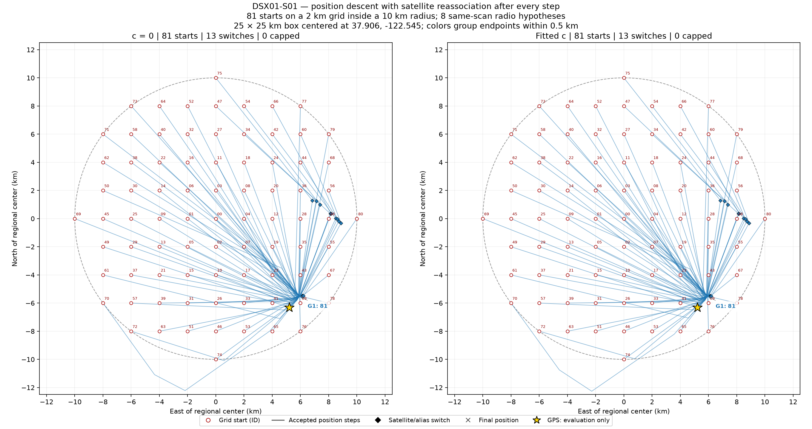
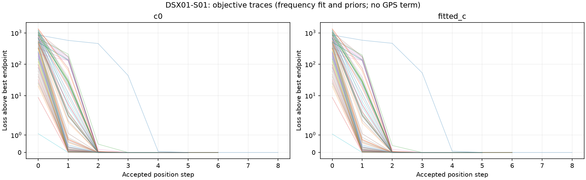
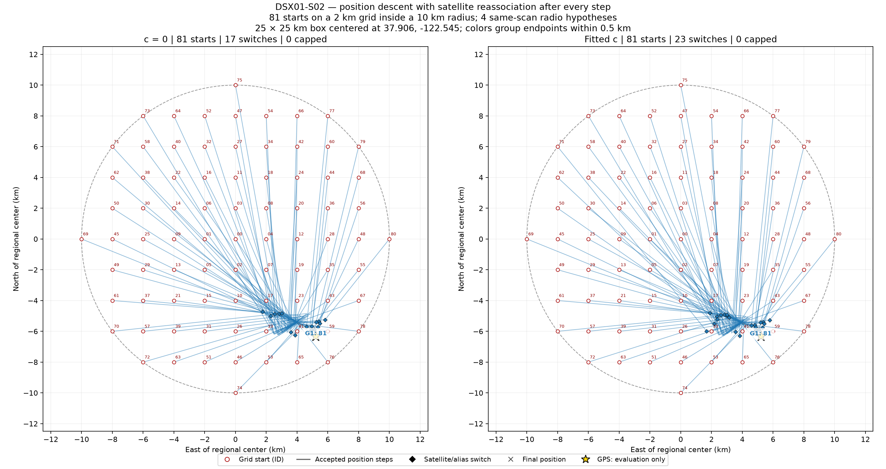
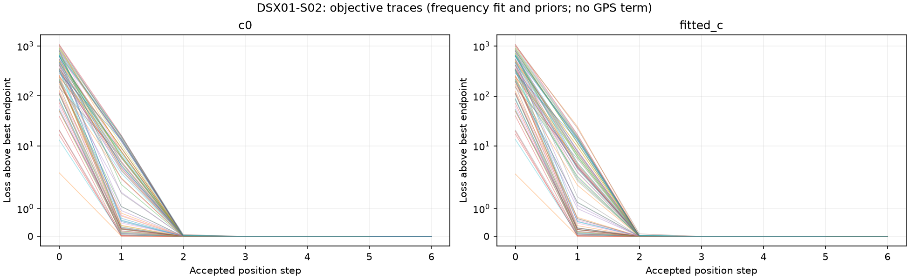
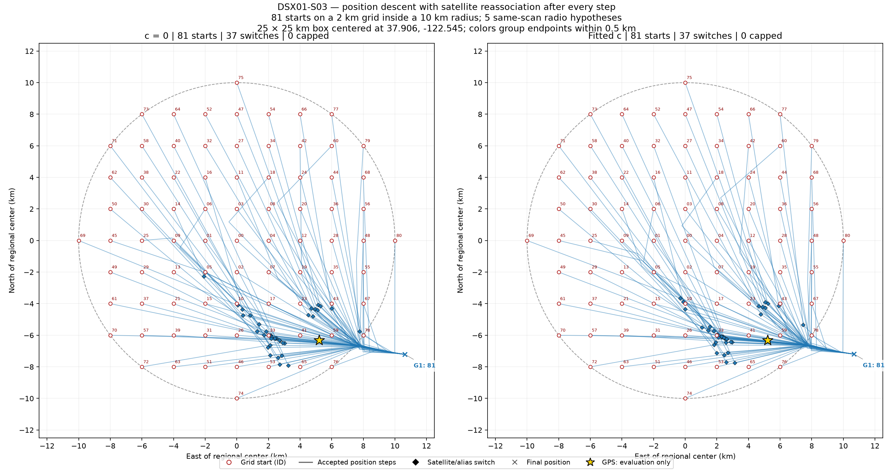
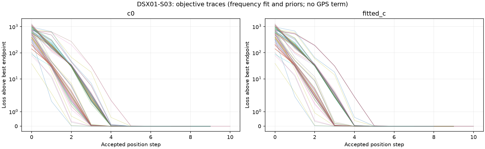
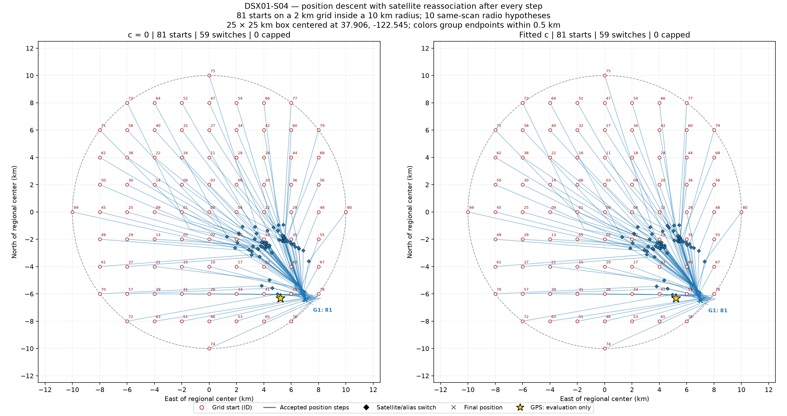
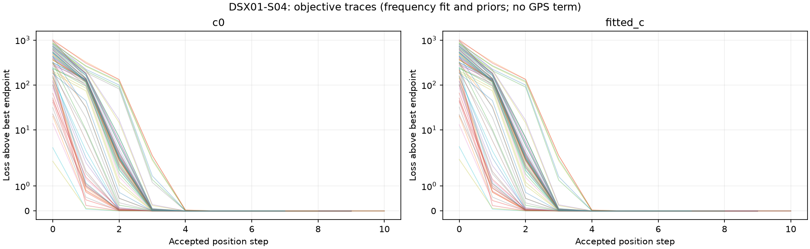
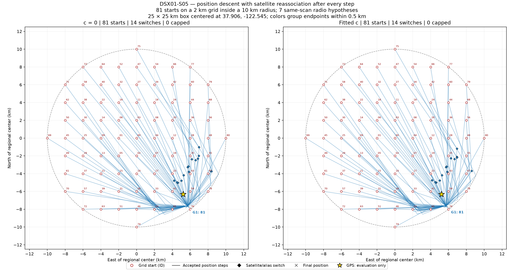
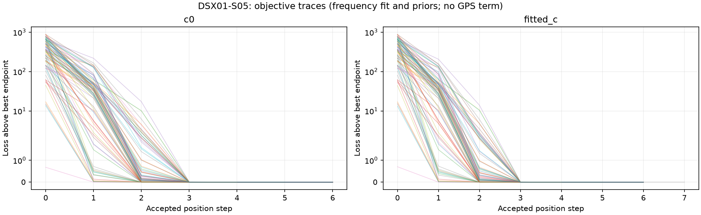

# DSX01: position descent with stepwise satellite reassociation

This is the preceding fixed-zero-expansion experiment. See the [phase-refreshed algorithm and corrected numerical treatment](../2026_10_19_dsx01_phase_refreshed_algorithm/README.md) before interpreting its position accuracy. This compact publication ships figures, summaries and validation receipts; per-start JSON histories remain in the full local archive.

Each scan has 81 position starts on a 2 km grid inside a 10 km disk. The enclosing search box is 25 × 25 km, centered at 37.906, -122.545. All original curved graph observations are retained.

At the initial position and after every accepted damped Gauss–Newton step, the algorithm scores every available satellite/alias hypothesis with the same full normal-model objective, including integrated nuisance priors and noise/complexity terms. A lower-scoring assignment replaces the incumbent. Thus these paths can change satellite identities during descent; they are not descent under one fixed starting assignment.

## Candidate scope and controls

The candidate hypothesis bank is the union of 13 independently cold, same-scan radio discoveries across the region. Those discovery searches examined each scan's complete causal regional satellite catalogue. Only discrete fragment labels and alias integers are reused; all learned phase, receiver calibration, smooth coefficients and positions are discarded. All models are rebuilt with common zero phase references and absolute zero-mean nuisance priors. Duplicate label/alias combinations collapse without positional ranking.

The common zero phase expansion makes branch comparisons reproducible, but is a different numerical linearization from the earlier per-discovery phase-reference experiments. This report therefore does not attribute changes in position error versus those experiments solely to reassociation. A fixed zero expansion is not a requirement that posterior phase be zero: phase and orbital corrections are still inferred under their absolute priors.

This is a finite search over whole-assignment hypotheses. It does not rediscover all catalogue candidates at every step, recombine arbitrary fragments into new hypotheses, or guarantee a global optimum. The 81 position starts share this RF-derived hypothesis bank; they are not 81 independent cold discovery runs. The earlier independent-start results remain intact.

Both c = 0 and fitted-c arms use the same observations, candidates, nuisance priors, initial grid and 64-step budget. Each arm selects its own best available assignment by its model objective. Causal TLE epoch and collection cutoffs are checked against the scan receipt. GPS is read only by this post-fit reporter; it never controls an update, stopping decision, candidate ranking, or restart.

## Results

The best endpoint below is selected by model loss, independently of GPS. Position error is an evaluation statistic. A lower frequency/prior loss does not establish better position accuracy. Association percentages use all original GLRT points as denominator; the objective uses original curved graph observations and final associations must also pass the existing gates.

| Scan | Arm | Hypotheses | Starts <1 km | Median error (km) | Error range (km) | Best-loss error (km) | Best-loss associated points | % all GLRT | Switches | Capped |
|---|---|---:|---:|---:|---:|---:|---:|---:|---:|---:|
| DSX01-S01 | c0 | 8 | 0/81 | 1.117 | 1.117–1.117 | 1.117 | 2646 | 55.16% | 13 | 0 |
| DSX01-S01 | fitted_c | 8 | 0/81 | 1.108 | 1.108–1.108 | 1.108 | 2646 | 55.16% | 13 | 0 |
| DSX01-S02 | c0 | 4 | 0/81 | 1.548 | 1.548–1.548 | 1.548 | 1915 | 54.34% | 17 | 0 |
| DSX01-S02 | fitted_c | 4 | 0/81 | 1.567 | 1.567–1.567 | 1.567 | 1915 | 54.34% | 23 | 0 |
| DSX01-S03 | c0 | 5 | 0/81 | 5.500 | 5.500–5.500 | 5.500 | 2259 | 56.64% | 37 | 0 |
| DSX01-S03 | fitted_c | 5 | 0/81 | 5.542 | 5.542–5.542 | 5.542 | 2259 | 56.64% | 37 | 0 |
| DSX01-S04 | c0 | 10 | 0/81 | 1.835 | 1.835–1.835 | 1.835 | 2309 | 62.09% | 59 | 0 |
| DSX01-S04 | fitted_c | 10 | 0/81 | 1.820 | 1.820–1.820 | 1.820 | 2309 | 62.09% | 59 | 0 |
| DSX01-S05 | c0 | 7 | 0/81 | 1.406 | 1.406–1.406 | 1.406 | 1934 | 47.68% | 14 | 0 |
| DSX01-S05 | fitted_c | 7 | 0/81 | 1.395 | 1.395–1.395 | 1.395 | 1934 | 47.68% | 14 | 0 |

## c ablation: fit and position evaluated separately

The loss includes frequency fit, nuisance integration and complexity terms. Compare its values within a scan; scans contain different observations. The RMS below covers all curved observations, including those rejected by the final gates. Each row uses the lowest-loss endpoint in that arm.

| Scan | c0 loss | Fitted-c loss | Δ loss (fitted − c0) | c0 RMS (Hz) | Fitted-c RMS (Hz) | c0 error (km) | Fitted-c error (km) |
|---|---:|---:|---:|---:|---:|---:|---:|
| DSX01-S01 | 12884.515 | 12896.695 | +12.181 | 355.74 | 355.98 | 1.117 | 1.108 |
| DSX01-S02 | 12135.889 | 12139.477 | +3.588 | 388.12 | 387.97 | 1.548 | 1.567 |
| DSX01-S03 | 13264.818 | 13274.184 | +9.366 | 462.10 | 462.32 | 5.500 | 5.542 |
| DSX01-S04 | 12447.051 | 12455.315 | +8.263 | 209.84 | 209.78 | 1.835 | 1.820 |
| DSX01-S05 | 12303.326 | 12314.673 | +11.347 | 175.53 | 175.53 | 1.406 | 1.395 |

## Reading the figures

Open red circles are actual starting positions, numbered 00–80. Lines join actual accepted position iterates. Diamonds mark accepted changes in satellite labels or aliases; alternatives are rescored even where no diamond appears. Crosses mark final positions. Endpoint colors and G labels describe groups with at most 0.5 km pairwise separation, not proven distinct optima. The gold star is evaluation GPS only. A black square would mark a step-budget termination, which is not convergence. Loss curves show the same objective used to accept position and assignment updates.

## DSX01-S01

## DSX01-S02

## DSX01-S03

## DSX01-S04

## DSX01-S05

## Artifacts and validation

[All 810 endpoints and starting coordinates](endpoints.csv), [summary](summary.json), [protocol](protocol.json), [selected-endpoint gradients and curvature](endpoint_diagnostics.json), [validation and artifact hashes](validation.json). Each per-start JSON contains every accepted position, all candidate scores at that position, actual assignment changes, final labels, calibration state and association gate results. The reporter checks monotonic loss, lowest available branch selection, matched inputs, declared starts and trajectory endpoint identity.
