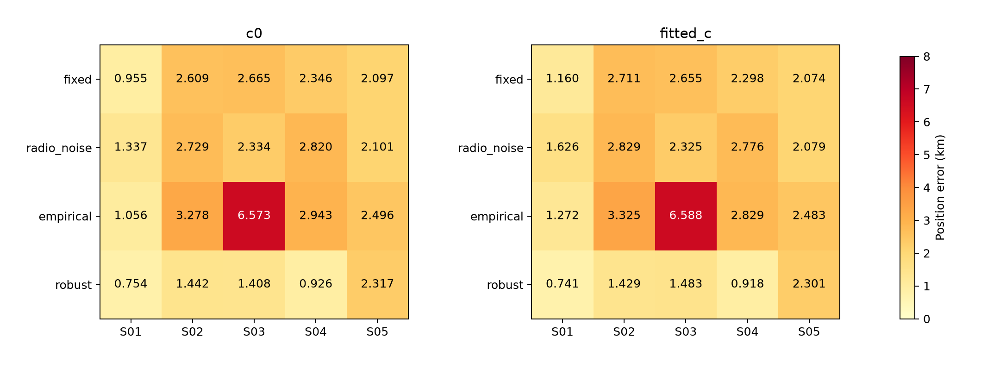
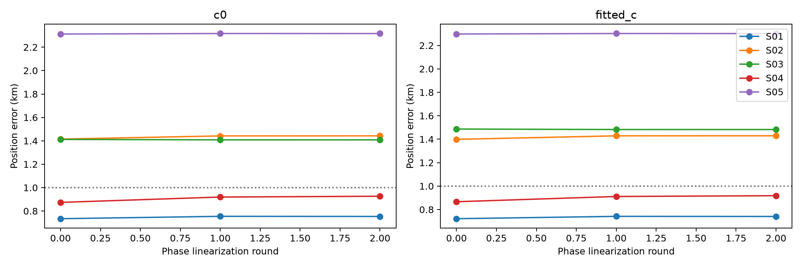
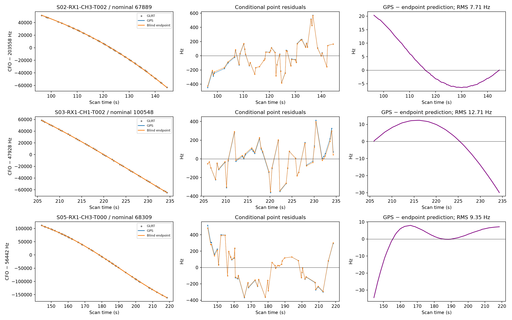
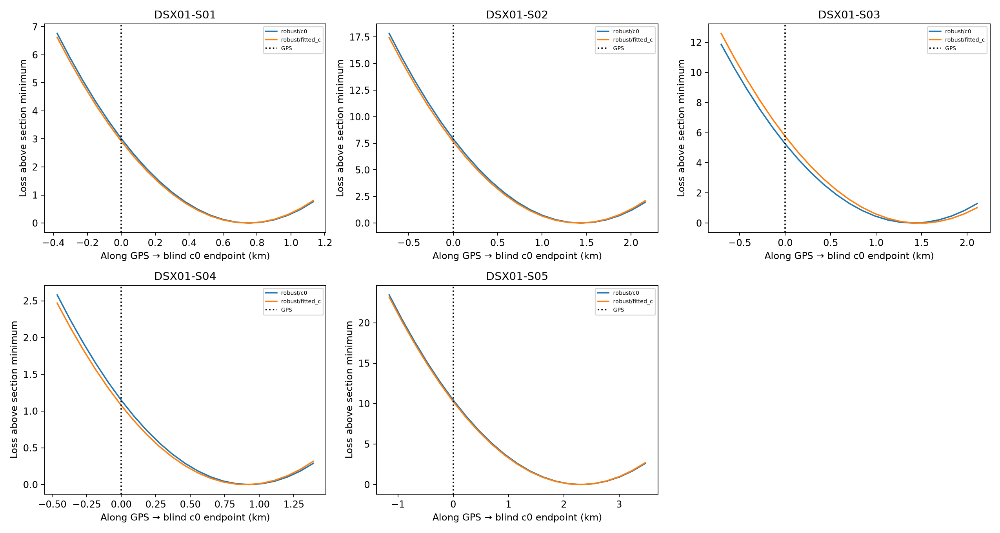

# DSX01: jointly integrating radio and orbital nuisance parameters

A robust joint model reaches approximately 0.74 km on S01 and 0.92 km on S04,
while retaining substantial curved-track coverage. S02, S03 and S05 still
exceed 1 km. The objective of a uniform blind sub-1 km rule across all five
scans is **not achieved** by this checkpoint.

## Why another model?

The [preceding transfer experiment](../2026_10_18_dsx01_clock_transfer/README.md)
tested remeasurement, tighter priors, sparse priors, point contamination,
bounded common UTC corrections and satellite updates across all six parent
algorithms. Cleaner radio measurements and lower fit scores did not reliably
improve position. A possible cause is optimizing shared nuisance parameters
without accounting for the uncertainty volume those parameters introduce.

This iteration tests three remedies and a robust continuation:

1. **Joint Gaussian integration:** integrate the receiver/band offsets,
   receiver drift means and band contrasts, smooth RX errors, satellite phases,
   causal physical orbital modes and fragment constants together. Include the
   covariance determinant rather than treating conditional coefficients as
   unconstrained extra fits.
2. **Radio-only noise estimation:** replace the common 150 Hz noise assumption
   with each scan's leverage-corrected polynomial residual noise, estimated
   before geographic fitting and without satellite residuals or GPS.
3. **Variance-component learning:** fit three positive scales for RX mean
   drift, smooth RX error and physical orbit covariance, including their
   covariance-volume costs.
4. **Robust joint noise:** retain every point, with one Student-noise latent
   precision per original curved fragment. Gaussian/Gamma variational updates
   include conditional coefficient covariance when estimating those precisions.
   This reduces the influence of poorly explained nominations without deleting
   observations or relabelling them.

A further run combines robust noise with variance-component learning. Its
outputs live under `robust_empirical/`; completion status and matched results
must be checked before interpreting that continuation.

## Blind search controls

Inference uses the existing 25 × 25 km square centered at **37.906°, −122.545°**,
with 25 grid nodes, three shared `c=0`-selected local starts and 24 bounded
Gauss–Newton iterations per start and arm. Three phase-linearization rounds
use the `c=0` reference for both arms. The phase prior always remains centered
on **absolute zero**, including after relinearization. Conditional phase
references are clipped to ±14.9 s to remain within the frozen bank; posterior
Gaussian phase coefficients themselves are not truncated.

All 12,724 original actively curved points are retained. Archived-IQ full-band
CFO refinements are applied with failed refinements falling back to original
measurements. No points are withheld. Satellite nominations and integer aliases
come from the same blind parent per scan and remain fixed. This tests the
objective and calibration model, not a fresh exhaustive satellite search.

The comparison uses the latest causal frozen candidate banks and earlier causal
TLE differences for physical uncertainty directions. GPS
**37.849061591561885°, −122.48574968092912°** enters only the reporter and the
explicitly labelled postfit diagnostics. This is independent per-scan inference;
the scans are not tied to a common fitted site in this experiment.

## Model and declared priors

Write the linearized observation model as `y = f(x) + U(x) a + noise`, with
unit-normal nuisance coefficients `a`. For fixed diagonal noise covariance `D`,
the Gaussian search cost contains

`rᵀ(D + UUᵀ)⁻¹r + log det(I + UᵀD⁻¹U)`.

The fixed diagonal determinant is omitted within each search. Therefore raw
costs from different fixed-noise variants must not be compared as evidences.
The fitted covariance scales vary `U`, so their determinant is included.
Two geographic coordinates, or those coordinates plus three hyperparameters,
receive the existing parameter-count × log(point-count) search penalty.
Integrated linear coefficients are not counted again as fitted parameters.

There are four independent RX/band offsets. Their broad proper Gaussian sigma
is the alias period / sqrt(12). RX mean-drift sigma is 10 Hz/s; band-contrast
sigma is 0.5 Hz/s. Smooth-RX sigma is 200 Hz, fragment-constant sigma 1,000 Hz,
and phase sigma uses the causal metadata with a 1 s floor. The fitted-`c` arm
has a proper Gaussian RF-coefficient prior with sigma 200,000; the `c=0` arm
omits that feature. These are declared engineering hypotheses, not calibrated
probabilities. The four offsets and RF feature can be strongly correlated.

Physical orbital covariance currently includes mean-motion, inclination and
RAAN directions for families observed on multiple RX/channel owners. Its
scales are estimated from causal state disagreement with explicit floors.
It does not yet span the full TLE error distribution. Orbital modes and phases
are locally linearized; this is not exact nonlinear orbital marginalization.

The robust version uses Student degrees of freedom 4 and at most 24 variational
updates per evaluation. Its cost is an upper bound to the negative integrated
log likelihood relative to the independent Student densities at zero. It is
not an exactly integrated Student likelihood. Every fragment retains positive
precision. Finite variational and geographic budgets do not prove convergence.

## Completed fixed-scale results

Position errors in km after three linearization rounds:

| Variant / arm | S01 | S02 | S03 | S04 | S05 |
| --- | ---: | ---: | ---: | ---: | ---: |
| Joint Gaussian, 150 Hz, `c=0` | 0.955 | 2.609 | 2.665 | 2.346 | 2.097 |
| Joint Gaussian, 150 Hz, fitted `c` | 1.160 | 2.711 | 2.655 | 2.298 | 2.074 |
| Radio noise, `c=0` | 1.337 | 2.729 | 2.334 | 2.820 | 2.101 |
| Radio noise, fitted `c` | 1.626 | 2.829 | 2.325 | 2.776 | 2.079 |
| Learned variance, `c=0` | 1.056 | 3.278 | 6.573 | 2.943 | 2.496 |
| Learned variance, fitted `c` | 1.272 | 3.325 | 6.588 | 2.829 | 2.483 |
| Robust joint, `c=0` | **0.754** | 1.442 | 1.408 | **0.926** | 2.317 |
| Robust joint, fitted `c` | **0.741** | 1.429 | 1.483 | **0.918** | 2.301 |

Learning variance under a Gaussian model can worsen localization even with
proper volume accounting. S03 reaches 6.57 km and the physical orbit scale
hits its upper bound. This indicates misspecification or incorrect nominations;
it does not establish that the learned uncertainty is physically correct.

The robust model's accepted nominated curved population is:

| Scan | Accepted points | Curves | Native RMS, `c=0` / fitted `c` (Hz) |
| --- | ---: | ---: | ---: |
| S01 | 2,742 | 76 | 98.747 / 98.746 |
| S02 | 1,852 | 51 | 135.454 / 135.402 |
| S03 | 2,338 | 65 | 140.536 / 140.548 |
| S04 | 2,276 | 60 | 118.754 / 118.750 |
| S05 | 2,154 | 56 | 163.050 / 163.047 |

Both arms accept the same curved populations in these robust results. Native
acceptance retains the preceding RMS, bias, residual-structure, visibility and
ownership checks. These are **curved-fragment** counts. Linear-track transfer
and final all-GLRT association were not run. Conditional displayed fragment
means include their constant; gate evaluation instead profiles that constant
once against the hardware/orbit prediction. It is not subtracted twice.

## What drives the wrong position?

At the final robust `c=0` settings, refit all integrated linear modes at GPS
while holding covariance hyperparameters and the phase reference fixed. The
following separates the objective difference, GPS minus blind endpoint:

| Scan | Total score advantage of displaced endpoint | Shared-prior contribution | Covariance-volume contribution |
| --- | ---: | ---: | ---: |
| S01 | 3.014 | 3.838 | −0.020 |
| S02 | 7.917 | −2.480 | −0.540 |
| S03 | 5.256 | 3.680 | 0.038 |
| S04 | 1.147 | −1.966 | −0.270 |
| S05 | 10.442 | 4.531 | −0.081 |

Track contributions additionally include their conditional data, fragment-bias
prior, Student Gamma and visibility terms. The full additive decomposition is
checked against the optimized objective. S01, S03 and S05 show substantial
prior influence; S02 and S04 are driven more by residual improvements. This is
conditional model accounting, not proof that a particular track or satellite
identity is wrong.

Leading individual curve contributions favoring the displaced endpoint include
S02 RX1 CH3 T002 (nominal 67889), S03 RX1 CH1 T002 (nominal 100548), and
S05 RX1 CH3 T000 (nominal 68309). After calibration refits, their GPS-versus-
endpoint predictions differ by only approximately **7.7, 12.7 and 9.4 Hz RMS**,
respectively. Their point residuals vary by hundreds of Hz. The figure exposes
how little discriminating frequency shape remains after nuisance adjustment.
It does not authenticate those satellite labels.

S02 RX1 CH3 T002 and S05 RX1 CH3 T000 fail the final native acceptance checks,
despite native RMS of approximately 199 and 204 Hz; their residual structure
matters. S03 RX1 CH1 T002 passes with approximately 165 Hz RMS. The retained
Student likelihood allows an unaccepted nomination to continue influencing
calibration. Keeping every observation in a likelihood is therefore distinct
from proving it should constrain position. These two failed nominations are
specific targets for candidate and residual-covariance debugging.

The following sections use GPS to define a diagnostic line through each blind
endpoint. Nominations, covariance hyperparameters and phase references are
fixed; integrated coefficients refit at every query. They are not full
geographic profile likelihoods or calibrated position probabilities. The
checkpoint sections include the completed robust fixed-scale model only.

The final fixed robust model's nonlinear-versus-linearized phase-mean differences
are below 0.05 Hz RMS in both arms on all five scans. This check addresses the
conditional mean approximation; it does not validate the full Gaussian
covariance approximation or eliminate TLE errors.

## Evidence, limitations and next experiment

[Evaluation table](evaluation_summary.csv), [matched common-point `c` ablation](c_ablation.csv),
[objective decomposition and native gates](false_basin_drivers.json),
[track-driver arrays](leading_track_drivers.json), and
[line-section samples](postfit_loss_sections.json) separate coverage, frequency
fit, prior effects and position. A lower frequency score alone is not used to
claim improved localization. Candidate labels remain hypotheses.

The numerical kernels are checked against dense Gaussian covariance calculations,
an exact Student limit with no nuisance modes, a small numerical integration
of the shared-nuisance Student likelihood, and additive objective accounting.
The frozen source bundle passes **130 focused tests**. [Source hashes](source_manifest.json)
and [test receipt](frozen_tests.json) identify that bundle. Completed fit scores
are recomputed by the reporter before inclusion; protocols preserve the blind
inputs, matched budgets and source hashes. The standalone numerical corpus is
not duplicated here; upstream frozen files remain required.

[Completed-model validation](completed_models_validation.json) covers 120 fit
records / 60 matched `c` pairs across the four completed variants, all five
scans and three phase-reference rounds. [Frozen-source replay](completed_models_replay.json)
recomputes all 120 objectives and reproduces **11 tables/JSON/figure products
byte for byte**. The bundle contains 343 source snapshots and pins 157 numerical
inputs; the preceding pilot-clock artifacts remain unchanged. The ongoing
robust variance-learning continuation is excluded from that frozen receipt.

The next physical remedy to test is a fuller causal orbital covariance,
including eccentricity-vector directions alongside phase, mean motion,
inclination and RAAN. The current three physical modes cannot express every
shape discrepancy. In parallel, satellite nomination proposals should be
ranked under this same robust integrated objective, rather than accepted solely
because a simpler nomination score improves. Neither remedy is claimed as
implemented or successful in this checkpoint.

A third follow-up is an explicit colored-residual alternative for each curve,
with a covariance-volume penalty, rather than treating structured residuals as
independent Student noise. It must preserve all observations and compare
matched `c` arms; it must not manufacture accuracy by dropping curves selected
using their effect on known position. That would directly test whether failed
noise-screen nominations are pulling the calibration toward the wrong basin.

No RF was collected. Archive paths were read-only. Production analysis,
persisted contracts and golden scientific fixtures were not changed.
