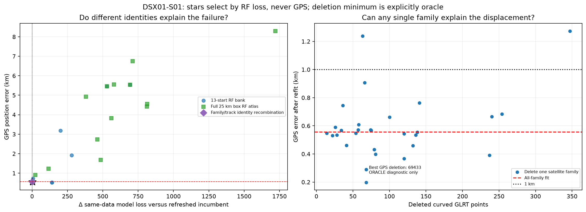
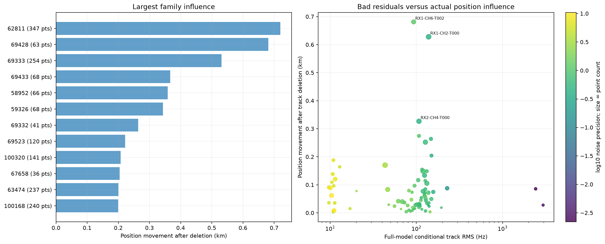
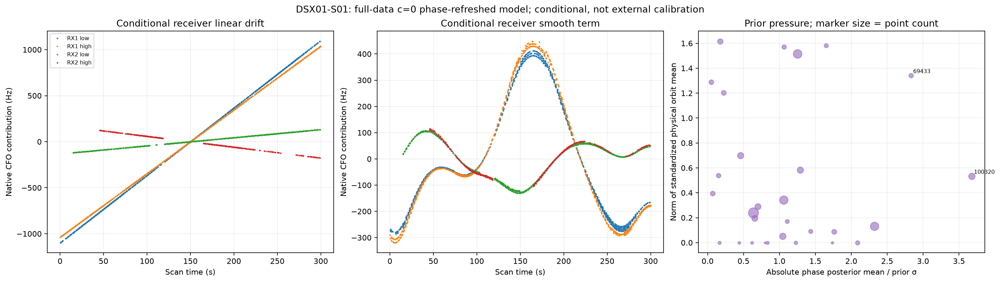
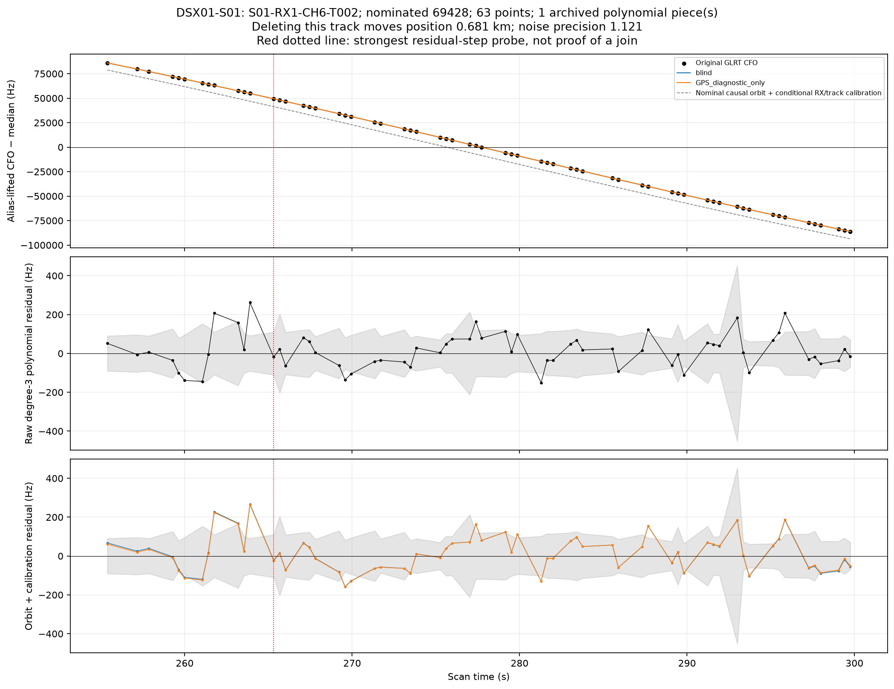
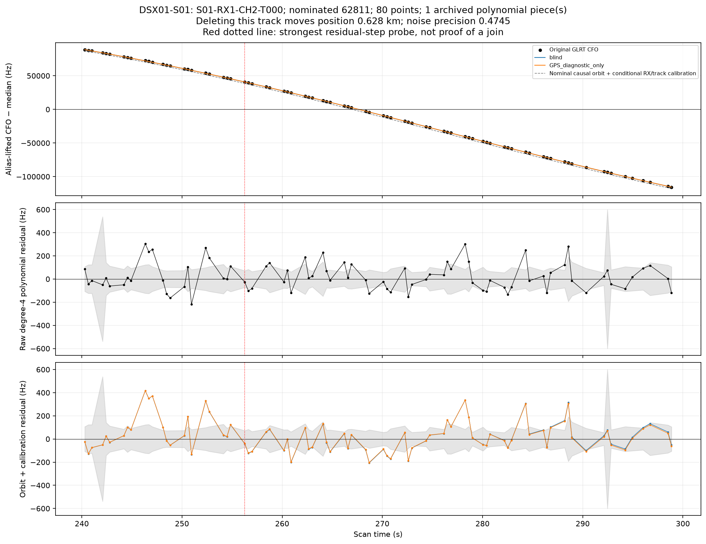
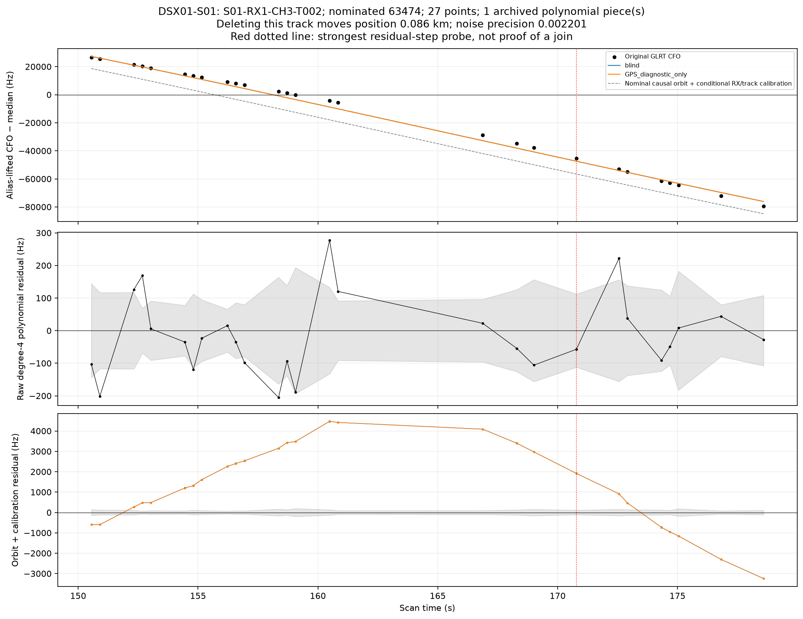

# DSX01-S01: localization root cause

[All-scan report](../README.md)

## Finding and smallest defensible correction

The phase tangent approximation is a confirmed source of bias: refreshing it reduces error from 1.117 to 0.557 km without changing a label, point or prior. The remaining offset is sensitive to several useful families, rather than dominated by the worst residual. Deleting 69433 reaches 0.198 km, but that choice uses GPS and does not authenticate an incorrect identity. Removing the larger 62811 family instead worsens error to 1.274 km. There are no archived multi-piece calibration joins here.

Keep phase refresh and all original points. A one-scalar RF-selected fragment-offset prior of 200 Hz gives 0.477 / 0.435 km (c0 / fitted c). This is a parsimonious candidate for testing on unseen scans, not evidence for deleting a particular satellite. It also raises c0 unweighted all-point CFO RMS from 362 to 889 Hz: the robust frequency/prior bound can favor tighter constants while accommodating badly explained fragments through lower noise precision. This is not an improvement in explaining every point, and should not be promoted on position error alone.

## Controlled position results

Errors below are **c0 / fitted c**, km. GPS is evaluation only.

| Intervention | Position error (km) | Interpretation |
|---|---:|---|
| Fixed zero phase expansion | 1.117 / 1.108 | Earlier joint-descent model |
| Phase refresh, same labels and priors | 0.557 / 0.546 | Numerical correction only |
| Best single-family deletion by GPS | 0.198 (c0) | ORACLE diagnostic: delete 69433, 68 points |
| Best single-track deletion by GPS | 0.296 (c0) | ORACLE diagnostic: delete S01-RX1-CH2-T002 |
| Expanded RF pool, retaining incumbent | 0.557 / 0.546 | RF-selected phase-refreshed incumbent; atlas adds 15 hypotheses |
| RF-learned independent offset σ=200 Hz | 0.477 / 0.435 | One learned scalar; no GPS selection |

Deletion experiments preserve the original nuisance prior support for all remaining observations. Their losses cannot be compared across different observation masks. A deletion improving GPS error is evidence of influence, not authentication that a satellite identity is wrong.

## Satellite and track evidence

Largest family movements are listed below, selected without GPS. Several influential constraints can pull toward the correct position.

| Deleted family | Points | Position movement (km) | GPS error after deletion (km) |
|---|---:|---:|---:|
| 62811 | 347 | 0.720 | 1.274 |
| 69428 | 63 | 0.681 | 1.238 |
| 69333 | 254 | 0.531 | 0.685 |
| 69433 | 68 | 0.367 | 0.198 |
| 58952 | 66 | 0.359 | 0.907 |
| 59326 | 68 | 0.343 | 0.289 |
| 69332 | 41 | 0.264 | 0.461 |
| 69523 | 120 | 0.222 | 0.367 |

## Why frequency fit prefers the displaced endpoint

Positive bars mean a term penalizes the GPS coordinate more than the blind minimum after re-profiling nuisance coefficients at both positions. The right-hand plot omits shared calibration, Gamma penalties and log-volume; it is a partial family decomposition, not a satellite probability.

These are conditional fitted coefficients under engineering priors. Their size does not establish actual hardware drift or actual orbit error. Each receiver has a mean linear drift and band contrast; offsets are separate for the four receiver/band groups. Smooth terms can absorb position-dependent Doppler. A large prior pull identifies model pressure, not an authenticated bad identity.

## General model controls

All rows below preserve the same points, candidate identities and aliases. Only the declared nuisance model or prior changes. The score change is c0 relative to phase refresh; smaller loss does not establish better position.

| Model | Error c0 / fitted c (km) | RMS c0 / fitted c (Hz) | c0 Δ loss | fitted-c Δ loss |
|---|---:|---:|---:|---:|
| zero phase expansion | 1.117 / 1.108 | 355.74 / 355.98 | +10.409 | +10.379 |
| phase refresh | 0.557 / 0.546 | 362.03 / 362.29 | +0.000 | +0.000 |
| drift_1 | 1.111 / 1.105 | 362.13 / 362.31 | +26.920 | +26.987 |
| phase_3 | 0.384 / 0.388 | 361.95 / 362.24 | +13.261 | +13.224 |
| bias_3 | 0.718 / 0.718 | 337.83 / 337.84 | +94.547 | +92.553 |
| orbit_3 | 0.603 / 0.597 | 362.35 / 362.61 | +7.707 | +7.702 |
| eccentric | 0.491 / 0.480 | 362.12 / 362.38 | -3.009 | -3.013 |
| native_band | 1.718 / 1.714 | 363.95 / 364.04 | -17.648 | -17.536 |
| colored | 1.571 / 1.553 | 597.12 / 599.22 | -21.066 | -21.365 |
| independent_bias_300 | 0.428 / 0.393 | 872.38 / 875.11 | -83.619 | -84.727 |
| smooth_20 | 1.320 / 1.326 | 367.49 / 367.86 | +89.607 | +89.518 |
| linear_radio_only | 1.566 / 1.573 | 371.14 / 371.53 | +152.186 | +152.115 |
| independent_band_drift_2 | 0.895 / 0.887 | 362.16 / 362.37 | +12.566 | +12.614 |
| phase_orbit_3 | 0.758 / 0.775 | 362.53 / 362.81 | +18.886 | +18.846 |
| smooth20_independent2 | 1.357 / 1.360 | 367.71 / 368.05 | +105.615 | +105.576 |
| hierarchical_clock_300 | 0.439 / 0.392 | 857.31 / 861.31 | -65.679 | -67.198 |
| orbit_floor_0.1_0.05 | 0.552 / 0.541 | 362.03 / 362.29 | +0.287 | +0.282 |
| orbit_floor_0.5_0.25 | 0.778 / 0.766 | 362.05 / 362.33 | -0.678 | -0.708 |
| orbit_floor_1.0_0.5 | 1.003 / 0.995 | 362.32 / 362.57 | +5.086 | +5.081 |

The RF-selected common fragment-offset scale is an additional one-scalar empirical-Bayes experiment, shown in the all-scan scale figure. All physical orbit-floor experiments leave the nominal causal TLE unchanged and add no coefficients. The expanded eccentricity control does add two supported-satellite physical modes; its Gaussian integration includes a volume penalty.

## Multiple-family and receiver/time controls

The three most influential families were selected by position movement, not GPS improvement. All three pairs and their triple were then removed. This is a bounded influence probe, not exhaustive multi-satellite subset search.

| Deleted families | Points removed | Error c0 / fitted c (km) |
|---|---:|---:|
| 62811, 69428 | 410 | 1.692 / 1.699 |
| 62811, 69333 | 601 | 1.212 / 1.234 |
| 69428, 69333 | 317 | 1.128 / 1.118 |
| 62811, 69428, 69333 | 664 | 1.591 / 1.613 |

| Deleted receiver/band or time group | Points removed | Error c0 / fitted c (km) |
|---|---:|---:|
| RX1_B0 | 967 | 1.360 / 1.350 |
| RX1_B1 | 793 | 1.841 / 1.833 |
| RX2_B0 | 694 | 1.081 / 1.058 |
| RX2_B1 | 455 | 0.509 / 0.508 |
| time_0_100 | 957 | 0.380 / 0.374 |
| time_100_200 | 951 | 0.803 / 0.767 |
| time_200_300 | 1001 | 2.013 / 2.059 |

## Calibration membership and joins

| RF-only calibration policy | Calibrating points | Error c0 / fitted c (km) |
|---|---:|---:|
| remeasured_curvature | 2909 | 0.557 / 0.546 |
| endpoint_stable_curvature | 2606 | 0.654 / 0.641 |
| all_RF_association_gates | 2646 | 0.934 / 0.911 |
| stable_curvature_and_gates | 2401 | 0.919 / 0.903 |

There are **0 archived multi-piece calibration tracks** in this scan. A single polynomial can still contain a misclustered point; zero archived joins does not prove every original point assignment correct. Split probes test the three strongest residual-step candidates and every archived join. A residual step can also indicate orbit mismatch. Each new calibration piece must retain at least 20 s and 250 Hz RMS departure from an affine line, so a split cannot introduce linear-only offset calibrators.

| Split target | Cut | Result |
|---|---:|---|
| S01-RX1-CH3-T002 | point 19 | Ineligible: each calibration piece must retain active curvature |
| S01-RX1-CH8-T006 | point 14 | Ineligible: each calibration piece must retain active curvature |
| S01-RX2-CH7-T000 | point 8 | Ineligible: each calibration piece must retain active curvature |

The split comparison uses the full normalized variational bound and an additional `3 log(n)` cut-search penalty because splitting changes the noise-group normalization. No original point is dropped or duplicated.

## Original GLRT evidence and 20-second views

Tracks below were chosen by largest deletion influence, largest residual-step evidence, and archived join membership—not by GPS improvement. The blue/orange model curves include orbit and fitted calibration; the nominal causal-orbit curve uses the same conditional calibration for display. GPS curves are post-fit diagnostics. A polynomial and an orbital model test different things.

### S01-RX1-CH6-T002

[Original CFO in 20-second segments](zoom20_S01-RX1-CH6-T002.png)

### S01-RX1-CH2-T000

[Original CFO in 20-second segments](zoom20_S01-RX1-CH2-T000.png)

### S01-RX1-CH3-T002

[Original CFO in 20-second segments](zoom20_S01-RX1-CH3-T002.png)
