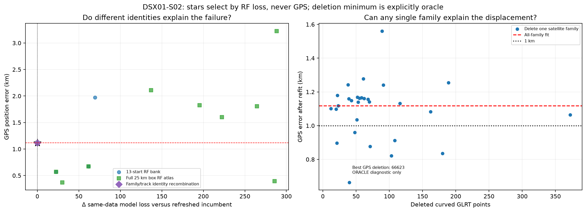
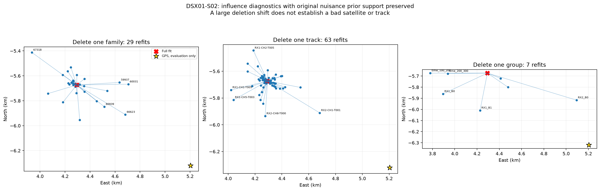
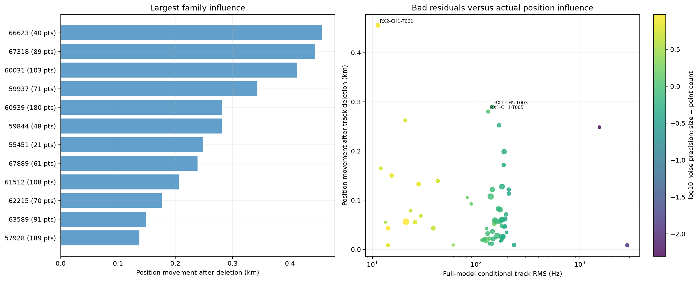
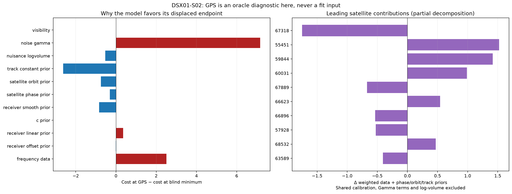
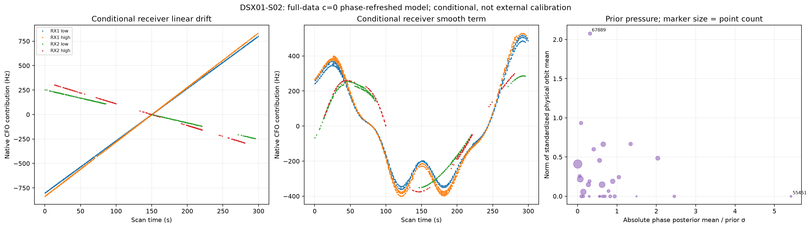
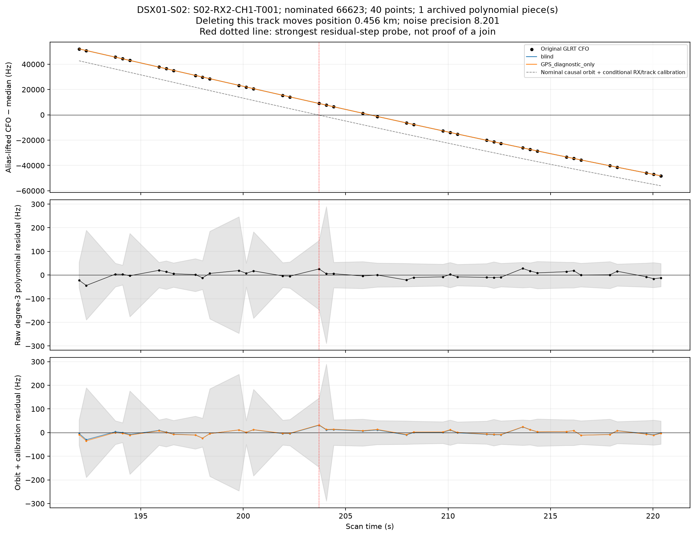
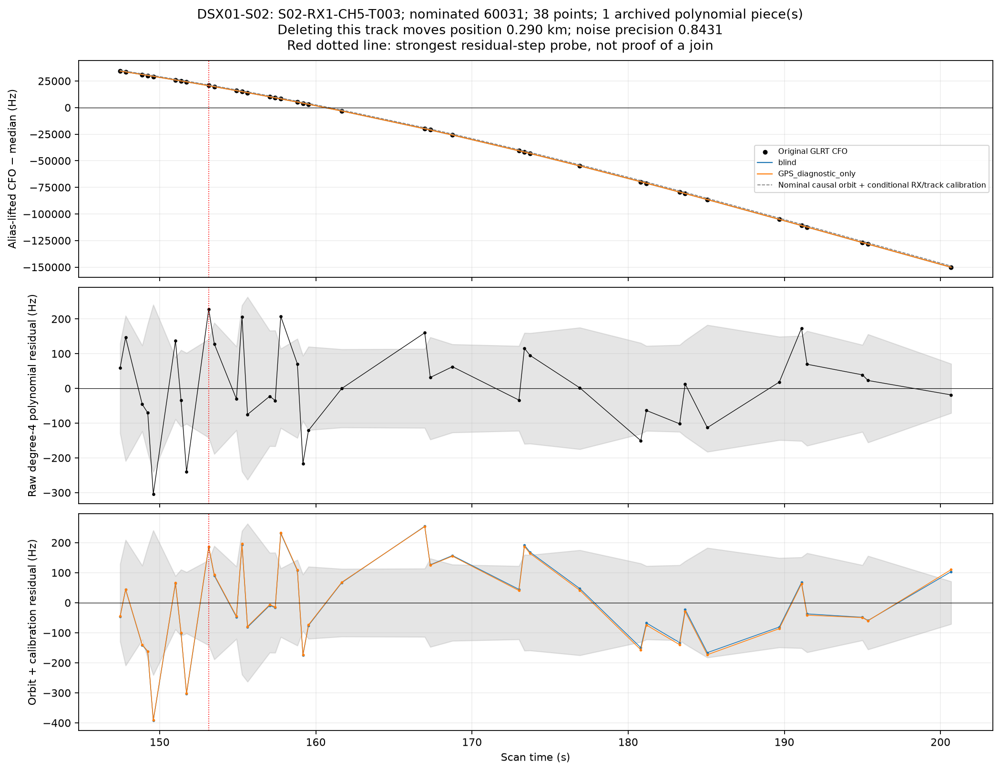
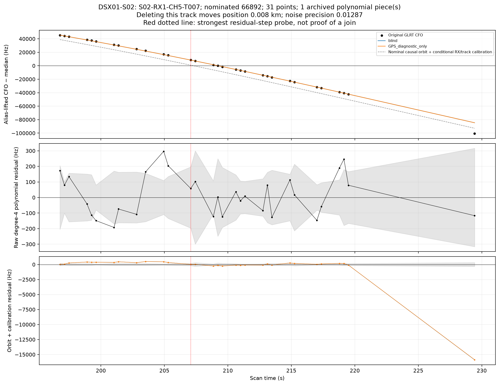

# DSX01-S02: localization root cause

[All-scan report](../README.md)

## Finding and smallest defensible correction

Phase refresh removes part of the bias (1.548 to 1.117 km). A single-family deletion can reach 0.664 km by removing 66623, but that is a 40-point single-track constraint, and a GPS improvement is insufficient to prove its identity wrong. No archived multi-piece calibration join exists. Radio covariance and prior assumptions have greater demonstrated leverage: a 1 Hz/s receiver mean-drift prior reaches 0.252 km, and the fixed OU noise control reaches 0.103 km. These hypotheses remain unverified hardware/noise explanations; their success on this scan alone is not validation.

The RF-selected 300 Hz independent track-offset scale reaches 0.424 / 0.560 km with no deletions or new per-track coefficients. Prefer this measured simple candidate over a GPS-based satellite blacklist. Independently validate noise correlation and receiver drift before adopting the more impressive OU result.

## Controlled position results

Errors below are **c0 / fitted c**, km. GPS is evaluation only.

| Intervention | Position error (km) | Interpretation |
|---|---:|---|
| Fixed zero phase expansion | 1.548 / 1.567 | Earlier joint-descent model |
| Phase refresh, same labels and priors | 1.117 / 1.159 | Numerical correction only |
| Best single-family deletion by GPS | 0.664 (c0) | ORACLE diagnostic: delete 66623, 40 points |
| Best single-track deletion by GPS | 0.664 (c0) | ORACLE diagnostic: delete S02-RX2-CH1-T001 |
| Expanded RF pool, retaining incumbent | 1.117 / 1.159 | RF-selected phase-refreshed incumbent; atlas adds 10 hypotheses |
| RF-learned independent offset σ=300 Hz | 0.424 / 0.560 | One learned scalar; no GPS selection |

Deletion experiments preserve the original nuisance prior support for all remaining observations. Their losses cannot be compared across different observation masks. A deletion improving GPS error is evidence of influence, not authentication that a satellite identity is wrong.

## Satellite and track evidence

Largest family movements are listed below, selected without GPS. Several influential constraints can pull toward the correct position.

| Deleted family | Points | Position movement (km) | GPS error after deletion (km) |
|---|---:|---:|---:|
| 66623 | 40 | 0.456 | 0.664 |
| 67318 | 89 | 0.443 | 1.561 |
| 60031 | 103 | 0.413 | 0.822 |
| 59937 | 71 | 0.343 | 0.877 |
| 60939 | 180 | 0.282 | 0.836 |
| 59844 | 48 | 0.281 | 0.960 |
| 55451 | 21 | 0.249 | 0.897 |
| 67889 | 61 | 0.239 | 1.278 |

## Why frequency fit prefers the displaced endpoint

Positive bars mean a term penalizes the GPS coordinate more than the blind minimum after re-profiling nuisance coefficients at both positions. The right-hand plot omits shared calibration, Gamma penalties and log-volume; it is a partial family decomposition, not a satellite probability.

These are conditional fitted coefficients under engineering priors. Their size does not establish actual hardware drift or actual orbit error. Each receiver has a mean linear drift and band contrast; offsets are separate for the four receiver/band groups. Smooth terms can absorb position-dependent Doppler. A large prior pull identifies model pressure, not an authenticated bad identity.

## General model controls

All rows below preserve the same points, candidate identities and aliases. Only the declared nuisance model or prior changes. The score change is c0 relative to phase refresh; smaller loss does not establish better position.

| Model | Error c0 / fitted c (km) | RMS c0 / fitted c (Hz) | c0 Δ loss | fitted-c Δ loss |
|---|---:|---:|---:|---:|
| zero phase expansion | 1.548 / 1.567 | 388.12 / 387.97 | +15.917 | +16.437 |
| phase refresh | 1.117 / 1.159 | 389.99 / 389.67 | +0.000 | +0.000 |
| drift_1 | 0.252 / 0.279 | 389.17 / 388.83 | +6.295 | +6.688 |
| phase_3 | 1.167 / 1.215 | 390.76 / 390.37 | +15.170 | +16.636 |
| bias_3 | 1.733 / 1.737 | 387.84 / 387.94 | +82.690 | +87.664 |
| orbit_3 | 1.355 / 1.408 | 387.85 / 387.41 | -1.266 | -0.635 |
| eccentric | 1.191 / 1.235 | 389.45 / 389.09 | -1.597 | -1.409 |
| native_band | 0.660 / 0.676 | 389.69 / 389.39 | +37.652 | +38.461 |
| colored | 0.103 / 0.206 | 471.89 / 463.80 | -299.896 | -297.900 |
| independent_bias_300 | 0.424 / 0.560 | 391.94 / 392.64 | -23.740 | -67.934 |
| smooth_20 | 1.163 / 1.219 | 391.93 / 391.68 | +165.747 | +165.086 |
| linear_radio_only | 1.396 / 1.459 | 392.75 / 392.49 | +218.271 | +216.711 |
| independent_band_drift_2 | 0.437 / 0.478 | 389.44 / 389.11 | +5.357 | +5.722 |
| phase_orbit_3 | 1.423 / 1.490 | 388.51 / 388.02 | +13.867 | +15.889 |
| smooth20_independent2 | 0.824 / 0.878 | 391.70 / 391.44 | +168.768 | +168.232 |
| hierarchical_clock_300 | 0.957 / 1.002 | 391.36 / 392.51 | -30.182 | -63.653 |
| orbit_floor_0.1_0.05 | 1.081 / 1.125 | 390.01 / 389.69 | -0.659 | -0.444 |
| orbit_floor_0.5_0.25 | 0.859 / 0.903 | 389.63 / 389.32 | -2.713 | -0.808 |
| orbit_floor_1.0_0.5 | 1.202 / 1.236 | 387.87 / 387.51 | -1.522 | +0.859 |

The RF-selected common fragment-offset scale is an additional one-scalar empirical-Bayes experiment, shown in the all-scan scale figure. All physical orbit-floor experiments leave the nominal causal TLE unchanged and add no coefficients. The expanded eccentricity control does add two supported-satellite physical modes; its Gaussian integration includes a volume penalty.

## Multiple-family and receiver/time controls

The three most influential families were selected by position movement, not GPS improvement. All three pairs and their triple were then removed. This is a bounded influence probe, not exhaustive multi-satellite subset search.

| Deleted families | Points removed | Error c0 / fitted c (km) |
|---|---:|---:|
| 66623, 67318 | 129 | 1.281 / 1.310 |
| 66623, 60031 | 143 | 0.523 / 0.579 |
| 67318, 60031 | 192 | 1.359 / 1.365 |
| 66623, 67318, 60031 | 232 | 1.169 / 1.200 |

| Deleted receiver/band or time group | Points removed | Error c0 / fitted c (km) |
|---|---:|---:|
| RX1_B0 | 852 | 1.387 / 1.443 |
| RX1_B1 | 957 | 1.025 / 1.048 |
| RX2_B0 | 329 | 0.419 / 0.500 |
| RX2_B1 | 179 | 0.892 / 0.893 |
| time_0_100 | 916 | 0.994 / 1.145 |
| time_100_200 | 754 | 1.564 / 1.639 |
| time_200_300 | 647 | 1.420 / 1.219 |

## Calibration membership and joins

| RF-only calibration policy | Calibrating points | Error c0 / fitted c (km) |
|---|---:|---:|
| remeasured_curvature | 2317 | 1.117 / 1.159 |
| endpoint_stable_curvature | 2123 | 0.995 / 0.981 |
| all_RF_association_gates | 1973 | 1.422 / 1.463 |
| stable_curvature_and_gates | 1800 | 1.421 / 1.409 |

There are **0 archived multi-piece calibration tracks** in this scan. A single polynomial can still contain a misclustered point; zero archived joins does not prove every original point assignment correct. Split probes test the three strongest residual-step candidates and every archived join. A residual step can also indicate orbit mismatch. Each new calibration piece must retain at least 20 s and 250 Hz RMS departure from an affine line, so a split cannot introduce linear-only offset calibrators.

| Split target | Cut | Result |
|---|---:|---|
| S02-RX1-CH5-T007 | point 12 | Ineligible: each calibration piece must retain active curvature |
| S02-RX1-CH5-T002 | point 8 | Ineligible: each calibration piece must retain active curvature |
| S02-RX1-CH7-T000 | point 12 | Ineligible: each calibration piece must retain active curvature |

The split comparison uses the full normalized variational bound and an additional `3 log(n)` cut-search penalty because splitting changes the noise-group normalization. No original point is dropped or duplicated.

## Original GLRT evidence and 20-second views

Tracks below were chosen by largest deletion influence, largest residual-step evidence, and archived join membership—not by GPS improvement. The blue/orange model curves include orbit and fitted calibration; the nominal causal-orbit curve uses the same conditional calibration for display. GPS curves are post-fit diagnostics. A polynomial and an orbital model test different things.

### S02-RX2-CH1-T001

[Original CFO in 20-second segments](zoom20_S02-RX2-CH1-T001.png)

### S02-RX1-CH5-T003

[Original CFO in 20-second segments](zoom20_S02-RX1-CH5-T003.png)

### S02-RX1-CH5-T007

[Original CFO in 20-second segments](zoom20_S02-RX1-CH5-T007.png)
