# DSX01: why the graph localization endpoints remain displaced

Publication companion: [full phase-refreshed algorithm, equations and recommendations](../2026_10_19_dsx01_phase_refreshed_algorithm/README.md). This compact remote publication includes every figure and linked result table. Large per-run JSON design matrices and logs remain in the local archived analysis; original validation hashes bind that larger archive. The [publication manifest](../2026_10_19_dsx01_phase_refreshed_algorithm/publication_manifest.json) separately binds files shipped here. Reproduction commands below refer to the full local analysis environment, whose dependency graph is not part of this documentation-only commit.

**18 October 2026 · all five scans · causal TLEs · matched c=0 / fitted-c controls**

The major confirmed numerical error source is a phase tangent expansion held at zero while fitting phases of several seconds. Updating the expansion without moving the absolute prior reduces S03's error from 5.500 to 1.571 km and S01's from 1.117 to 0.557 km. The remaining failures are model-sensitive. The tests do not support attributing every scan to one bad satellite or an incorrect track join, and do not establish a universal sub-km correction.

A simple RF-selected common fragment-offset scale helps S01, S02 and S05, but worsens S03. S04 remains unresolved. More flexible orbital or receiver models can improve frequency fit while worsening position. The per-scan diagnoses below distinguish measured numerical causes, model sensitivity and unverified physical explanations.

## Main controlled results

Each cell is **position error c0 / fitted c**, in km. All fits here use the same original curved GLRT observations and baseline satellite labels. The last column learns one common offset scale using only the c0 RF bound; both c arms then use that same scale. It is a separate prototype, not a GPS-selected winner.

| Scan | Previous zero expansion | Phase refresh | RF-selected offset σ | Phase refresh + selected σ |
|---|---:|---:|---:|---:|
| [S01](DSX01-S01/README.md) | 1.117 / 1.108 | 0.557 / 0.546 | 200 Hz | 0.477 / 0.435 |
| [S02](DSX01-S02/README.md) | 1.548 / 1.567 | 1.117 / 1.159 | 300 Hz | 0.424 / 0.560 |
| [S03](DSX01-S03/README.md) | 5.500 / 5.542 | 1.571 / 1.630 | 300 Hz | 1.818 / 1.857 |
| [S04](DSX01-S04/README.md) | 1.835 / 1.820 | 1.848 / 1.877 | 300 Hz | 1.647 / 1.878 |
| [S05](DSX01-S05/README.md) | 1.406 / 1.395 | 1.887 / 1.870 | 100 Hz | 0.998 / 1.010 |

## c ablation: frequency score and position are separate

Both arms share points, labels, aliases, other priors and search budgets. The loss includes the nuisance integration penalty, so an extra fitted coefficient can improve residuals while increasing loss. RMS includes all original curved points, including strongly downweighted fragments. The offset-scale rows use the common scale selected by c0 RF evidence.

| Scan | Model | Δ loss (fitted c − c0) | RMS c0 / fitted c (Hz) | Error c0 / fitted c (km) |
|---|---|---:|---:|---:|
| S01 | Phase refresh | +12.211 | 362.03 / 362.29 | 0.557 / 0.546 |
| S01 | Offset σ=200 Hz | +7.892 | 888.85 / 891.89 | 0.477 / 0.435 |
| S02 | Phase refresh | +3.068 | 389.99 / 389.67 | 1.117 / 1.159 |
| S02 | Offset σ=300 Hz | -41.126 | 391.94 / 392.64 | 0.424 / 0.560 |
| S03 | Phase refresh | +8.289 | 461.00 / 461.25 | 1.571 / 1.630 |
| S03 | Offset σ=300 Hz | -28.448 | 462.93 / 462.83 | 1.818 / 1.857 |
| S04 | Phase refresh | +8.737 | 210.20 / 210.18 | 1.848 / 1.877 |
| S04 | Offset σ=300 Hz | -14.497 | 212.16 / 211.81 | 1.647 / 1.878 |
| S05 | Phase refresh | +11.347 | 174.99 / 174.99 | 1.887 / 1.870 |
| S05 | Offset σ=100 Hz | +8.701 | 178.14 / 178.28 | 0.998 / 1.010 |

## Phase approximation and nuisance confounding

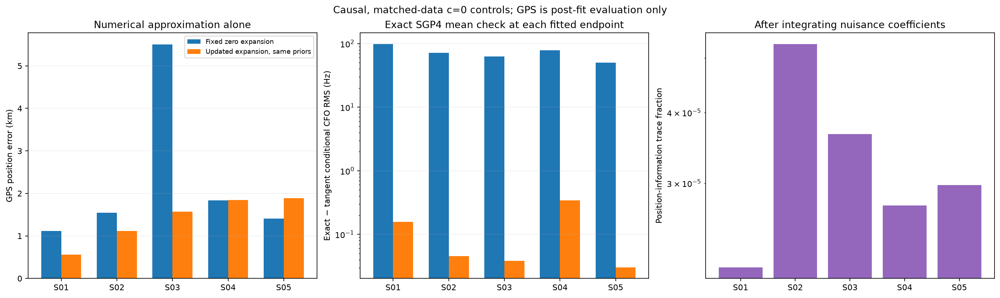

The exact-minus-tangent check uses the same fitted physical orbit correction and evaluates its conditional SGP4 mean. CFO discrepancy falls from 49.9–98.3 Hz to 0.030–0.342 Hz. This establishes numerical agreement, not truth of the causal TLE. S05 becomes less accurate after the numerical correction, exposing a bias that had partly cancelled the old approximation error. The right panel is a local Schur-complement information diagnostic: nuisance integration retains only 2.1–5.3 × 10⁻⁵ of the known-nuisance trace. This shows strong local confounding; it is not a calibrated confidence interval or a proof that accurate localization is impossible.

## Did descent actually converge?

The [preceding stepwise-reassociation experiment](../2026_10_18_dsx01_joint_descent/README.md) ran 81 starts per scan and c arm inside the 10 km disk (810 paths total). Within each scan/arm the endpoints agreed within 0.08 m; none reached the outer step cap. It converged tightly to a displaced solution under that finite-hypothesis objective. Restart agreement does not establish geographic accuracy.

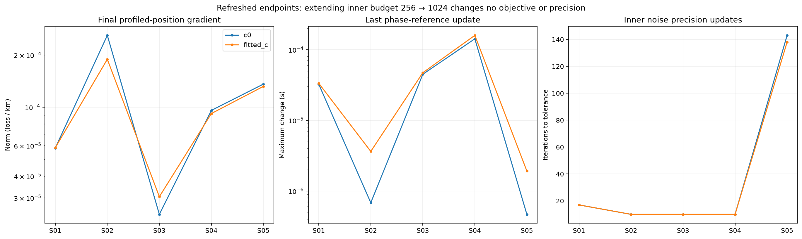

For the refreshed model, all ten endpoints also have small profiled-position gradients and small final phase-reference changes. Increasing the inner precision-update budget from 256 to 1024 changes neither objective nor noise precision: the updates already stop at their tolerance. These checks support focusing on approximation/model bias rather than simply spending more iterations at the same endpoints. They do not certify a global optimum over all possible satellite combinations.

## Scan-by-scan diagnosis

### [DSX01-S01](DSX01-S01/README.md)

The phase tangent approximation is a confirmed source of bias: refreshing it reduces error from 1.117 to 0.557 km without changing a label, point or prior. The remaining offset is sensitive to several useful families, rather than dominated by the worst residual. Deleting 69433 reaches 0.198 km, but that choice uses GPS and does not authenticate an incorrect identity. Removing the larger 62811 family instead worsens error to 1.274 km. There are no archived multi-piece calibration joins here.

Keep phase refresh and all original points. A one-scalar RF-selected fragment-offset prior of 200 Hz gives 0.477 / 0.435 km (c0 / fitted c). This is a parsimonious candidate for testing on unseen scans, not evidence for deleting a particular satellite. It also raises c0 unweighted all-point CFO RMS from 362 to 889 Hz: the robust frequency/prior bound can favor tighter constants while accommodating badly explained fragments through lower noise precision. This is not an improvement in explaining every point, and should not be promoted on position error alone.

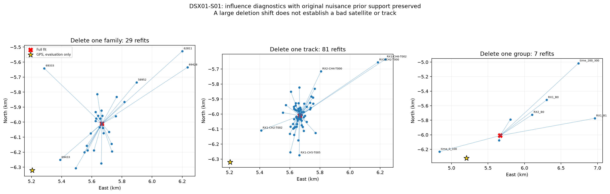

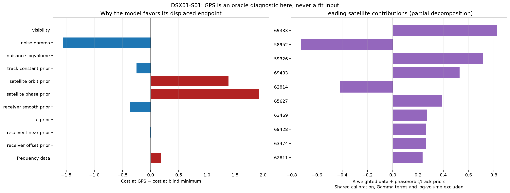

### [DSX01-S02](DSX01-S02/README.md)

Phase refresh removes part of the bias (1.548 to 1.117 km). A single-family deletion can reach 0.664 km by removing 66623, but that is a 40-point single-track constraint, and a GPS improvement is insufficient to prove its identity wrong. No archived multi-piece calibration join exists. Radio covariance and prior assumptions have greater demonstrated leverage: a 1 Hz/s receiver mean-drift prior reaches 0.252 km, and the fixed OU noise control reaches 0.103 km. These hypotheses remain unverified hardware/noise explanations; their success on this scan alone is not validation.

The RF-selected 300 Hz independent track-offset scale reaches 0.424 / 0.560 km with no deletions or new per-track coefficients. Prefer this measured simple candidate over a GPS-based satellite blacklist. Independently validate noise correlation and receiver drift before adopting the more impressive OU result.


### [DSX01-S03](DSX01-S03/README.md)

The original 5.500 km error was largely numerical: phase refresh reaches 1.571 km. The remaining displacement is not explained solely by any one tested satellite family: the best single-family deletion still has 1.051 km error. Removing the largest-influence pair/triple does not resolve it either. The only archived join, RX1 CH4 T002, can be separated into actively curved pieces, but the point-preserving refit worsens error to 1.649 km. Rechecking active curvature excludes one 19-point track and barely changes error (1.554 km). At GPS the weighted frequency-data cost is actually lower, while the total prior/Gamma/log-volume objective prefers the displaced endpoint. This directly implicates model regularization/calibration ambiguity in addition to the corrected phase approximation.

A 20 Hz receiver-smooth prior reaches 0.438 km without adding coefficients, but worsens the RF objective by about 183; selecting it because of GPS would be oracle tuning. The RF-selected offset scale and a lower-loss alternate identity both worsen position. Keep the numerical correction; obtain independent receiver stability constraints before claiming a remaining sub-km solution.

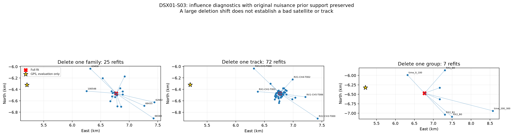

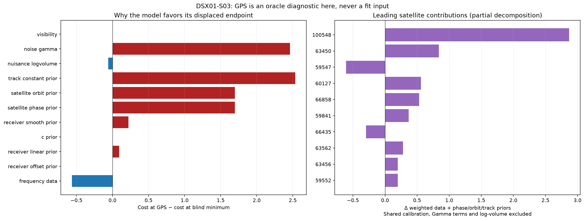

### [DSX01-S04](DSX01-S04/README.md)

This is the clearest unresolved case. Phase refresh leaves approximately the same 1.85 km displacement. No single family deletion reaches 1 km, no archived multi-piece calibration join exists, and the most influential individual track moves the fit by less than 0.41 km. Removing the large 59540 family (415 points) worsens error to 2.860 km. The full-box atlas contributes 23 distinct hypotheses; its own best candidate has 2.702 km error and worse RF loss than the retained incumbent. Thus expanding this finite pool is not a solution. These experiments cannot rule out an untested joint identity combination or actual causal-orbit error.

A linear-only receiver calibration reaches 1.124 km, RF-gated calibrators reach 1.376 km, and an RF-selected 300 Hz track-offset scale reaches 1.647 / 1.878 km. None is a demonstrated sub-km correction. Do not force a TLE adjustment or discard the strongest family to manufacture agreement. The next discriminating evidence is independently measured calibration stability or a better validated causal orbital covariance, followed by broader joint identity search.

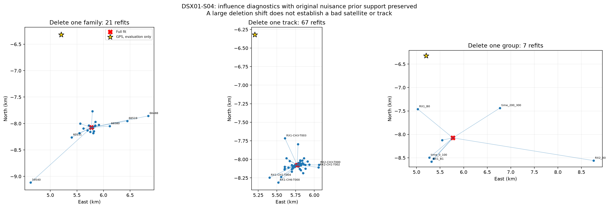

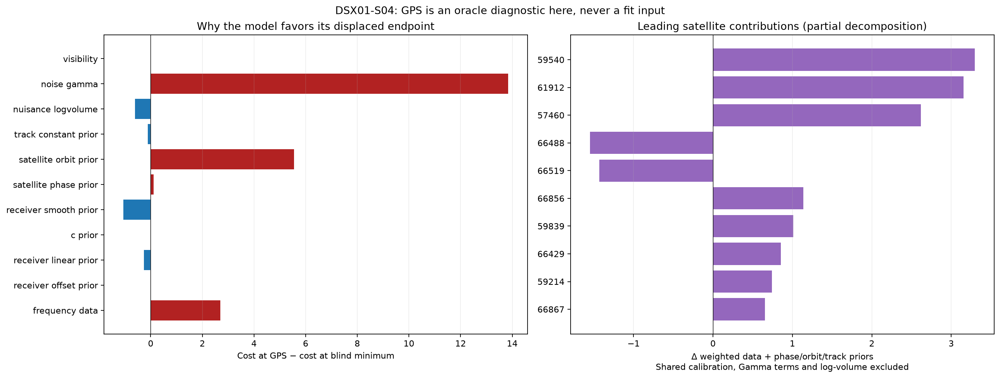

### [DSX01-S05](DSX01-S05/README.md)

Refreshing the inaccurate phase tangent worsens GPS error from 1.406 to 1.887 km while improving RF loss. The earlier apparent accuracy partly relied on cancellation with a numerical approximation error. No one-family deletion resolves the remaining bias (best 1.582 km), no archived multi-piece join exists, and hard RF-gate rejection worsens error to 3.118 km. Allowing more orbital flexibility also worsens position. The strongest demonstrated simple lever is the independent fragment-constant prior.

Learning one common scale from RF evidence selects 100 Hz and reaches 0.998 / 1.010 km while retaining all points and identities. Treat this as approximately 1 km, not a robust pass of a sharp 1 km threshold. The same scale-learning policy fails to improve S03, so it is a promising candidate rather than a validated universal correction.

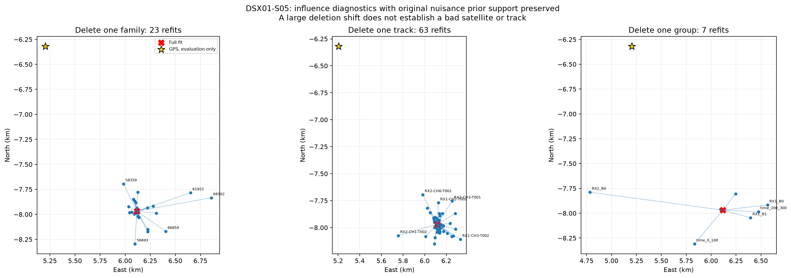

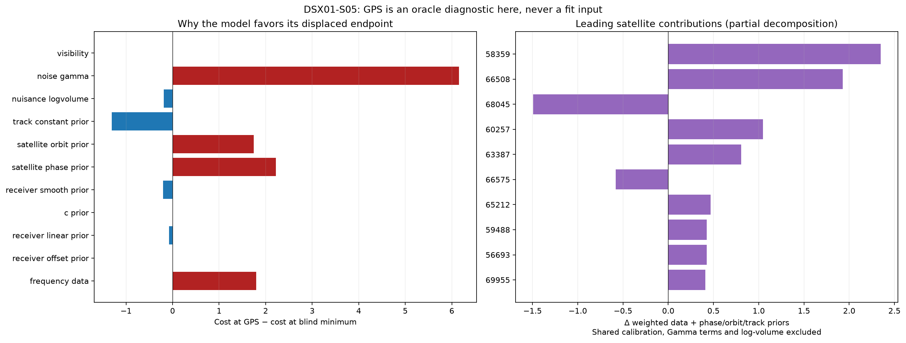

## Association and track-join ablations

Every original nominated satellite family and every original curved track was removed once, in both c arms. Family deletions were tested both before and after phase refresh. The refreshed phase reference is held fixed within each deletion series; every deletion independently refits position and reintegrates all remaining nuisance coefficients from the regional center. Keeping the original nuisance design prevents deletion from also removing the multi-owner physical-orbit prior support. Four receiver/band groups and three 100-second time blocks were independently removed. Three top-influence families supply all three pair deletions plus their triple; this is not an exhaustive subset search. Scores for different observation masks are not comparable.

| Scan | Curved points | Tracks | Nominated families | Best one-family deletion, km (ORACLE) | Archived multi-piece calibration tracks |
|---|---:|---:|---:|---:|---:|
| S01 | 2909 | 81 | 29 | 0.198, remove 69433 | 0 |
| S02 | 2317 | 63 | 29 | 0.664, remove 66623 | 0 |
| S03 | 2609 | 72 | 25 | 1.051, remove 100548 | 1 |
| S04 | 2530 | 67 | 21 | 1.563, remove 57460 | 0 |
| S05 | 2359 | 63 | 23 | 1.582, remove 58359 | 0 |

GPS-selected deletion minima above are deliberately labeled ORACLE. Improved GPS error after deletion does not identify a false satellite. There is no external authentication of the satellite labels in this study. No single-family deletion reaches 1 km in S03–S05; that rejects one tested family as the sole removable source of each displacement, but does not prove multiple identities are wrong. Several valid families can pull in competing directions under an imperfect shared calibration model.

Residual structure was examined independently: best degree 1–4 polynomial with BIC penalty, conditional orbital residual means/slopes/steps, noise precisions, and each original archived boundary. We tested the strongest three residual-step cuts plus every archived join per scan. Most cuts would create a piece without active curvature and are ineligible to calibrate. The only eligible archived unjoin is S03; it does not improve position. Large residuals often cause downweighting, so the largest-RMS track is not necessarily the most influential. Each per-scan report includes the most influential tracks, strongest residual-step track, every archived joined track, and original GLRT CFO views in 20-second panels. A point assignment error within a single archived polynomial remains possible.

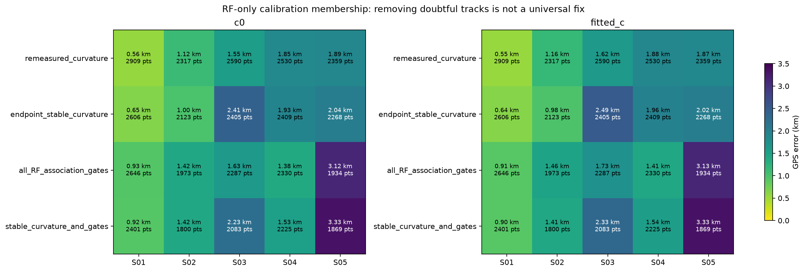

Rechecking active curvature, endpoint-stable curvature, all conditional association gates, or both gates and endpoint stability does not fix all scans. These masks change calibration membership only; excluded points remain available for later satellite explanation. Losing curvature after removing an endpoint can also be a duration-threshold effect and is not proof that the endpoint is an outlier.

## Wider RF-only satellite search

We refit every distinct hypothesis from the previous 13-start bank, made a broader causal full-catalogue proposal (`topk=12`, maximum 256), and tried coherent family and individual-fragment moves between donor hypotheses. Coordinate search screens all local proposals and fully refits the best 12 per pass for at most two passes. We additionally refit **80 distinct hypotheses** from 25 cold RF discovery positions spanning the full 25 × 25 km box (15/10/14/23/18 by scan). Saved atlas positions and nuisance states are discarded. Every refit starts at the regional center with zero nuisance and phase-reference initialization. Selection uses c0 loss, and fitted-c is the matched control. The expanded pool always retains the incumbent.

| Scan | RF-selected source from union | Error c0 / fitted c (km) | c0 Δ loss versus refreshed incumbent |
|---|---|---:|---:|
| S01 | phase-refreshed incumbent | 0.557 / 0.546 | +0.000 |
| S02 | phase-refreshed incumbent | 1.117 / 1.159 | +0.000 |
| S03 | hypotheses:3 | 1.809 / 1.878 | -3.476 |
| S04 | identity coordinate moves | 1.854 / 1.887 | -1.104 |
| S05 | phase-refreshed incumbent | 1.887 / 1.870 | +0.000 |

This search is finite and does not enumerate all joint satellite/alias assignments. In S03 the RF-preferred alternate identity improves loss while worsening GPS error. In S04 the atlas-only winner has worse loss than the incumbent, so it is retained only as a diagnostic alternative, not forced into the selected solution. Per-scan association plots show both pools.

## Nuisance and physical-orbit controls

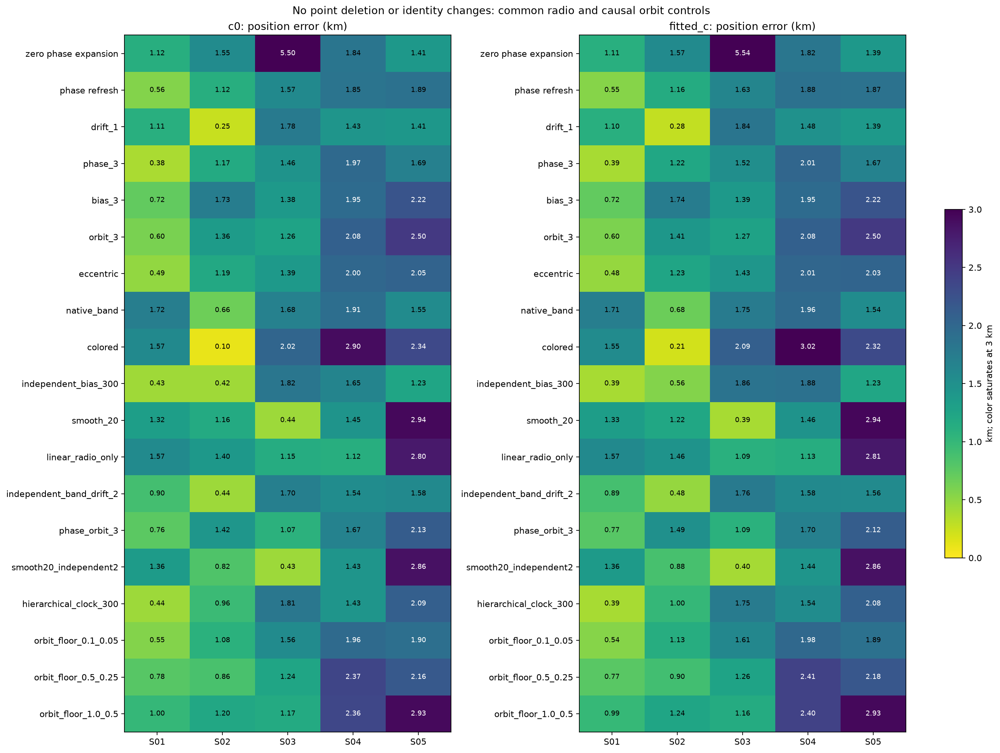

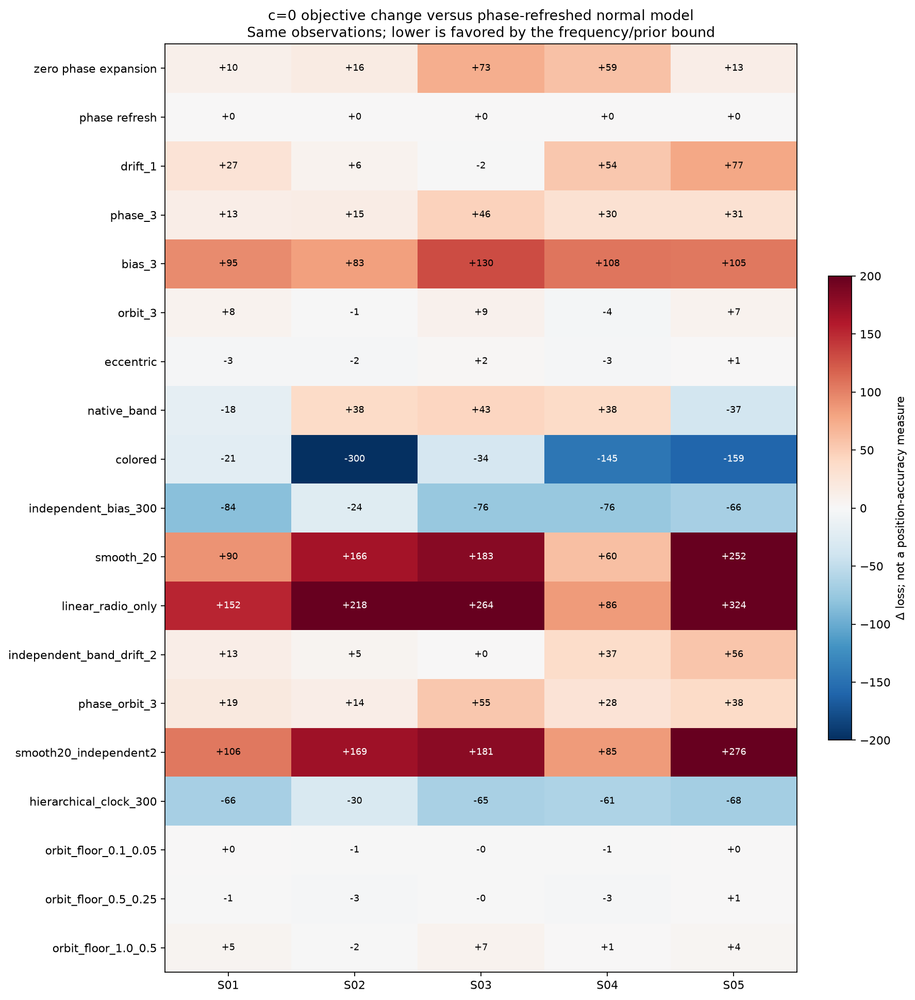

Both figures are needed: better in-sample frequency/prior loss does not establish better localization. All full-data controls retain identical observations, labels, aliases, candidate sets, position bounds, five phase refresh rounds and paired c budgets. Baseline engineering scales include four RX/band offsets, a 10 Hz/s mean linear drift per RX and 1 Hz/s band contrast, RX smooth coefficients at 200 Hz, per-satellite absolute phase σ≥1 s, causal physical orbit modes for satellites observed by at least two RX/channel owners, and independent fragment constants at 1000 Hz. There is no free linear Doppler term per satellite in this model.

Controls include tighter receiver drift, a 3× phase prior, 3× track constants, 3× orbit modes, two extra eccentricity modes, native-band smooth terms, a diagonal-plus-OU covariance (150 Hz amplitude, 10 s correlation), 300 Hz fragment constants, 20 Hz or zero receiver smooth terms, independent 2 Hz/s drifts in each RX/band, combined controls, and a shared satellite clock hierarchy. Radial/normal physical covariance floors of (0.1,0.05), (0.5,0.25), and (1,0.5) km alter prior uncertainty without adding physical parameters or changing nominal TLEs. Mean-motion, inclination and RAAN corrections are evaluated consistently through SGP4; exact conditional means were checked for the orbit-floor controls. None of these floors uniformly improves position.

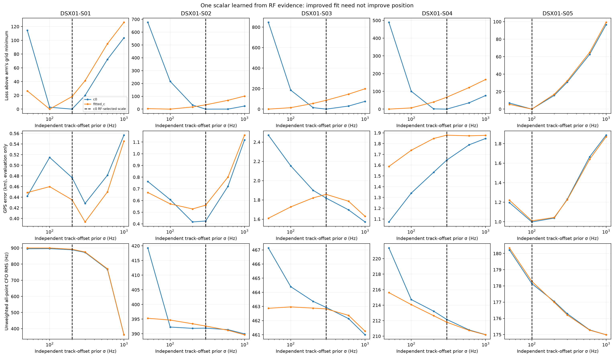

The offset-scale prototype tries 50, 100, 200, 300, 600 and 1000 Hz and selects by the same-data c0 variational frequency/prior bound. Both c arms use the same chosen scale. One hyperparameter costs an additional `log(n)` BIC penalty relative to the fixed-scale model (recorded in JSON); this constant does not change which grid value wins. This is finite-grid empirical Bayes, not a fully marginalized hyperparameter posterior. The policy is RF-only but developed on DSX01; unseen-location validation is still needed. Retaining every observation row does not guarantee that every point is well explained: noise precisions are re-estimated. S01's selected scale improves position modestly while increasing unweighted RMS from 362 to 889 Hz. The third row exposes this tradeoff. Do not call a lower frequency/prior bound a reduction in raw frequency residuals, or promote a scale based only on its GPS error.

## Reproducible scope and leakage controls

The input is the existing graph catalogue with archived GLRT300 CFO remeasurements, not a new RF acquisition. Across five scans it contains 20,084 raw GLRT detections; this investigation preserves 12,724 originally selected actively curved calibration detections. It does not claim those are all associated GLRT points or rerun acquisition/GLRT/track construction for every ablation. Linear tracks can later be associated or overlapped, but never calibrate offsets or drifts here. Active curvature requires at least 20 s duration and 250 Hz RMS departure from an affine fit.

The regional box remains **25 × 25 km**, centered at **37.906°, −122.545°** with east/north bounds ±12.5 km. The broader causal visibility catalogue uses a 250 km radius centered at 37.5°, −122.0° and no identity whitelist. The evaluation coordinate **37.849061591561885°, −122.48574968092912°** appears only in the reporting and separate forbidden-as-inference post-fit diagnostic tool. No GPS value chooses a fit, identity, nuisance coefficient or RF-selected scale. GPS-best deletions and promising GPS-error model rows are explicitly retrospective oracle diagnostics. These controlled ablations optimize position from the box center after RF discovery; they are not complete pipeline reruns at every map pixel.

Receiver altitude remains fixed at 0 m in these controls. The supplied ground truth contains latitude/longitude only; physical site height was not inferred or ablated here. This and untested timing/frame effects remain possible model limitations, alongside unexplored joint identities.

Only causal elements are used: both collection time and TLE byte epoch must precede each scan cutoff. Previous causal elements inform engineering orbit uncertainty; no following TLE or later observation is read. Candidate counts are 1707/1479/1422/1427/1424. The read guard rejects future-element, evaluation-site and unrelated report inputs during inference. The original joint-descent receipt contributes the identity of its RF-selected mode, not its saved position or nuisance solution; the baseline fit is replayed numerically. Source hashes and temporal receipts are saved in each core artifact. Post-fit GPS loss decomposition is written by a separate tool and is never read by any fitting/selection tool.

The objective integrates Gaussian nuisance coefficients and iterates Gamma fragment noise precisions. The optimized residual vector includes weighted frequency innovations, standardized nuisance means, integration log-volume, Gamma cost, fixed diagonal-noise volume, and visibility cost. Each position step uses bounded damped Gauss–Newton, at most 48 iterations per phase round. Refreshed fits use five rounds from zero phase reference; the phase prior stays centered at absolute zero. Conditional means need not have exactly zero residual on each short fragment under finite priors; gates and residual plots diagnose resulting structure. Split comparisons restore full normalization and add a `3 log(n)` cut penalty. The Gaussian noise model and engineering prior scales are hypotheses, not calibrated ground truth.

## What generalizes and what needs more evidence

- Phase refresh is a numerical consistency correction that applies at any location and uses no external GPS or later scan.
- Curvature eligibility, RF-only scale learning, causal candidate discovery and paired c ablations can run on a single scan. Their form is general, but the tested scales and model family were developed on DSX01.
- Physical orbit uncertainty uses the latest and previous **causal** element records. It therefore depends on pre-scan history, not solely on the current scan. It cannot establish actual TLE accuracy without independent orbit truth.
- Choosing a satellite deletion, a smoothness scale, or a different model for each scan because it gives the smallest GPS error is not deployable evidence. No such GPS-chosen policy is promoted here.

The lean next step is to retain phase refresh, compare the RF-only offset-scale policy on unseen archived scans/locations, and constrain receiver drift/smoothness using independent calibration evidence. Only then expand satellite orbit freedom with causal calibrated covariances. S04 remains the priority unresolved case; no experiment here justifies claiming its physical cause is known.

## Relation to primary literature

TLE mean elements and their propagator must be treated consistently; a numerically precise fit is not validation of true satellite position. This distinction follows the [CelesTrak SGP4 tutorial](https://celestrak.org/software/tutorials/sgp4.php) and motivates the exact conditional-mean checks here.

Clock and ephemeris uncertainties are recognized LEO Doppler positioning limitations. [A Double-Difference Doppler Shift-Based Positioning Framework with Ephemeris Error Correction of LEO Satellites](https://arxiv.org/abs/2409.05026) examines corrections with differential/reference information; that reference infrastructure is not present in these single-scan tests. [Orbital Errors in LEO Satellite Positioning: Modeling, Analysis, and Bayesian Calibration](https://arxiv.org/abs/2511.06060) studies Bayesian orbital-error calibration. These works motivate physical uncertainty models; they do not authenticate any satellite label or engineering prior used here.

## Artifacts and reproduction

- [Model scores, residual RMS and coordinates](models_and_candidates.csv).
- [Every family, track and group deletion](deletion_ablations.csv).
- [Machine-readable summary](summary.json) and [artifact validation](validation.json).
- [Component tests and lint verification](verification.json).
- Every scan directory contains all intervention JSON, original point IDs, source hashes, loss decompositions and linked diagnostic figures.

Inference tools: `investigate_dsx01_localization_failures.py`, `dsx01_failure_followups.py`, `dsx01_failure_prior_controls.py`, `dsx01_failure_bias_scale.py`, `dsx01_failure_orbit_floors.py`, `dsx01_failure_regional_candidates.py`. Post-fit-only tools: `probe_dsx01_failure_postfit.py`, `report_dsx01_failure_investigation.py`.

```bash
OPENBLAS_NUM_THREADS=1 OMP_NUM_THREADS=1 PYTHONPATH=src:tools \
  .venv/bin/python tools/report_dsx01_failure_investigation.py
```
