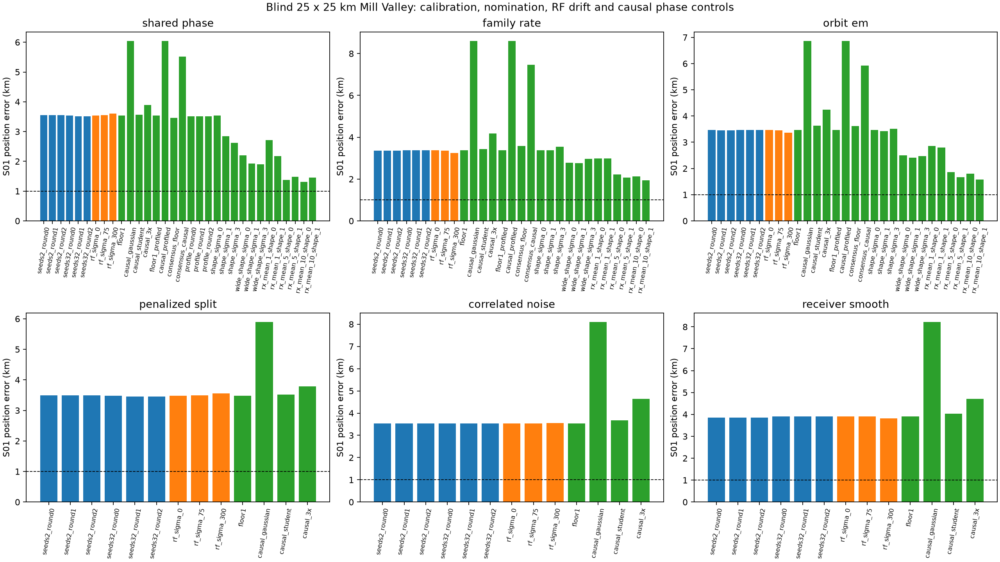
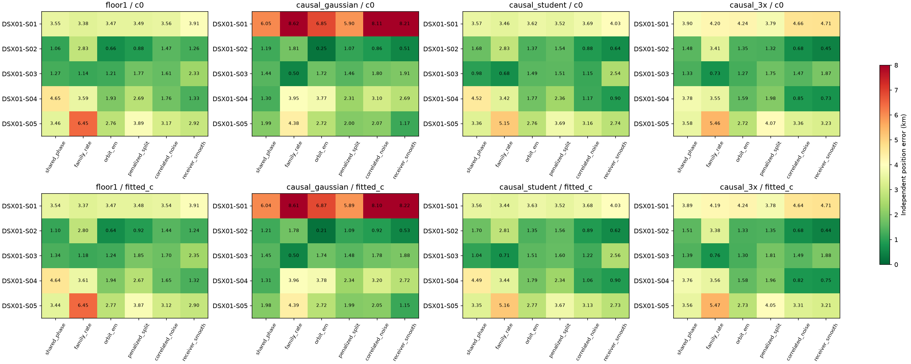
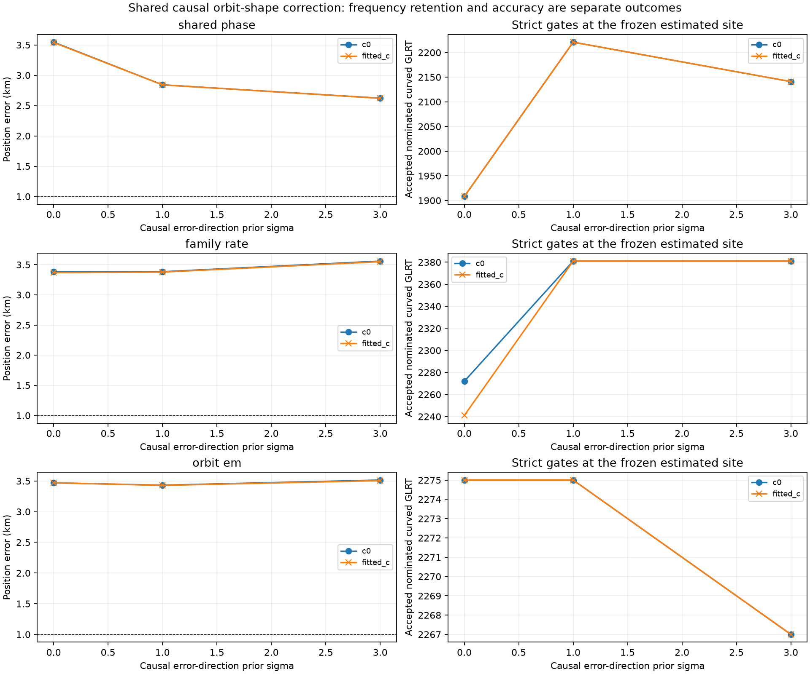
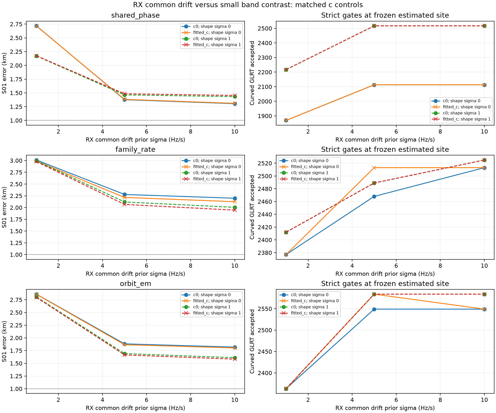

# DSX01 localization: diagnosing biased minima and receiver drift

The original **S01 10 km local loss surfaces, gradients and local minima** are in the [published local-loss report](https://github.com/misko/leo-tracker-reduxredux/blob/main/reports/2026_10_18_s01_local_loss/README.md), commit `00915da6e43ad6d95e06864ae156ff846b6a0d4b`. That analysis deliberately starts at the supplied GPS coordinate. This follow-up asks why blind fits from a Mill Valley grid reach displaced minima and tests physical explanations. The two experiments have different initialization protocols and must not be pooled as a matched accuracy comparison.

The clearest new finding is sensitivity to the **receiver drift constraint**. For S01, a common linear drift per receiver, with a smaller difference between its low/high bands, reduces the shared-phase position error from **3.55 km to 1.30 km** (`c=0`; fitted `c`: **3.54 km to 1.31 km**). The fitted RX1 band rates are approximately **8.0 and 8.6 Hz/s**, beyond the original ±1 Hz/s bounds. This is evidence that the original bound can force position to compensate for radio calibration; it is not an independent measurement proving these are the physical LNB rates.

**Reliable sub-1 km localization per scan has not been achieved.** Several S02 fits pass 1 km, but S01 and other scans remain displaced. A previous five-scan mean of smooth-receiver estimates gave 670/680 m (`c=0`/fitted `c`), conditional on one stationary site. That is one combined estimate, not five independent successes; omitting one scan can increase its error to 1.33 km.

## Protocol and scientific controls

- The blind search centre is the rounded Mill Valley coordinate **37.906, −122.545**. Its **25 × 25 km** square uses 25 grid evaluations on a 5 × 5 grid, east/north ±12.5 km. Ordinary fits choose three starts using `c=0` grid scores and refine each for at most 24 bounded damped Gauss–Newton iterations. The family-consensus search additionally refines every grid cell for six rounds before choosing three diverse starts.
- The supplied evaluation position, **37.849061591561885, −122.48574968092912**, is read by reporting/audit programs after endpoints are saved. The blind objectives have no attraction to that GPS coordinate. Model development is informed by this dataset and its errors, so this is exploratory analysis, not independent validation.
- All methods reuse the radio-only graph polynomial partition and frozen latest-causal TLE banks. No post-observation TLE is used for these fits. The causal-shape experiment additionally uses an earlier causal TLE, aligned in orbital phase.
- **Only individually active curved fragments calibrate or rank position**: span at least 20 s and affine-fit residual RMS at least 250 Hz. S01 contributes 81 fragments / **2,909 curved GLRT points**, from 170 retained polynomial fragments / 4,486 points and **4,797 raw GLRT points**. No data are randomly or temporally withheld. Linear tracks do not calibrate offsets or drifts in these experiments.
- Every reported `c=0` versus fitted-`c` pair keeps observations, candidate sets, other priors and geographic/iteration budgets matched. `c` is the constant RF-dependent calibration term; new RF-by-time or drift terms are distinct parameters. Nomination rows and aliases match in all 27 new joint-radio/orbit and receiver-drift pairs.
- Per-curve Gaussian constants, alias handling and smooth robust curve costs are retained. Strict RMS (450 Hz), bias (3,000 Hz), residual-structure, visibility and cross-channel ownership gates are applied after fixing each estimated position. Satellite identities remain candidate hypotheses. The composite loss is **not a calibrated probability**.

The six physical models are shared phase, satellite-family frequency rate, orbital eccentricity-vector correction, penalized subdivision, correlated noise, and smooth receiver error. `orbit_em` uses an EM-like centre initializer, followed by fixed-nomination continuous joint MAP fitting; that continuous refinement is not EM. Aliases are fixed inside each continuous fit and can be refreshed between stages. Tangent orbital corrections do not constitute a new independently validated TLE.

## What was tested

The [evaluation table](evaluation_summary.csv) contains **594 evaluated fit/stage records**, including repeated controls and nomination stages. This is not 594 independent algorithms or trials.

| Experiment | Records | Hypothesis and result |
| --- | ---: | --- |
| Deeper calibration / nomination refresh | 216 | Increase candidate phase seeds from 3 to 33 at centre; then two nomination refreshes. Some scans improve, but S01 remains about 3.4–3.9 km away. |
| RF × time calibration | 36 | Add one RF-dependent drift term per receiver. S01 location changes little; a frequency-fit improvement is insufficient to explain the bias. |
| Causal phase-prior scales | 240 | Replace the 1 s floor by causal-disagreement Gaussian, Student-like, or 3× scales. Tighter causal Gaussian scales worsen S01 markedly; disagreement between TLEs is not a calibrated orbit covariance. |
| Whole-family consensus / larger search | 24 | Bound each satellite family's joint data/phase energy, retain hardware priors, and refine all 25 cells. S01 converges near the same displaced basin. |
| Candidate-specific phase exploration | 6 | Profile previously unselected candidates' phases; cluster compatible proposals before enforcing shared satellite parameters. No canonical-score improvement over the inherited S01 shared-phase fit. |
| Shared causal orbit-shape direction | 18 | Add a zero-mean, shared old-versus-new causal frequency-error direction beyond phase. Shared-phase S01 improves to 2.62 km, but its added-parameter penalty outweighs the score gain. |
| Wider separate RX/band drifts + shape | 18 | Relax drift prior sigma to 2 Hz/s and bounds to ±5 Hz/s. Shared-phase S01 reaches about 2.20 km without shape; both RX1 bands still reach the bound. |
| Common RX drift / small band contrast | 36 | Parameterize each receiver by common drift plus a smaller band difference. Shared-phase S01 reaches 1.30/1.31 km without orbit-shape parameters. |

The phase, nomination and RF controls cover all six models. Nomination and phase-prior controls cover all five scans. The final shape/drift and family-consensus prototypes currently cover **S01 and three models**; they have not established a five-scan improvement.



## Independent scan errors after deeper nominations

Errors below are kilometres, **`c=0` / fitted `c`**. Within each arm/model, the displayed nomination stage is selected by the saved objective plus complexity penalty, not by GPS error. Different loss/prior variants elsewhere in this report are exploratory controls, not one automatically comparable model-selection tournament.

| Model | S01 | S02 | S03 | S04 | S05 |
| --- | ---: | ---: | ---: | ---: | ---: |
| Shared phase | 3.525 / 3.518 | **0.754 / 0.775** | 1.270 / 1.336 | 3.495 / 3.480 | 3.463 / 3.457 |
| Family rate | 3.382 / 3.370 | 2.783 / 2.772 | 1.145 / 1.180 | 4.007 / 4.011 | 5.432 / 5.431 |
| Orbital correction | 3.470 / 3.471 | **0.662 / 0.643** | 1.212 / 1.244 | 1.368 / 1.360 | 2.764 / 2.772 |
| Penalized subdivision | 3.457 / 3.451 | **0.754 / 0.775** | 1.774 / 1.852 | 3.495 / 3.480 | 3.892 / 3.870 |
| Correlated noise | 3.568 / 3.543 | 1.457 / 1.433 | 1.607 / 1.700 | 1.945 / 2.024 | 3.170 / 3.119 |
| Smooth receiver error | 3.914 / 3.908 | 1.260 / 1.239 | 2.326 / 2.353 | 2.752 / 2.731 | 2.916 / 2.898 |



For S01 shared phase, tightening the phase prior to the uninflated causal Gaussian changes fitted-`c` error from 3.54 to **6.05 km**. The Student-like prior gives 3.56 km and the 3× prior 3.89 km. Similar regressions occur in the other columns. A tighter prior can make a wrong physical mean more influential; simply shrinking the feasible correction is not a reliable localization repair.

## What the local information audit says

At the frozen S01 shared-phase solution, a Gaussian linearization with nominal 150 Hz noise gives data-only local axis scales of **0.373/0.301 km**, and **0.332/0.217 km** after the declared Gaussian priors. Yet the location error is about 3.5 km. This discrepancy supports a systematic model/identity/calibration issue rather than insufficient numerical precision alone.

These scales are **conditional local sensitivities, not empirical confidence intervals**: candidate identities are fixed, robust loss and active hard bounds are omitted, and the noise scale is assumed. The family-rate and orbital variants have weaker data-only axes (about 1.54/0.95 and 2.62/0.68 km), showing the location–satellite-correction tradeoff. Full matrices, assumptions and active-bound indicators are in [conditional_information.json](conditional_information.json).

## Causal TLEs contain shape disagreement beyond phase

At the nominal Mill Valley centre, align each previous causal orbit to the latest one by a shared along-track phase, then remove a best affine frequency component over 0–300 s. Significant non-affine disagreement remains for several candidates:

| NORAD | Old–new 3D difference (km) | Aligned phase (s) | Phase-aligned frequency RMS (Hz) | After removing affine frequency (Hz) |
| --- | ---: | ---: | ---: | ---: |
| 69333 | 7.713 | 1.009 | 73.9 | 51.9 |
| 69523 | 7.945 | 1.035 | 102.2 | 67.9 |
| 69428 | 0.644 | 0.083 | 9.0 | 2.8 |
| 67658 | 12.158 | 1.585 | 189.3 | 143.1 |
| 62811 | 6.269 | 0.816 | 98.5 | 72.3 |
| 57129 | 2.793 | 0.366 | 2.3 | 1.4 |

These are disagreements between predictions, not measured truth errors; the 300 s window can extend beyond an individual fragment's support. The [audit data](causal_phase_aligned_directions.json) records the computation. The earlier TLE SHA-256 is checked against the original causal prior receipt.

The shape prototype adds one shared Gaussian coefficient per sufficiently supported satellite to the phase-aligned old-minus-new frequency direction. Latest-causal prediction remains the mean. Support requires at least two distinct curved RX/channel owners. It adds 20 directions in S01 and is a frequency uncertainty hypothesis, not a newly valid SGP4 TLE.



For shared phase with fitted `c`, increasing the shape prior sigma from 0 to 3 changes error **3.540 → 2.619 km**, accepted nominated curved points **1,908 → 2,141**, and frequency-plus-prior score **1,716.7 → 1,600.1**. But total score including the `k log(n)` complexity term worsens **2,027.7 → 2,070.6**. The extra freedom cannot be selected merely because its GPS error is smaller. Other two models show much smaller location benefit.

## Receiver common drift is a stronger explanation

The original independent RX/band drifts have prior sigma 0.5 Hz/s and bounds ±1 Hz/s. Relaxing these to sigma 2 and bounds ±5 still pushes both RX1 bands to their limit. The next prototype preserves four separate constant offsets and changes only the drift coordinates:

`low-band drift = receiver mean − band contrast`

`high-band drift = receiver mean + band contrast`

Receiver means have prior sigma 1, 5 or 10 Hz/s; contrast sigma is 0.5 Hz/s. Bounds are ±3 prior sigmas. This is the same number of radio parameters, with a different, correlated prior. It permits a common receiver frequency ramp while discouraging an arbitrary large difference between bands.



| S01 model / correction | Position error km, c=0 / fitted c | Accepted nominated curved points, c=0 / fitted c |
| --- | ---: | ---: |
| Shared phase, original drift, no shape | 3.546 / 3.540 | 1,908 / 1,908 |
| Shared phase, common-drift sigma 5, no shape | 1.377 / 1.383 | 2,113 / 2,113 |
| Shared phase, common-drift sigma 10, no shape | **1.304 / 1.311** | 2,113 / 2,113 |
| Shared phase, common-drift sigma 10, shape sigma 1 | 1.432 / 1.454 | 2,517 / 2,517 |
| Family rate, common-drift sigma 10, no shape | 2.198 / 2.125 | 2,513 / 2,513 |
| Family rate, common-drift sigma 10, shape sigma 1 | 2.005 / 1.945 | 2,525 / 2,525 |
| Orbital correction, common-drift sigma 10, no shape | 1.819 / 1.802 | 2,549 / 2,549 |
| Orbital correction, common-drift sigma 10, shape sigma 1 | 1.610 / 1.582 | 2,584 / 2,584 |

For the shared-phase sigma-10, no-shape fitted-`c` endpoint (**37.8451350, −122.4716754**), learned drifts are:

| Receiver | Low band (Hz/s) | High band (Hz/s) | Mean (Hz/s) | Half high-minus-low (Hz/s) |
| --- | ---: | ---: | ---: | ---: |
| RX1 | 8.046 | 8.639 | 8.343 | 0.297 |
| RX2 | −1.161 | −1.451 | −1.306 | −0.145 |

The common modes are comfortably inside the new ±30 Hz/s bounds. Sigma 5 versus 10 gives similar results, so the improvement is not simply moving to another immediately active bound. However, satellite-model error and receiver drift can trade off; hardware evidence or replication on the other scans is still needed before treating these rates as identified physical calibration.

## Matched c ablation: frequency and position are separate

The following rows use **the exact intersection of accepted curved fragments in each c pair**, with identical satellite labels for every point shown. RMS is native CFO residual after profiling constants. Each pair has matching observations, candidates, other priors and search budgets. It is a conditional frequency comparison, not all-GLRT association coverage.

| Shared-phase S01 variant | Common accepted curved points | RMS Hz, c=0 / fitted c | Position error km, c=0 / fitted c |
| --- | ---: | ---: | ---: |
| Original drift; shape off | 1,908 | 121.443 / 121.458 | 3.546 / 3.540 |
| Original drift; shape sigma 3 | 2,141 | 119.088 / 119.078 | 2.622 / 2.619 |
| Common RX sigma 10; shape off | 2,113 | 121.329 / 121.340 | 1.304 / 1.311 |
| Common RX sigma 10; shape sigma 1 | 2,517 | 118.109 / 118.092 | 1.432 / 1.454 |

There is no consistent material benefit from fitting `c` in these controls. Adding shape can retain more points and lower residual RMS while worsening position relative to the common-drift-only fit. The [full c-ablation CSV](c_ablation.csv) and [per-fit table](evaluation_summary.csv) preserve both outcomes separately.

**Association counts here cover only nominated active-curvature fragments at each frozen endpoint.** They exclude linear-track transfer and untracked raw points. They must not be compared directly to earlier 2,608/3,494/3,403 all-GLRT association counts, which used different known-position calibration and populations. The full DSX01 raw denominator remains 20,084; this follow-up does not claim a new complete-corpus association percentage.

## Conclusions and next tests

1. Carry the common-RX / small-band-contrast drift model across the other four scans with matched c controls. Check rates, active bounds, residual structure and independent position error before adopting it.
2. Model the remaining causal orbit disagreement as shared low-rank uncertainty, with a justified covariance or marginal likelihood/volume penalty. A collection of free per-satellite corrections plus naive parameter counting is an incomplete uncertainty model.
3. Check physical nuisance assumptions such as fixed zero height, timing and residual CFO quantization using bounded existing-data controls. Separate calibration evidence from position accuracy, and do not tune a parameter solely because it moves the estimate toward GPS.

More starts, stronger phase priors and nomination refresh alone did not resolve S01. The strongest tested explanation is an overly restrictive common receiver drift. It substantially reduces the error but leaves roughly 1.3 km, so neither a fully identified physical explanation nor the per-scan sub-1 km target is established.

## Reproduction and verification

[validation.json](validation.json) records **36 passing focused tests**, matched new c pairs, hash/link checks, and the clean publication validation. Tests cover numerical constant elimination, curvature preservation, sparse/dense phase-geometry parity, bounded optimization, family energy scaling, nomination membership, coherent phase proposals, shared causal-shape support, and drift coordinate/prior transformations. No scientific golden fixture changed, no RF was collected, and QNAP/archive inputs were read only.

[source_manifest.json](source_manifest.json) binds the frozen source closure and versions; [input_manifest.json](input_manifest.json) binds original input bytes to compressed snapshots or previously published S01 snapshots. [artifact_manifest.json](artifact_manifest.json) hashes the report artifacts. Absolute original paths in the saved evaluation binding are historical provenance; the portable manifest uses repository-relative paths.

From a repository checkout containing this report and the earlier local-loss report, materialize an empty scratch directory using `prepare_reproduction.py --destination /absolute/empty/scratch`. It verifies all input hashes and writes only that destination. Then use the existing scientific Python environment:

```bash
OPENBLAS_NUM_THREADS=1 OMP_NUM_THREADS=1 PYTHONPATH=/absolute/empty/scratch/src:/absolute/empty/scratch/tools /path/to/venv/bin/python /absolute/empty/scratch/tools/report_dsx01_model_iterations.py
```

This recomputes the 594-row evaluation, c comparisons and four figures from frozen endpoints and observations. Fit tools are preserved in `run_sources` for inspection or explicitly rerunning selected experiments; replaying saved endpoints is not a new independent fit. Intermediate frequency caches are derived and are not needed in the published bundle. Original source revisions preserved with experiment results distinguish pre-factory code from later compatible helper extensions.
