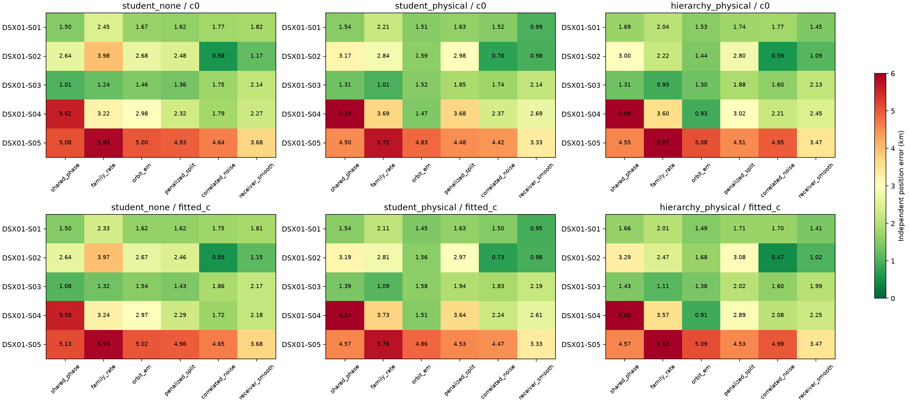
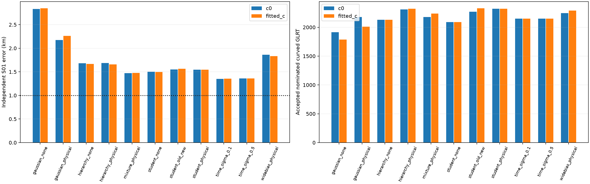
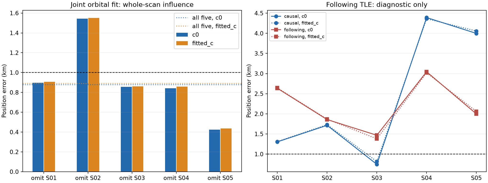

# DSX01: shared orbital uncertainty and independent-scan localization

The latest causal experiments produce independent-scan errors of **990 / 948 m for S01** and **933 / 913 m for S04**, for `c=0` / fitted `c`. These use different physical models, chosen here for diagnostic review after evaluation. **There is no demonstrated blind model-selection rule that achieves sub-1 km on all five scans. S05 remains unresolved.** The previously obtained all-five-scan joint solution is 876 / 888 m, but a whole-scan influence test shows that result depends appreciably on S02.

This report extends the [receiver-drift and exact joint-fit report](../2026_10_18_dsx01_receiver_geometry/README.md), the [published model-iteration report](../2026_10_18_dsx01_model_iterations/README.md), and the [S01 local loss surfaces](../2026_10_18_s01_local_loss/README.md). Those earlier loss maps answer the original question about the landscape near GPS. The present experiments address why the blind fit can prefer another position and test three additional remedies: shared orbital uncertainty, hierarchical frequency biases, and receiver timing. A fourth test deliberately substitutes a following TLE as a diagnostic.

## Fixed experimental controls

Each independent fit starts from the **25 × 25 km Mill Valley square**, centre **37.906, −122.545**, using 25 grid evaluations and three shared geographic starts, with at most 24 joint optimization iterations per start. The evaluation GPS is **37.849061591561885, −122.48574968092912**. It enters reporting and explicitly separated oracle audits only; it does not initialize these fits or contribute to their objectives. Development has repeatedly used these scans and their evaluation errors, so these are exploratory results on the development corpus.

All six graph-based physical models retain the original centre nominations and radio-only polynomial partition. Only fragments with at least 20 s span and 250 Hz affine-residual RMS calibrate or locate. Linear tracks are not used to estimate offsets, drifts, or position. No random or time-interval withholding is used in the principal fits. The scan-deletion experiment below is an influence diagnostic, not a replacement training set selected by GPS.

Every scan has independent RX/band constant offsets. Common receiver drift has prior sigma **10 Hz/s**, with band-contrast sigma **0.5 Hz/s**: low-band rate = mean − contrast, high-band rate = mean + contrast. The two `c` arms share observations, candidate sets, nominations, aliases, other priors, starts and iteration budgets within each experiment. `c` is the RF-dependent calibration coefficient. Frequency fit and localization error are evaluated separately.

The six parent models are shared phase, shared family rate, orbital correction (`orbit_em`), penalized subdivision, correlated noise, and smooth receiver. The `orbit_em` label denotes an EM-like initializer followed here by continuous fitting with fixed nominations; this iteration does not repeatedly reassign candidates during optimization. Satellite identities remain hypotheses.

## Why shared uncertainty is different from another free polynomial

The preceding investigation found that several strongly curved satellite families reward movement away from GPS even after receiver drift is released. Previous causal TLE versions also disagree by tens to hundreds of metres after phase alignment. Treating every smooth orbital discrepancy as receiver drift can therefore move the estimated site.

The new likelihood gives each nominated satellite one small set of shared orbital-error modes, affecting all of that satellite's curved RX/channel fragments together. Physical modes represent mean motion at the observation midpoint, inclination and RAAN. Their scales come from phase-aligned previous-versus-current **causal** TLE disagreement, with radial/cross-track floors of 50/25 m and explicit fallback scales when previous elements are missing. At least two distinct curved RX/channel owners are required. These scales are engineering priors, not measured orbit-error covariances.

After whitening and integrating fragment constant biases, let `r` be the residual vector and `U` the shared frequency-error modes. The Gaussian marginal term is

`Q + log det(I + U Uᵀ)`, where `Q = rᵀ (I + U Uᵀ)⁻¹ r`.

The determinant penalizes the volume of allowed corrections, so a more flexible covariance cannot improve the objective without cost. The robust family variant replaces `Q` by `(ν + n) log(1 + Q/ν)`, using **ν = 4** and the original observation count `n`. The nominal 150 Hz parameter is a Student scale; it is not an empirically calibrated standard deviation. Conditional corrections remain shared across the satellite's fragments. The integration and complexity rationale follows the [Gaussian-process marginal likelihood treatment](https://gaussianprocess.org/gpml/chapters/RW2.pdf); the heavy-tailed motivation is consistent with [Student-t process literature](https://proceedings.mlr.press/v33/shah14.html).

Three variants are run for every scan and parent model:

| Variant | Orbital uncertainty | Frequency-bias structure |
| --- | --- | --- |
| `student_none` | None; robust family likelihood control | Independent fragment constants, sigma 1,000 Hz |
| `student_physical` | Three shared physical modes per supported satellite | Independent fragment constants, sigma 1,000 Hz |
| `hierarchy_physical` | Same physical modes | Fragment constants sigma 300 Hz plus a shared satellite bias sigma 1,000 reference-Hz, scaled by RF |

The hierarchy is a joint change in bias structure and physical covariance relative to `student_none`; it is not an isolated single-parameter ablation. Extra S01 shared-phase controls separate these changes and test an old/new single mode, Gaussian likelihood, a signal/clutter mixture, no-orbit hierarchy, and wider satellite bias. Absolute losses across different likelihood families are not calibrated model probabilities and must not select the best model merely by their numerical magnitude.

## All-five-scan results

Errors below are kilometres, **`c=0` / fitted `c`**. Each cell uses its own scan independently. The earlier common-drift baseline is retained in the [preceding report](../2026_10_18_dsx01_receiver_geometry/README.md); it is a different likelihood control.

### `student_none`

| Model | S01 | S02 | S03 | S04 | S05 |
| --- | ---: | ---: | ---: | ---: | ---: |
| Shared phase | 1.500 / 1.498 | 2.640 / 2.645 | 1.013 / 1.076 | 5.623 / 5.584 | 5.080 / 5.127 |
| Family rate | 2.447 / 2.329 | 3.978 / 3.967 | 1.239 / 1.317 | 3.225 / 3.243 | 5.883 / 5.928 |
| Orbital correction | 1.672 / 1.624 | 2.682 / 2.667 | 1.464 / 1.542 | 2.981 / 2.966 | 5.002 / 5.023 |
| Penalized subdivision | 1.623 / 1.624 | 2.482 / 2.462 | 1.357 / 1.432 | 2.317 / 2.291 | 4.932 / 4.957 |
| Correlated noise | 1.773 / 1.749 | 0.578 / 0.550 | 1.753 / 1.861 | 1.790 / 1.724 | 4.638 / 4.649 |
| Smooth receiver | 1.819 / 1.811 | 1.173 / 1.148 | 2.139 / 2.173 | 2.266 / 2.176 | 3.682 / 3.683 |

### `student_physical`

| Model | S01 | S02 | S03 | S04 | S05 |
| --- | ---: | ---: | ---: | ---: | ---: |
| Shared phase | 1.543 / 1.544 | 3.172 / 3.187 | 1.311 / 1.386 | 6.241 / 6.235 | 4.503 / 4.567 |
| Family rate | 2.209 / 2.109 | 2.840 / 2.806 | 1.007 / 1.094 | 3.691 / 3.729 | 5.722 / 5.763 |
| Orbital correction | 1.513 / 1.452 | 1.590 / 1.560 | 1.516 / 1.582 | 1.473 / 1.509 | 4.833 / 4.859 |
| Penalized subdivision | 1.629 / 1.632 | 2.981 / 2.973 | 1.853 / 1.937 | 3.684 / 3.643 | 4.479 / 4.529 |
| Correlated noise | 1.519 / 1.499 | 0.756 / 0.731 | 1.737 / 1.831 | 2.366 / 2.239 | 4.419 / 4.469 |
| Smooth receiver | 0.990 / 0.948 | 0.984 / 0.978 | 2.143 / 2.194 | 2.688 / 2.615 | 3.330 / 3.331 |

### `hierarchy_physical`

| Model | S01 | S02 | S03 | S04 | S05 |
| --- | ---: | ---: | ---: | ---: | ---: |
| Shared phase | 1.688 / 1.657 | 3.000 / 3.289 | 1.309 / 1.433 | 6.088 / 5.999 | 4.547 / 4.570 |
| Family rate | 2.040 / 2.013 | 2.217 / 2.470 | 0.929 / 1.110 | 3.600 / 3.569 | 6.073 / 6.116 |
| Orbital correction | 1.530 / 1.490 | 1.438 / 1.679 | 1.299 / 1.384 | 0.933 / 0.913 | 5.078 / 5.094 |
| Penalized subdivision | 1.738 / 1.710 | 2.805 / 3.082 | 1.876 / 2.016 | 3.017 / 2.890 | 4.507 / 4.527 |
| Correlated noise | 1.770 / 1.701 | 0.589 / 0.467 | 1.598 / 1.604 | 2.210 / 2.078 | 4.947 / 4.994 |
| Smooth receiver | 1.453 / 1.407 | 1.093 / 1.024 | 2.128 / 1.994 | 2.452 / 2.252 | 3.469 / 3.470 |

The improvement is selective. Shared physical uncertainty helps S01 with smooth receiver dynamics; hierarchical orbital uncertainty helps S04 with orbital correction. The S03 shared-phase common-drift baseline remains 0.745 / 0.815 km, while the new robust variants worsen it. S05 remains above 3 km even for its better new variants. Choosing the best model separately for each scan using evaluation GPS would be an oracle selection, not a deployable algorithm.

## S01 and S04: what the sub-kilometre endpoints actually establish

| Scan / model / variant | Position error (m), c0 / fitted c | Accepted curved points | Fragments | Points/fragment | Exact − lifted RMS / max (Hz), c0; fitted c |
| --- | ---: | ---: | ---: | ---: | ---: |
| DSX01-S01 / Smooth receiver / `student_physical` | 990.1 / 947.8 | 2634 / 2634 | 74 / 74 | 35.6 / 35.6 | 0.115 / 0.476; 0.117 / 0.483 |
| DSX01-S04 / Orbital correction / `hierarchy_physical` | 932.6 / 912.9 | 2094 / 2046 | 54 / 53 | 38.8 / 38.6 | 1.175 / 5.750; 1.230 / 5.862 |

The exact-propagation audit freezes the endpoint position, hardware, phases, and conditional orbital-mode coefficients, constructs corrected SGP4 elements and recomputes the nominated-track gates. All accepted counts shown above remain unchanged. This checks the numerical orbit approximation at the saved endpoint. **It is not a fresh exact-SGP4 position optimization**, an identity proof, or a confidence interval. In particular, the S01 `c=0` result has only a 10 m margin below the target; that numerical threshold alone should not be interpreted as robust accuracy.

The accepted counts here cover **nominated curved points only**, not every GLRT point. They are not directly comparable to the earlier full-corpus transfer percentage. The raw corpus still contains **20,084 GLRT points** across the five scans. No full linear-track transfer was added to these new independent uncertainty experiments.

| Case / model / variant | Common points | Native RMS (Hz), c0 / fitted c |
| --- | ---: | ---: |
| DSX01-S01 / Smooth receiver / `student_physical` | 2634 | 116.582 / 116.571 |
| DSX01-S02 / Correlated noise / `hierarchy_physical` | 2152 | 169.623 / 167.447 |
| DSX01-S04 / Orbital correction / `hierarchy_physical` | 2046 | 140.653 / 140.593 |

These are matched **common accepted points**, preserving satellite labels. Native residual RMS is kept separate from the correlated-noise innovation RMS where that parent model applies. The complete [c ablation](c_ablation.csv) covers every paired uncertainty/timing fit; [evaluation_summary.csv](evaluation_summary.csv) records position, score, residuals, accepted fragments and points per fragment. A tiny RMS gain does not imply improved location.

## Additional S01 controls and timing

None of the additional shared-phase controls establishes a sub-kilometre result. A single previous/current TLE disagreement mode is not a universal repair. Increasing satellite-bias width also does not solve the shared-phase position bias. The signal/clutter mixture is explicitly a different normalized observation model, not merely a gate that deletes a family after seeing GPS.

Relative receiver timing is tested separately by shifting RX1 UTC by `−δ/2` and RX2 by `+δ/2`, leaving the mean clock fixed. This propagates the orbit and Earth rotation at the actual shifted observation times; it is distinct from per-satellite orbital phase. S01 shared-phase fits infer roughly **73–91 ms** relative timing with 0.1/0.5 s priors, but position remains about **1.36–1.37 km**. Relative timing does not explain the remaining S01 bias in that model. A free common UTC shift would be degenerate with longitude/phase without external evidence and is not used as a GPS repair.

## Is the joint result robust to each scan?

The prior all-five joint orbital fit reaches 0.878 / 0.890 km before exact continuation and 0.876 / 0.888 km afterward. All five scans contribute to that reported fit and share only the site position. The following diagnostic repeats the blind original-grid procedure after omitting one entire scan, retaining the original priors and nominations for the others.

| Omitted scan | Joint position error (km), c0 / fitted c |
| --- | ---: |
| S01 | 0.896 / 0.905 |
| S02 | 1.543 / 1.551 |
| S03 | 0.855 / 0.860 |
| S04 | 0.842 / 0.858 |
| S05 | 0.424 / 0.436 |

Omitting S02 worsens the result to **1.543 / 1.551 km**. Omitting S05 improves it, but that does not justify discarding S05 based on GPS. These changes show sensitivity to scan-specific evidence; the joint sub-kilometre point estimate is not by itself a stability guarantee. Objective values from different retained observation sets are not directly comparable.

## Following TLEs: a diagnostic, never a causal solution

For every centre-nominated candidate, the archive supplies at least three past versions and a first following distinct newer version. The previous-element composite used for uncertainty is reconstructed from per-satellite causal versions and its expected bytes verified. Future entries are isolated in the history/diagnostic artifact and are **not inputs to the causal marginal fits**.

The following experiment replaces only nominated orbit state arrays in memory, retains the same candidate IDs and aliases, resets initial phases to zero in both causal and following arms, and repeats the same shared-phase/common-drift search budget. It asks whether newer elements diagnose a modelling mismatch. It is not an operational result available at observation time, and following elements are not ground truth.

| Scan | Causal error (km), c0 / fitted c | Following error (km), c0 / fitted c | Frequency + prior score, fitted c: causal → following |
| --- | ---: | ---: | ---: |
| S01 | 1.304 / 1.311 | 2.634 / 2.645 | 1653.03 → 2023.18 |
| S02 | 1.715 / 1.731 | 1.858 / 1.868 | 2017.97 → 1978.33 |
| S03 | 0.745 / 0.815 | 1.468 / 1.381 | 1968.63 → 2002.03 |
| S04 | 4.391 / 4.362 | 3.045 / 3.019 | 1890.97 → 1919.42 |
| S05 | 3.998 / 4.057 | 1.998 / 2.058 | 1843.77 → 1865.32 |

For S01, following elements worsen both position and the frequency-plus-prior score. For S05, they improve position from about 4 km to about 2 km while the score worsens. Orbit age, propagation across a manoeuvre, and model mismatch can therefore affect different scans differently. A lower residual or newer element set alone does not establish a better location. The [following diagnostic summary](following_diagnostic_summary.csv) and matched-c frequency table preserve this separation from causal results.

## Conclusions and next bounded iteration

Shared orbital uncertainty is useful when the data support it, and receiver drift must be broad enough to represent measured scan behaviour. Neither is a universal solution. The independent S01/S04 improvements and unchanged exact-propagation gates justify further investigation, while S05 and the joint scan-influence test prevent claiming the localization task is finished.

The next useful steps are to test a **causal prior-mean forecast** from several past TLE versions, learn receiver-smoothness strength through a properly normalized marginal likelihood, and audit S05 family leverage and identities without choosing families by GPS. These are proposed next experiments, not results already tested here. External orbit/timing evidence would also help distinguish radio drift, satellite model error and identity mistakes.

## Artifacts and verification

There are **196 evaluated uncertainty/timing fit records and 98 matched c pairs**, plus **20 following-TLE diagnostic endpoints / 10 matched c pairs** and 10 scan-deletion endpoints. The 192 marginal records comprise 180 all-scan core records plus 12 extra S01 controls; four records test relative timing. **60 focused tests pass** ([receipt](focused_tests.json)), covering dense low-rank covariance equivalence, marginal-volume penalties, observation counts, shared satellite corrections, receiver coordinate mapping, hierarchical bias and UTC timing. Both exact-propagation audits preserve accepted counts. Main/timing/following c-arm protocols were checked for identical starts, nominations and aliases across 108 pairs. Complete machine-readable results include [evaluation](evaluation_summary.csv), [common-point c comparisons](c_ablation.csv), [exact orbit audit](independent_exact_orbit_audit.json), [scan influence](scan_influence_summary.csv), and [following-TLE matched-c frequency comparisons](following_diagnostic_c_ablation.csv).

The 60 tests also pass when imported from the [frozen source closure](frozen_source_tests.json). The [manifest](manifest.json) records frozen source, scientific-input and artifact hashes. The earlier receiver-geometry report is published alongside this one unchanged; its own manifest, 48-test run and byte-for-byte 28-product replay remain intact. Research source snapshots are report artifacts rather than changes to runtime components or public contracts. No new RF was collected, golden fixtures were not changed, and archive/QNAP access was read only.

Reproduction uses the repository virtual environment with `OPENBLAS_NUM_THREADS=1 OMP_NUM_THREADS=1 PYTHONPATH=src:tools`. Core fit tools are `prototype_dsx01_orbit_marginal.py`, `build_dsx01_orbit_modes.py`, `prototype_dsx01_receiver_timing.py`, and `probe_dsx01_scan_influence.py`. Reporting/audit tools evaluate saved endpoints; `probe_dsx01_following_tle.py` is explicitly noncausal diagnostic code. Source snapshots and protocols preserve the exact versions, nominations, starts and budgets. Numerical posterior checks validate implementation and residual gates, not the truth of an unverified satellite assignment.
