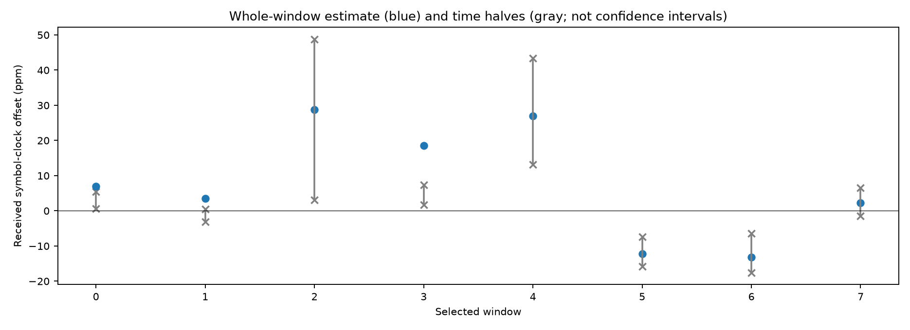
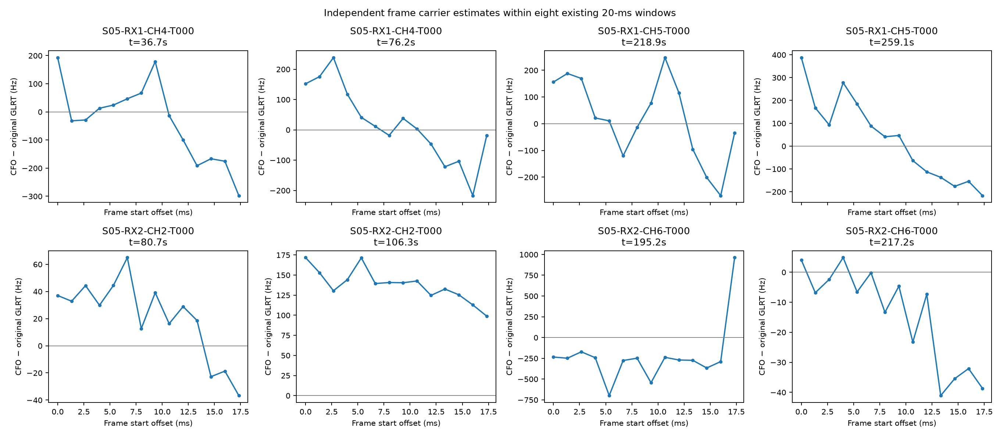
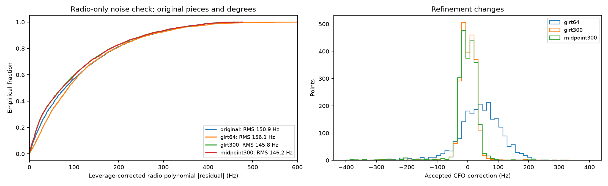
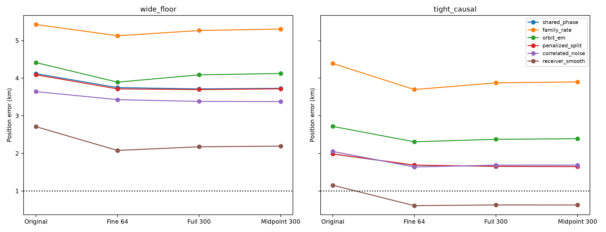
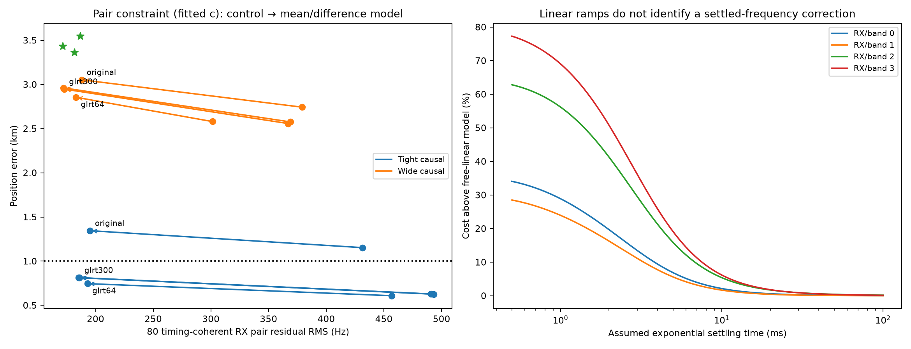

# DSX01 S05: pilot-frequency remeasurement and receiver-difference constraints

**S05 now has conditional sub-kilometre results from the blind Mill Valley grid.** With smooth receiver error, the original tight drift/causal phase priors, and timing-linked RX difference factors, fine-grid GLRT-64 gives **803 / 746 m** and full GLRT-300 gives **868 / 812 m** for `c=0` / fitted `c`. The RX difference residual also improves substantially. However, wider drift priors still produce distant positions, and this iteration has not rerun the improved measurement method on the other four scans. **The full independent-scan localization goal remains open.**

This follows the [geographic-calibration investigation](../2026_10_18_dsx01_geographic_calibration/README.md). It changes frequency measurements using existing IQ and then tests a calibration factorization. It does not select a deployable model by GPS error, establish authenticated satellite identities, or demonstrate calibrated position uncertainty.

## Controls and populations

The geographic search remains the **25 × 25 km** square centred at **37.906, −122.545**, with a 5 × 5 grid, three `c=0`-selected starts and at most 24 optimization iterations per start. GPS **37.849061591561885, −122.48574968092912** enters postfit evaluation only. No new RF was collected. Original graph membership, point IDs, observation times, causal satellite bank and acquisition anchors remain fixed.

All **2,359 original actively curved S05 points** are remeasured. Original curvature eligibility is retained; it is not reselected to favour any position. Rejected refinements fall back to their original CFO, so no random or temporal withholding occurs. The read-only full-scan IQ pass took **55.14 s**. Linear tracks do not calibrate or locate; this report does not perform final linear-track transfer. S05 has 4,056 raw GLRT points, so the accepted counts below are **nominated curved points**, not full-corpus association percentages.

Every matched `c` pair has identical observations, nominations, aliases, other priors, geographic starts and optimization budgets. The native noise reference remains 150 Hz. The existing RMS, bias, structure, visibility and correction-ownership association gates are unchanged. Frequency fit, RX calibration residual and geographic error are separate outcomes.

## A short-window measurement discrepancy

The initial panel uses fixed 20%/80% points of the longest original curved track in each RX/band group: eight already-recorded 20 ms windows, selected without satellite labels or GPS. A pure-array fit profiles eight independent complex channel gains in every frame. It estimates carrier CFO and received symbol-clock offset without linking carrier phase between frames. The symbol-clock estimate includes transmitter, sample-clock and propagation effects; it is not a transmitter-only measurement.

Synthetic controls recover separate injected offsets with unknown channels and independent frame phases, reject a wrong Qin sequence and unrelated noise, and verify the analytic profile gradient. On the recordings, symbol-clock estimates vary considerably between time halves. Their added carrier corrections are generally small. There is insufficient evidence to impose a symbol-clock correction on localization.

The independent frame carrier estimates expose much larger variation. Several RX1 windows change by hundreds of hertz within 20 ms. Such a pattern must be distinguished from orbital dynamics, timing-dependent estimator bias and a radio transient.

A second read-only panel extracts both receivers for the same two physical windows. At about **76.153 s**, the saved RX timing peaks differ by only **0.000559 samples**; this numerical agreement is not a timing uncertainty or satellite authentication. A template-free raw cross-IQ fit gives a relative frequency rate of **−12,846 Hz/s**, versus **−13,965 Hz/s** from independently estimated pilot frame frequencies. The raw cross-IQ explained fraction is only **0.01250**. This is corroborating descriptive evidence, not a calibrated confidence result or proof of a specific hardware cause. The other pair has a large timing displacement and cannot establish common propagation cancellation.

The literature motivates separating clocks rather than forcing a common correction: [Morrison and Humphreys](https://radionavlab.ae.utexas.edu/wp-content/uploads/morrison_rtsdr_LEOPNT_2.pdf) distinguish carrier, frame and symbol clocks; [Qin et al.](https://arxiv.org/abs/2501.05302) describe frame-timing instability. These papers do not identify the cause of the DSX01 ramps.

## Three frequency-measurement remedies

1. **Fine-grid, re-centred GLRT-64.** Retain the original timing/alias anchor, derotate at its finalized CFO, and refine the residual on a 16,384-bin grid: **13.872 Hz** spacing, versus 443.892 Hz for 512 bins. The search remains within ±1 kHz of the original branch; a refinement must meet its known-pilot/control margin and ±750 Hz correction gate.
2. **Full GLRT-300.** Use all 300 published pilot symbols, profiling frame phases independently through power-spectrum aggregation. Acquisition is unchanged. The same bounded residual search and negative-control procedure apply.
3. **Midpoint GLRT-300.** Estimate CFO separately in complete frames and fit a robust frequency line within the 20 ms window. Evaluate it at the observation's 10 ms midpoint. Require at least six valid frames spanning 7 ms. This corrects a measurement time reference; it does not extrapolate to an unknown settled radio frequency.

The GLRT-64 research scorer matches the public scalar scorer's exact score, control score and frequency, including fractional timing, on controlled waveforms. A saved eight-window 512-bin re-scoring panel shows that re-centring alone changes one coarse-bin answer. **The fine-grid comparison is therefore not an isolated quantization-only ablation**: re-centring the derotation also changes the scorer. No original detector decision is rewritten.

| Measurement | Corrected points | Original-CFO fallbacks | Radio-polynomial residual scale (Hz) |
| --- | ---: | ---: | ---: |
| Original | 0 | 2,359 | 150.88 |
| Fine GLRT-64 | 2,336 | 23 | 156.06 |
| Full GLRT-300 | 2,334 | 25 | 145.80 |
| Midpoint GLRT-300 | 2,315 | 44 | 146.16 |

The last column refits the original radio-polynomial pieces at their declared degrees and corrects squared residuals for leverage. It uses no orbit or location fit. Fine GLRT-64 illustrates why closer positions must not be inferred from lower measurement residuals: it improves the positions below despite a **higher** polynomial residual scale. Full GLRT-300 gives the best scale in this radio-only check.

## All six S05 parent models

The first comparison retains wide RX mean/contrast drift priors of **10 / 0.5 Hz/s**, phase sigma floored at one second, and the previously selected blind incumbent's nominations/state. Errors are kilometres, **`c=0` / fitted `c`**.

| Parent | Original | Fine GLRT-64 | Full GLRT-300 | Midpoint GLRT-300 |
| --- | ---: | ---: | ---: | ---: |
| Shared phase | 4.074 / 4.122 | 3.687 / 3.751 | 3.653 / 3.715 | 3.668 / 3.731 |
| Family rate | 5.407 / 5.429 | 5.081 / 5.129 | 5.224 / 5.269 | 5.263 / 5.308 |
| Orbital MAP / EM-like | 4.391 / 4.416 | 3.855 / 3.894 | 4.051 / 4.089 | 4.087 / 4.126 |
| Penalized subdivision | 4.048 / 4.091 | 3.658 / 3.716 | 3.640 / 3.697 | 3.660 / 3.717 |
| Correlated noise | 3.625 / 3.644 | 3.399 / 3.429 | 3.350 / 3.383 | 3.345 / 3.378 |
| Smooth receiver | 2.702 / 2.711 | 2.062 / 2.078 | 2.155 / 2.175 | 2.171 / 2.193 |

A second controlled measurement comparison uses the original four independent band drift priors, sigma **0.5 Hz/s** and bounds **±1 Hz/s**, the original causal Gaussian phase scales floored at 0.1 s, and original blind centre nominations. This matches the older tight-causal experiment. **Comparing these two tables is a joint change in priors and initialization/nominations**, not an isolated drift-prior ablation.

| Parent | Original | Fine GLRT-64 | Full GLRT-300 | Midpoint GLRT-300 |
| --- | ---: | ---: | ---: | ---: |
| Shared phase | 1.993 / 1.983 | 1.696 / 1.685 | 1.665 / 1.654 | 1.658 / 1.647 |
| Family rate | 4.384 / 4.392 | 3.695 / 3.698 | 3.875 / 3.876 | 3.900 / 3.901 |
| Orbital MAP / EM-like | 2.716 / 2.718 | 2.311 / 2.308 | 2.377 / 2.375 | 2.392 / 2.390 |
| Penalized subdivision | 1.996 / 1.986 | 1.699 / 1.689 | 1.666 / 1.655 | 1.660 / 1.650 |
| Correlated noise | 2.068 / 2.052 | 1.651 / 1.638 | 1.703 / 1.687 | 1.704 / 1.688 |
| Smooth receiver | 1.168 / 1.153 | **0.634 / 0.609** | **0.643 / 0.629** | **0.642 / 0.626** |

Those closer smooth-receiver estimates initially fit the simultaneous low-band RX differences poorly: fitted-`c` RMS is **457–493 Hz** after remeasurement. An accurate geographic answer alone does not validate that calibration.

## Separate the RX difference from source-common error

Timing-coherent pairs are eligible only when both original fragments are actively curved, their blind satellite nominations agree, and the fragment pair repeats at least three times. For the centre-seed tight-causal experiment, **79 pairs / 158 original points** qualify. Five high-band pairs have disagreeing labels and are skipped. The inherited wide seed has different nominations and admits 84 pairs; it is a separate control, not an isolated prior comparison.

For a simultaneous pair, replace its two data coordinates by

`mean = (y_RX1 + y_RX2) / sqrt(2)`

`difference = (y_RX1 − y_RX2) / sqrt(2)`

The transform preserves the original observation count, noise covariance and squared norm. A source-common frequency error cancels from the difference. A shared source constant is profiled across timing-linked fragments; the difference receives pointwise Huber protection rather than sharing the whole family's orbital-error downweight. This is a change in bias/correlation and robust-likelihood assumptions, not extra measurements. Common and difference coordinates jointly account for every original CFO exactly once.

The pair model is evaluated with both `c` arms and the same geographic budget. Accepted counts below are identical in the two arms. RX RMS uses the same 80 low-band timing-coherent pairs for evaluation, one more than the 79 centre-seed training pairs. **These are predominantly in-sample residuals, not independent validation.** Timing coherence and agreeing model labels still do not prove emitter identity.

| Tight-causal smooth receiver + pair factors | Position km, c0 / fitted c | Accepted curved points | Fragments | Common-point native RMS Hz, c0 / fitted c | RX difference RMS Hz, c0 / fitted c |
| --- | ---: | ---: | ---: | ---: | ---: |
| Original CFO | 1.360 / 1.345 | 1,916 | 51 | 171.54 / 171.55 | 195.2 / 195.2 |
| Fine GLRT-64 | **0.803 / 0.746** | **2,054** | **55** | 169.82 / 169.77 | 195.3 / 193.0 |
| Full GLRT-300 | **0.868 / 0.812** | 1,788 | 48 | 169.35 / 169.28 | 188.3 / 186.1 |
| Midpoint GLRT-300 | **0.868 / 0.814** | 1,788 | 48 | 169.73 / 169.65 | 187.6 / 185.3 |

Fitting `c` changes the position somewhat, with a very small common-point native frequency RMS change. Neither result licenses choosing `c` or a measurement variant by GPS accuracy. The complete [matched-c table](c_ablation.csv) preserves common populations and satellite-label agreement.

The inherited wide-causal pair controls fit the RX difference at **172–183 Hz** after remeasurement, but their fitted-`c` position errors remain **2.855–2.961 km**. The tight solution's RX1 low-band linear rate is at its **−1 Hz/s bound**; its smooth receiver coefficients carry substantial additional variation. Thus even a good RX difference fit does not identify the common receiver frequency trend or select the correct geographic basin. The extra [matched-nomination prior control](pair_prior_control/DSX01-S05/receiver_smooth/endpoints.json) holds the centre seed, rows, aliases, physical initialization, causal phase priors and geographic start locations fixed while widening only the radio drift prior coordinates/scales/bounds. Its results are also included in the full evaluation table. The green stars in the figure mark those controls.

| Matched-nomination pair control | Tight prior error km, c0 / fitted c | Wider prior error km, c0 / fitted c | Wider-prior RX difference RMS Hz, fitted c |
| --- | ---: | ---: | ---: |
| Original CFO | 1.360 / 1.345 | 3.526 / 3.546 | 186.6 |
| Fine GLRT-64 | 0.803 / 0.746 | 3.330 / 3.365 | 181.6 |
| Full GLRT-300 | 0.868 / 0.812 | 3.401 / 3.434 | 171.4 |

This controlled comparison preserves the same good relative-calibration fit at very different geographic answers. It isolates a remaining common-mode/prior ambiguity; it is not explained by a candidate refresh alone. Selecting the tight branch because it is closer to the evaluation GPS would still be circular.

## Do not extrapolate an unidentified settling correction

An exponential-settling hypothesis profiles one shared time constant per RX/band, with independent frequency and amplitude for each eligible window. It uses only frame-frequency shape, without a satellite or GPS. A linear-ramp limit is included explicitly. Synthetic curved signals identify their injected time constant; synthetic linear ramps do not authorize extrapolation.

All four recorded groups prefer the **free-linear limit**. None meets the declared interior-minimum, curvature-gain and window-bootstrap stability conditions. A measured short ramp therefore cannot determine an asymptotic frequency correction. No such correction is applied. The profile uses 926, 706, 408 and 195 windows in RX1-low, RX1-high, RX2-low and RX2-high, respectively. These descriptive profiles are not calibrated likelihoods or confidence intervals.

## Remaining work

The new evidence narrows the problem: measurement refinement helps all six S05 parents; separate RX difference factors can enforce a much better relative calibration; the absolute/common frequency trend remains prior-sensitive. S05 has a demonstrated conditional sub-kilometre example, but there is no verified uniform rule that yields independent sub-kilometre results across all five scans.

The next comparisons should transfer the measurement refiner to the other four scans and test a single declared calibration/prior rule across them. Candidate remedies include sparse heavy-tailed nuisance priors, pointwise signal/clutter treatment informed by the longer known-pilot evidence, and better causal orbital/common-frequency constraints. These are proposals, not tested successes in this report. Choosing each scan's prior by its GPS error would not satisfy the goal.

## Verification and artifacts

There are **134 new localization fit records / 67 matched `c` pairs**: 48 wide-floor, 48 tight-causal, 32 pair-factor/control and six matched-nomination wide-prior records. These are fit records, not 134 independent algorithms. **111 focused tests pass from the frozen source closure**, including 22 new waveform, measurement and factorization controls. Ruff passes for the new tools and tests. Every saved frequency-plus-prior objective is recomputed at its endpoint; all `c` pairs have matching rows, aliases and starts. The three cross-prior comparisons additionally verify identical nominations, aliases and geographic start locations.

The [evaluation table](evaluation_summary.csv), [frequency/pair details](frequency_and_pair_details.json), [fit bindings](evaluation_bindings.json), [objective/c-pair checks](fit_validation.json), [remeasured points](remeasurement/DSX01-S05/measurements.json), [raw cross-IQ diagnostic](paired_RX/differential_chirp.json), [settling profiles](settling_profile.json), and [radio-only noise data](radio_noise.json) accompany the five figures. Protocols retain source-window and manifest digests; the initial small IQ panels are saved locally. Full-scan IQ is not recopied.

The [source/input/artifact manifest](manifest.json), [frozen-source test receipt](frozen_source_tests.json) and [verification receipt](validation.json) record the completed checkpoint. Tests include waveform recovery, public-score parity, chirp controls, disjoint observation transforms and exact fallback/alias identity checks. Runtime components, public persisted contracts, golden fixtures and archived recordings are unchanged. Figure regeneration from saved results is distinct from rerunning the optimization campaign.
