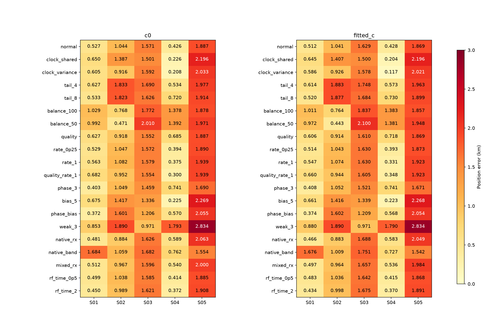
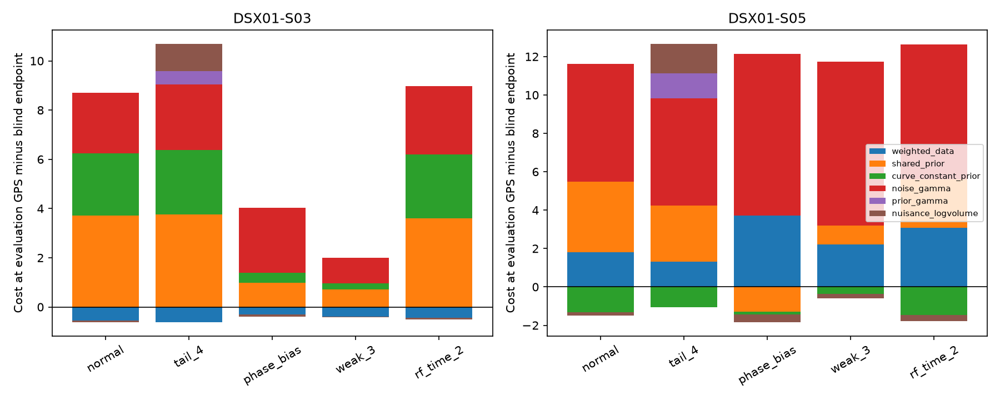
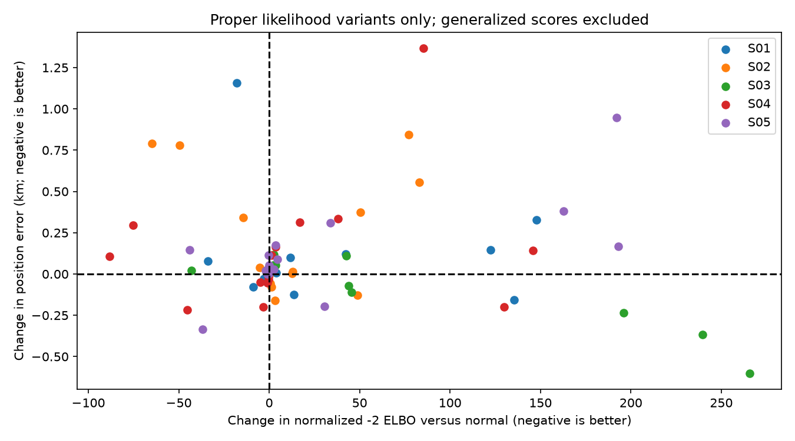
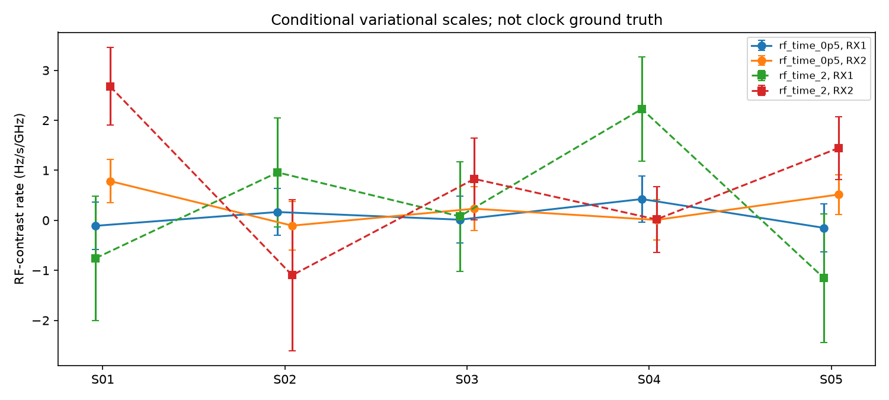

# DSX01: prior bias, satellite corrections and receiver clock models

**The uniform independent all-five sub-1 km goal remains open.** Looser
Gaussian nuisance priors bring S03 to approximately **0.971 km**, but worsen
S04 and S05. Other models improve individual scans. Their lowest GPS errors
cannot be assembled into a valid blind method. This report follows the
[previous radio/orbit controls](../2026_10_18_dsx01_radio_orbit_followup/README.md).

## Experiments and controls

All **12,724 original curved observations** remain in each fit. Candidate
labels, integer aliases, causal TLE inputs and measured per-point radio noise
are fixed. Only curved evidence calibrates hardware. Linear-track transfer
was not rerun. No observations are held out and no RF was collected.

Each scan starts from the **25 × 25 km Mill Valley box**, centered at
37.906°, −122.545°, with 25 grid nodes, three shared c0-selected starts,
24 bounded iterations per start/arm, and three phase-reference rounds.
Every c0 / fitted-c pair has matching data, labels, aliases, other priors,
likelihood powers and search budgets. Global constant RF coefficient c is
distinct from the new satellite offsets and receiver RF/time terms. The known
coordinate 37.849061591561885°, −122.48574968092912° enters only evaluation.
Scans remain independent. This is exploratory development on the same corpus.

The initial three remedies are:

1. **Shared satellite frequency offsets.** One RF-scaled nuisance per
   supported family at sigma 3,000 Hz, or a variance-preserving shared/independent
   hierarchy. The latter keeps each fragment's constant variance at 1,000² Hz²
   and puts 90% of that budget into a shared component at 12.5 GHz. Only
   candidates with two RX/channel owners receive these added corrections.
2. **Heavier-tailed orbital priors.** One Normal/Gamma precision per satellite
   phase and three physical modes, using degrees 4 or 8. Marginal variances
   match the Gaussian control. These priors are more concentrated near zero;
   the comparison changes both central shape and tails, not only tail behavior.
3. **Family balance.** Fixed likelihood powers cap each satellite family's
   effective contribution at 100 or 50 points. No power is zero. These are
   generalized scores; comparing their raw totals with different power designs
   would be invalid. Family size alone proves insufficient as a reliability rule.

Followups target the observed failures. A normalized radio polynomial
background, marginalizing degrees 1–4, identifies 3/2/2/3/0 doubtful fragments
on S01–S05, covering 97/52/75/113/0 points. Their conditional evidence at the
completed normal c0 endpoint defines fixed calibration powers with a 0.01
floor. This is a heuristic reliability transfer, not final association
probability or exact mixture EM. Original acceptance gates remain unchanged.

Small satellite-specific frequency rates use sigma 0.25 or 1 Hz/s and remain
shared across RX/channels. Gaussian phase/bias controls separately widen
phase by 3 and fragment-bias sigma from 1,000 to 5,000 Hz; `weak_3` additionally
widens RX smooth and physical modes by 3. Hardware linear priors remain unchanged.

Native-Hz nonlinear radio models test a different assumption: heterodyne LO
frequency changes can be additive within a band, whereas fractional-reference
errors scale with RF. We compare native per-RX, independent native per-band,
and a mixed native/fractional per-RX process. All retain the same time basis
with no affine component on the scan interval. The gate adapter includes the
actual native calibration exactly once.

Finally, the earlier RF-times-time hypothesis is transferred into this joint
model with corrected RX mean-drift priors and GLRT-300 point noise. It adds
two receiver terms `(RF−band mean RF)/GHz × (time−150)` at sigma 0.5 or 2
Hz/s/GHz. This mechanism was tested earlier in a different nuisance model;
it is not claimed as a newly discovered correction.

## Independent position results

Errors are km, **c0 / fitted c**. A dagger marks a generalized weighting
design whose raw score must not compete with differently weighted designs.

| Model | S01 | S02 | S03 | S04 | S05 |
| --- | ---: | ---: | ---: | ---: | ---: |
| normal | 0.527 / 0.512 | 1.044 / 1.041 | 1.571 / 1.629 | 0.426 / 0.428 | 1.887 / 1.869 |
| clock_shared | 0.650 / 0.645 | 1.387 / 1.407 | 1.501 / 1.500 | 0.226 / 0.204 | 2.196 / 2.196 |
| clock_variance | 0.605 / 0.586 | 0.916 / 0.926 | 1.592 / 1.578 | 0.208 / 0.117 | 2.033 / 2.021 |
| tail_4 | 0.627 / 0.614 | 1.833 / 1.883 | 1.690 / 1.748 | 0.534 / 0.573 | 1.977 / 1.963 |
| tail_8 | 0.533 / 0.520 | 1.823 / 1.877 | 1.626 / 1.684 | 0.720 / 0.730 | 1.914 / 1.899 |
| balance_100 † | 1.029 / 1.011 | 0.768 / 0.764 | 1.772 / 1.837 | 1.378 / 1.383 | 1.878 / 1.857 |
| balance_50 † | 0.992 / 0.972 | 0.471 / 0.443 | 2.010 / 2.100 | 1.392 / 1.381 | 1.971 / 1.948 |
| quality † | 0.627 / 0.606 | 0.918 / 0.914 | 1.552 / 1.610 | 0.685 / 0.718 | 1.887 / 1.869 |
| rate_0p25 | 0.529 / 0.514 | 1.047 / 1.043 | 1.572 / 1.630 | 0.394 / 0.393 | 1.890 / 1.873 |
| rate_1 | 0.563 / 0.547 | 1.082 / 1.074 | 1.579 / 1.630 | 0.375 / 0.331 | 1.939 / 1.923 |
| quality_rate_1 † | 0.682 / 0.660 | 0.952 / 0.944 | 1.554 / 1.605 | 0.300 / 0.348 | 1.939 / 1.923 |
| phase_3 | 0.403 / 0.408 | 1.049 / 1.052 | 1.459 / 1.521 | 0.741 / 0.741 | 1.690 / 1.671 |
| bias_5 | 0.675 / 0.661 | 1.417 / 1.416 | 1.336 / 1.339 | 0.225 / 0.223 | 2.269 / 2.268 |
| phase_bias | 0.372 / 0.374 | 1.601 / 1.602 | 1.206 / 1.209 | 0.570 / 0.568 | 2.055 / 2.054 |
| weak_3 | 0.853 / 0.880 | 1.890 / 1.890 | 0.971 / 0.971 | 1.793 / 1.790 | 2.834 / 2.834 |
| native_rx | 0.481 / 0.466 | 0.884 / 0.883 | 1.626 / 1.688 | 0.589 / 0.583 | 2.063 / 2.049 |
| native_band | 1.684 / 1.676 | 1.059 / 1.009 | 1.682 / 1.751 | 0.762 / 0.727 | 1.554 / 1.542 |
| mixed_rx | 0.512 / 0.497 | 0.967 / 0.964 | 1.596 / 1.657 | 0.540 / 0.536 | 2.000 / 1.984 |
| rf_time_0p5 | 0.499 / 0.483 | 1.038 / 1.036 | 1.585 / 1.642 | 0.414 / 0.415 | 1.885 / 1.868 |
| rf_time_2 | 0.450 / 0.434 | 0.989 / 0.998 | 1.621 / 1.675 | 0.372 / 0.370 | 1.908 / 1.891 |

A single c0 selection rule, restricted to proper likelihood variants and using
the fully normalized variational bound, selects **S01 clock_variance (0.586 km); S02 tail_4 (1.883 km); S03 clock_variance (1.578 km); S04 tail_4 (0.573 km); S05 clock_variance (2.021 km)**. Different
bound tightness and unverified satellite labels still limit its interpretation;
this is not calibrated model probability and does not use GPS to choose models.

## What drives the displaced solutions?

The previous S03 result already showed that calibration/constant priors can
favor a displaced site even when the true coordinate has lower weighted
frequency error. The widened-prior controls move S03 below 1 km, while the
same change worsens other scans. Thus weakening regularization is not a uniform
fix. Family caps and conditional reliability weights also have different
effects across scans; S05 contains no fragments favored by this polynomial
background diagnostic.

The RF/time coefficients below are relative calibration parameters, with
variational scales conditional on the fitted position and labels. They do not
establish whether a physical clock, LNB or model discrepancy caused the term.

Exact combined SGP4 mean checks, after adding back the same auxiliary
frequency terms, range up to **2.602 Hz RMS** across completed
endpoints. They check means, not exact nonlinear marginalization or identity.
There are **0 unavailable
exact-mean checks**, with reasons recorded in the evaluation table.
There are **2 final arms** above the 1e-5 latent-precision
change tolerance at the 256-iteration limit; the
[convergence receipt](precision_convergence_checks.json) records the
fixed-endpoint tighter checks separately.
Those checks change the conditional means by at most
**0.0040 Hz RMS** and the bound by
**1.34e-06** units. This iteration limit is not the
main source of the kilometre-scale displacement at those endpoints.

## Coverage and frequency fit

The original white-residual gates and the 12,724 curved-point denominator are
used throughout. These are nominated curved fragments, not all raw GLRT
associations. RMS uses common accepted points within each matched c pair.
Position accuracy is evaluated separately from fit and coverage.

| Model, fitted c | Accepted curved points | % curved | Curves | Points/curve | Common RMS c0 / fitted c (Hz) |
| --- | ---: | ---: | ---: | ---: | ---: | ---: |
| normal | 10,825 | 85.08% | 296 | 36.57 | 130.762 / 130.751 |
| clock_shared | 11,045 | 86.80% | 300 | 36.82 | 130.611 / 130.618 |
| clock_variance | 10,994 | 86.40% | 299 | 36.77 | 130.895 / 130.898 |
| tail_4 | 10,871 | 85.44% | 298 | 36.48 | 130.425 / 130.415 |
| tail_8 | 10,871 | 85.44% | 298 | 36.48 | 130.425 / 130.414 |
| balance_100 † | 10,806 | 84.93% | 298 | 36.26 | 131.318 / 131.312 |
| balance_50 † | 10,751 | 84.49% | 297 | 36.20 | 131.455 / 131.437 |
| quality † | 10,978 | 86.28% | 299 | 36.72 | 130.850 / 130.843 |
| rate_0p25 | 10,825 | 85.08% | 296 | 36.57 | 130.759 / 130.748 |
| rate_1 | 10,918 | 85.81% | 298 | 36.64 | 131.073 / 131.069 |
| quality_rate_1 † | 10,978 | 86.28% | 299 | 36.72 | 130.783 / 130.778 |
| phase_3 | 10,861 | 85.36% | 297 | 36.57 | 130.793 / 130.784 |
| bias_5 | 10,865 | 85.39% | 294 | 36.96 | 130.297 / 130.297 |
| phase_bias | 10,830 | 85.11% | 293 | 36.96 | 130.131 / 130.132 |
| weak_3 | 10,884 | 85.54% | 292 | 37.27 | 130.883 / 130.883 |
| native_rx | 11,018 | 86.59% | 300 | 36.73 | 131.258 / 131.251 |
| native_band | 11,457 | 90.04% | 309 | 37.08 | 131.854 / 131.875 |
| mixed_rx | 10,971 | 86.22% | 299 | 36.69 | 130.902 / 130.895 |
| rf_time_0p5 | 10,885 | 85.55% | 297 | 36.65 | 130.491 / 130.481 |
| rf_time_2 | 10,977 | 86.27% | 299 | 36.71 | 130.926 / 130.916 |

## Numerical and literature grounding

The grouped Normal/Gamma implementation restores likelihood and prior
normalization constants. It reproduces the previous Gaussian control and is
checked against independent one-dimensional quadrature, including the exact
projection of a shared three-dimensional Student prior, unit prior variances,
fractional-likelihood integrals and
monotone coordinate updates. The hierarchy extends the variational framework
described by [Tipping and Lawrence](https://inverseprobability.com/publications/files/robustBayesian.pdf).
The fixed-power experiments use a loss-based update of the kind formalized by
[Bissiri, Holmes and Walker](https://arxiv.org/abs/1306.6430); that framework
does not by itself calibrate our weights or validate localization accuracy.

There are **600 saved fit records / 300 matched c pairs**,
including every outer round. [Evaluation CSV](evaluation_summary.csv),
[common-point c controls](c_ablation.csv), [gate/cost details](frequency_details.json),
and [input bindings](evaluation_bindings.json) separate fit from position.
Production contracts and golden scientific fixtures are unchanged. GLRT-300
means 300 pilot symbols per frame from archived 2.5 MS/s, 20 ms windows.

The next analysis should add information rather than choose per-scan GPS
winners: securely transfer linear detections for geometry while retaining
curved-only calibration, transfer timing-linked frequency-bias covariance into
the current joint model, and test variational branch sensitivity on S05.

Frozen verification: **195 passing tests**, **408 source snapshots**, and **639 pinned inputs**. See [validation](validation.json), [test receipt](frozen_tests.json), [source hashes](source_manifest.json), [input hashes](input_manifest.json) and [product replay](frozen_endpoint_replay.json).
