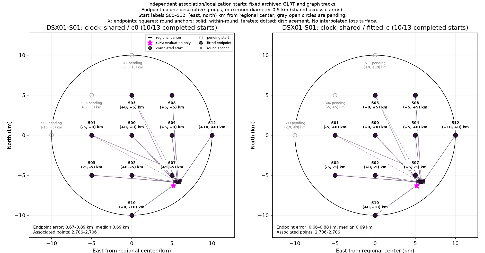
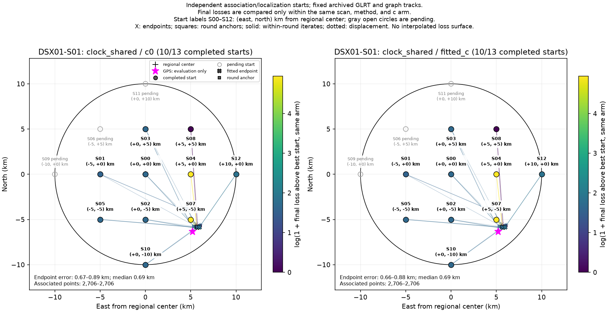

# DSX01-S01: clock_shared independent-start results

Each start independently reruns satellite discovery/association and localization on fixed archived GLRT observations and graph tracks. This is a basin-of-attraction experiment, not a pointwise loss or probability surface. GPS is used by this reporter only.

| Arm | Starts | Endpoint groups | Error min / median / max (km) | Associated points min–max |
| --- | ---: | ---: | --- | --- |
| c0 | 10 | 1 | 0.668 / 0.690 / 0.885 | 2,706–2,706 |
| fitted_c | 10 | 1 | 0.663 / 0.688 / 0.883 | 2,706–2,706 |

