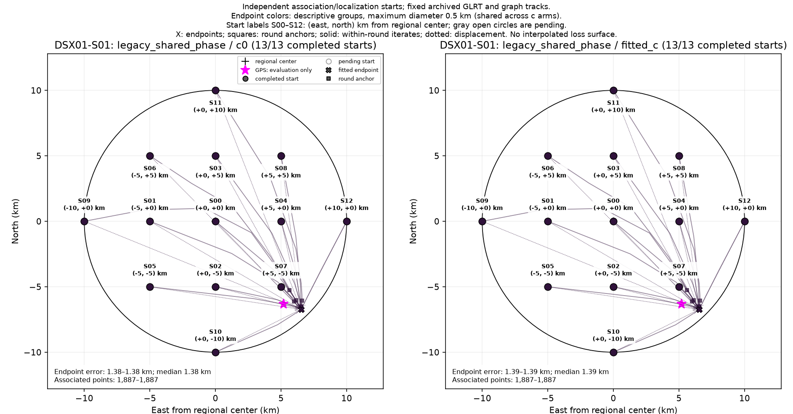
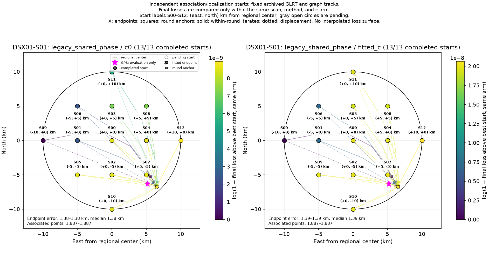

# DSX01-S01: legacy_shared_phase independent-start results

Each start independently reruns satellite discovery/association and localization on fixed archived GLRT observations and graph tracks. This is a basin-of-attraction experiment, not a pointwise loss or probability surface. GPS is used by this reporter only.

| Arm | Starts | Endpoint groups | Error min / median / max (km) | Associated points min–max |
| --- | ---: | ---: | --- | --- |
| c0 | 13 | 1 | 1.377 / 1.377 / 1.377 | 1,887–1,887 |
| fitted_c | 13 | 1 | 1.385 / 1.385 / 1.385 | 1,887–1,887 |

